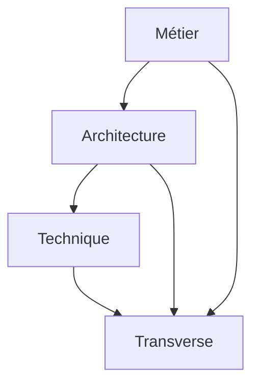

# Commande Init-Glossaire

Crée ou met à jour directement le glossaire projet AI-KIDO en analysant les documents existants dans [`/prompts/hard_points/`](../prompts/hard_points/) et en l'intégrant dans la hiérarchie des concepts existants.

## Exécution

### Phase 1 : Détection du Glossaire Existant

**Vérifier l'existence d'un glossaire** dans [`/prompts/gen/concepts/`](../prompts/gen/concepts/) :
- Scanner tous les fichiers `.md` pour détecter un glossaire existant
- Patterns de détection : `glossaire*.md`, `*glossary*.md`, `terminologie*.md`
- Si trouvé : Mode **MISE À JOUR**
- Si absent : Mode **CRÉATION**

### Phase 2 : Sélection des Sources d'Analyse

Poser la **Question 1 : Sources d'analyse**
```
Quelles sources voulez-vous analyser pour le glossaire ?

Options disponibles :
1. Analyse automatique de tous les documents hard_points
2. Analyse automatique des sources projet existantes (src/, docs/, etc.)
3. Analyse combinée hard_points + sources projet
4. Sélection manuelle de documents spécifiques
5. Analyse complète + saisie manuelle complémentaire

Votre choix (1/2/3/4/5) :
```

**Si choix 1** : Analyser automatiquement tous les fichiers `.md/.mdx` dans [`/prompts/hard_points/`](../prompts/hard_points/) récursivement

**Si choix 2** : Scanner le workspace pour détecter les sources projet
```
🔍 DÉTECTION AUTOMATIQUE DES SOURCES PROJET :

Répertoires détectés dans le workspace :
[Liste automatique des répertoires trouvés : src/, docs/, lib/, components/, etc.]

Voulez-vous analyser tous ces répertoires ? (o/n)
Si non, sélectionnez les répertoires à analyser :
```

**Si choix 3** : Combiner hard_points + sources projet automatiquement

**Si choix 4** : Poser la question de sélection manuelle
```
Listez les chemins des documents à analyser (séparés par des virgules) :
Exemple : hard_points/ai-kido.md, src/components/README.md, docs/architecture.md

Sources disponibles :
[Liste automatique des fichiers .md/.mdx/.js/.ts/.py/.java etc. trouvés]

Votre sélection :
```

**Si choix 5** : Combiner analyse automatique complète + saisie manuelle

### Phase 3 : Analyse et Extraction Terminologique

#### 3.1 Analyse Automatique des Documents

Pour chaque document sélectionné :

**A. Analyse des Documents Markdown (.md/.mdx)** :
1. **Extraction des termes techniques** :
   - Mots en `code` ou **gras**
   - Acronymes (mots en MAJUSCULES)
   - Termes métier spécifiques au domaine
   - Noms de technologies, frameworks, outils

2. **Extraction des définitions** :
   - Phrases contenant "est", "signifie", "désigne"
   - Sections "Définition", "Glossaire", "Terminologie"
   - Descriptions entre parenthèses ou tirets

**B. Analyse des Sources Code (.js/.ts/.py/.java/.go/.rs/.php/.rb/.cs/.cpp/.c/.h)** :
1. **Extraction des éléments techniques** :
   - Noms de classes, interfaces, types
   - Noms de fonctions/méthodes principales
   - Constantes et énumérations
   - Imports/modules utilisés
   - Commentaires de documentation (JSDoc, docstrings, etc.)

2. **Extraction des patterns architecturaux** :
   - Design patterns détectés
   - Structures de données personnalisées
   - APIs et endpoints
   - Configuration et variables d'environnement

**C. Analyse des Fichiers de Configuration** :
1. **Technologies détectées** :
   - `package.json` → Stack Node.js/npm
   - `requirements.txt` → Stack Python
   - `Cargo.toml` → Stack Rust
   - `pom.xml` → Stack Java/Maven
   - `Dockerfile` → Containerisation
   - `docker-compose.yml` → Orchestration

2. **Dépendances et outils** :
   - Frameworks utilisés
   - Bibliothèques tierces
   - Outils de build et CI/CD

3. **Catégorisation automatique** :
   - **Concepts métier** : Termes liés au domaine d'application
   - **Concepts techniques** : Technologies, architectures, patterns
   - **Acronymes** : Sigles et abréviations
   - **Outils** : Logiciels, frameworks, bibliothèques
   - **Processus** : Méthodes, workflows, procédures
   - **Architecture** : Composants, services, modules détectés

#### 3.2 Résolution des Conflits et Doublons

**Détecter les définitions multiples** :
```
⚠️ CONFLIT DÉTECTÉ pour le terme "[TERME]" :

Définition 1 (dans [fichier1]) : [définition1]
Définition 2 (dans [fichier2]) : [définition2]

Quelle définition conserver ?
1. Définition 1
2. Définition 2  
3. Fusionner les deux
4. Créer une définition personnalisée

Votre choix :
```

### Phase 4 : Détection Automatique du Contexte Projet (si sources projet analysées)

**Analyse du contexte technique** :
```
📊 ANALYSE DU CONTEXTE PROJET DÉTECTÉ :

Stack technique identifiée :
- Frontend : [Technologies détectées]
- Backend : [Technologies détectées]
- Base de données : [Technologies détectées]
- Infrastructure : [Outils détectés]

Domaine métier probable : [Basé sur les termes métier extraits]
Architecture détectée : [Patterns architecturaux identifiés]

Cette analyse est-elle correcte ? (o/n)
Si non, précisez les corrections :
```

### Phase 5 : Saisie Manuelle Complémentaire (si choix 5)

Poser la **Question 2 : Termes complémentaires**
```
Souhaitez-vous ajouter des termes spécifiques non détectés automatiquement ?

Format : Terme | Catégorie | Définition
Exemple : "API Gateway | Technique | Point d'entrée unique pour toutes les requêtes API"

Entrez les termes (un par ligne, ou 'fin' pour terminer) :
```

### Phase 6 : Répartition par Rôles Humains (Règle AI-KIDO 15)

#### 6.1 Identification des Rôles pour le Glossaire

**Analyser le contexte projet** pour identifier les rôles responsables du glossaire :
- **Architecte Solutions** : Terminologie architecturale, patterns, décisions techniques
- **Expert Métier** : Terminologie métier, processus, règles business
- **Développeur Lead** : Terminologie technique, outils, frameworks
- **Documentation Manager** : Cohérence terminologique, maintenance du glossaire

#### 6.2 Création de la Structure par Rôles

**Créer les sous-répertoires spécialisés** dans `/prompts/gen/concepts/` :
```
/prompts/gen/concepts/glossaire/
├── architecture/          # Responsable: Architecte Solutions
├── metier/                # Responsable: Expert Métier
├── technique/             # Responsable: Développeur Lead
└── transverse/            # Responsable: Documentation Manager
```

#### 6.3 Répartition des Termes par Responsabilité

**Assigner automatiquement les termes** selon leur catégorie :
- **architecture/** : Patterns, composants, services, architecture système
- **metier/** : Processus business, règles métier, domaine fonctionnel
- **technique/** : Technologies, frameworks, outils, APIs
- **transverse/** : Acronymes, abréviations, termes communs

### Phase 7 : Génération/Mise à Jour du Glossaire

#### 7.1 Mode CRÉATION - Nouveau Glossaire

**A. Créer le glossaire principal** [`/prompts/gen/concepts/glossaire-projet.md`](../prompts/gen/concepts/glossaire-projet.md) :
```markdown
# 📚 Glossaire Projet AI-KIDO (Règle 15 - Répartition par Rôles)
> Version: 1.0 | Date: [DATE] | Statut: Initial | Sources: [LISTE_SOURCES]

## Vue d'ensemble
Terminologie et concepts clés extraits des documents hard_points du projet AI-KIDO.
**Structure organisée par responsabilités selon la règle AI-KIDO 15.**

## Structure par Rôles

### 🏗️ Terminologie Architecture
**Responsable** : Architecte Solutions
**Localisation** : [`glossaire/architecture/`](glossaire/architecture/)
- Patterns architecturaux, composants système, services
- [Lien vers sous-glossaire architecture]

### 💼 Terminologie Métier
**Responsable** : Expert Métier
**Localisation** : [`glossaire/metier/`](glossaire/metier/)
- Processus business, règles métier, domaine fonctionnel
- [Lien vers sous-glossaire métier]

### ⚙️ Terminologie Technique
**Responsable** : Développeur Lead
**Localisation** : [`glossaire/technique/`](glossaire/technique/)
- Technologies, frameworks, outils, APIs
- [Lien vers sous-glossaire technique]

### 🔄 Terminologie Transverse
**Responsable** : Documentation Manager
**Localisation** : [`glossaire/transverse/`](glossaire/transverse/)
- Acronymes, abréviations, termes communs
- [Lien vers sous-glossaire transverse]

## Index Alphabétique Global
[Index complet de tous les termes avec renvois vers les sous-glossaires]

## Matrice de Responsabilités

| Catégorie | Architecte | Expert Métier | Dev Lead | Doc Manager |
|-----------|------------|---------------|----------|-------------|
| Architecture | R | C | C | I |
| Métier | C | R | I | C |
| Technique | C | I | R | C |
| Transverse | I | C | C | R |

**Légende** : R=Responsable, A=Approbateur, C=Consulté, I=Informé

## Relations Conceptuelles


---
*Glossaire généré automatiquement par init-glossaire le [DATE] - Règle AI-KIDO 15 appliquée*
*Sources analysées : [NOMBRE] documents hard_points*
```

**B. Créer les sous-glossaires spécialisés** :

**Architecture** [`/prompts/gen/concepts/glossaire/architecture/index.md`](../prompts/gen/concepts/glossaire/architecture/index.md) :
```markdown
# 🏗️ Glossaire Architecture
> Responsable: Architecte Solutions | Version: 1.0 | Date: [DATE]

[Termes architecturaux extraits et organisés]
```

**Métier** [`/prompts/gen/concepts/glossaire/metier/index.md`](../prompts/gen/concepts/glossaire/metier/index.md) :
```markdown
# 💼 Glossaire Métier
> Responsable: Expert Métier | Version: 1.0 | Date: [DATE]

[Termes métier extraits et organisés]
```

**Technique** [`/prompts/gen/concepts/glossaire/technique/index.md`](../prompts/gen/concepts/glossaire/technique/index.md) :
```markdown
# ⚙️ Glossaire Technique
> Responsable: Développeur Lead | Version: 1.0 | Date: [DATE]

[Termes techniques extraits et organisés]
```

**Transverse** [`/prompts/gen/concepts/glossaire/transverse/index.md`](../prompts/gen/concepts/glossaire/transverse/index.md) :
```markdown
# 🔄 Glossaire Transverse
> Responsable: Documentation Manager | Version: 1.0 | Date: [DATE]

[Acronymes et termes communs extraits et organisés]
```

#### 5.2 Mode MISE À JOUR - Glossaire Existant

**Analyser le glossaire existant** :
1. Extraire les termes déjà définis
2. Identifier les nouveaux termes à ajouter
3. Détecter les définitions à mettre à jour
4. Préserver la structure existante

**Stratégie de mise à jour** :
```
📊 ANALYSE DU GLOSSAIRE EXISTANT :

Termes existants : [NOMBRE]
Nouveaux termes détectés : [NOMBRE]
Définitions à mettre à jour : [NOMBRE]
Conflits potentiels : [NOMBRE]

Stratégie de mise à jour :
✅ Ajouter [X] nouveaux termes
✅ Mettre à jour [Y] définitions existantes
✅ Résoudre [Z] conflits
✅ Préserver la structure existante

Continuer ? (o/n) :
```

### Phase 7 : Mise à Jour de l'Indexation AI-KIDO

#### 6.1 Mise à Jour de l'Index Concepts

Mettre à jour [`/prompts/gen/concepts/index.md`](../prompts/gen/concepts/index.md) :
```markdown
## Fichiers Disponibles

- [`guideline-prompts.md`](guideline-prompts.md) : Guidelines pour la création de prompts efficaces
- [`glossaire-projet.md`](glossaire-projet.md) : Glossaire terminologique du projet AI-KIDO
```

#### 6.2 Mise à Jour de l'Index Principal

Mettre à jour [`/prompts/gen/index.md`](../prompts/gen/index.md) avec référence au glossaire :
```markdown
## Structure

- [`concepts/`](concepts/index.md) : Concepts fondamentaux (incluant glossaire projet)
```

#### 6.3 Création/Mise à Jour du Fichier AGENTS.md

Créer ou mettre à jour [`AGENTS.md`](../AGENTS.md) à la racine avec section glossaire :

```markdown
# AI Agents Configuration

## Knowledge Base Components

### Glossaire Projet
- **Location**: [`prompts/gen/concepts/glossaire-projet.md`](prompts/gen/concepts/glossaire-projet.md)
- **Terms Count**: [NOMBRE] termes définis
- **Categories**: Métier, Technique, Acronymes, Outils, Processus
- **Last Updated**: [DATE]
- **Sources**: [NOMBRE] documents hard_points analysés

### Terminology Usage Guidelines
- Agents MUST use terminology as defined in the project glossary
- When encountering undefined terms, agents SHOULD suggest adding them to the glossary
- Consistency in terminology usage across all agent interactions

---
*Updated by init-glossaire on [DATE]*
```

## Messages de Confirmation

### Succès - Mode Création
```
✅ Glossaire projet AI-KIDO créé avec succès !

Fichier créé :
- /prompts/gen/concepts/glossaire-projet.md

Statistiques :
- [X] termes métier
- [Y] termes techniques  
- [Z] acronymes
- [W] outils/technologies
- [V] processus/méthodes

Sources analysées :
- Hard points : [NOMBRE] documents
- Sources projet : [NOMBRE] fichiers code + [NOMBRE] fichiers config
- Répertoires scannés : [LISTE_REPERTOIRES]

Index mis à jour :
- /prompts/gen/concepts/index.md
- /prompts/gen/index.md
- AGENTS.md (créé/mis à jour)

🎯 Glossaire prêt pour utilisation par les agents AI-KIDO !
```

### Succès - Mode Mise à Jour
```
✅ Glossaire projet AI-KIDO mis à jour avec succès !

Modifications apportées :
- [X] nouveaux termes ajoutés
- [Y] définitions mises à jour
- [Z] conflits résolus

Statistiques finales :
- [TOTAL] termes au total
- [NOUVELLES_SOURCES] nouvelles sources analysées

🔄 Glossaire enrichi et synchronisé !
```

## Gestion des Erreurs

- **Documents hard_points introuvables** : Lister les fichiers manquants et proposer sélection alternative
- **Sources projet inaccessibles** : Lister les répertoires non accessibles et continuer avec les sources disponibles
- **Glossaire existant corrompu** : Proposer sauvegarde et recréation
- **Conflits de définitions non résolus** : Créer section "Définitions en conflit" pour résolution ultérieure
- **Extraction terminologique échouée** : Passer en mode saisie manuelle
- **Analyse code échouée** : Continuer avec analyse documents uniquement
- **Stack technique non détectée** : Demander saisie manuelle du contexte technique
- **Erreur génération Mermaid** : Créer index textuel de fallback
- **Permissions insuffisantes** : Proposer création dans répertoire temporaire

## Règles AI-KIDO Respectées

- ✅ Analyse des documents hard_points existants
- ✅ Intégration dans la hiérarchie [`/prompts/gen/concepts/`](../prompts/gen/concepts/)
- ✅ Mise à jour des index généraux
- ✅ Format Markdown avec métadonnées
- ✅ Liens vers sources originales
- ✅ Diagramme Mermaid pour relations conceptuelles
- ✅ Contrainte 500 lignes par fichier (pagination si nécessaire)
- ✅ Mise à jour automatique d'AGENTS.md
- ✅ Préservation de l'existant en mode mise à jour

---
