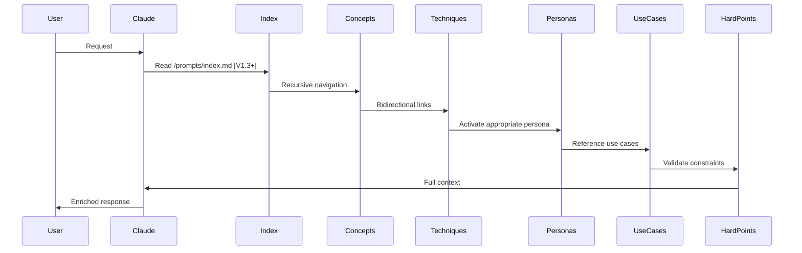

# Mapping AI-KIDO Memory Bank ↔ CLAUDE.md Standard

@AGENTS.md
@prompts/hard_points/aikido.md
@prompts/index.md

## 1. Core Concepts Mapping

| CLAUDE.md | AI-KIDO | Location | Key Mapping |
|-----------|---------|----------|-------------|
| **Skills** | **Skills** | `skills_list.md` | 1 Skill = 1 Skill |
| **Subagents** | **Personas** | `/prompts/gen/personas/` | 1:1 enriched correspondence (skills, thinking mode, style) |
| **Slash Commands** | **Commands** | `prompts/hard_points/commands/` and `commands_list.md` | |
| **MCP Resources** | **Hard Points + Use Cases** | `/prompts/hard_points/` + `/use_cases/` | Resources → Hard Points (immutable) + Use Cases (scenarios) |

### Mapping Details

**Available agents**: [agents_list.md](agents_list.md)
**Available skills**: [skills_list.md](skills_list.md)

**Subagents → Personas**

- `tools` → Mapped permissions: Read→read, Write→edit, Bash→command, Browser→browser
- `model` → Inherited from context
- Auto-configured in `.roomodes`

**AI-KIDO Specific Commands**

- `/init-aikido`, `/create-persona`, `/create-command`, `/analyse-project`, `/analyse-aikido`, `/maj-aikido`, `/init-glossaire`, `/check-truth`, `/list-command`, `/clean-index`, `/reindex-projet`, `/validate-analyse-plan`, `/create-search-plan`, `/validate-search-plan`, `/create-analyse-plan`, `/skill-manage` → See [prompts/hard_points/commands/](prompts/hard_points/commands/)

## Workflows and Orchestration

