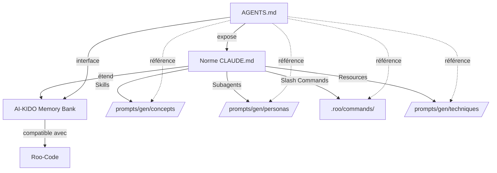
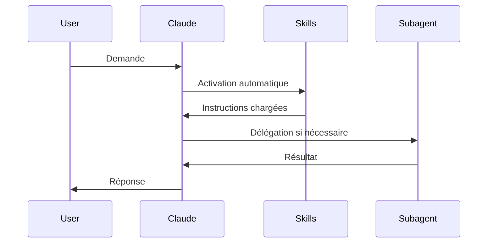
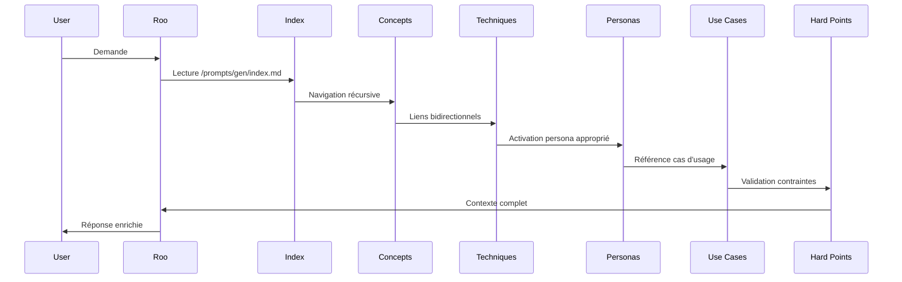
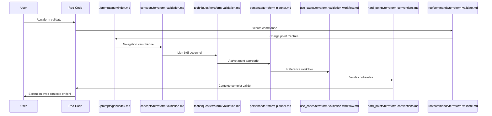

# Mapping AI-KIDO Memory Bank ↔ Norme CLAUDE.md

> **Version**: 1.0 | **Date**: 2025-01-20 | **Statut**: Documentation de Mapping
>
> Ce document établit la correspondance entre notre Memory Bank AI-KIDO (compatible Roo-Code) et la norme CLAUDE.md pour assurer l'interopérabilité et la compatibilité.

## 🎯 Point d'Entrée Principal

**Pour accéder à la Memory Bank AI-KIDO, consultez en priorité :**

### [`AGENTS.md`](AGENTS.md) - Interface Principale (Règles AI-KIDO 16-18)

Le fichier `AGENTS.md` à la racine du projet sert d'**interface unifiée** entre :
- La norme CLAUDE.md (Subagents, Skills, Resources)
- La Memory Bank AI-KIDO (`/prompts/gen/`)
- Les configurations Roo-Code (`.roomodes`, `.roo/commands/`)

**Structure de AGENTS.md** :
```markdown
# AI Agents Configuration

## Project Context
→ Synchronisé avec /prompts/gen/index.md
→ Référence le mode AI-KIDO (Standard/Light)
→ Pointe vers les hard_points

## Available Agents
→ Liste complète des personas depuis /prompts/gen/personas/
→ Correspondance 1:1 avec les Subagents CLAUDE.md
→ Liens directs vers les définitions complètes

## Agent Interaction Matrix
→ Basée sur la matrice RACI si disponible
→ Définit les responsabilités et interactions

## Usage Guidelines
→ Liés aux /prompts/gen/use_cases/
→ Exemples pratiques d'utilisation
```

**Règles de Consultation** :
1. **Toujours commencer par AGENTS.md** pour avoir la vue d'ensemble
2. **Suivre les liens** vers `/prompts/gen/` pour les détails
3. **Ne jamais dupliquer** le contenu dans AGENTS.md (Règle 16)
4. **Vérifier la bidirectionnalité** : chaque agent doit avoir un persona correspondant (Règle 17)

## Vue d'ensemble

Notre Memory Bank AI-KIDO utilise une architecture arborescente hiérarchique qui **étend et enrichit** les concepts de CLAUDE.md tout en restant **100% compatible** avec ses mécanismes fondamentaux.

### Philosophie de Mapping



### Parcours de Navigation Recommandé

Pour consulter la Memory Bank AI-KIDO, suivez ce parcours :

1. **Commencez par [`AGENTS.md`](AGENTS.md)** → Vue d'ensemble et contexte projet
2. **Consultez [`/prompts/gen/index.md`](prompts/gen/index.md)** → Point d'entrée de la structure arborescente
3. **Naviguez vers les domaines spécifiques** :
   - [`/prompts/gen/concepts/`](prompts/gen/concepts/) → Théorie et concepts fondamentaux
   - [`/prompts/gen/techniques/`](prompts/gen/techniques/) → Pratiques et méthodes
   - [`/prompts/gen/personas/`](prompts/gen/personas/) → Agents LLM spécialisés
   - [`/prompts/gen/use_cases/`](prompts/gen/use_cases/) → Cas d'usage et exemples
4. **Référez-vous aux [`/prompts/hard_points/`](prompts/hard_points/)** → Vérités immuables (priorité absolue)
5. **Explorez [`.roo/commands/`](.roo/commands/)** → Commandes disponibles

**Règle d'Or** : `AGENTS.md` → `/prompts/gen/index.md` → Navigation récursive

## 1. Mapping des Concepts Fondamentaux

### 1.1 Skills (CLAUDE.md) ↔ Concepts + Techniques (AI-KIDO)

| Concept CLAUDE.md | Équivalent AI-KIDO | Emplacement | Notes |
|-------------------|-------------------|-------------|-------|
| **Skills** | **Concepts + Techniques** | `/prompts/gen/concepts/` + `/prompts/gen/techniques/` | Les Skills CLAUDE.md sont **décomposés** en théorie (concepts) et pratique (techniques) selon la Règle AI-KIDO 2 |
| Progressive Disclosure (3 niveaux) | Arborescence hiérarchique (≤4 niveaux) | Structure complète `/prompts/gen/` | AI-KIDO utilise une profondeur maximale de 4 niveaux avec facteur de branchement 3-7 (Règle 7) |
| `SKILL.md` | `concept.md` + `technique.md` | Fichiers séparés | Séparation théorie/pratique systématique |
| Metadata (name, description, allowed-tools) | Frontmatter Markdown | En-tête de chaque fichier | Format: `> Version: X.Y \| Date: YYYY-MM-DD \| Statut: [Statut]` |
| `reference.md` | Liens bidirectionnels | Intégrés dans chaque fichier | Règle 6: A→B implique B→A |
| `examples.md` | `/prompts/gen/use_cases/` | Répertoire dédié | Cas d'usage séparés et réutilisables |

#### Exemple de Conversion Skill → AI-KIDO

**CLAUDE.md Skill** :
```markdown
---
name: terraform-validator
description: Validates Terraform configurations
allowed-tools: Read, Grep
---
# Instructions
[Contenu mixte théorie + pratique]
```

**AI-KIDO Équivalent** :
```
/prompts/gen/concepts/terraform-validation.md  # Théorie
/prompts/gen/techniques/terraform-validation.md # Pratique
/prompts/gen/use_cases/terraform-validation-workflow.md # Exemples
```

### 1.2 Subagents (CLAUDE.md) ↔ Personas (AI-KIDO)

| Concept CLAUDE.md | Équivalent AI-KIDO | Emplacement | Notes |
|-------------------|-------------------|-------------|-------|
| **Subagents** | **Personas** | `/prompts/gen/personas/` | Correspondance 1:1 avec enrichissement |
| Configuration `.md` | Fichier persona `.md` | `/prompts/gen/personas/[slug].md` | Format enrichi avec compétences, mode de pensée, style |
| `name` | `slug` + `nom` | Frontmatter + titre | Génération automatique du slug |
| `description` | `Spécialisation` + `Rôle` | Section dédiée | Description plus riche du rôle de l'agent LLM |
| `tools` | `Permissions` | Section dédiée | Mapping: Read→read, Write→edit, Bash→command, Browser→browser |
| `model` | Non spécifié | Hérité du contexte | AI-KIDO délègue le choix du modèle à Roo-Code |
| System prompt | `Prompt système` | Section complète | Enrichi avec compétences, mode de pensée, style de communication |

#### Mapping des Permissions

| CLAUDE.md `tools` | AI-KIDO `Permissions` | Description |
|-------------------|----------------------|-------------|
| `Read, Grep, Glob` | `read` | Lecture de fichiers et recherche |
| `Write, Edit` | `edit` | Modification de fichiers |
| `Bash` | `command` | Exécution de commandes |
| `Browser` | `browser` | Utilisation du navigateur |

#### Configuration dans `.roomodes`

Les personas AI-KIDO sont **automatiquement synchronisés** avec `.roomodes` :

```yaml
customModes:
  - slug: [slug-persona]
    name: [emoji] [nom] - [spécialisation]
    roleDefinition: >-
      [Prompt système complet depuis /prompts/gen/personas/[slug].md]
    whenToUse: >-
      [Contextes d'utilisation]
    groups:
      - [permissions mappées]
```

### 1.3 Slash Commands (CLAUDE.md) ↔ Commands (AI-KIDO)

| Concept CLAUDE.md | Équivalent AI-KIDO | Emplacement | Notes |
|-------------------|-------------------|-------------|-------|
| **Slash Commands** | **Commands** | `.roo/commands/` | Correspondance 1:1 avec enrichissement |
| Fichier `.md` dans `.claude/commands/` | Fichier `.md` dans `.roo/commands/` | `.roo/commands/[nom].md` | Même format, emplacement différent |
| Frontmatter `description` | Frontmatter `description` | Identique | Compatible 100% |
| Frontmatter `allowed-tools` | Frontmatter `allowed-tools` | Identique | Compatible 100% |
| Frontmatter `argument-hint` | Frontmatter `argument-hint` | Identique | Compatible 100% |
| `$ARGUMENTS`, `$1`, `$2` | `$ARGUMENTS`, `$1`, `$2` | Identique | Compatible 100% |
| Namespacing via sous-répertoires | Namespacing via sous-répertoires | `.roo/commands/[namespace]/` | Compatible 100% |

#### Commandes AI-KIDO Spécifiques

AI-KIDO ajoute des commandes spécialisées pour la gestion de la Memory Bank :

| Commande | Description | Équivalent CLAUDE.md |
|----------|-------------|---------------------|
| `/init-aikido` | Initialise la Memory Bank | Aucun (spécifique AI-KIDO) |
| `/create-persona` | Crée un nouveau persona | Création manuelle de Subagent |
| `/analyse-project` | Analyse les sources projet | Aucun (spécifique AI-KIDO) |
| `/analyse-aikido` | Audit de la Memory Bank | Aucun (spécifique AI-KIDO) |
| `/maj-aikido` | Synchronisation après rebase | Aucun (spécifique AI-KIDO) |
| `/init-glossaire` | Crée le glossaire métier | Aucun (spécifique AI-KIDO) |
| `/logllmon` / `/logllmoff` | Gestion de la traçabilité | Aucun (spécifique AI-KIDO) |

### 1.4 Resources (CLAUDE.md) ↔ Hard Points + Use Cases (AI-KIDO)

| Concept CLAUDE.md | Équivalent AI-KIDO | Emplacement | Notes |
|-------------------|-------------------|-------------|-------|
| **MCP Resources** | **Hard Points** | `/prompts/hard_points/` | Vérités immuables, priorité absolue (Règle 8) |
| URI-based access | Liens Markdown | `[texte](chemin/fichier.md)` | Navigation hiérarchique via liens |
| Context sources | **Use Cases** | `/prompts/gen/use_cases/` | Applications pratiques et scénarios |
| Dynamic resources | **Techniques** | `/prompts/gen/techniques/` | Méthodes pratiques évolutives |

## 2. Architecture et Organisation

### 2.1 Structure des Répertoires

#### CLAUDE.md Standard
```
.claude/
├── skills/
│   └── skill-name/
│       ├── SKILL.md
│       ├── reference.md
│       └── examples.md
├── agents/
│   └── agent-name.md
└── commands/
    └── command-name.md
```

#### AI-KIDO Memory Bank
```
prompts/
├── gen/                          # Tables de vérités évolutives
│   ├── index.md                  # Point d'entrée principal (Règle 1)
│   ├── concepts/                 # Théorie (équivalent Skills théoriques)
│   │   ├── index.md
│   │   ├── [concept].md          # ≤500 lignes (Règle 4)
│   │   └── roles/                # Répartition par rôles (Règle 15)
│   │       ├── [role-1]/
│   │       └── [role-2]/
│   ├── techniques/               # Pratique (équivalent Skills pratiques)
│   │   ├── index.md
│   │   ├── [technique].md
│   │   └── roles/
│   ├── personas/                 # Agents LLM (équivalent Subagents)
│   │   ├── index.md
│   │   └── [persona-slug].md
│   └── use_cases/                # Applications (équivalent examples.md)
│       ├── index.md
│       ├── [use-case].md
│       └── roles/
├── hard_points/                  # Vérités immuables (équivalent Resources)
│   ├── index.md
│   ├── ai-kido.md                # Règles fondamentales (priorité absolue)
│   ├── ai-kido-light.md          # Mode Light
│   └── roo-code/                 # Documentation Roo-Code
└── spec/                         # Espace personnel (ignoré sauf activation)

.roo/
└── commands/                     # Commandes (équivalent Slash Commands)
    └── [command-name].md

.roomodes                         # Configuration des modes (sync avec personas)
AGENTS.md                         # Interface principale (Règles 16-18)
```

### 2.2 Règles d'Équilibrage et Contraintes

| Règle CLAUDE.md | Règle AI-KIDO | Détails |
|-----------------|---------------|---------|
| Progressive disclosure (3 niveaux) | Arborescence ≤4 niveaux (Règle 7) | AI-KIDO plus profond mais contrôlé |
| Pas de limite de taille explicite | ≤500 lignes par fichier (Règle 4) | Division automatique si dépassement |
| Pas de contrainte de branchement | Facteur 3-7 enfants/parent (Règle 7) | Équilibrage automatique |
| Pas de contrainte de liens | Liens bidirectionnels obligatoires (Règle 6) | A→B implique B→A |

## 3. Fonctionnalités Avancées

### 3.1 Progressive Disclosure vs Arborescence Hiérarchique

#### CLAUDE.md Progressive Disclosure
```
Niveau 1: Métadonnées (~100 tokens, toujours chargées)
Niveau 2: Instructions (<5k tokens, chargées à l'activation)
Niveau 3: Ressources (illimité, chargées à la demande)
```

#### AI-KIDO Arborescence Hiérarchique
```
Niveau 0: /prompts/gen/index.md (point d'entrée, toujours chargé)
Niveau 1: /prompts/gen/[domaine]/index.md (navigation)
Niveau 2: /prompts/gen/[domaine]/[concept].md (contenu principal)
Niveau 3: /prompts/gen/[domaine]/roles/[role]/[detail].md (spécialisation)
Niveau 4: Liens vers hard_points ou use_cases (références)
```

**Avantage AI-KIDO** : Navigation récursive intelligente depuis le point d'entrée unique.

### 3.2 Gestion du Contexte

| Aspect | CLAUDE.md | AI-KIDO | Avantage |
|--------|-----------|---------|----------|
| **Chargement** | Progressive disclosure | Parcours récursif depuis index | AI-KIDO: navigation guidée |
| **Contexte séparé** | Subagents | Personas avec liens | AI-KIDO: contexte partagé enrichi |
| **Isolation** | Oui (Subagents) | Optionnelle (via modes) | CLAUDE.md: meilleure isolation |
| **Réutilisabilité** | Skills cross-conversation | Tables de vérités persistantes | AI-KIDO: capitalisation continue |

### 3.3 Auto-Alimentation et Évolution

| Fonctionnalité | CLAUDE.md | AI-KIDO | Notes |
|----------------|-----------|---------|-------|
| **Création dynamique** | Manuelle | Automatique via commandes | `/init-aikido`, `/analyse-project` |
| **Mise à jour** | Manuelle | Semi-automatique | `/maj-aikido` après rebase git |
| **Audit** | Aucun | Automatique | `/analyse-aikido` pour cohérence |
| **Versioning** | Git | Git + métadonnées | Horodatage et versioning intégrés |
| **Traçabilité** | Aucune | Optionnelle | `LLM_TRACIBILITY=TRUE/FALSE` |

## 4. Synchronisation AGENTS.md ↔ CLAUDE.md

### 4.1 Structure AGENTS.md (Règles AI-KIDO 16-18)

Le fichier `AGENTS.md` à la racine sert d'**interface principale** entre la Memory Bank AI-KIDO et les outils compatibles CLAUDE.md :

```markdown
# AI Agents Configuration

## Project Context
[Synchronisé avec /prompts/gen/index.md]

## Available Agents
[Généré depuis /prompts/gen/personas/]

## Agent Interaction Matrix
[Basé sur la matrice RACI si disponible]

## Usage Guidelines
[Lié aux /prompts/gen/use_cases/]
```

### 4.2 Correspondance 1:1 Agents ↔ Personas

**Règle 17** : Chaque agent dans `AGENTS.md` **doit** correspondre à un persona dans `/prompts/gen/personas/` :

```markdown
# AGENTS.md
### Agent: Terraform Validator
[Lien vers /prompts/gen/personas/terraform-validator.md]

# /prompts/gen/personas/terraform-validator.md
# 🏗️ Terraform Validator - Validation Infrastructure
[Définition complète du persona]
```

### 4.3 Pas de Duplication (Règle 16)

**INTERDIT** : Dupliquer le contenu des personas dans `AGENTS.md`

**OBLIGATOIRE** : Utiliser des liens exclusifs vers `/prompts/gen/`

```markdown
<!-- ❌ MAUVAIS -->
### Agent: Terraform Validator
Description complète copiée ici...

<!-- ✅ BON -->
### Agent: Terraform Validator
[Voir définition complète](prompts/gen/personas/terraform-validator.md)
```

## 5. Workflows et Orchestration

### 5.1 Workflow CLAUDE.md Standard



### 5.2 Workflow AI-KIDO Enrichi



### 5.3 Orchestration Multi-Agents

| Aspect | CLAUDE.md | AI-KIDO | Notes |
|--------|-----------|---------|-------|
| **Chaînage** | Subagents séquentiels | Workflows dans `.roo/rules-orchestrator/` | AI-KIDO: orchestration explicite |
| **Coordination** | Automatique | RACI + Matrice d'interaction | AI-KIDO: responsabilités claires |
| **Sélection** | Basée sur description | Basée sur spécialisation + contexte | AI-KIDO: sélection plus précise |

## 6. Modes de Fonctionnement

### 6.1 Mode Standard vs Mode Light

| Caractéristique | CLAUDE.md | AI-KIDO Standard | AI-KIDO Light |
|-----------------|-----------|------------------|---------------|
| **Nombre de Skills/Concepts** | Illimité | 8-15 | 3-5 |
| **Nombre de Subagents/Personas** | Illimité | 6-12 | 3-5 |
| **Structure** | Flexible | Multi-fichiers | Fichiers unifiés |
| **RACI** | Non applicable | Complet multi-acteurs | Optionnel/Minimal |
| **Use Cases** | Illimité | 8-15 | 3 maximum |
| **Cible** | Tous projets | Équipes 4+, projets complexes | Solo/petites équipes, POCs |

### 6.2 Détection du Mode

Le mode AI-KIDO est détecté via `/prompts/gen/index.md` :

```markdown
<!-- Mode STANDARD -->
- **Référence**: [ai-kido.md](../hard_points/ai-kido.md)

<!-- Mode LIGHT -->
- **Référence**: [ai-kido-light.md](../hard_points/ai-kido-light.md)
```

## 7. Compatibilité et Interopérabilité

### 7.1 Compatibilité Ascendante

✅ **AI-KIDO est 100% compatible avec CLAUDE.md** :
- Les Slash Commands AI-KIDO fonctionnent dans Claude Code
- Les Personas AI-KIDO peuvent être convertis en Subagents
- Les Concepts/Techniques peuvent être packagés en Skills

### 7.2 Conversion AI-KIDO → CLAUDE.md

#### Conversion Persona → Subagent

```bash
# Depuis /prompts/gen/personas/terraform-validator.md
# Vers .claude/agents/terraform-validator.md

---
name: terraform-validator
description: [Extrait de la section Spécialisation]
tools: [Mappé depuis Permissions]
model: sonnet
---
[Extrait de la section Prompt système]
```

#### Conversion Concept+Technique → Skill

```bash
# Fusion de:
# /prompts/gen/concepts/terraform-validation.md
# /prompts/gen/techniques/terraform-validation.md
# Vers .claude/skills/terraform-validation/SKILL.md

---
name: terraform-validation
description: [Fusion des descriptions]
allowed-tools: [Mappé depuis Permissions]
---
# [Contenu concept]
# [Contenu technique]
```

### 7.3 Migration CLAUDE.md → AI-KIDO

Pour migrer un projet CLAUDE.md vers AI-KIDO :

1. **Analyser la structure existante** :
   ```bash
   /analyse-project
   # Choix 1: Documents hard-points uniquement
   # Pointer vers .claude/
   ```

2. **Initialiser AI-KIDO** :
   ```bash
   /init-aikido
   # Choix du mode (Standard/Light)
   # Import automatique des Skills/Subagents/Commands
   ```

3. **Synchroniser** :
   ```bash
   /maj-aikido
   # Synchronisation complète
   ```

## 8. Best Practices de Mapping

### 8.1 Quand Utiliser Quoi ?

| Besoin | CLAUDE.md | AI-KIDO | Recommandation |
|--------|-----------|---------|----------------|
| **Projet simple, prototype** | Skills + Commands | Mode Light | AI-KIDO Light |
| **Projet complexe, équipe** | Skills + Subagents + Commands | Mode Standard | AI-KIDO Standard |
| **Capitalisation long terme** | Skills réutilisables | Tables de vérités | AI-KIDO |
| **Isolation stricte** | Subagents | Personas + modes | CLAUDE.md |
| **Orchestration complexe** | Chaînage Subagents | Workflows + RACI | AI-KIDO |

### 8.2 Principes de Conception

#### CLAUDE.md
- ✅ Concision et clarté
- ✅ Progressive disclosure
- ✅ Workflows clairs
- ✅ Spécialisation

#### AI-KIDO (étend CLAUDE.md)
- ✅ Séparation théorie/pratique (Règle 2)
- ✅ Arborescence hiérarchique (Règle 1)
- ✅ Liens bidirectionnels (Règle 6)
- ✅ Contraintes d'équilibrage (Règles 4, 7)
- ✅ Densité sémantique (Règle 11)
- ✅ Schémas Mermaid (Règle 12)
- ✅ Répartition par rôles (Règle 15)
- ✅ Auto-alimentation (Règles de capitalisation)

## 9. Limitations et Différences

### 9.1 Limitations AI-KIDO

| Limitation | Impact | Mitigation |
|------------|--------|------------|
| Contrainte 500 lignes | Fichiers multiples | Division automatique |
| Profondeur ≤4 niveaux | Hiérarchie limitée | Facteur de branchement 3-7 |
| Liens bidirectionnels obligatoires | Maintenance accrue | Génération automatique |
| Mode Light restrictif | Moins de flexibilité | Migration vers Standard possible |

### 9.2 Avantages AI-KIDO

| Avantage | Bénéfice | Cas d'usage |
|----------|----------|-------------|
| Séparation théorie/pratique | Clarté conceptuelle | Projets complexes |
| Arborescence hiérarchique | Navigation guidée | Grandes bases de connaissances |
| Auto-alimentation | Capitalisation continue | Projets long terme |
| RACI intégré | Responsabilités claires | Équipes multiples |
| Audit automatique | Cohérence garantie | Maintenance |

## 10. Tableau de Correspondance Complet

### 10.1 Concepts

| CLAUDE.md | AI-KIDO | Emplacement | Règles |
|-----------|---------|-------------|--------|
| Skill | Concept + Technique | `/prompts/gen/concepts/` + `/prompts/gen/techniques/` | Règles 2, 4, 6, 7 |
| Subagent | Persona | `/prompts/gen/personas/` | Règles 9, 16-18 |
| Slash Command | Command | `.roo/commands/` | Compatible 100% |
| Resource | Hard Point + Use Case | `/prompts/hard_points/` + `/prompts/gen/use_cases/` | Règle 8 |
| Metadata | Frontmatter | En-tête Markdown | Format AI-KIDO |
| Progressive Disclosure | Arborescence Hiérarchique | Structure `/prompts/gen/` | Règles 1, 7 |

### 10.2 Fichiers

| CLAUDE.md | AI-KIDO | Notes |
|-----------|---------|-------|
| `.claude/skills/[name]/SKILL.md` | `/prompts/gen/concepts/[name].md` + `/prompts/gen/techniques/[name].md` | Séparation théorie/pratique |
| `.claude/agents/[name].md` | `/prompts/gen/personas/[slug].md` | Enrichi avec compétences, mode de pensée, style |
| `.claude/commands/[name].md` | `.roo/commands/[name].md` | Compatible 100% |
| N/A | `/prompts/gen/index.md` | Point d'entrée unique AI-KIDO |
| N/A | `/prompts/hard_points/ai-kido.md` | Règles fondamentales |
| N/A | `AGENTS.md` | Interface principale (Règles 16-18) |
| N/A | `.roomodes` | Configuration modes (sync personas) |

## 11. Exemples Pratiques

### 11.1 Exemple Complet : Terraform Validator

#### CLAUDE.md Structure
```
.claude/
├── skills/
│   └── terraform-validator/
│       ├── SKILL.md
│       ├── reference.md
│       └── examples.md
├── agents/
│   └── terraform-planner.md
└── commands/
    └── terraform-validate.md
```

#### AI-KIDO Structure Équivalente
```
prompts/
├── gen/
│   ├── concepts/
│   │   └── terraform-validation.md          # Théorie
│   ├── techniques/
│   │   └── terraform-validation.md          # Pratique
│   ├── personas/
│   │   └── terraform-planner.md             # Agent LLM
│   └── use_cases/
│       └── terraform-validation-workflow.md # Exemples
├── hard_points/
│   └── terraform-conventions.md             # Contraintes
.roo/
└── commands/
    └── terraform-validate.md                # Commande
AGENTS.md                                    # Interface
.roomodes                                    # Config modes
```

### 11.2 Workflow Complet



## 12. État Actuel de la Memory Bank (Généré automatiquement)

> **Dernière analyse** : 2025-12-01 07:38:10
> **Mode AI-KIDO** : STANDARD
> **Conformité globale** : 60% ⚠️
> **Statut** : Bootstrap de projet - Memory Bank en construction

### 12.1 Inventaire Complet

#### Concepts (1)
- [`guideline-prompts.md`](prompts/gen/concepts/guideline-prompts.md) - Lignes de conduite pour les prompts (125 lignes)

#### Techniques (0)
⚠️ **Aucune technique détectée** - Violation de la Règle 2 (séparation théorie/pratique)

#### Personas (0)
⚠️ **Aucun persona détecté** - Memory Bank non peuplée

#### Use Cases (0)
⚠️ **Aucun use case détecté** - Exemples pratiques manquants

#### Hard Points (4)
- [`ai-kido.md`](prompts/hard_points/ai-kido.md) - Règles fondamentales AI-KIDO (Mode STANDARD) ✅
- [`ai-kido-light.md`](prompts/hard_points/ai-kido-light.md) - Règles AI-KIDO Mode Light ✅
- [`gestion-logs-aikido.md`](prompts/hard_points/gestion-logs-aikido.md) - Gestion de la traçabilité ✅
- [`index.md`](prompts/hard_points/index.md) - Index des hard points ✅

#### Commandes (11)
- [`analyse-aikido.md`](.roo/commands/analyse-aikido.md) - Audit complet de la Memory Bank ✅
- [`analyse-project.md`](.roo/commands/analyse-project.md) - Analyse des sources projet ✅
- [`check-claude.md`](.roo/commands/check-claude.md) - Synchronisation CLAUDE.md ✅
- [`compile-agent-from-use.md`](.roo/commands/compile-agent-from-use.md) - Génération d'agent depuis use case ✅
- [`create-persona.md`](.roo/commands/create-persona.md) - Création de nouveau persona ✅
- [`init-aikido.md`](.roo/commands/init-aikido.md) - Initialisation Memory Bank ✅
- [`init-glossaire.md`](.roo/commands/init-glossaire.md) - Création glossaire métier ✅
- [`init-raci-aikido.md`](.roo/commands/init-raci-aikido.md) - Initialisation matrice RACI ✅
- [`logllmoff.md`](.roo/commands/logllmoff.md) - Désactivation traçabilité ✅
- [`logllmon.md`](.roo/commands/logllmon.md) - Activation traçabilité ✅
- [`maj-aikido.md`](.roo/commands/maj-aikido.md) - Synchronisation après rebase ✅

### 12.2 Métriques de Qualité

- **Conformité Règle 1** (Point d'entrée unique) : ✅ 100% - `/prompts/gen/index.md` présent
- **Conformité Règle 2** (Séparation théorie/pratique) : ❌ 0% - Aucune technique correspondante aux concepts
- **Conformité Règle 4** (≤500 lignes) : ✅ 100% - Tous les fichiers respectent la limite
- **Conformité Règle 6** (Liens bidirectionnels) : ⚠️ Non évaluable - Memory Bank minimale
- **Conformité Règle 7** (Équilibrage) : ✅ CONFORME - Profondeur 2 niveaux, structure respectée
- **Conformité Règle 8** (Hard Points prioritaires) : ✅ 100% - Hard points présents et référencés
- **Conformité Règles 16-18** (AGENTS.md) : ⚠️ NON APPLICABLE - Bootstrap de projet sans AGENTS.md

### 12.3 Statistiques Globales

```
📊 MEMORY BANK AI-KIDO (Bootstrap)

Contenu actuel :
- Concepts : 1 fichier
- Techniques : 0 fichier
- Personas : 0 fichier
- Use Cases : 0 fichier
- Hard Points : 4 fichiers
- Commandes : 11 fichiers
- Total : 16 fichiers

Équivalence CLAUDE.md :
- Skills équivalents : 0 (incomplet : concept sans technique)
- Subagents équivalents : 0
- Slash Commands : 11 ✅
- Resources : 4 (hard points uniquement)

Profondeur arborescente : 2 niveaux
Taille moyenne fichiers : 36 lignes
Traçabilité : ✅ Activée (LLM_TRACIBILITY=TRUE)
```

### 12.4 Écarts et Recommandations

#### Écarts Critiques ❌

1. **Règle 2 - Séparation théorie/pratique**
   - Concept `guideline-prompts.md` sans technique correspondante
   - **Action** : Créer `/prompts/gen/techniques/guideline-prompts.md` avec les méthodes pratiques

2. **Memory Bank non peuplée**
   - Aucun persona, use case ou technique
   - **Action** : Exécuter `/init-aikido` sur projet réel pour peupler automatiquement

3. **AGENTS.md absent**
   - Violation des Règles 16-18 (acceptable en mode bootstrap)
   - **Action** : Créer AGENTS.md lors du premier peuplement de personas

#### Écarts Mineurs ⚠️

1. **Fichier `.roomodes` absent**
   - Configuration Roo-Code manquante
   - **Action** : Créer lors de l'ajout des premiers personas

2. **Répertoire `.claude/agents/` absent**
   - Pas de fichiers agents pour Claude Code
   - **Action** : Générer automatiquement lors du peuplement

#### Points Positifs ✅

1. ✅ **Infrastructure complète** : Tous les répertoires et commandes sont en place
2. ✅ **Hard points solides** : Règles AI-KIDO documentées et référencées
3. ✅ **Commandes opérationnelles** : 11 commandes AI-KIDO disponibles
4. ✅ **Contraintes respectées** : Limite 500 lignes, profondeur ≤4 niveaux
5. ✅ **Traçabilité configurée** : Système de logs prêt à l'emploi

### 12.5 Workflow Recommandé pour Peupler la Memory Bank

Pour transformer ce bootstrap en Memory Bank opérationnelle :

1. **Analyser un projet réel** :
   ```bash
   /analyse-project
   ```
   → Extrait concepts, techniques, rôles depuis les sources

2. **Initialiser la Memory Bank** :
   ```bash
   /init-aikido
   ```
   → Crée personas, use cases, structure RACI

3. **Créer des personas spécialisés** :
   ```bash
   /create-persona
   ```
   → Ajoute agents LLM selon besoins projet

4. **Initialiser le glossaire métier** :
   ```bash
   /init-glossaire
   ```
   → Capitalise vocabulaire projet

5. **Vérifier la cohérence** :
   ```bash
   /analyse-aikido
   ```
   → Audit complet et recommandations

6. **Synchroniser CLAUDE.md** :
   ```bash
   /check-claude
   ```
   → Met à jour cette documentation

### 12.6 Matrice de Correspondance Actuelle

| Élément AI-KIDO | Type | Équivalent CLAUDE.md | Statut | Notes |
|-----------------|------|---------------------|--------|-------|
| `guideline-prompts.md` | Concept | Skill (théorie) | ⚠️ Incomplet | Manque technique correspondante |
| `ai-kido.md` | Hard Point | Resource | ✅ Mappé | Règles fondamentales |
| `ai-kido-light.md` | Hard Point | Resource | ✅ Mappé | Mode Light |
| `gestion-logs-aikido.md` | Hard Point | Resource | ✅ Mappé | Traçabilité |
| `check-claude.md` | Command | Slash Command | ✅ Mappé | Synchronisation |
| `init-aikido.md` | Command | Slash Command | ✅ Mappé | Initialisation |
| `create-persona.md` | Command | Slash Command | ✅ Mappé | Création agent |
| `analyse-project.md` | Command | Slash Command | ✅ Mappé | Analyse sources |
| `analyse-aikido.md` | Command | Slash Command | ✅ Mappé | Audit |
| `maj-aikido.md` | Command | Slash Command | ✅ Mappé | Mise à jour |
| `init-glossaire.md` | Command | Slash Command | ✅ Mappé | Glossaire |

---

*Section générée automatiquement par /check-claude le 2025-12-01 à 07:38:10*

## 13. Conclusion

### 13.1 Résumé du Mapping

✅ **AI-KIDO est une extension compatible de CLAUDE.md** qui :
- Décompose les Skills en Concepts (théorie) + Techniques (pratique)
- Enrichit les Subagents en Personas avec compétences et mode de pensée
- Maintient la compatibilité 100% des Slash Commands
- Ajoute une couche d'organisation hiérarchique et de capitalisation
- Intègre des mécanismes d'auto-alimentation et d'audit

### 12.2 Avantages de l'Approche AI-KIDO

1. **Capitalisation continue** : Tables de vérités évolutives
2. **Navigation guidée** : Arborescence hiérarchique depuis point d'entrée unique
3. **Séparation claire** : Théorie vs Pratique
4. **Responsabilités explicites** : RACI intégré
5. **Cohérence garantie** : Audit automatique
6. **Modes adaptatifs** : Standard (complexe) vs Light (simple)

### 12.3 Compatibilité Garantie

- ✅ Les commandes `.roo/commands/` sont compatibles avec `.claude/commands/`
- ✅ Les personas peuvent être convertis en subagents
- ✅ Les concepts+techniques peuvent être packagés en skills
- ✅ La structure peut être migrée dans les deux sens

---

## Références

- **CLAUDE.md Norme** : [Documentation fournie par l'utilisateur]
- **AI-KIDO Règles** : [`/prompts/hard_points/ai-kido.md`](prompts/hard_points/ai-kido.md)
- **AI-KIDO Light** : [`/prompts/hard_points/ai-kido-light.md`](prompts/hard_points/ai-kido-light.md)
- **Roo-Code Docs** : [`/prompts/hard_points/roo-code/docs/`](prompts/hard_points/roo-code/docs/)
- **AGENTS.md** : [`AGENTS.md`](AGENTS.md)

---

*Document généré le 2025-01-20 - Mis à jour le 2025-12-01 - Compatible avec Roo-Code et norme CLAUDE.md*