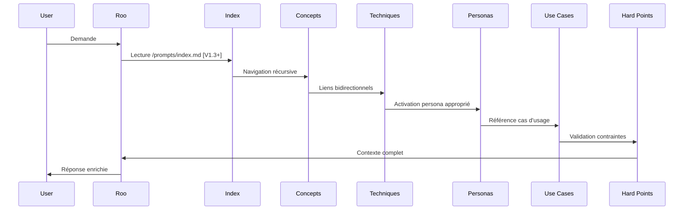

# Mapping AI-KIDO Memory Bank ↔ Norme CLAUDE.md

@AGENTS.md
@prompts/hard_points/aikido.md
@prompts/index.md

## 1. Mapping des Concepts Fondamentaux

| CLAUDE.md | AI-KIDO | Emplacement | Mapping Clé |
|-----------|---------|-------------|-------------|
| **Skills** | **Skills** | `skills_list.md` | 1 Skill = 1 Skill|
| **Subagents** | **Personas** | `/prompts/gen/personas/` | Correspondance 1:1 enrichie (compétences, mode de pensée, style) |
| **Slash Commands** | **Commands** | `prompts/hard_points/commands/` et `commands_list.md`  
| **MCP Resources** | **Hard Points + Use Cases** | `/prompts/hard_points/` + `/use_cases/` | Resources → Hard Points (immuables) + Use Cases (scénarios) |

### Détails de Mapping

**available agents** : [agents_list.md](agents_list.md).
**available skills** : [skills_list.md](skills_list.md).

**Subagents → Personas**

- `tools` → Permissions mappées: Read→read, Write→edit, Bash→command, Browser→browser
- `model` → Hérité du contexte (Roo-Code)
- Configuration automatique dans `.roomodes`

**Commands Spécifiques AI-KIDO**

- `/init-aikido`, `/create-persona`, `/create-command`, `/analyse-project`, `/analyse-aikido`, `/maj-aikido`, `/init-glossaire`, `/check-truth`, `/list-command`, `/clean-index`, `/reindex-projet`, `/validate-analyse-plan`, `/create-search-plan`, `/validate-search-plan`, `/create-analyse-plan`, `/skill-get` → Voir [prompts/hard_points/commands/](prompts/hard_points/commands/)

## Workflows et Orchestration

