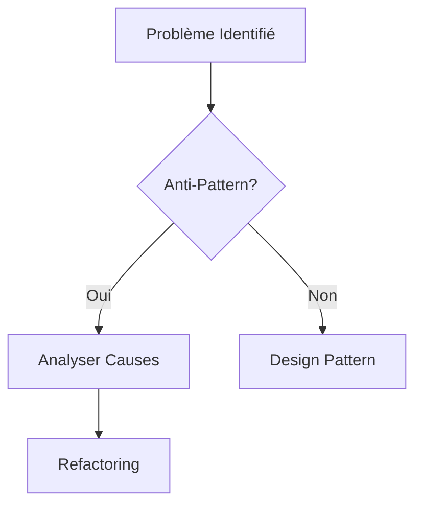

# Gouvernance AI-KIDO - Formation Design Patterns & Anti-Patterns
> Version: 1.0 | Date: 2025-01-05 | Statut: Règles de gouvernance projet

## Vue d'ensemble

Ce fichier établit les règles de gouvernance spécifiques au projet **Formation Design Patterns & Anti-Patterns**, complétant les hard points généraux avec des contraintes techniques et méthodologiques propres au contexte web.

## Règles Techniques Web

### RG-WEB-001 : Distinction Liens Relatifs/Absolus
**Contexte** : Site statique HTML dans le répertoire `/out`
**Règle** : Distinction obligatoire entre deux types de liens :

**1. Liens entre pages HTML** : RELATIFS
- **Usage** : Navigation directe entre pages (liens `<a href="">` dans le contenu)
- **Format** : Relatifs par rapport à l'emplacement de la page courante
- **Exemples** :
  - ❌ Absolus : `/pages/section/page.html`
  - ❌ Avec préfixe : `/out/pages/section/page.html`
  - ✅ Relatifs : `../section/page.html` ou `../../index.html`

**2. Liens du Menu JavaScript** : ABSOLUS
- **Usage** : Navigation via le menu latéral (système `navigation.js`)
- **Format** : Absolus depuis la racine `/out` (sans le préfixe `/out`)
- **Exemples** :
  - ✅ Absolus menu : `pages/biais-cognitifs/index.html`
  - ✅ Absolus menu : `pages/design-patterns/creational/singleton.html`
  - ❌ Relatifs menu : `../biais-cognitifs/index.html`

**Justification** :
- Liens HTML relatifs → Portabilité et fonctionnement depuis n'importe quel niveau
- Liens menu absolus → Cohérence de navigation depuis toutes les pages

### RG-WEB-002 : Pas de Tests Browser Automatisés
**Contexte** : Développement interface utilisateur
**Règle** : L'IA ne doit **jamais** tester l'interface via browser_action
**Justification** : L'utilisateur est le seul juge de l'expérience utilisateur
**Application** :
- ❌ Lancement automatique de browser pour validation
- ❌ Tests de navigation automatisés
- ✅ Demander à l'utilisateur de tester et rapporter les problèmes

### RG-WEB-003 : Hiérarchie CSS Cohérente
**Contexte** : Design system de la formation
**Règle** : Séparation stricte des classes CSS selon leur usage
**Application** :
- `.page-title` : Uniquement pour les titres de page (1.875rem)
- `.nav-page-title` : Uniquement pour les liens de navigation (0.875rem)
- `.section-title` : Pour les titres de section du menu

## Règles Pédagogiques

### RG-PEDA-001 : Ordre Pédagogique Immuable
**Séquence obligatoire** :
1. **🧩 Biais Cognitifs** → Comprendre nos mécanismes de décision
2. **⚠️ Anti-Patterns** → Identifier les pièges à éviter
3. **🏗️ Design Patterns** → Apprendre les bonnes solutions
4. **🎯 Exercices** → Mettre en pratique

**Justification** : Approche psycho-cognitive avant technique pour une meilleure assimilation

### RG-PEDA-002 : Interconnexions Obligatoires
**Règle** : Chaque concept doit être relié aux autres domaines
**Application** :
- Biais cognitif → Anti-pattern correspondant
- Anti-pattern → Design pattern correcteur
- Design pattern → Exercice pratique

## Règles de Documentation

### RG-DOC-001 : Format AI-KIDO Strict
**Structure obligatoire** pour tous les fichiers :
```markdown
# Titre - Contexte AI-KIDO
> Version: X.Y | Date: YYYY-MM-DD | Statut: Description

## Sections standardisées
- Vue d'ensemble
- [Contenu spécifique]
- Navigation contextuelle
- Références
```

### RG-DOC-002 : Navigation Contextuelle
**Règle** : Chaque fichier doit inclure des liens vers les fichiers connexes
**Format** : `→ Consulter [fichier.md](chemin/fichier.md) pour [contexte]`

### RG-DOC-003 : Formatage Formulaires à Choix Multiple
**Contexte** : Création de quiz et exercices interactifs
**Règle** : Chaque réponse de formulaire à choix multiple doit être sur une ligne séparée
**Justification** : Lisibilité et facilité de sélection pour l'utilisateur
**Application** :
- ❌ Format condensé : `A) Réponse 1 B) Réponse 2 C) Réponse 3`
- ✅ Format ligne par ligne :
```
A) Réponse 1
B) Réponse 2
C) Réponse 3
```

### RG-DOC-004 : Visualisation Graphique par Blocs
**Contexte** : Présentation des concepts et interactions dans la formation
**Règle** : Privilégier systématiquement la visualisation graphique par blocs plutôt que des paragraphes de texte linéaire
**Justification** : Favorise la compréhension de l'interaction des concepts et améliore l'assimilation pédagogique
**Application** :
- ❌ Texte linéaire : "Le Système 1 est rapide, intuitif et automatique. Il traite l'information de manière heuristique..."
- ✅ Blocs visuels : Structure en cartes avec sections distinctes (caractéristiques, exemples, comportements)
- ✅ CSS Grid/Flexbox : Mise en page structurée avec espacement et hiérarchie visuelle
- ✅ Couleurs distinctives : Codes couleur pour différencier les concepts (ex: rouge pour Système 1, bleu pour Système 2)

### RG-DOC-005 : Français Authentique
**Contexte** : Rédaction de tous les contenus de formation
**Règle** : Utiliser le moins d'anglicismes possible tout en préservant les noms propres techniques
**Justification** : Maintenir l'authenticité linguistique française pour une meilleure appropriation culturelle
**Application** :
- ❌ Anglicismes : "trade-offs", "feedback", "debug", "code smell"
- ✅ Français authentique : "compromis", "retours", "débogage", "défaut de code"
- ✅ Noms propres préservés : "Singleton Pattern", "Factory Pattern", "Observer Pattern"
- ✅ Terminologie technique : Garder les noms officiels des patterns et anti-patterns

### RG-DOC-006 : Workflows au Format Mermaid
**Contexte** : Représentation des processus et workflows dans la formation
**Règle** : Tous les workflows doivent être représentés en syntaxe Mermaid avec intégration de la librairie Mermaid.js
**Justification** : Améliore la compréhension des processus complexes par la visualisation standardisée et interactive
**Application** :
- ✅ Syntaxe Mermaid : Tous les diagrammes de flux en format Mermaid
- ✅ Librairie intégrée : Mermaid.js chargée dans toutes les pages HTML
- ✅ Types supportés : Flowchart, Sequence, State, Class selon le contexte
- ✅ Rendu automatique : Transformation automatique des blocs ```mermaid
**Exemples** :


## Règles de Validation

### RG-VAL-001 : Tests Utilisateur Obligatoires
**Processus** :
1. Développement technique par l'IA
2. Test utilisateur manuel
3. Rapport de problèmes par l'utilisateur
4. Correction par l'IA
5. Nouveau cycle si nécessaire

### RG-VAL-002 : Cohérence Multi-Niveaux
**Vérifications obligatoires** :
- [ ] Liens fonctionnels à tous les niveaux
- [ ] CSS cohérent sur toutes les pages
- [ ] Navigation logique respectée
- [ ] Contenu pédagogique aligné

## Métriques de Conformité

### Technique
- [ ] 100% des liens sont dynamiques/relatifs
- [ ] 0 test browser automatisé
- [ ] Classes CSS séparées selon usage

### Pédagogique
- [ ] Ordre Biais → Anti-Patterns → Design Patterns → Exercices respecté
- [ ] Interconnexions documentées entre tous les concepts

### Documentation
- [ ] Format AI-KIDO appliqué à 100% des fichiers
- [ ] Navigation contextuelle présente partout
- [ ] Visualisation par blocs privilégiée sur texte linéaire (RG-DOC-004)
- [ ] Français authentique utilisé avec noms propres préservés (RG-DOC-005)
- [ ] Workflows représentés en format Mermaid avec librairie intégrée (RG-DOC-006)

## Historique des Règles

| Version | Date | Modification | Justification |
|---------|------|--------------|---------------|
| 1.0 | 2025-01-05 | Création initiale | Formalisation des règles émergentes |
| | | RG-WEB-001 : Liens dynamiques | Problème de navigation identifié |
| | | RG-WEB-002 : Pas de tests browser | Séparation des responsabilités |
| 1.1 | 2025-01-06 | RG-DOC-004 : Visualisation par blocs | Amélioration compréhension concepts |
| | | RG-DOC-005 : Français authentique | Préférence utilisateur authenticité linguistique |
| 1.2 | 2025-01-06 | RG-DOC-006 : Workflows Mermaid | Standardisation visualisation processus |

## Application Immédiate

**Actions en cours** :
- [x] Correction des liens dans `navigation.js` (RG-WEB-001)
- [x] Séparation classes CSS (RG-WEB-003)
- [x] Documentation des règles (RG-DOC-001)

**Actions à venir** :
- [ ] Validation utilisateur complète (RG-VAL-001)
- [ ] Vérification cohérence multi-niveaux (RG-VAL-002)

---

**NAVIGATION CONTEXTUELLE** :
→ Retour à [`../index.md`](../index.md) pour la vue d'ensemble du projet
→ Consulter [`../validation/index.md`](../validation/index.md) pour les méthodes de validation
→ Voir [`../../hard_points/index.md`](../../hard_points/index.md) pour les contraintes générales
