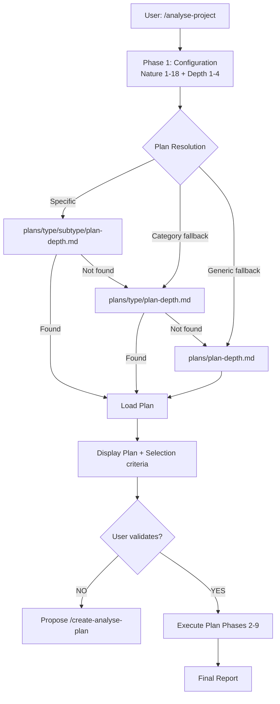

# Analysis Plans — Index

> **Version**: 1.0 | **Date**: 2025-12-10 | **Purpose**: Hierarchical Analysis Plan System

## 📋 Overview

This directory contains the **analysis plans** used by `/analyse-project`. Each plan defines the **complete analysis strategy** for a specific type and depth:

- **Sources to Analyze**: Code, docs, config specific to the analysis type
- **Agents to Use**: Which AI-KIDO agents to invoke and how
- **Extraction Strategy**: Detection algorithms and patterns
- **Analysis Depth**: Level of detail (1=Overview → 4=Expert)
- **Output Format**: Output template and expected metadata
- **Selection Criteria**: When to use this plan vs others

## 🎯 Benefits of the Plan System

By offloading the analysis algorithm into specific plans:
- ✅ **Reduced complexity**: `/analyse-project` becomes a simple orchestrator
- ✅ **Precise targeting**: Analysis adapted to context (architecture vs stack vs domain)
- ✅ **Customization**: Plans modifiable by project type
- ✅ **Capitalization**: Best analysis practices centralized
- ✅ **Performance**: Avoids unnecessary exhaustive analysis

## 🗂️ Hierarchical Structure

Plans are organized hierarchically to allow resolution by specificity:

```
plans/
├── README.md                              # This file
├── plan-survol.md                         # Generic depth 1 (fallback)
├── plan-standard.md                       # Generic depth 2 (fallback)
├── plan-approfondi.md                     # Generic depth 3 (fallback)
├── plan-expert.md                         # Generic depth 4 (fallback)
├── architecturale/
│   ├── c1/
│   │   ├── plan-survol.md                 # C1 Overview (depth 1)
│   │   ├── plan-standard.md               # C1 Standard (depth 2)
│   │   ├── plan-approfondi.md             # C1 In-depth (depth 3)
│   │   └── plan-expert.md                 # C1 Expert (depth 4)
│   ├── c2/ … c4/                          # (TODO)
├── technique/
│   ├── stack-generale/ backend/ frontend/ infrastructure/ securite/  # (TODO)
├── fonctionnelle/
│   ├── generale/ domaine/ use-cases/ workflows/  # (TODO)
└── methodologique/
    ├── uml2/ rup/ agile/ devops/           # (TODO)
```

## 🔍 Plan Resolution Logic

`/analyse-project` selects the plan using this logic:

### Resolution Algorithm

```python
def resolve_analysis_plan(nature: str, depth: int) -> str:
    """
    Resolves the most specific available analysis plan.

    Parameters:
    - nature: Analysis type (1-18 from Phase 1 of /analyse-project)
      - 1: Simple global analysis
      - 2-5: Architectural (C1-C4)
      - 6-10: Technical (general stack, backend, frontend, infra, security)
      - 11-14: Functional (general, domain, use cases, workflows)
      - 15-18: Methodological (UML2, RUP, Agile, DevOps)
    - depth: Depth level (1-4)
      - 1: Overview
      - 2: Standard
      - 3: In-depth
      - 4: Expert

    Priority (most specific to most generic):
    1. plans/{category}/{subtype}/plan-{depth}.md
    2. plans/{category}/plan-{depth}.md
    3. plans/plan-{depth}.md (generic fallback)
    """
    base = "prompts/hard_points/system/analyse/plans"
    depth_names = {1: "survol", 2: "standard", 3: "approfondi", 4: "expert"}
    depth_name = depth_names[depth]

    nature_mapping = {
        1: ("generale", None),
        2: ("architecturale", "c1"), 3: ("architecturale", "c2"),
        4: ("architecturale", "c3"), 5: ("architecturale", "c4"),
        6: ("technique", "stack-generale"), 7: ("technique", "backend"),
        8: ("technique", "frontend"), 9: ("technique", "infrastructure"),
        10: ("technique", "securite"), 11: ("fonctionnelle", "generale"),
        12: ("fonctionnelle", "domaine"), 13: ("fonctionnelle", "use-cases"),
        14: ("fonctionnelle", "workflows"), 15: ("methodologique", "uml2"),
        16: ("methodologique", "rup"), 17: ("methodologique", "agile"),
        18: ("methodologique", "devops"),
    }

    category, subtype = nature_mapping[nature]

    # Level 1: Category + Subtype + Depth (most specific)
    if subtype:
        path = f"{base}/{category}/{subtype}/plan-{depth_name}.md"
        if exists(path): return path

    # Level 2: Category + Depth
    path = f"{base}/{category}/plan-{depth_name}.md"
    if exists(path): return path

    # Level 3: Generic fallback by depth
    return f"{base}/plan-{depth_name}.md"
```

### Resolution Examples

| Nature | Depth | Resolved Plan |
|--------|-------|--------------|
| **2** (C1) | **2** (Standard) | `plans/architecturale/c1/plan-standard.md` ✅ |
| **7** (Backend) | **3** (In-depth) | `plans/technique/backend/plan-approfondi.md` → `plan-approfondi.md` |
| **1** (Global) | **1** (Overview) | `plans/plan-survol.md` ✅ (fallback) |

## 📦 Available Plans (Status)

### ✅ Available

| Plan | Path | Description | Lines |
|------|------|-------------|-------|
| **Generic Overview** | `plan-survol.md` | Fallback depth 1 (quick overview) | ~300 |
| **Generic Standard** | `plan-standard.md` | Fallback depth 2 (moderate detail) | ~400 |
| **Generic In-depth** | `plan-approfondi.md` | Fallback depth 3 (exhaustive) | ~500 |
| **Generic Expert** | `plan-expert.md` | Fallback depth 4 (full audit) | ~600 |
| **Full Technical Audit Expert** | `technique/audit-complet/plan-expert.md` | Multi-repository technical audit (frontend+backend) — Depth 4 | ~1200 |

### ⏳ To Create (TODO — Prioritized)

| Plan | Path | Description | Priority |
|------|------|-------------|----------|
| **C1 Standard** | `architecturale/c1/plan-standard.md` | System context analysis (depth 2) | High |
| **C2 In-depth** | `architecturale/c2/plan-approfondi.md` | Detailed container analysis (depth 3) | High |
| **Backend In-depth** | `technique/backend/plan-approfondi.md` | Specific backend stack (depth 3) | High |
| **Frontend In-depth** | `technique/frontend/plan-approfondi.md` | Specific frontend stack (depth 3) | High |
| **Functional General** | `fonctionnelle/generale/plan-standard.md` | Global business processes (depth 2) | Medium |
| **Use Cases Standard** | `fonctionnelle/use-cases/plan-standard.md` | Usage scenarios (depth 2) | Medium |
| **DevOps In-depth** | `methodologique/devops/plan-approfondi.md` | Continuous integration (depth 3) | Medium |
| **Security Expert** | `technique/securite/plan-expert.md` | Full security audit (depth 4) | Low |

## 🎯 How to Create a New Analysis Plan

### 1. Identify Type and Depth

- **Analysis type?** → Category (architectural/technical/functional/methodological)
- **Subtype?** → Sub-category (c1, backend, use-cases, etc.)
- **Depth?** → Detail level (1=overview, 2=standard, 3=in-depth, 4=expert)

### 2. Plan Template

```markdown
# Analysis Plan {TYPE} - {DEPTH}

> **Version**: 1.0 | **Date**: YYYY-MM-DD | **Type**: Analysis Plan | **Nature**: {TYPE} | **Depth**: {DEPTH}

## 📋 Overview
[Plan description and specific use case]

## 🎯 Selection Criteria
This plan is selected when:
- **Nature**: {NATURE_NUMBER} - {NATURE_DESCRIPTION}
- **Depth**: {DEPTH_NUMBER} - {DEPTH_DESCRIPTION}
- **Context**: {IDEAL_CONTEXT}

## 🔍 Sources to Analyze
### Priority Sources
**Source Code**: directories: {DIRECTORIES} | extensions: {FILE_EXTENSIONS}
**Documentation**: {DOC_FILES}
**Configuration**: {CONFIG_FILES}

## 🤖 AI-KIDO Agents to Use
### Phase 3.1: Code Scan (Mandatory)
**Agent**: agent-aikido-explore-code
**Specialized prompt**: "FORMAT: JSON\n{PROMPT}"

### Phase 3.2: Parallel Search (Optional — depth ≥ {THRESHOLD})
**Agent**: agent-aikido-explore-all

### Contradiction Resolution (If needed)
**Agent**: agent-aikido-truth-evaluator | **Hierarchy**: {HIERARCHY_STRATEGY}

### RACI Classification (Optional)
**Agent**: agent-aikido-raci-delegator

### Auto Population (Optional)
**Agent**: agent-aikido-bank-populate

### Final Validation (Mandatory)
**Agent**: agent-aikido-validator | **Rules**: {VALIDATION_RULES}

## 📊 Extraction Strategy
### Detection Patterns
```regex
{DETECTION_PATTERNS}
```

## 🔄 Full Workflow
```mermaid
graph TB
    START[Start {TYPE} Analysis] --> SCAN[🤖 explore-code]
    SCAN --> EXTRACT[Metadata Extraction]
    EXTRACT --> VALIDATE[🤖 validator]
    VALIDATE --> END[✅ Analysis complete]
```

## 📤 Output Format
[Output template]

## 📚 References
- Lower depth: `plan-{LOWER_DEPTH}.md`
- Higher depth: `plan-{HIGHER_DEPTH}.md`
```

## 🔧 Customization & Extension

```bash
# Add a new analysis type
mkdir -p prompts/hard_points/system/analyse/plans/{new_category}
for depth in survol standard approfondi expert; do
  cp plans/plan-${depth}.md plans/{new_category}/plan-${depth}.md
done

# Add a specific subtype
mkdir -p plans/architecturale/c3
cp plans/plan-approfondi.md plans/architecturale/c3/plan-approfondi.md
```

## 📊 Performance Metrics (Targets)

| Depth | Max Time | Max Tokens | Agents Used | Target Accuracy |
|-------|----------|------------|-------------|----------------|
| **Overview** | 10 min | 5k | 2-3 | 75% |
| **Standard** | 20 min | 10k | 3-4 | 85% |
| **In-depth** | 40 min | 20k | 4-5 | 90% |
| **Expert** | 60 min | 30k | 5-6 | 95% |

## 🔗 Integration with /analyse-project



## 📚 References

- **Main command**: `prompts/hard_points/commands/analyse-project.md`
- **Generic plans**: `plan-survol.md`, `plan-standard.md`, `plan-approfondi.md`, `plan-expert.md`
- **AI-KIDO agents**: `prompts/hard_points/agents/agent-aikido-*.md`
- **AI-KIDO documentation**: `prompts/hard_points/ai-kido.md`

---
*Index created 2025-12-10 for AI-KIDO analysis plan system*
