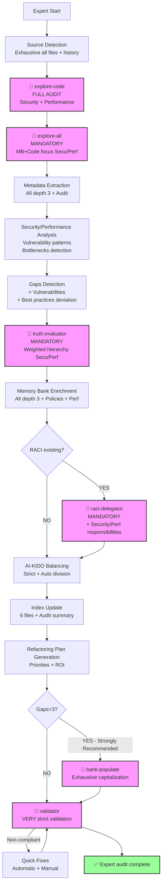

# Generic Analysis Plan - Expert (Depth 4)

> **Version**: 1.0 | **Date**: 2025-12-10 | **Type**: Analysis Plan | **Nature**: Generic | **Profondeur**: 4 - Expert

## 📋 Overview

**Generic expert** analysis plan offering a full audit of the project including security, performance, and a detailed refactoring plan. **Most thorough analysis** with actionable recommendations and estimated ROI. Used as **fallback** for depth 4 when no specific plan exists.

**Expert Philosophy** :
- ✅ Full Audit (~40-60 min)
- ✅ Security analysis (OWASP, CVE)
- ✅ Performance analysis (bottlenecks, optimizations)
- ✅ Detailed refactoring plan (steps, ROI)
- ✅ Prioritized recommendations with effort/impact
- ✅ Technical roadmap

## 🎯 Selection Criteria

This plan is selected when:
- **Nature** : Any analysis type (1-18)
- **Depth** : 4 - Expert (full audit, security, performance, refactoring)
- **Context** : Pre-production audit, certification, critical migration, technical due diligence

**Difference vs other depths** :
- vs Overview (1) : Full Audit vs high-level view
- vs Standard (2) : + Security + Performance + Refactoring
- vs In-depth (3) : + Full security/performance audit + Step-by-step refactoring plan + ROI

## 🔍 Sources to Analyze

### Priority Sources (Exhaustive + Security/Performance)

**Source Code** (full audit) :
- **All** files (source + tests + scripts + config)
- **Security analysis** : Vulnerabilities detection (injection, XSS, CSRF, etc.)
- **Performance analysis** : Bottlenecks detection (N+1, memory leaks, etc.)
- **No exclusion** except binaries

**Documentation** (exhaustive + historical) :
- All technical documentation
- Decision history (ADRs if present)
- Security policies (if existing)
- Performance requirements (if documented)
- Full changelog (evolution analysis)

**Configuration** (security/performance audit) :
- **Security** : Secrets management, permissions, network policies
- **Performance** : Cache configs, pool sizes, timeout settings
- **Infrastructure** : Scaling policies, resource limits
- **Monitoring** : Logs, metrics, alerting

**External** (if applicable) :
- CVE databases (known vulnerabilities)
- Performance benchmarks (industry comparisons)
- Best practices (OWASP, SANS, etc.)

### Filtering Criteria

**No limit** :
- Exhaustive analysis of all files
- Historical analysis (git history if accessible)
- Transitive dependency analysis (multi-level)
- Security/performance pattern search

## 🤖 AI-KIDO Agents to Mobilize

### Phase 3.1 : Code Scan (Mandatory - Full Audit)

**Agent** : `agent-aikido-explore-code`

**Specialized prompt** :
```
"FORMAT: JSON

Expert analysis (depth 4) - Full audit:

MAIN FOCUS:
- (All from depth 3) +
- SECURITY: Vulnerability patterns (injection, XSS, CSRF, auth bypass, etc.)
- PERFORMANCE: Bottlenecks (N+1, inefficient loops, potential memory leaks)
- CONFIGURATION: Hardcoded secrets, insecure settings

AUDIT DETAIL:
- All depth 3 elements +
- Security patterns: SQL injection, XSS, CSRF, auth/authz issues
- Performance patterns: N+1 queries, inefficient loops, large data loads
- Insecure configurations: Hardcoded credentials, weak crypto, permissive CORS
- Deprecated APIs: Usage of obsolete/insecure functions
- Error handling: Try/catch coverage, error exposure

AUDIT METADATA:
- Security score per file (heuristic)
- Performance score per file (heuristic)
- Critical issues with severity (CRITICAL/HIGH/MEDIUM/LOW)

Expected output:
- Exhaustive index + security/performance audit
- Critical issues with exact location
- ~120-150 lines per analyzed file
- Total budget < 30k tokens"
```

**Expected Result** : Exhaustive index + security/performance audit in < 30k tokens

### Phase 3.2 : Parallel Search (Mandatory)

**Condition** : **MANDATORY** at depth 4

**Agent** : `agent-aikido-explore-all`

**Specialized prompt** :
```
"FORMAT: JSON

Exhaustive parallel search with security/performance focus:

Memory Bank:
- (All from depth 3) +
- Documented security policies
- Documented performance requirements

Source Code:
- (All from depth 3) +
- Potential vulnerabilities vs policies
- Bottlenecks vs requirements

Search keywords:
- Security patterns: password, token, secret, auth, crypto, hash, sql, query, input, sanitize
- Performance patterns: cache, pool, connection, query, loop, memory, async, promise

Expected output:
- Security gaps (policies vs implementation)
- Performance gaps (requirements vs implementation)
- Detected potential vulnerabilities"
```

**Expected Result** : Exhaustive audit report with security/performance focus

### Contradiction Resolution (Mandatory)

**Agent** : `agent-aikido-truth-evaluator`

**Hierarchy strategy** : INVESTIGATION scenario + security/performance weighting
- Security : Policies > Code > Config > Docs
- Performance : Requirements > Code > Config > Docs

### RACI Classification (Mandatory if existing)

**Agent** : `agent-aikido-raci-delegator`

**Mapping** : Exhaustive classification + security/performance responsibility assignment

### Automatic Population (Strongly Recommended)

**Condition** : **STRONGLY RECOMMENDED** if gaps > 3

**Agent** : `agent-aikido-bank-populate`

**Strategy** : Exhaustive capitalization including :
- Security policies extracted from code
- Performance patterns detected
- Best practices identified

### Final Validation (Mandatory - Very Strict)

**Agent** : `agent-aikido-validator`

**Strict rules** :
- All depth 3 rules +
- Security documentation validation
- Performance documentation validation
- Links to critical issues

## 📊 Extraction Strategy

### 1. Automatic Detection (Full Audit)

**Expert algorithm** :
1. (All from depth 3) +
2. **Security scan** : OWASP Top 10 vulnerability patterns
3. **Performance scan** : Known bottlenecks (N+1, memory leaks, etc.)
4. **Dependency analysis** : CVE checking (if data available)
5. **Configuration analysis** : Security misconfigurations
6. **Historical analysis** : Code evolution (git blame on critical areas)

**Search patterns** (security/performance) :
```regex
# (All from depth 3) +

# SECURITY

# Potential SQL Injection
(query|execute|prepare)\s*\(\s*[^\?].*\+.*\)
SELECT.*WHERE.*\$.*\+
INSERT.*VALUES.*\$.*\+

# Potential XSS
innerHTML\s*=
dangerouslySetInnerHTML
eval\(
document.write\(

# Hardcoded secrets
(password|secret|key|token)\s*=\s*['"][^'"]+['"]
(api_key|api_secret|private_key)\s*=

# Insecure crypto
md5\(
sha1\(
des_encrypt

# Auth/Authz issues
(auth|authorize|permission).*false
if\s*\(\s*true\s*\).*admin

# PERFORMANCE

# Potential N+1 queries
for.*\n.*query|select
forEach.*\n.*find|findOne

# Inefficient loops
for.*for.*for  # nested loops 3+
while.*\n.*sleep

# Potential memory leaks
addEventListener.*\n(?!.*removeEventListener)
setInterval.*\n(?!.*clearInterval)

# Synchronous operations (blocking)
(readFileSync|execSync|sleep)\(

# Large data loads
SELECT\s+\*\s+FROM  # select all
findAll\(\)  # ORM load all
```

**Advanced heuristics** :
- (All from depth 3) +
- **Security score** : Number of issues / LOC * 1000
- **Performance score** : Number of bottlenecks / LOC * 1000
- **Criticality** : Location (auth, payment, admin = CRITICAL)

### 2. Metadata Extraction (Audit)

**(All from depth 3) +**

**Security** :
- Detected vulnerabilities with severity (CRITICAL/HIGH/MEDIUM/LOW)
- CVE matches (if known dependencies)
- Security misconfigurations
- Localized hardcoded secrets
- Insecure crypto usage
- Missing security headers/validations

**Performance** :
- Detected bottlenecks with estimated impact
- Localized inefficient queries/loops
- Memory leak risks
- Missing caching opportunities
- Synchronous blocking operations
- Resource limits (connections, memory)

### 3. Depth-Specific Analysis

**Depth 4 - Expert** :
- **Level of detail** : Full audit security + performance + refactoring
- **Metrics collected** :
  - (All metrics from depth 3) +
  - Global security score + by category
  - Global performance score + by area
  - CRITICAL issues count
  - CVE count (if data available)
  - Estimated refactoring effort (hours)
  - Refactoring ROI (impact vs effort)
- **Generated graphs** :
  - (All graphs from depth 3) +
  - Security heatmap (vulnerable areas)
  - Performance heatmap (bottlenecks)
  - Refactoring roadmap (timeline)
- **Estimated time** : 40-60 minutes

## 🔄 Complete Workflow

### Execution Phases (Full Audit)



**Expert-only phase** :
- ✅ Refactoring Plan Generation (after index, before population)

### Estimated Execution Time

- **Source detection** : ~4 min
- **Audit scan (explore-code)** : ~12-18 min
- **Parallel search secu/perf** : ~8-12 min
- **Security/performance analysis** : ~5-8 min
- **Contradiction resolution** : ~5 min
- **Exhaustive enrichment** : ~8-12 min
- **Refactoring plan generation** : ~5-8 min
- **RACI classification** : ~4 min
- **Population** : ~8-12 min
- **Very strict validation** : ~3-5 min

**Total** : ~40-60 minutes

## 📤 Output Format

### Output Structure (Full Audit)

```markdown
# Expert Audit Report (Depth 4)

**Date** : {DATE}
**Duration** : {DURATION}
**Sources analyzed** : {SOURCE_COUNT} files (100% + history)

## 🎯 Configuration

- **Nature** : {ANALYSIS_TYPE_DESCRIPTION}
- **Depth** : 4 - Expert (full audit, security, performance, refactoring)
- **Plan used** : `plans/plan-expert.md`

## 🔒 Security Analysis

### Global Security Score

**Score** : {SECURITY_SCORE}/100
- ✅ Green (80-100) : Solid security
- ⚠️  Orange (50-79) : Improvements needed
- 🔴 Red (0-49) : Critical risks

### Critical Issues (CRITICAL) 🔴

**{CRITICAL_COUNT} critical issue(s) detected** :

1. **{ISSUE_TYPE}** ({FILE}:{LINE}) - Severity: CRITICAL
   - **Description** : {DESCRIPTION}
   - **Impact** : {IMPACT}
   - **Exploitation** : {EXPLOIT_SCENARIO}
   - **Recommendation** : {FIX}
   - **Effort** : {EFFORT}
   - **Priority** : P0 - Immediate

### High Priority Issues (HIGH) ⚠️

**{HIGH_COUNT} high priority issue(s)** :

1. **{ISSUE_TYPE}** ({FILE}:{LINE}) - Severity: HIGH
   - **Description** : {DESCRIPTION}
   - **Impact** : {IMPACT}
   - **Recommendation** : {FIX}
   - **Effort** : {EFFORT}
   - **Priority** : P1 - Short term

### Vulnerabilities by Category (OWASP Top 10)

| OWASP Category | Issues | Max Severity | Affected Files |
|----------------|--------|--------------|----------------|
| A01: Broken Access Control | {COUNT} | {MAX_SEV} | {FILES} |
| A02: Cryptographic Failures | {COUNT} | {MAX_SEV} | {FILES} |
| A03: Injection | {COUNT} | {MAX_SEV} | {FILES} |
| A04: Insecure Design | {COUNT} | {MAX_SEV} | {FILES} |
| A05: Security Misconfiguration | {COUNT} | {MAX_SEV} | {FILES} |
| ... | | | |

### Vulnerable Dependencies (CVE)

**{CVE_COUNT} dependency(ies) with known CVE(s)** :

- **{LIBRARY} {VERSION}** - CVE-{YEAR}-{ID} (Severity: {CRITICAL/HIGH/MEDIUM})
  - Description : {CVE_DESC}
  - Fix : Upgrade to {VERSION_FIXED}

### Security Heatmap

```mermaid
{SECURITY_HEATMAP}
```

Critical areas (red) :
- `{CRITICAL_ZONE_1}` - {ISSUE_COUNT} issues
- `{CRITICAL_ZONE_2}` - {ISSUE_COUNT} issues

## ⚡ Performance Analysis

### Global Performance Score

**Score** : {PERFORMANCE_SCORE}/100
- ✅ Green (80-100) : Optimal performance
- ⚠️  Orange (50-79) : Possible optimizations
- 🔴 Red (0-49) : Critical bottlenecks

### Critical Bottlenecks 🔴

**{CRITICAL_BOTTLENECK_COUNT} critical bottleneck(s)** :

1. **{BOTTLENECK_TYPE}** ({FILE}:{LINE})
   - **Description** : {DESCRIPTION}
   - **Impact** : {IMPACT_DESCRIPTION} (ex: +{MS}ms per request)
   - **Frequency** : {FREQUENCY} (if detectable)
   - **Recommendation** : {FIX}
   - **Estimated gain** : {GAIN_MS}ms ({GAIN_PERCENT}%)
   - **Effort** : {EFFORT}
   - **ROI** : {ROI_SCORE}/10

### High Priority Bottlenecks ⚠️

**{HIGH_BOTTLENECK_COUNT} high priority bottleneck(s)** :

1. **{BOTTLENECK_TYPE}** ({FILE}:{LINE})
   - **Description** : {DESCRIPTION}
   - **Impact** : {IMPACT}
   - **Recommendation** : {FIX}
   - **Estimated gain** : {GAIN}
   - **Effort** : {EFFORT}

### Caching Opportunities

**{CACHE_OPP_COUNT} caching opportunity(ies) detected** :

- **{FUNCTION}** ({FILE}:{LINE}) - Estimated gain : {GAIN_MS}ms
  - Calls : {CALL_COUNT}/min (if detectable)
  - Strategy : {CACHE_STRATEGY}

### Performance Heatmap

```mermaid
{PERFORMANCE_HEATMAP}
```

Critical areas (red) :
- `{CRITICAL_ZONE_1}` - {BOTTLENECK_COUNT} bottlenecks
- `{CRITICAL_ZONE_2}` - {BOTTLENECK_COUNT} bottlenecks

## 📊 (All depth 3 sections)

[Architecture, Stack, Quality, Gaps, etc. from plan-approfondi.md]

## 🛠️  Detailed Refactoring Plan

### Overview

**Total estimated effort** : {HOURS}h ({DAYS} man-days)
**Global ROI** : {ROI_SCORE}/10
**Priorities** :
- P0 (Immediate) : {P0_COUNT} items - {P0_HOURS}h
- P1 (Short term) : {P1_COUNT} items - {P1_HOURS}h
- P2 (Medium term) : {P2_COUNT} items - {P2_HOURS}h

### Phase 1 : Security (Immediate - P0)

**Duration** : {PHASE1_DURATION}
**Effort** : {PHASE1_EFFORT}h

**Steps** :
1. **Fix {CRITICAL_ISSUE_1}** ({FILE}:{LINE})
   - Action : {ACTION_STEPS}
   - Tests : {TEST_STEPS}
   - Validation : {VALIDATION_STEPS}
   - Effort : {EFFORT}h
   - Impact : 🔴 Critical

2. **Fix {CRITICAL_ISSUE_2}** ({FILE}:{LINE})
   - Action : {ACTION_STEPS}
   - Tests : {TEST_STEPS}
   - Validation : {VALIDATION_STEPS}
   - Effort : {EFFORT}h
   - Impact : 🔴 Critical

### Phase 2 : Performance (Short term - P1)

**Duration** : {PHASE2_DURATION}
**Effort** : {PHASE2_EFFORT}h

**Steps** :
1. **Optimize {BOTTLENECK_1}** ({FILE}:{LINE})
   - Strategy : {OPTIMIZATION_STRATEGY}
   - Estimated gain : {GAIN_MS}ms ({GAIN_PERCENT}%)
   - Performance tests : {PERF_TEST_STEPS}
   - Effort : {EFFORT}h
   - ROI : {ROI}/10

### Phase 3 : Quality (Medium term - P2)

**Duration** : {PHASE3_DURATION}
**Effort** : {PHASE3_EFFORT}h

**Steps** :
1. **Refactor {ANTI_PATTERN_1}** ({FILE}:{LINE})
   - Strategy : {REFACTOR_STRATEGY}
   - Quality impact : {QUALITY_IMPACT}
   - Effort : {EFFORT}h

### Visual Roadmap

```mermaid
gantt
    title Refactoring Plan
    dateFormat YYYY-MM-DD
    section Phase 1 Security
    {TASK_1} :crit, {START}, {DURATION}d
    {TASK_2} :crit, {START}, {DURATION}d
    section Phase 2 Performance
    {TASK_3} : {START}, {DURATION}d
    {TASK_4} : {START}, {DURATION}d
    section Phase 3 Quality
    {TASK_5} : {START}, {DURATION}d
```

### Complete Checklist

**Phase 1 - Security** :
- [ ] {TASK_1} ({EFFORT}h) - {OWNER}
- [ ] {TASK_2} ({EFFORT}h) - {OWNER}

**Phase 2 - Performance** :
- [ ] {TASK_1} ({EFFORT}h) - {OWNER}
- [ ] {TASK_2} ({EFFORT}h) - {OWNER}

**Phase 3 - Quality** :
- [ ] {TASK_1} ({EFFORT}h) - {OWNER}
- [ ] {TASK_2} ({EFFORT}h) - {OWNER}

## 💡 Strategic Recommendations

### Security

**Immediate (P0)** :
- {SECURITY_REC_1}

**Short term (P1)** :
- {SECURITY_REC_2}

**Policies to establish** :
- {POLICY_REC_1}

### Performance

**Quick Wins (high ROI, low effort)** :
- {PERF_QUICKWIN_1} - Gain : {GAIN}, Effort : {EFFORT}h, ROI : {ROI}/10

**Major optimizations (medium ROI, high effort)** :
- {PERF_MAJOR_1} - Gain : {GAIN}, Effort : {EFFORT}h, ROI : {ROI}/10

### Architecture

**Recommended evolution** :
- {ARCH_REC_1}

**Suggested migration** :
- {MIGRATION_REC_1}

## 📝 Applied Enrichments

[Similar section to depth 3 + security policies + performance patterns]

## ✅ AI-KIDO Compliance (Very Strict)

[Similar section to depth 3 with reinforced validation]

## 📊 Final Metrics

- **Files analyzed** : {COUNT} (100% exhaustive)
- **LOC audited** : {LOC}
- **Security issues** : {COUNT} ({CRITICAL}🔴 / {HIGH}⚠️  / {MEDIUM}/ {LOW})
- **Performance issues** : {COUNT} ({CRITICAL}🔴 / {HIGH}⚠️)
- **Technical debt** : {DEBT_HOURS}h
- **Refactoring effort** : {REFACTOR_HOURS}h
- **Refactoring ROI** : {ROI}/10
- **Agents used** : 6 (all AI-KIDO agents)
- **Total time** : {DURATION}
- **Token budget** : ~{TOKENS} (< 30k target)

---
*Generated by /analyse-project with plan plan-expert.md*
*Full audit : security + performance + refactoring*
```

## 🎓 Ideal Use Cases

The expert plan is ideal for :
- ✅ Pre-production audit (critical go/no-go)
- ✅ Security certification (SOC2, ISO27001, etc.)
- ✅ Technical due diligence (M&A)
- ✅ Critical migration (major overhaul)
- ✅ Performance optimization (critical SLAs)
- ✅ Technical debt reduction (multi-year planning)

## 📚 References

- **Lower depth plan** : `plan-approfondi.md` (depth 3)
- **Agents** : All AI-KIDO agents (6 agents)
- **Command** : `prompts/hard_points/commands/analyse-project.md`
- **OWASP Top 10** : https://owasp.org/Top10/
- **AI-KIDO Documentation** : `prompts/hard_points/ai-kido.md`

---
*Expert Plan created on 2025-12-10 for /analyse-project*
*Full audit : security + performance + refactoring + ROI*
