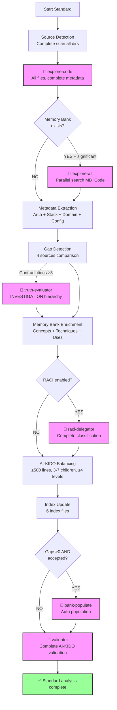

# Generic Analysis Plan - Standard (Depth 2)

> **Version**: 1.0 | **Date**: 2025-12-10 | **Type**: Analysis Plan | **Nature**: Generic | **Depth**: 2 - Standard

## 📋 Overview

**Generic standard** analysis plan offering a balance between detail and performance. Complete analysis of architecture, dependencies, and business logic with a moderate level of detail. Used as a **fallback** for depth 2 when no specific plan exists.

**Standard Philosophy** :
- ✅ Balanced (~10-20 min)
- ✅ Complete architecture analysis
- ✅ Dependencies and relations
- ✅ Main business logic
- ❌ No detailed audit
- ❌ No advanced recommendations

## 🎯 Selection Criteria

This plan is selected when:
- **Nature** : Any analysis type (1-18)
- **Depth** : 2 - Standard (moderate detail, balanced)
- **Context** : Regular analysis, truth table updates, architecture understanding

**Difference vs other depths** :
- vs Overview (1) : Complete architecture analysis, dependency detection, relation graphs
- vs In-depth (3) : No fine implementation analysis, no systematic anti-pattern detection
- vs Expert (4) : No security/performance audit, no refactoring plan

## 🔍 Sources to Analyze

### Priority Sources

**Source Code** (complete scan) :
- All source directories: `src/`, `lib/`, `app/`, `components/`, `modules/`, `services/`
- Complete extensions: All detected languages
- Depth: All levels
- **Exclusions** : node_modules, vendor, dist, build, target, tests (analyzed separately if required)

**Documentation** (complete read) :
- `README.md` (mandatory)
- `ARCHITECTURE.md`, `DESIGN.md`, docs/architecture
- `API.md`, docs/api
- Business glossary (if exists)
- CHANGELOG.md

**Configuration** (detailed analysis) :
- Package managers: package.json, composer.json, requirements.txt, go.mod, Cargo.toml, Gemfile
- Build: Makefile, webpack.config.js, tsconfig.json
- Docker: Dockerfile, docker-compose.yml
- CI/CD: .github/workflows/, .gitlab-ci.yml, Jenkinsfile
- Environment: .env.example, config/*.yml

### Filtering Criteria

**Selective analysis** :
- All main source files (no limit)
- Files > 1000 lines: complete analysis but priority metadata extraction
- Tests: metadata scan only (coverage, frameworks)

## 🤖 AI-KIDO Agents to Mobilize

### Phase 3.1 : Code Scan (Mandatory)

**Agent** : `agent-aikido-explore-code`

**Specialized prompt** :
```
"FORMAT: JSON

Standard analysis (depth 2) of the project:

FOCUS:
- Complete architecture (all source directories)
- Detailed technical stack (languages, frameworks, libraries)
- Dependencies and relations (imports, extends, implements)
- Main business logic (classes, interfaces, modules)
- API points and public interfaces

DETAIL:
- All source files (no limit)
- Complete metadata per element:
  - Classes: name, extends, implements, methods (signatures), properties
  - Interfaces: name, methods (signatures)
  - Functions: name, signature, parameters, return type
  - Imports: all dependencies with line numbers
- Complete dependency graph (Mermaid)

EXCLUSIONS:
- Tests (separate scan if required)
- Generated files (dist, build)

Expected output:
- Complete architecture index
- Detailed dependency graph
- ~50-80 lines per analyzed file
- Total budget < 10k tokens"
```

**Expected result** : Complete architectural index + dependency graphs in < 10k tokens

### Phase 3.2 : Parallel Search (Optional)

**Condition** : If existing Memory Bank with significant content (> 10 documents)

**Agent** : `agent-aikido-explore-all`

**Specialized prompt** :
```
"FORMAT: JSON

Parallel Memory Bank + Code search for standard analysis:

Memory Bank (/prompts/gen/):
- Documented architecture concepts
- Documented stack techniques
- Documented process use cases
- Business terms glossary

Source Code (outside /prompts/):
- Actually implemented architecture
- Actually used technical stack
- Actually coded processes
- Business terms in code

Search keywords: {TYPE_DEPENDENT_KEYWORDS}

Expected output:
- Memory Bank ↔ Code cross-references
- Detected gaps (docs vs implementation)
- Potentially obsolete elements"
```

**Expected result** : Gap report + cross-references in ~3-5 sec

### Contradiction Resolution (If needed)

**Condition** : Contradictions detected (>= 3 major contradictions)

**Agent** : `agent-aikido-truth-evaluator`

**Hierarchy strategy** : INVESTIGATION scenario
- Code (implementation) > Config (operational) > Docs (intentional) > Memory Bank (historical)

### RACI Classification (If enabled)

**Condition** : RACI structure enabled in /prompts/hard_points/

**Agent** : `agent-aikido-raci-delegator`

**Mapping** : Complete classification of extracted documents by domain and role

### Automatic Population (If accepted)

**Condition** : Gaps > 0 AND user accepts

**Agent** : `agent-aikido-bank-populate`

**Strategy** : Capitalization from code/docs/config with expert personas

### Final Validation (Mandatory)

**Agent** : `agent-aikido-validator`

**Strict rules** :
- Rule 4: Size ≤ 500 lines
- Rule 6: Complete bidirectional links
- Rule 7: Balancing (3-7 children, ≤ 4 levels)
- Frontmatter present and valid
- Correct location according to RACI

## 📊 Extraction Strategy

### 1. Automatic Detection (Complete)

**Standard algorithm** :
1. Scan all source directories (full depth)
2. Detect all languages and frameworks (package managers + imports)
3. Identify all entry points (mains, routers, controllers)
4. Extract all classes/interfaces/modules with metadata
5. Build complete dependency graph (extends, implements, imports)
6. Detect architectural patterns (MVC, MVVM, microservices, etc.)

**Search patterns** (complete) :
```regex
# Entry points
(index|main|app|server|router|controller)\.(js|ts|php|py|java|go|rs|rb)

# Imports/Dependencies (multi-language)
^import\s+.*from\s+['"]([^'"]+)['"]          # JS/TS
^require\(['"]([^'"]+)['"]\)                  # JS CommonJS
^use\s+([\w\\]+);                             # PHP
^from\s+(\S+)\s+import                        # Python
^import\s+([\w\.]+)                           # Java/Go
^use\s+([\w:]+);                              # Rust

# Class/interface declarations
^(export\s+)?(default\s+)?class\s+(\w+)       # JS/TS
^class\s+(\w+)(\s+extends\s+(\w+))?           # PHP/Python/Java
^interface\s+(\w+)                            # TS/Java/PHP
^trait\s+(\w+)                                # PHP/Rust
^type\s+(\w+)\s+struct                        # Go
^pub\s+struct\s+(\w+)                         # Rust

# Functions/Methods
^(export\s+)?(async\s+)?function\s+(\w+)      # JS/TS
^(public|private|protected)\s+function\s+(\w+) # PHP
^def\s+(\w+)\s*\(                             # Python
^func\s+(\w+)\s*\(                            # Go
^pub\s+fn\s+(\w+)                             # Rust
```

**Heuristics** :
- Language ratio → Main vs secondary languages
- Import tree depth → Architecture complexity
- Number of abstract classes/interfaces → Abstraction level
- File naming pattern → Architecture convention (MVC, etc.)

### 2. Metadata Extraction (Detailed)

**Architecture** :
- Complete directory structure (all levels)
- Detected architecture pattern with confidence
- Identified main components (controllers, models, services, etc.)
- Relations between components (Mermaid graph)

**Technical Stack** :
- Languages (all) with percentages
- Frameworks (all) with versions
- Major libraries (top 20) with versions
- Detected build/deploy tools

**Business Domain** :
- Detected business entities (from class/table names)
- Identified business processes (from code workflows)
- Business terms glossary (automatic extraction)
- Exposed APIs (endpoints, public methods)

**Configuration** :
- Environments (dev, staging, prod)
- External services (databases, APIs, queues)
- Required environment variables
- Ports and protocols used

### 3. Depth-Specific Analysis

**Depth 2 - Standard** :
- **Level of detail** : Complete but without optimization
- **Collected metrics** :
  - LOC per language
  - Number of classes/interfaces/modules
  - Dependency tree depth
  - Average cyclomatic complexity (if detectable)
  - Test coverage (if tests present)
- **Generated graphs** :
  - Complete directory tree
  - Dependency graph (Mermaid)
  - Component diagram (if applicable)
- **Estimated time** : 10-20 minutes

**Standard Metrics** :
```markdown
- **Total files** : {COUNT}
- **Total LOC** : {LOC_COUNT}
- **Languages** : {LANG_LIST} ({PERCENTAGES}%)
- **Frameworks** : {FRAMEWORKS}
- **Classes** : {CLASS_COUNT}
- **Interfaces** : {INTERFACE_COUNT}
- **Functions** : {FUNCTION_COUNT}
- **External dependencies** : {DEP_COUNT}
- **Complexity** : Low/Medium/High (calculated)
```

## 🔄 Full Workflow

### Execution Phases (Complete Standard)



**All phases enabled in standard** except:
- Phase 3.2 (explore-all) : Optional depending on Memory Bank
- Phase 8 (bank-populate) : If gaps detected and accepted

### Estimated Execution Time

- **Source detection** : ~2 min
- **Code scan (explore-code)** : ~5-8 min
- **Parallel search (opt)** : ~3-5 min
- **Contradiction resolution** : ~2-3 min
- **Enrichment** : ~3-5 min
- **RACI classification (opt)** : ~2 min
- **Population (opt)** : ~3-5 min
- **Validation** : ~1-2 min

**Total** : ~10-20 minutes (depending on options)

## 📤 Output Format

### Output Structure

```markdown
# Standard Analysis Report (Depth 2)

**Date** : {DATE}
**Duration** : {DURATION}
**Analyzed sources** : {SOURCE_COUNT} files

## 🎯 Configuration

- **Nature** : {ANALYSIS_TYPE_DESCRIPTION}
- **Depth** : 2 - Standard (moderate detail, balanced)
- **Plan used** : `plans/plan-standard.md`

## 📊 Complete Architecture

### Directory Structure

```
{PROJECT_ROOT}/
├── src/ ({FILE_COUNT} files, {LOC} LOC)
│   ├── components/
│   ├── services/
│   └── models/
├── lib/ ({FILE_COUNT} files)
├── tests/ ({FILE_COUNT} files)
└── docs/ ({FILE_COUNT} files)
```

**Architecture pattern** : {PATTERN} with confidence {CONFIDENCE}%

### Main Components

**Controllers** ({COUNT}) :
- `{CONTROLLER_1}` ({LINES} lines) - Handles {RESPONSIBILITY}
- `{CONTROLLER_2}` ({LINES} lines) - Handles {RESPONSIBILITY}
- ...

**Services** ({COUNT}) :
- `{SERVICE_1}` ({LINES} lines) - {DESCRIPTION}
- `{SERVICE_2}` ({LINES} lines) - {DESCRIPTION}
- ...

**Models/Entities** ({COUNT}) :
- `{MODEL_1}` ({PROPERTIES} properties) - {DESCRIPTION}
- `{MODEL_2}` ({PROPERTIES} properties) - {DESCRIPTION}
- ...

### Dependency Graph

```mermaid
{DEPENDENCY_GRAPH}
```

## 🛠️  Detailed Technical Stack

### Languages

| Language | Files | LOC | Percentage |
|----------|-------|-----|------------|
| {LANG_1} | {COUNT} | {LOC} | {PERCENT}% |
| {LANG_2} | {COUNT} | {LOC} | {PERCENT}% |
| {LANG_3} | {COUNT} | {LOC} | {PERCENT}% |

### Frameworks & Libraries

**Major frameworks** :
- {FRAMEWORK_1} {VERSION} - {USAGE_DESCRIPTION}
- {FRAMEWORK_2} {VERSION} - {USAGE_DESCRIPTION}

**Main libraries** (top 10) :
- {LIB_1} {VERSION}
- {LIB_2} {VERSION}
- ...

### Configuration

**Environments** : {ENV_LIST}
**External services** :
- Database: {DB_TYPE} (port {PORT})
- Cache: {CACHE_TYPE} (port {PORT})
- Message Queue: {MQ_TYPE} (port {PORT})

## 📋 Business Domain

### Detected Business Entities

| Entity | File | Properties | Relations |
|--------|------|------------|-----------|
| {ENTITY_1} | {FILE}:{LINE} | {COUNT} | {RELATIONS} |
| {ENTITY_2} | {FILE}:{LINE} | {COUNT} | {RELATIONS} |

### Identified Business Processes

- **{PROCESS_1}** : {DESCRIPTION} (implemented in {FILES})
- **{PROCESS_2}** : {DESCRIPTION} (implemented in {FILES})

### Exposed APIs

**Endpoints** ({COUNT}) :
- `{METHOD} {PATH}` - {DESCRIPTION} ({CONTROLLER}:{LINE})
- `{METHOD} {PATH}` - {DESCRIPTION} ({CONTROLLER}:{LINE})

**Public methods** ({COUNT}) :
- `{CLASS}.{METHOD}({PARAMS})` ({FILE}:{LINE})

## ⚠️  Gaps and Contradictions

### Code vs Documentation

{CODE_VS_DOCS_GAPS}

### Declared vs Used Stack

{DECLARED_VS_USED_STACK}

### Documented vs Implemented Processes

{DOCUMENTED_VS_IMPLEMENTED_PROCESSES}

## 📝 Applied Enrichments

- **Concepts** : {CONCEPTS_COUNT} updated
  - {CONCEPT_1} (new/updated)
  - {CONCEPT_2} (new/updated)
- **Techniques** : {TECHNIQUES_COUNT} enriched
  - {TECHNIQUE_1} (detailed stack)
  - {TECHNIQUE_2} (detected patterns)
- **Use Cases** : {USE_CASES_COUNT} added/modified
  - {USE_CASE_1} (business process)
  - {USE_CASE_2} (workflow)
- **Personas** : {PERSONAS_COUNT} adapted
  - {PERSONA_1} (adjusted skills)

### RACI Distribution (if enabled)

| Domain | Responsible Role | Documents |
|--------|-----------------|-----------|
| Architecture | {ROLE} | {COUNT} docs |
| Backend | {ROLE} | {COUNT} docs |
| Frontend | {ROLE} | {COUNT} docs |

## 💡 Initial Recommendations

### Architecture
- {RECOMMENDATION_1}
- {RECOMMENDATION_2}

### Technical Stack
- {RECOMMENDATION_1}
- {RECOMMENDATION_2}

### Documentation
- {RECOMMENDATION_1}
- {RECOMMENDATION_2}

**For deeper analysis** :
- Depth 3 (In-depth) : Anti-pattern detection, optimizations
- Depth 4 (Expert) : Security/performance audit, refactoring plan

## ✅ AI-KIDO Compliance

- **Documents created/modified** : {COUNT}
- **Rules respected** : {COMPLIANCE_SCORE}%
  - Rule 4 (≤500 lines) : {R4_STATUS}
  - Rule 6 (bidirectional links) : {R6_STATUS}
  - Rule 7 (balancing) : {R7_STATUS}
- **Quick fixes applied** : {FIXES_COUNT}

## 📊 Final Metrics

- **Analyzed files** : {COUNT}
- **Total LOC** : {LOC}
- **Agents used** : {AGENTS_LIST}
- **Total time** : {DURATION}
- **Token budget** : ~{TOKENS} (< 10k target)

---
*Generated by /analyse-project with plan plan-standard.md*
*Complete analysis balanced performance/detail*
```

## 🎓 Ideal Use Cases

The standard plan is ideal for:
- ✅ Regular analysis of an existing project
- ✅ Truth table updates after changes
- ✅ Complete architecture understanding
- ✅ Onboarding new developers
- ✅ Up-to-date technical documentation
- ✅ Code/docs gap detection

## 📚 References

- **Lower depth plan** : `plan-survol.md` (depth 1)
- **Higher depth plan** : `plan-approfondi.md` (depth 3)
- **Main agents** : explore-code, explore-all, truth-evaluator, raci-delegator, bank-populate, validator
- **Command** : `prompts/hard_points/commands/analyse-project.md`
- **AI-KIDO documentation** : `prompts/hard_points/ai-kido.md`

---
*Standard plan created on 2025-12-10 for /analyse-project*
*Optimal balance between detail and performance*
