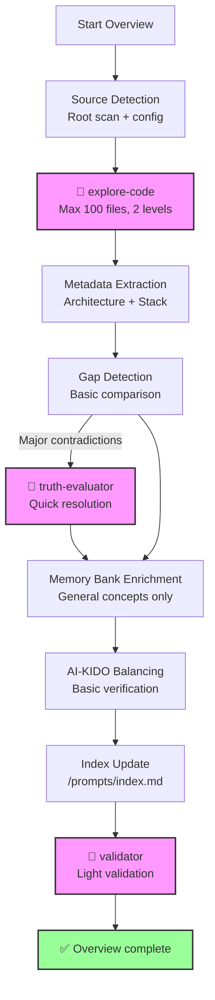

# Generic Analysis Plan - Overview (Depth 1)

> **Version**: 1.0 | **Date**: 2025-12-10 | **Type**: Analysis Plan | **Nature**: Generic | **Depth**: 1 - Overview

## 📋 Overview

**Generic overview** analysis plan for a quick high-level view of the project without going into details. Used as a **fallback** when no specific plan exists, or for first discovery of a project.

**Overview Philosophy** :
- ✅ Fast (~5-10 min)
- ✅ High-level view
- ✅ Identification of main elements
- ❌ No technical details
- ❌ No exhaustive analysis

## 🎯 Selection Criteria

This plan is selected when:
- **Nature** : Any analysis type (1-18)
- **Depth** : 1 - Overview (general high-level view)
- **Context** : First discovery, quick audit, go/no-go decision

**Difference vs other depths** :
- vs Standard (2) : Less technical detail, no dependency analysis
- vs In-depth (3) : No pattern detection, no exhaustive analysis
- vs Expert (4) : No audit, no detailed recommendations

## 🔍 Sources to Analyze

### Priority Sources

**Source Code** (superficial scan) :
- Root directories only: `src/`, `lib/`, `app/`, `components/`
- Main extensions: `*.{js,ts,php,py,java,go,rs,rb}`
- **Exclusions** : node_modules, vendor, dist, build, target, .git

**Documentation** (quick read) :
- `README.md` (mandatory)
- `ARCHITECTURE.md` or `docs/architecture.*` (if exists)
- `CHANGELOG.md` (if exists)

**Configuration** (minimal scan) :
- Package managers: `package.json`, `composer.json`, `requirements.txt`, `go.mod`, `Cargo.toml`, `Gemfile`
- Build: `Makefile`, `docker-compose.yml`
- CI/CD: `.github/workflows/*.yml` (quick scan)

### Filtering Criteria

**Limit the scan** :
- Max 100 analyzed code files
- Directory depth: ≤ 2 levels
- Files > 1000 lines: header scan only (first 50 lines)

## 🤖 AI-KIDO Agents to Mobilize

### Phase 3.1 : Code Scan (Mandatory)

**Agent** : `agent-aikido-explore-code`

**Specialized prompt** :
```
"FORMAT: JSON

Overview analysis (depth 1) of the project:

FOCUS:
- General architecture (main directories)
- Main technical stack (languages, major frameworks)
- Entry points (main files, index, routes)

LIMIT:
- Max 100 files
- Depth 2 levels max
- Essential metadata only (main classes, major imports)

EXCLUSIONS:
- Unit tests
- Detailed configuration files
- External dependencies

Expected output:
- Directory structure (2-level tree)
- Detected technical stack (main languages + frameworks)
- Identified entry points (main files)
- ~30 lines per analyzed file max
- Total budget < 1500 tokens"
```

**Expected result** : Architecture + stack overview in < 2000 tokens

### Phase 3.2 : Parallel Search

**Condition** : **NOT USED** for depth 1 (overview)

agent-aikido-explore-all is **skipped** for overview (too heavy)

### Contradiction Resolution

**Condition** : If major contradictions detected (rare in overview)

**Agent** : `agent-aikido-truth-evaluator`

**Hierarchy strategy** : Code > Config > Docs (simple and fast)

### RACI Classification

**Condition** : **OPTIONAL** - Only if RACI structure already present

**Agent** : `agent-aikido-raci-delegator`

**Mapping** : High-level classification only (general categories)

### Automatic Population

**Condition** : **NOT RECOMMENDED** for overview (premature)

Automatic population is **skipped** at depth 1. Wait for deeper analysis (depth ≥ 2).

### Final Validation (Mandatory)

**Agent** : `agent-aikido-validator`

**Strict rules** :
- Frontmatter verification of created documents
- Size compliance ≤ 500 lines
- Bidirectional links if multiple documents

## 📊 Extraction Strategy

### 1. Automatic Detection (Light)

**Overview algorithm** :
1. List root directories (ls -d src lib app components services)
2. Detect technical stack (package.json, composer.json, etc.)
3. Identify main files (index.*, main.*, app.*, server.*)
4. Scan first 50 lines of each main file
5. Extract major imports only

**Search patterns** (basic) :
```regex
# Entry points
(index|main|app|server)\.(js|ts|php|py|java|go|rs|rb)

# Major imports only
^import\s+.*from\s+['"]([^'"]+)['"]
^require\(['"]([^'"]+)['"]\)
^use\s+([\w\\]+);

# Top-level classes only
^(export\s+)?(default\s+)?class\s+(\w+)
^class\s+(\w+)
```

**Heuristics** :
- Size of `src/` directory or equivalent → Complexity estimation
- Number of config files → Project maturity estimation
- Presence of structured README → Documentation quality

### 2. Metadata Extraction (Minimal)

**Architecture** :
- Directory structure (2-level tree)
- Detected pattern (MVC, microservices, monolith) - basic heuristic

**Technical Stack** :
- Main language (automatic detection)
- Major framework (from package manager)
- Version (from package manager)

**Business Domain** :
- Project name (from README or package.json)
- 1-line description (from README)
- Suggested business domains (from directory/file names)

**Configuration** :
- Detected environments (dev, prod) - basic
- Major external services (from config) - heuristic

### 3. Depth-Specific Analysis

**Depth 1 - Overview** :
- **Level of detail** : High-level view only
- **Collected metrics** : Number of files, codebase size (estimated LOC), detected languages
- **Generated graphs** : 2-level directory tree (simplified Mermaid)
- **Estimated time** : 5-10 minutes

**Overview Metrics** :
```markdown
- **Total files** : ~{COUNT} (estimation)
- **Codebase size** : ~{SIZE_MB} MB
- **Detected languages** : {LANG_LIST}
- **Main framework** : {FRAMEWORK}
- **Estimated complexity** : Low/Medium/High (heuristic)
```

## 🔄 Full Workflow

### Execution Phases (Simplified)



**Phases skipped in overview** :
- ❌ Phase 3.2 : explore-all (too heavy)
- ❌ Phase 5 : Detailed RACI (optional only)
- ❌ Phase 8 : Automatic population (premature)

### Estimated Execution Time

- **Source detection** : ~1 min
- **Code scan (explore-code)** : ~3-5 min
- **Basic enrichment** : ~2-3 min
- **Validation** : ~1 min

**Total** : ~5-10 minutes

## 📤 Output Format

### Output Structure

```markdown
# Overview Analysis Report (Depth 1)

**Date** : {DATE}
**Duration** : {DURATION}
**Analyzed sources** : {SOURCE_COUNT} files (~{PERCENT}% of total)

## 🎯 Configuration

- **Nature** : Generic overview analysis
- **Depth** : 1 - Overview (quick high-level view)
- **Plan used** : `plans/plan-survol.md`

## 📊 Overview

### General Architecture

**Directory structure** (2 levels) :
```
{PROJECT_ROOT}/
├── src/ ({FILE_COUNT} files)
├── lib/ ({FILE_COUNT} files)
├── tests/ (ignored)
└── docs/ ({FILE_COUNT} files)
```

**Detected pattern** : {PATTERN} (MVC / Microservices / Monolith / Other)

### Technical Stack

- **Main language** : {MAIN_LANGUAGE} (~{PERCENT}% of code)
- **Major framework** : {MAIN_FRAMEWORK} {VERSION}
- **Secondary languages** : {SECONDARY_LANGUAGES}

**Major dependencies** (top 5) :
- {DEPENDENCY_1}
- {DEPENDENCY_2}
- {DEPENDENCY_3}
- {DEPENDENCY_4}
- {DEPENDENCY_5}

### Business Domain

- **Project name** : {PROJECT_NAME}
- **Description** : {ONE_LINE_DESCRIPTION}
- **Suggested domains** : {DOMAIN_SUGGESTIONS} (from file/directory names)

### Global Metrics

- **Total files** : ~{COUNT} (estimation)
- **Codebase size** : ~{SIZE_MB} MB
- **Estimated complexity** : {LOW|MEDIUM|HIGH}

## 🔍 Identified Entry Points

- `{ENTRY_FILE_1}` (line {LINE})
- `{ENTRY_FILE_2}` (line {LINE})
- `{ENTRY_FILE_3}` (line {LINE})

## ⚠️  Detected Gaps (Global View)

{MAJOR_GAPS_ONLY}

*(Superficial analysis - Depth 2+ recommended for details)*

## 📝 Initial Recommendations

1. **Documentation** : {README_QUALITY} - {RECOMMENDATION}
2. **Architecture** : {ARCH_CLARITY} - {RECOMMENDATION}
3. **Stack** : {STACK_MATURITY} - {RECOMMENDATION}

**To go further** :
- Depth 2 (Standard) : Detailed architecture analysis
- Depth 3 (In-depth) : Pattern and anti-pattern detection
- Depth 4 (Expert) : Full audit with recommendations

## ✅ AI-KIDO Compliance

- **Documents created** : {COUNT} (general concepts only)
- **Rules respected** : {COMPLIANCE_SCORE}% (basic validation)
- **Quick fixes applied** : {FIXES_COUNT}

---
*Generated by /analyse-project with plan plan-survol.md*
*Duration: {DURATION} | Token budget: ~{TOKENS} (< 2000 target)*
```

## 📋 Overview Limitations

**What the overview does NOT do** :
- ❌ Detailed dependency analysis
- ❌ Detection of complex architectural patterns
- ❌ Analysis of business logic
- ❌ Anti-pattern detection
- ❌ Optimization recommendations
- ❌ Security audit
- ❌ Performance analysis

**For these needs** → Use depth ≥ 2 (Standard, In-depth, or Expert)

## 🎓 Ideal Use Cases

The overview plan is ideal for:
- ✅ First discovery of a new project
- ✅ Quick go/no-go decision
- ✅ Complexity estimation before detailed analysis
- ✅ Quick multi-project audit (compare several projects)
- ✅ Quick update after major changes

## 📚 References

- **Higher depth plan** : `plan-standard.md` (depth 2)
- **Main agent** : `prompts/hard_points/agents/agent-aikido-explore-code.md`
- **Command** : `prompts/hard_points/commands/analyse-project.md`
- **AI-KIDO documentation** : `prompts/hard_points/ai-kido.md`

---
*Overview plan created on 2025-12-10 for /analyse-project*
*Optimized for speed and high-level view*
