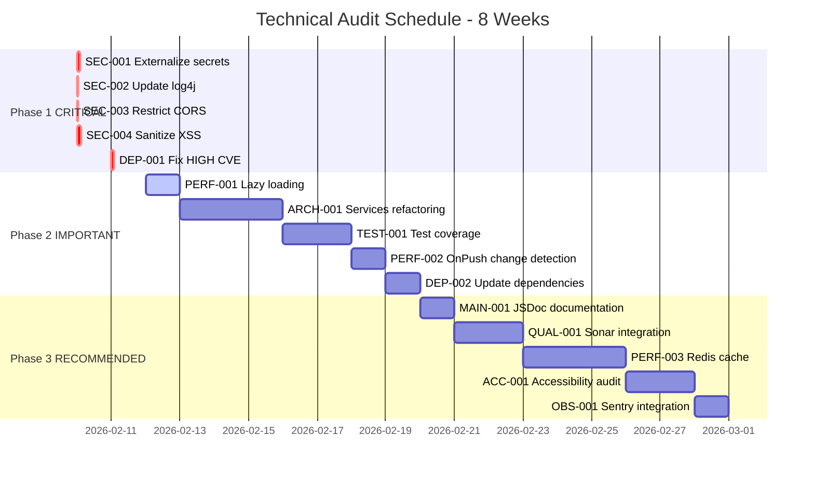

# Technical Analysis Plan - Expert Full Audit

> **Version**: 1.0 | **Date**: 2026-02-10 | **Type**: Analysis Plan | **Nature**: technique/audit-complet | **Depth**: 4 - Expert

## 📋 Overview

Specialized analysis plan for a **Full Technical Audit** at **Expert** depth.

This plan carries out an in-depth, detailed technical audit covering:
- Architecture & code (structure, patterns, best practices)
- Technical stack (versions, obsolescence, configuration)
- Dependencies (libraries, CVE vulnerabilities)
- Security (authentication, authorization, vulnerabilities)
- Tests & quality (coverage, CI/CD, static analysis)
- Performance (lazy loading, cache, bundle size, optimizations)
- Observability (logging, monitoring, error handling)
- Maintainability (documentation, i18n, accessibility)

**Expert philosophy**:
- Exhaustive and systematic analysis of all technical aspects
- Proactive detection of security and performance issues
- Concrete, actionable recommendations with effort estimates
- Action prioritization (CRITICAL/IMPORTANT/RECOMMENDED)
- Phased action plan with estimated ROI
- Detailed reports generated per repository

## 🎯 Selection Criteria

This plan is selected when:
- **Nature**: 6 (General stack) or a need for a full multi-aspect technical audit
- **Depth**: 4 - Expert (full audit ~40-60 min)
- **Context**: 
  - Audit before a major migration
  - Technical assessment of an existing project
  - Security certification preparation
  - Technical debt diagnosis
  - Pre-production audit

**Difference vs other plans**:
- vs Generic plan: Specialized for multi-repository technical audits (frontend + backend)
- vs Depth 3 (In-depth): Adds CVE security, in-depth performance, phased action plan
- vs Specific plans (backend/frontend): Complete overview + cross analysis

## 🔍 Sources to Analyze

### Path Configuration

**⚠️ TO BE CONFIGURED BEFORE EXECUTION**:

```yaml
# Change these paths according to your project
repositories:
  frontend:
    path: "./frontend"  # ← MODIFY HERE
    type: "frontend"
    priority: "high"
  backend:
    path: "./backend"   # ← MODIFY HERE
    type: "backend"
    priority: "high"
  # Add other repositories if needed
  # infrastructure:
  #   path: "./terraform"
  #   type: "infrastructure"
  #   priority: "medium"
```

### Priority Sources

**Frontend source code**:
- Directories: `{frontend_path}/src/`, `{frontend_path}/components/`, `{frontend_path}/views/`
- Extensions: `.ts`, `.tsx`, `.js`, `.jsx`, `.vue`, `.svelte`, `.html`, `.css`, `.scss`
- Exclusions: `node_modules/`, `dist/`, `build/`, `.next/`, `coverage/`

**Backend source code**:
- Directories: `{backend_path}/src/`, `{backend_path}/api/`, `{backend_path}/services/`
- Extensions: `.java`, `.kt`, `.ts`, `.js`, `.py`, `.php`, `.go`, `.rs`, `.cs`
- Exclusions: `node_modules/`, `target/`, `build/`, `vendor/`, `__pycache__/`

**Documentation**:
- Files: `README.md`, `ARCHITECTURE.md`, `CONTRIBUTING.md`, `docs/**/*.md`
- Priority sections: Architecture, Technical stack, Deployment, Security

**Configuration**:
- **Frontend**: `package.json`, `tsconfig.json`, `angular.json`, `webpack.config.js`, `vite.config.js`, `.env.example`
- **Backend**: `pom.xml`, `build.gradle`, `package.json`, `requirements.txt`, `composer.json`, `application.yml`, `.env.example`
- **CI/CD**: `.github/workflows/`, `.gitlab-ci.yml`, `Jenkinsfile`, `docker-compose.yml`, `Dockerfile`
- **Security**: `.npmrc`, `security.md`, `OWASP-*`, CORS/CSP configurations

### Filtering Criteria

**Include**:
- All source files (no depth limit)
- Configuration files (versions, build, deployment)
- Tests (unit, integration, e2e)
- Technical documentation
- CI/CD and deployment scripts

**Exclude**:
- External dependencies (`node_modules/`, `vendor/`, `target/`)
- Generated files (`dist/`, `build/`, `coverage/`)
- Binary assets (images, fonts, except size analysis)
- Logs and temporary files

## 🤖 AI-KIDO Agents to Mobilize

### Phase 3.1: Multi-Repository Code Scan (Required)

**Agent**: `agent-aikido-explore-code`

**Specialized prompt**:
```
"FORMAT: JSON

FULL TECHNICAL analysis at EXPERT depth:

REPOSITORIES:
- Frontend: {frontend_path}
- Backend: {backend_path}

FULL AUDIT FOCUS:

1. ARCHITECTURE & CODE
   - Module/package/component structure
   - Patterns: services, repositories, guards, interceptors, dependency injection
   - SOLID, DRY, separation of concerns
   - Code smells: classes >300 lines, methods >50 lines, cyclomatic complexity >10
   - Duplications, dead code

2. TECHNICAL STACK
   - Framework versions (Java, Spring Boot, Angular, React, Vue, Node)
   - EOL (End of Life) and support
   - TypeScript configuration (strict mode, noImplicitAny)
   - Build configuration (Maven, Gradle, Webpack, Vite, esbuild)

3. DEPENDENCIES
   - package.json, pom.xml, build.gradle, requirements.txt
   - Outdated libraries (>2 major versions behind)
   - CVE vulnerabilities (npm audit, OWASP Dependency-Check)
   - Unused or redundant dependencies

4. SECURITY
   - Authentication/Authorization (JWT, OAuth2, guards, interceptors)
   - Hardcoded secrets (API keys, passwords, tokens)
   - OWASP Top 10 vulnerabilities: XSS, CSRF, SQL/NoSQL injection
   - CORS configuration, security headers (CSP, HSTS, X-Frame-Options)
   - Sensitive data encryption

5. TESTS & QUALITY
   - Unit test coverage (target >80%)
   - Integration tests, e2e tests
   - Test quality (assertions, mocks, fixtures)
   - CI/CD (GitLab CI, GitHub Actions, Jenkins)
   - Static analysis (SonarQube, ESLint, Checkstyle, Prettier)

6. PERFORMANCE
   - Lazy loading: modules, routes, images
   - Cache strategies: frontend (service worker) and backend (Redis, Caffeine)
   - Bundle size and tree shaking
   - N+1 queries, DB query optimization
   - Memory leaks: RxJS subscriptions not unsubscribed, event listeners
   - Change detection strategy (Angular OnPush)
   - Code splitting and dynamic imports

7. OBSERVABILITY
   - Structured logging (JSON vs text)
   - Appropriate log levels (DEBUG, INFO, WARN, ERROR)
   - Monitoring and metrics (Prometheus, Grafana, APM)
   - Centralized error handling (Sentry, Rollbar)
   - Distributed tracing (OpenTelemetry, Jaeger)

8. MAINTAINABILITY
   - Code documentation (JSDoc, JavaDoc, comments)
   - Internationalization i18n (ngx-translate, i18next)
   - Accessibility WCAG 2.1 AA (aria, semantic HTML)
   - Responsive design (mobile-first, breakpoints)

REQUIRED DETAIL:
- Precise location (file:line) for each problem
- Severity: 🔴 CRITICAL / 🟠 IMPORTANT / 🟡 RECOMMENDED
- Business and technical impact
- Concrete recommendation with code example
- Effort estimate (hours/days/weeks)

EXCLUSIONS:
- node_modules/, dist/, build/, target/, vendor/
- Generated, minified files
- Binary assets (except size analysis)

Expected output:
{
  \"synthese_executive\": \"5-line summary\",
  \"repositories_analyses\": {
    \"frontend\": { ... },
    \"backend\": { ... }
  },
  \"points_amelioration\": [
    {
      \"id\": \"SEC-001\",
      \"priorite\": \"CRITICAL\",
      \"categorie\": \"Security\",
      \"titre\": \"Hardcoded secrets\",
      \"description\": \"...\",
      \"localisation\": \"src/config/api.ts:12\",
      \"impact\": \"...\",
      \"recommandation\": \"...\",
      \"effort_estime\": \"2 hours\"
    }
  ],
  \"plan_action_phase\": { ... },
  \"points_positifs\": [ ... ],
  \"diagrammes\": { ... }
}"
```

### Phase 3.2: Parallel Memory Bank + Code Search (Required for Expert)

**Condition**: Depth = 4 (Expert)

**Agent**: `agent-aikido-explore-all`

**Specialized prompt**:
```
"FORMAT: JSON

Parallel Memory Bank + Code search for EXPERT TECHNICAL AUDIT:

KEYWORDS:
- Architecture: layered, hexagonal, microservices, monolith, DDD, CQRS
- Security: authentication, authorization, JWT, OAuth2, OWASP, XSS, CSRF, SQL injection
- Performance: cache, lazy loading, optimization, N+1, bundle size, memory leak
- Testing: unit test, integration test, e2e, coverage, TDD, BDD
- CI/CD: pipeline, deployment, docker, kubernetes, terraform
- Observability: logging, monitoring, tracing, metrics, APM

GAPS SOUGHT:
- Architecture documentation vs actual implementation
- Documented security standards vs applied ones
- Described test processes vs actual coverage
- Documented deployment configuration vs actual scripts

Expected output: Complete view with Memory Bank ↔ Code cross-references"
```

### Contradiction Resolution (If detected)

**Condition**: Contradictions between documentation and code

**Agent**: `agent-aikido-truth-evaluator`

**Hierarchy strategy**:
1. **Source code** = truth (actual implementation)
2. Technical documentation if up to date (< 6 months)
3. Code comments if consistent
4. README if recently validated

### CVE Vulnerability Validation (Required for Expert)

**Condition**: Depth = 4

**External commands**:
```bash
# Frontend
cd {frontend_path}
npm audit --json > audit-frontend.json
# or
yarn audit --json > audit-frontend.json

# Backend (depending on stack)
# Node.js
cd {backend_path}
npm audit --json > audit-backend.json

# Java
mvn org.owasp:dependency-check-maven:check
# or
gradle dependencyCheckAnalyze
```

**Agent**: `agent-aikido-explore-code` (audit results analysis)

### RACI Classification (Optional)

**Condition**: RACI structure enabled in the project

**Agent**: `agent-aikido-raci-delegator`

**Mapping**:
- Architecture → `prompts/{project}/architecte/`
- Security → `prompts/{project}/securite/`
- Performance → `prompts/{project}/performance/`
- Tests → `prompts/{project}/qualite/`

### Automatic Population (Optional)

**Condition**: Gaps detected > 3 AND user accepts

**Agent**: `agent-aikido-bank-populate`

**Strategy**:
- Create technical sheets for the detected stack
- Document identified architectural patterns
- Generate use cases from API endpoints
- Create sheets for detected vulnerabilities

### Final Validation (Required)

**Agent**: `agent-aikido-validator`

**Strict rules**:
- AI-KIDO-compliant markdown report (headers, structure)
- All improvement points documented with priority
- Action plan with estimates
- Precise source code references (file:line)
- No false positives (manual validation recommended)

## 📊 Extraction Strategy

### 1. Automatic Detection

**Expert algorithm**:

```python
def detect_audit_elements(repository_path, repo_type):
    """
    Exhaustive detection for the expert technical audit.
    """
    elements = {
        "architecture": detect_architecture_patterns(repository_path),
        "stack": detect_tech_stack(repository_path, repo_type),
        "dependencies": analyze_dependencies(repository_path, repo_type),
        "security": scan_security_issues(repository_path),
        "tests": analyze_test_coverage(repository_path),
        "performance": detect_performance_issues(repository_path, repo_type),
        "observability": analyze_observability(repository_path),
        "maintainability": assess_maintainability(repository_path)
    }
    return elements

def detect_architecture_patterns(path):
    """Detects architectural patterns."""
    patterns = []
    
    # Layered architecture
    if exists(f"{path}/src/controllers") and exists(f"{path}/src/services"):
        patterns.append("Layered (MVC)")
    
    # Hexagonal/Ports & Adapters
    if exists(f"{path}/src/domain") and exists(f"{path}/src/infrastructure"):
        patterns.append("Hexagonal Architecture")
    
    # Microservices
    if exists(f"{path}/docker-compose.yml") or find_files(path, "*/Dockerfile"):
        patterns.append("Microservices (containerized)")
    
    return patterns

def detect_tech_stack(path, repo_type):
    """Detects versions and EOL."""
    stack = {}
    
    if repo_type == "frontend":
        # Angular
        if exists(f"{path}/angular.json"):
            pkg = load_json(f"{path}/package.json")
            angular_version = pkg.get("dependencies", {}).get("@angular/core", "")
            stack["framework"] = f"Angular {angular_version}"
            stack["eol_check"] = check_angular_eol(angular_version)
        
        # React
        elif "@react" in load_json(f"{path}/package.json").get("dependencies", {}):
            react_version = load_json(f"{path}/package.json")["dependencies"]["react"]
            stack["framework"] = f"React {react_version}"
        
        # TypeScript
        if exists(f"{path}/tsconfig.json"):
            ts_config = load_json(f"{path}/tsconfig.json")
            stack["typescript"] = {
                "version": load_json(f"{path}/package.json")["devDependencies"]["typescript"],
                "strict": ts_config.get("compilerOptions", {}).get("strict", False)
            }
    
    elif repo_type == "backend":
        # Spring Boot (Java)
        if exists(f"{path}/pom.xml"):
            pom = parse_xml(f"{path}/pom.xml")
            spring_version = pom.find(".//spring-boot.version").text
            java_version = pom.find(".//java.version").text
            stack["framework"] = f"Spring Boot {spring_version}"
            stack["language"] = f"Java {java_version}"
            stack["eol_check"] = check_java_eol(java_version)
        
        # Node.js
        elif exists(f"{path}/package.json"):
            pkg = load_json(f"{path}/package.json")
            if "express" in pkg.get("dependencies", {}):
                stack["framework"] = f"Express {pkg['dependencies']['express']}"
            node_version = load_file(f"{path}/.nvmrc") or "unknown"
            stack["runtime"] = f"Node.js {node_version}"
    
    return stack

def analyze_dependencies(path, repo_type):
    """Analyzes dependencies and vulnerabilities."""
    vulnerabilities = []
    outdated = []
    
    if repo_type in ["frontend", "backend"] and exists(f"{path}/package.json"):
        # Run npm audit
        audit_result = run_command(f"cd {path} && npm audit --json")
        audit_data = json.loads(audit_result)
        
        for vuln in audit_data.get("vulnerabilities", []):
            vulnerabilities.append({
                "package": vuln["name"],
                "severity": vuln["severity"],
                "cve": vuln.get("cves", []),
                "recommendation": vuln["fixAvailable"]
            })
        
        # Run npm outdated
        outdated_result = run_command(f"cd {path} && npm outdated --json")
        outdated_data = json.loads(outdated_result)
        
        for pkg, info in outdated_data.items():
            if semver_major_diff(info["current"], info["latest"]) >= 2:
                outdated.append({
                    "package": pkg,
                    "current": info["current"],
                    "latest": info["latest"],
                    "type": "major_outdated"
                })
    
    return {"vulnerabilities": vulnerabilities, "outdated": outdated}

def scan_security_issues(path):
    """Scans for security issues."""
    issues = []
    
    # Hardcoded secrets
    secret_patterns = [
        r"(api[_-]?key|apikey)\s*[:=]\s*['\"]([^'\"]+)['\"]",
        r"(password|passwd|pwd)\s*[:=]\s*['\"]([^'\"]+)['\"]",
        r"(secret|token)\s*[:=]\s*['\"]([^'\"]+)['\"]",
        r"(aws|s3)[_-]?(access|secret)[_-]?key",
        r"['\"]([a-zA-Z0-9]{32,})['\"]"  # Long strings (potential keys)
    ]
    
    for file in find_files(path, "**/*.{ts,js,java,py,php}"):
        content = load_file(file)
        for pattern in secret_patterns:
            matches = re.findall(pattern, content, re.IGNORECASE)
            if matches:
                line_num = get_line_number(content, matches[0])
                issues.append({
                    "type": "hardcoded_secret",
                    "severity": "CRITICAL",
                    "file": file,
                    "line": line_num,
                    "pattern": pattern
                })
    
    # CORS configuration
    cors_files = find_files(path, "**/*{cors,security,config}*.{ts,js,java}")
    for file in cors_files:
        content = load_file(file)
        if "allowedOrigins" in content and '"*"' in content:
            issues.append({
                "type": "insecure_cors",
                "severity": "IMPORTANT",
                "file": file,
                "message": "CORS allows all origins (*)"
            })
    
    return issues

def analyze_test_coverage(path):
    """Analyzes test coverage."""
    coverage = {
        "unit_tests": 0,
        "integration_tests": 0,
        "e2e_tests": 0,
        "coverage_percent": 0
    }
    
    # Count test files
    test_files = find_files(path, "**/*.{spec,test}.{ts,js,java}")
    coverage["unit_tests"] = len([f for f in test_files if "spec" in f or "test" in f])
    
    integration_files = find_files(path, "**/integration/**/*.{ts,js,java}")
    coverage["integration_tests"] = len(integration_files)
    
    e2e_files = find_files(path, "**/e2e/**/*.{ts,js}")
    coverage["e2e_tests"] = len(e2e_files)
    
    # Read the coverage report if it exists
    if exists(f"{path}/coverage/coverage-summary.json"):
        cov_data = load_json(f"{path}/coverage/coverage-summary.json")
        coverage["coverage_percent"] = cov_data["total"]["lines"]["pct"]
    
    return coverage

def detect_performance_issues(path, repo_type):
    """Detects performance issues."""
    issues = []
    
    if repo_type == "frontend":
        # Lazy loading modules (Angular)
        if exists(f"{path}/src/app/app-routing.module.ts"):
            routing = load_file(f"{path}/src/app/app-routing.module.ts")
            if "loadChildren" not in routing:
                issues.append({
                    "type": "no_lazy_loading",
                    "severity": "IMPORTANT",
                    "message": "No lazy loading detected in routing"
                })
        
        # Bundle size
        if exists(f"{path}/dist") or exists(f"{path}/build"):
            bundle_size = get_directory_size(f"{path}/dist" or f"{path}/build")
            if bundle_size > 5_000_000:  # 5MB
                issues.append({
                    "type": "large_bundle",
                    "severity": "IMPORTANT",
                    "size": bundle_size,
                    "message": f"Bundle size {bundle_size / 1e6:.1f}MB > 5MB"
                })
        
        # OnPush change detection
        components = find_files(path, "**/*.component.ts")
        onpush_count = 0
        for comp in components:
            content = load_file(comp)
            if "ChangeDetectionStrategy.OnPush" in content:
                onpush_count += 1
        
        if onpush_count / len(components) < 0.5:
            issues.append({
                "type": "suboptimal_change_detection",
                "severity": "RECOMMENDED",
                "message": f"Only {onpush_count}/{len(components)} components use OnPush"
            })
        
        # Memory leaks (RxJS subscriptions)
        for file in find_files(path, "**/*.component.ts"):
            content = load_file(file)
            if ".subscribe(" in content and "ngOnDestroy" not in content:
                issues.append({
                    "type": "potential_memory_leak",
                    "severity": "IMPORTANT",
                    "file": file,
                    "message": "Subscription without unsubscribe in ngOnDestroy"
                })
    
    elif repo_type == "backend":
        # N+1 queries
        service_files = find_files(path, "**/service/**/*.{java,ts,js}")
        for file in service_files:
            content = load_file(file)
            # N+1 pattern detection (loop with query)
            if re.search(r"for\s*\([^)]+\)\s*\{[^}]*\.(find|query|select)", content):
                issues.append({
                    "type": "potential_n_plus_1",
                    "severity": "IMPORTANT",
                    "file": file,
                    "message": "Potential N+1 query detected"
                })
    
    return issues
```

**Search patterns**:
```regex
# Hardcoded secrets
(api[_-]?key|apikey|password|passwd|secret|token)\s*[:=]\s*['"]([^'"]+)['"]

# Open CORS
allowedOrigins.*['"]?\*['"]?

# SQL Injection
(execute|query)\s*\(\s*['"].*\+.*['"]

# XSS
innerHTML\s*=|dangerouslySetInnerHTML

# RxJS memory leaks
\.subscribe\([^)]*\)(?!.*\.unsubscribe)

# N+1 queries
for\s*\([^)]+\)\s*\{[^}]*\.(find|query|select)

# Unused imports
^import\s+.*from\s+['"]([^'"]+)['"];?\s*$
```

**Heuristics**:
- Class >300 lines → refactoring candidate
- Method >50 lines → extraction candidate
- Cyclomatic complexity >10 → simplify
- Duplication >20 lines → factorize
- Coverage <80% → improve tests
- CVE HIGH/CRITICAL vulnerabilities → fix immediately

### 2. Metadata Extraction

**Architecture**:
- Detected patterns (Layered, Hexagonal, Microservices)
- Number of modules/packages/components
- Hierarchy depth (max depth)
- Inter-module coupling (dependencies)

**Technical Stack**:
- Frameworks and versions (Angular 15, Spring Boot 3.0, etc.)
- Languages and versions (Java 17, TypeScript 5.0, etc.)
- Build tools (Maven 3.8, Webpack 5, Vite 4)
- EOL status for each technology

**Business Domain**:
- Detected API endpoints (REST, GraphQL)
- Business entities (models, DTOs)
- Business rules (validations, constraints)
- Implemented use cases

**Configuration**:
- Environment variables (.env files)
- Build configuration (tsconfig, maven, gradle)
- Deployment configuration (Docker, K8s)
- Security configuration (CORS, headers, auth)

### 3. Depth-Specific Analysis

**Depth 4 - Expert**:
- **Level of detail**: Exhaustive with precise location (file:line)
- **Collected metrics**:
  - Architecture: Number of modules, depth, coupling
  - Stack: Versions, EOL dates, compatibilities
  - Dependencies: Total count, outdated, CVE vulnerabilities with CVSS scores
  - Security: Hardcoded secrets, OWASP vulnerabilities, CORS/CSP configuration
  - Tests: Coverage %, number of tests (unit/integration/e2e)
  - Performance: Bundle size, lazy loading %, detected memory leaks
  - Code: Lines of code, duplication %, average cyclomatic complexity
- **Generated graphs**:
  - Architecture diagram (Mermaid C4)
  - Module dependency graph
  - Component coupling matrix
  - Technology EOL timeline
  - Vulnerability breakdown by severity
- **Estimated time**: 40-60 min (depending on project size)

## 🔄 Complete Workflow

### Execution Phases

```mermaid
graph TB
    START[Start Expert Technical Audit] --> CONFIG[Path Configuration<br/>Frontend + Backend]
    CONFIG --> DETECT[Source Detection<br/>Multi-repository]
    
    DETECT --> SCAN_FE[🤖 explore-code<br/>FRONTEND<br/>Architecture, Stack, Security]
    DETECT --> SCAN_BE[🤖 explore-code<br/>BACKEND<br/>Architecture, Stack, Security]
    
    SCAN_FE --> AUDIT_FE[NPM/Yarn Audit<br/>CVE Vulnerabilities]
    SCAN_BE --> AUDIT_BE[Maven/Gradle/NPM Audit<br/>CVE Vulnerabilities]
    
    AUDIT_FE --> PARALLEL[🤖 explore-all<br/>Parallel Bank+Code search]
    AUDIT_BE --> PARALLEL
    
    PARALLEL --> EXTRACT[Metadata Extraction<br/>Architecture, Stack, Domain]
    EXTRACT --> ANALYZE[Multi-Aspect Analysis<br/>8 audit categories]
    
    ANALYZE --> GAPS[Gap Detection<br/>Doc vs Code]
    
    GAPS -->|Contradictions| TRUTH[🤖 truth-evaluator<br/>Hierarchical resolution]
    TRUTH --> PRIORITIZE
    GAPS --> PRIORITIZE[Issue Prioritization<br/>CRITICAL/IMPORTANT/RECOMMENDED]
    
    PRIORITIZE --> ENRICH[Memory Bank Enrichment<br/>Technical sheets, patterns]
    
    ENRICH --> RACI{RACI enabled?}
    RACI -->|YES| CLASSIFY[🤖 raci-delegator<br/>Classification by domain]
    RACI -->|NO| BALANCE
    
    CLASSIFY --> BALANCE[AI-KIDO Balancing<br/>≤500 lines, 3-7 children]
    BALANCE --> INDEX[Index Update<br/>index.md]
    
    INDEX --> POPULATE{Gaps>3 AND<br/>accepted?}
    POPULATE -->|YES| BANKPOP[🤖 bank-populate<br/>Auto population]
    POPULATE -->|NO| VALIDATE
    
    BANKPOP --> VALIDATE[🤖 validator<br/>Compliance validation]
    VALIDATE --> REPORT[Report Generation<br/>Per repository + Summary]
    
    REPORT --> PLAN[Phased Action Plan<br/>Effort estimates]
    PLAN --> END[✅ Audit complete<br/>Markdown reports generated]
    
    style SCAN_FE fill:#f9f,stroke:#333,stroke-width:2px
    style SCAN_BE fill:#f9f,stroke:#333,stroke-width:2px
    style PARALLEL fill:#f9f,stroke:#333,stroke-width:2px
    style TRUTH fill:#f9f,stroke:#333,stroke-width:2px
    style CLASSIFY fill:#f9f,stroke:#333,stroke-width:2px
    style BANKPOP fill:#f9f,stroke:#333,stroke-width:2px
    style VALIDATE fill:#f9f,stroke:#333,stroke-width:2px
    style END fill:#9f9,stroke:#333,stroke-width:2px
```



### Estimated Execution Time

**Per phase**:
- Configuration and source detection: ~2 min
- Frontend code scan (explore-code): ~8 min
- Backend code scan (explore-code): ~8 min
- CVE dependency audit (npm/maven): ~5 min
- Parallel search (explore-all): ~10 min
- Extraction and analysis: ~8 min
- Contradiction resolution (if needed): ~3 min
- Prioritization and enrichment: ~5 min
- RACI classification (optional): ~3 min
- Automatic population (optional): ~5 min
- Validation and report generation: ~5 min

**Total**: ~50-60 min (may vary depending on project size)

## 📤 Output Format

### Output Structure

The plan generates separate markdown reports in `audits/`:

```
audits/
├── audit-synthese.md              # Global executive summary
├── audit-frontend.md              # Detailed frontend report
├── audit-backend.md               # Detailed backend report
├── plan-action.md                 # Phased action plan
└── vulnerabilites-cve.json        # JSON export of vulnerabilities
```

### Template: audit-synthese.md

```markdown
# Full Technical Audit - Executive Summary

**Date**: {DATE}
**Duration**: {DURATION}
**Repositories analyzed**: {REPO_COUNT}

## 🎯 Configuration

- **Nature**: Full Technical Audit (General stack + Security + Performance)
- **Depth**: 4 - Expert
- **Plan used**: `plans/technique/audit-complet/plan-expert.md`
- **Repositories**:
  - Frontend: `{frontend_path}`
  - Backend: `{backend_path}`

## 📋 EXECUTIVE SUMMARY (5 lines)

{EXECUTIVE_SUMMARY}

Example:
> The audit reveals a globally well-structured codebase with a few critical points to address immediately: 3 HIGH CVE vulnerabilities detected in the backend dependencies, no frontend lazy loading (performance impact), and 5 hardcoded secrets to externalize. Test coverage is decent (78%) but integration tests need improvement. The prioritized action plan estimates 4 weeks of effort to fix the critical points and 8 additional weeks for the recommended improvements.

## 📊 IMPROVEMENT POINTS TABLE

### 🔴 CRITICAL - Handle immediately (Security, EOL, CVE)

| ID | Category | Title | Location | Impact | Effort |
|----|----------|-------|----------|--------|--------|
| SEC-001 | Security | Hardcoded API secrets | frontend/src/config/api.ts:12 | **CRITICAL** - Credentials exposure | 2h |
| SEC-002 | Security | CVE-2023-XXXX vulnerability (HIGH) | backend/pom.xml (log4j 2.14) | **CRITICAL** - Possible RCE | 1h |
| SEC-003 | Security | CORS open to all origins | backend/src/config/CorsConfig.java:18 | **CRITICAL** - XSS attacks | 30min |

**Total CRITICAL: {CRITICAL_COUNT} points - Estimated effort: {CRITICAL_EFFORT}**

### 🟠 IMPORTANT - Major technical debt (plan quickly)

| ID | Category | Title | Location | Impact | Effort |
|----|----------|-------|----------|--------|--------|
| PERF-001 | Performance | No module lazy loading | frontend/src/app/app-routing.module.ts | **IMPORTANT** - High initial load time | 1d |
| ARCH-001 | Architecture | Services too tightly coupled | backend/src/services/*.java | **IMPORTANT** - Reduced maintainability | 3d |
| TEST-001 | Tests | Integration test coverage <50% | backend/src/test/integration/ | **IMPORTANT** - Regression risk | 2d |

**Total IMPORTANT: {IMPORTANT_COUNT} points - Estimated effort: {IMPORTANT_EFFORT}**

### 🟡 RECOMMENDED - Continuous improvements (backlog)

| ID | Category | Title | Location | Impact | Effort |
|----|----------|-------|----------|--------|--------|
| MAIN-001 | Maintainability | Incomplete JSDoc documentation | frontend/src/services/*.ts | RECOMMENDED - Maintainability | 1d |
| PERF-002 | Performance | OnPush change detection on 40% of components | frontend/src/components/*.component.ts | RECOMMENDED - Perf optimization | 2d |
| QUAL-001 | Quality | Outdated dependencies (2+ versions behind) | package.json, pom.xml | RECOMMENDED - Future security | 1d |

**Total RECOMMENDED: {RECOMMENDED_COUNT} points - Estimated effort: {RECOMMENDED_EFFORT}**

## 📈 GLOBAL STATISTICS

| Metric | Value | Status | Target |
|--------|-------|--------|--------|
| **Test coverage** | {COVERAGE}% | {STATUS_ICON} | ≥80% |
| **CVE vulnerabilities** | {CVE_COUNT} ({HIGH_COUNT} HIGH, {MEDIUM_COUNT} MEDIUM) | {STATUS_ICON} | 0 HIGH |
| **Outdated dependencies** | {OUTDATED_COUNT} | {STATUS_ICON} | <5 |
| **Cyclomatic complexity** | {CYCLOMATIC_AVG} | {STATUS_ICON} | <10 |
| **Code duplication** | {DUPLICATION}% | {STATUS_ICON} | <5% |
| **Bundle size** | {BUNDLE_SIZE} MB | {STATUS_ICON} | <3 MB |

## 🎯 IMMEDIATE PRIORITIES (Week 1)

1. **SEC-001**: Externalize secrets to environment variables (2h)
2. **SEC-002**: Update log4j to 2.20+ (1h)
3. **SEC-003**: Restrict CORS to authorized domains (30min)

## 📋 DETAILED ACTION PLAN

See: [`plan-action.md`](./plan-action.md)

## ✅ POSITIVE POINTS IDENTIFIED

- ✅ Well-structured backend architecture (Layered + DDD)
- ✅ TypeScript strict mode enabled (frontend)
- ✅ Working CI/CD with automated tests
- ✅ Structured JSON logging (backend)
- ✅ Docker used for deployment
- ✅ Complete README documentation

## 🔗 DETAILED REPORTS

- **Frontend**: [`audit-frontend.md`](./audit-frontend.md)
- **Backend**: [`audit-backend.md`](./audit-backend.md)
- **Phased action plan**: [`plan-action.md`](./plan-action.md)
- **CVE export**: [`vulnerabilites-cve.json`](./vulnerabilites-cve.json)

---
*Generated by /analyse-project with plan `technique/audit-complet/plan-expert.md` on {DATE}*
```

### Template: audit-frontend.md

```markdown
# Frontend Technical Audit - Detailed Report

**Repository**: `{frontend_path}`
**Date**: {DATE}
**Framework**: {FRAMEWORK} {VERSION}

## 🏗️ 1. ARCHITECTURE & CODE

### Detected Structure

- **Pattern**: {PATTERN} (e.g. Layered MVC, Feature-based)
- **Modules**: {MODULE_COUNT}
- **Components**: {COMPONENT_COUNT}
- **Services**: {SERVICE_COUNT}
- **Max depth**: {MAX_DEPTH} levels

### Detected Code Smells

#### CS-001: Class too large
- **File**: `src/services/data.service.ts`
- **Lines**: 450 (recommended limit: 300)
- **Recommendation**: Extract into several specialized services
- **Effort**: 4h

#### CS-002: High cyclomatic complexity
- **File**: `src/components/form/form.component.ts`
- **Method**: `validateForm()`
- **Complexity**: 15 (recommended limit: 10)
- **Recommendation**: Extract validations into separate functions
- **Effort**: 2h

### Best Practices Compliance

| Practice | Status | Detail |
|----------|--------|--------|
| **SOLID** | 🟡 Partial | SRP violated in {COUNT} services |
| **DRY** | ✅ Good | Duplication <5% |
| **Separation of concerns** | ✅ Good | Components, services, models separated |
| **Dependency Injection** | ✅ Excellent | Used systematically |

## 📦 2. TECHNICAL STACK

### Frameworks and Versions

| Technology | Current Version | Stable Version | EOL Date | Status |
|------------|-----------------|----------------|----------|--------|
| **{FRAMEWORK}** | {CURRENT_VERSION} | {STABLE_VERSION} | {EOL_DATE} | {STATUS_ICON} |
| **TypeScript** | {TS_VERSION} | {TS_STABLE} | N/A | {STATUS_ICON} |
| **Node.js** | {NODE_VERSION} | {NODE_LTS} | {NODE_EOL} | {STATUS_ICON} |

### TypeScript Configuration

```json
{
  "compilerOptions": {
    "strict": {STRICT_MODE},              // ⚠️ Recommended: true
    "noImplicitAny": {NO_IMPLICIT_ANY},   // ⚠️ Recommended: true
    "strictNullChecks": {STRICT_NULL},    // ⚠️ Recommended: true
    "target": "{TARGET}",
    "module": "{MODULE}"
  }
}
```

**Detected issues**:
- {ISSUE_1}
- {ISSUE_2}

### Build Configuration

- **Tool**: {BUILD_TOOL} (Webpack, Vite, esbuild, etc.)
- **Version**: {BUILD_VERSION}
- **Enabled optimizations**:
  - Tree shaking: {TREE_SHAKING}
  - Minification: {MINIFICATION}
  - Code splitting: {CODE_SPLITTING}

## 🔗 3. DEPENDENCIES

### CVE Vulnerabilities

```json
{
  "total": {CVE_TOTAL},
  "critical": {CVE_CRITICAL},
  "high": {CVE_HIGH},
  "medium": {CVE_MEDIUM},
  "low": {CVE_LOW}
}
```

#### CVE-001: {PACKAGE_NAME} - {CVE_ID}
- **Severity**: **HIGH**
- **CVSS score**: {CVSS_SCORE}
- **Description**: {CVE_DESCRIPTION}
- **Affected version**: {AFFECTED_VERSION}
- **Fix available**: {FIX_VERSION}
- **Action**: `npm update {PACKAGE_NAME}@{FIX_VERSION}`

### Outdated Dependencies

| Package | Current Version | Latest Version | Lag | Action |
|---------|-----------------|----------------|-----|--------|
| {PACKAGE_1} | {CURRENT_1} | {LATEST_1} | {DIFF_1} major versions | Update |
| {PACKAGE_2} | {CURRENT_2} | {LATEST_2} | {DIFF_2} major versions | Update |

### Unused Dependencies

- `{UNUSED_1}`: No usage detected in the code
- `{UNUSED_2}`: No usage detected in the code

**Action**: Clean up with `npm prune` or remove manually

## 🔒 4. SECURITY

### Hardcoded Secrets

#### SEC-FE-001: Hardcoded API Key
- **File**: `src/config/api.ts:12`
- **Code**:
```typescript
export const API_CONFIG = {
  apiKey: "sk_live_XXXXXXXXXX",  // ⚠️ EXPOSED SECRET
  endpoint: "https://api.example.com"
};
```
- **Impact**: **CRITICAL** - Credentials exposed in the source code
- **Recommendation**: Use environment variables
```typescript
export const API_CONFIG = {
  apiKey: process.env.VITE_API_KEY || "",
  endpoint: process.env.VITE_API_ENDPOINT || ""
};
```
- **Effort**: 30min

### OWASP Vulnerabilities

#### XSS (Cross-Site Scripting)
- **File**: `src/components/display/display.component.ts:45`
- **Code**:
```typescript
this.element.nativeElement.innerHTML = userInput;  // ⚠️ XSS
```
- **Impact**: **IMPORTANT** - Malicious code injection possible
- **Recommendation**: Use sanitization
```typescript
this.element.nativeElement.textContent = userInput;  // Safe
// or
this.sanitizedContent = this.sanitizer.sanitize(SecurityContext.HTML, userInput);
```

### Security Configuration

| Item | Status | Recommendation |
|------|--------|----------------|
| **CSP Headers** | {CSP_STATUS} | Implement Content-Security-Policy |
| **HTTPS Only** | {HTTPS_STATUS} | Force HTTPS in production |
| **Secure Cookies** | {COOKIE_STATUS} | Add Secure, HttpOnly, SameSite flags |

## ✅ 5. TESTS & QUALITY

### Test Coverage

| Type | Count | Coverage | Target | Status |
|------|-------|----------|--------|--------|
| **Unit tests** | {UNIT_COUNT} | {UNIT_COV}% | ≥80% | {UNIT_STATUS} |
| **Integration tests** | {INTEGRATION_COUNT} | {INTEGRATION_COV}% | ≥70% | {INTEGRATION_STATUS} |
| **E2E tests** | {E2E_COUNT} | {E2E_COV}% | ≥60% | {E2E_STATUS} |

**Recommendation**: Increase integration test coverage (currently {INTEGRATION_COV}%, target 70%)

### Test Quality

**Positive points**:
- ✅ Well-organized tests (*.spec.ts next to the files)
- ✅ Use of mocks and fixtures

**To improve**:
- ⚠️ {IMPROVEMENT_1}
- ⚠️ {IMPROVEMENT_2}

### CI/CD

- **Platform**: {CI_PLATFORM} (GitHub Actions, GitLab CI, etc.)
- **Pipeline**:
  - ✅ Automatic build
  - ✅ Automatic tests
  - {LINTING_STATUS} Linting (ESLint)
  - {SONAR_STATUS} Sonar analysis

### Static Analysis

**ESLint**:
- Errors: {ESLINT_ERRORS}
- Warnings: {ESLINT_WARNINGS}

**Prettier**:
- Formatting: {PRETTIER_STATUS}

## ⚡ 6. PERFORMANCE

### Lazy Loading

**Modules**:
- Lazy loaded: {LAZY_COUNT} / {TOTAL_MODULES}
- Ratio: {LAZY_RATIO}%

**Recommendation**: Implement lazy loading for {MISSING_LAZY_MODULES}

```typescript
// Example of a route to lazy load
{
  path: 'admin',
  loadChildren: () => import('./admin/admin.module').then(m => m.AdminModule)
}
```

### Bundle Size

| File | Size | Status | Recommendation |
|------|------|--------|----------------|
| **main.js** | {MAIN_SIZE} MB | {MAIN_STATUS} | {MAIN_RECOMMENDATION} |
| **vendor.js** | {VENDOR_SIZE} MB | {VENDOR_STATUS} | {VENDOR_RECOMMENDATION} |
| **polyfills.js** | {POLYFILLS_SIZE} MB | {POLYFILLS_STATUS} | {POLYFILLS_RECOMMENDATION} |

**Total**: {TOTAL_BUNDLE_SIZE} MB (target <3 MB)

### Cache Strategy

- **Service Worker**: {SW_STATUS}
- **HTTP Caching**: {HTTP_CACHE_STATUS}
- **State Management**: {STATE_MGMT} ({NGRX_AKITA_ETC})

### Memory Leaks

#### PERF-FE-001: Subscription not unsubscribed
- **File**: `src/components/user/user.component.ts:32`
- **Code**:
```typescript
ngOnInit() {
  this.userService.getUser().subscribe(user => {
    this.user = user;
  }); // ⚠️ Memory leak
}
```
- **Recommendation**:
```typescript
private destroy$ = new Subject<void>();

ngOnInit() {
  this.userService.getUser()
    .pipe(takeUntil(this.destroy$))
    .subscribe(user => this.user = user);
}

ngOnDestroy() {
  this.destroy$.next();
  this.destroy$.complete();
}
```

### Change Detection

- **Components with OnPush**: {ONPUSH_COUNT} / {COMPONENT_COUNT}
- **Ratio**: {ONPUSH_RATIO}%

**Recommendation**: Increase OnPush usage to optimize performance

## 📊 7. OBSERVABILITY

### Logging

- **Level**: {LOG_LEVEL}
- **Format**: {LOG_FORMAT} (structured JSON recommended)
- **Centralized service**: {LOG_SERVICE_STATUS}

### Monitoring

- **APM**: {APM_STATUS} (e.g. Datadog, New Relic)
- **Error Tracking**: {ERROR_TRACKING} (e.g. Sentry, Rollbar)

### Error Handling

```typescript
// Example of a global error handler
@Injectable()
export class GlobalErrorHandler implements ErrorHandler {
  handleError(error: Error) {
    // ⚠️ Improve: send to a centralized service
    console.error(error);
  }
}
```

## 🛠️ 8. MAINTAINABILITY

### Code Documentation

- **JSDoc**: {JSDOC_COVERAGE}% of functions/classes
- **Comments**: {COMMENT_STATUS}

**Recommendation**: Increase documentation for public functions

### Internationalization (i18n)

- **Library**: {I18N_LIB} (ngx-translate, i18next, etc.)
- **Supported languages**: {LANGUAGES}
- **Coverage**: {I18N_COVERAGE}%

### Accessibility (WCAG 2.1)

| Criterion | Status | Issues |
|-----------|--------|--------|
| **ARIA labels** | {ARIA_STATUS} | {ARIA_ISSUES} |
| **Semantic HTML** | {SEMANTIC_STATUS} | {SEMANTIC_ISSUES} |
| **Keyboard navigation** | {KEYBOARD_STATUS} | {KEYBOARD_ISSUES} |
| **Contrast ratio** | {CONTRAST_STATUS} | {CONTRAST_ISSUES} |

### Responsive Design

- **Mobile-first**: {MOBILE_FIRST_STATUS}
- **Breakpoints**: {BREAKPOINTS}
- **Media queries**: {MEDIA_QUERIES_COUNT}

---

**Frontend report generated on {DATE}**
*See global summary: [`audit-synthese.md`](./audit-synthese.md)*
```

### Template: plan-action.md

```markdown
# Phased Action Plan - Technical Audit

**Date**: {DATE}
**Total estimated effort**: {TOTAL_EFFORT}
**Estimated duration**: {TOTAL_DURATION}

## 🎯 Objectives

Fix the identified critical points and improve overall code quality according to the prioritization:
1. **Phase 1** (Week 1): CRITICAL - Security and EOL
2. **Phase 2** (Weeks 2-3): IMPORTANT - Major technical debt
3. **Phase 3** (Weeks 4-8): RECOMMENDED - Continuous improvements

## 📋 PHASE 1: CRITICAL (Week 1)

**Goal**: Fix all critical vulnerabilities and security issues

### 🔴 Critical Tasks

| ID | Task | Repository | Effort | Owner | Status |
|----|------|------------|--------|-------|--------|
| SEC-001 | Externalize hardcoded secrets to .env | Frontend | 2h | Frontend Dev | ⏳ To do |
| SEC-002 | Update log4j 2.14 → 2.20+ (CVE-2023-XXXX) | Backend | 1h | Backend Dev | ⏳ To do |
| SEC-003 | Restrict CORS to authorized domains | Backend | 30min | Backend Dev | ⏳ To do |
| SEC-004 | Sanitize user inputs (XSS) | Frontend | 3h | Frontend Dev | ⏳ To do |
| DEP-001 | Fix 2 HIGH CVE vulnerabilities | Backend | 2h | Backend Dev | ⏳ To do |

**Total Phase 1 effort**: 8.5h (~1 day)

### Phase 1 Details

#### SEC-001: Externalize hardcoded secrets

**Impacted files**:
- `frontend/src/config/api.ts`
- `frontend/src/services/auth.service.ts`

**Actions**:
1. Create a `.env.example` file with template variables
2. Create `.env.local` (ignored by git) with real values
3. Replace hardcoded secrets with `process.env.VITE_*`
4. Document in README.md

**Validation**:
- ✅ No secret in git history
- ✅ Application starts with .env
- ✅ Variables documented

#### SEC-002: Update log4j

**Actions**:
1. Edit `pom.xml`: `<log4j.version>2.20.0</log4j.version>`
2. Run `mvn clean install`
3. Test the application (logs working)
4. Check the audit: `mvn org.owasp:dependency-check-maven:check`

**Validation**:
- ✅ No HIGH/CRITICAL CVE vulnerability
- ✅ Tests pass
- ✅ Application works

## 📋 PHASE 2: IMPORTANT (Weeks 2-3)

**Goal**: Reduce major technical debt affecting maintainability and performance

### 🟠 Important Tasks

| ID | Task | Repository | Effort | Owner | Status |
|----|------|------------|--------|-------|--------|
| PERF-001 | Implement module lazy loading | Frontend | 1d | Frontend Dev | ⏳ To do |
| ARCH-001 | Refactor coupled services | Backend | 3d | Backend Dev | ⏳ To do |
| TEST-001 | Increase integration test coverage | Backend | 2d | QA + Dev | ⏳ To do |
| PERF-002 | Optimize OnPush change detection | Frontend | 1d | Frontend Dev | ⏳ To do |
| DEP-002 | Update outdated dependencies | Frontend + Backend | 1d | Full Dev | ⏳ To do |

**Total Phase 2 effort**: 8d (~2 weeks)

### Phase 2 Details

#### PERF-001: Module lazy loading

**Modules to lazy load**:
- AdminModule (used by <10% of users)
- ReportsModule (heavy dependencies)
- SettingsModule

**Actions**:
1. Edit `app-routing.module.ts`
2. Replace direct `import` with `loadChildren`
3. Measure bundle size impact (before/after)

**Expected benefit**:
- 📉 Initial bundle: -1.2 MB (~40% reduction)
- ⚡ Initial load time: -2s (~30% improvement)

#### ARCH-001: Refactor coupled services

**Impacted services**:
- `UserService` (450 lines, 12 dependencies)
- `DataService` (380 lines, 8 dependencies)

**Actions**:
1. Extract into specialized services (e.g. UserAuthService, UserProfileService)
2. Apply the SRP principle (Single Responsibility)
3. Add unit tests for each new service

**Expected benefit**:
- 🧪 Improved testability
- 🔧 Simplified maintainability
- 📉 Reduced complexity

## 📋 PHASE 3: RECOMMENDED (Weeks 4-8)

**Goal**: Continuous improvements for long-term quality

### 🟡 Recommended Tasks

| ID | Task | Repository | Effort | Owner | Status |
|----|------|------------|--------|-------|--------|
| MAIN-001 | Complete JSDoc documentation | Frontend | 1d | Frontend Dev | ⏳ To do |
| QUAL-001 | Implement Sonar analysis | CI/CD | 2d | DevOps | ⏳ To do |
| PERF-003 | Implement Redis cache | Backend | 3d | Backend Dev | ⏳ To do |
| ACC-001 | WCAG 2.1 AA accessibility audit | Frontend | 2d | Frontend Dev | ⏳ To do |
| OBS-001 | Integrate Sentry error tracking | Frontend + Backend | 1d | Full Dev | ⏳ To do |

**Total Phase 3 effort**: 9d (~2 weeks)

## 📊 Effort Summary

| Phase | Duration | Effort | Priority | ROI |
|-------|----------|--------|----------|-----|
| **Phase 1** | Week 1 | 1d | 🔴 CRITICAL | Very high |
| **Phase 2** | Weeks 2-3 | 2 weeks | 🟠 IMPORTANT | High |
| **Phase 3** | Weeks 4-8 | 2 weeks | 🟡 RECOMMENDED | Medium |

**Total**: 4-8 weeks (depending on resources)

## 🎯 Success KPIs

| Indicator | Before | Target | Measure |
|-----------|--------|--------|---------|
| **HIGH CVE vulnerabilities** | {CVE_HIGH_BEFORE} | 0 | npm audit, OWASP |
| **Test coverage** | {COVERAGE_BEFORE}% | 85% | Coverage report |
| **Bundle size** | {BUNDLE_BEFORE} MB | <3 MB | Webpack bundle analyzer |
| **Load time** | {LOAD_BEFORE}s | <2s | Lighthouse |
| **Technical debt** | {DEBT_BEFORE}h | -{DEBT_TARGET}h | SonarQube |

## 📅 Recommended Schedule



## ✅ Validation Checklist

### Phase 1
- [ ] All HIGH/CRITICAL CVE vulnerabilities fixed
- [ ] No hardcoded secret in the code
- [ ] CORS configured with a domain whitelist
- [ ] User inputs sanitized (XSS protection)
- [ ] Security tests pass

### Phase 2
- [ ] Lazy loading implemented (bundle size reduced >30%)
- [ ] Services refactored (complexity reduced)
- [ ] Test coverage ≥80%
- [ ] OnPush used on main components
- [ ] Dependencies up to date (<1 major version behind)

### Phase 3
- [ ] JSDoc documentation ≥80% coverage
- [ ] Sonar analysis integrated in CI/CD
- [ ] Cache implemented (API response time reduction)
- [ ] WCAG 2.1 AA accessibility validated
- [ ] Error tracking operational (Sentry)

---

**Action plan generated on {DATE}**
*See summary: [`audit-synthese.md`](./audit-synthese.md)*
```

## 🎓 Ideal Use Cases

The **Full Technical Audit - Expert** plan is ideal for:

1. **Pre-production audit**: Full validation before a major production release
2. **Technical due diligence**: Assessment of an existing project (acquisition, takeover)
3. **Framework migration**: Audit before a major migration (Angular 12→17, Java 11→17)
4. **Security certification**: Security audit preparation (ISO 27001, SOC 2)
5. **Technical debt diagnosis**: Exhaustive assessment of the code state
6. **New team onboarding**: In-depth understanding of the project
7. **Refactoring roadmap**: Basis for planning multi-month refactoring
8. **Performance audit**: Detection of bottlenecks and optimizations

**Ideal context**:
- Existing project (>6 months of development)
- Multi-repository (frontend + backend minimum)
- Need for a complete, actionable diagnosis
- Available time budget (~1 day of analysis)
- Team ready to implement fixes

## 📚 References

- **Lower depth plan**: `plan-approfondi.md` (depth 3, ~30 min)
- **Specialized plans**:
  - `technique/backend/plan-expert.md` (backend focus only)
  - `technique/frontend/plan-expert.md` (frontend focus only)
  - `technique/securite/plan-expert.md` (in-depth security focus)
- **Generic plan**: `plan-expert.md` (fallback)
- **Agents**: `agent-aikido-explore-code`, `agent-aikido-explore-all`, `agent-aikido-truth-evaluator`, `agent-aikido-validator`
- **Command**: `prompts/hard_points/commands/analyse-project.md`
- **AI-KIDO documentation**: `prompts/hard_points/ai-kido.md`

---
*Full Technical Audit plan created on 2026-02-10 for /analyse-project*
*Generated for in-depth multi-repository audit (frontend + backend)*
*Usage: /analyse-project with nature=6 (General stack), depth=4 (Expert)*
