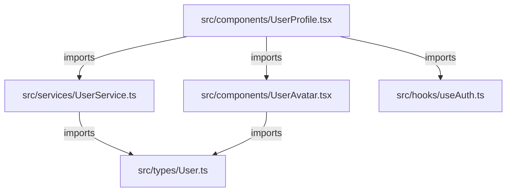

# JavaScript/TypeScript Code Search Plan

> **Version**: 1.0 | **Date**: 2025-12-09 | **Type**: Search Plan | **Language**: JavaScript + TypeScript

## 📋 Overview

Specialized search plan for JavaScript and TypeScript projects. Covers ES6+, CommonJS, ES Modules, Node.js, React, Vue, Angular, and other modern frameworks.

**Use cases**: Frontend/backend JavaScript projects, TypeScript, modern frameworks (React, Vue, Angular, Svelte, Next.js, Nuxt).

## 🔍 File Patterns

### JavaScript/TypeScript Extensions
```text
*.js       # Standard JavaScript
*.mjs      # ES Module
*.cjs      # CommonJS
*.jsx      # React JSX
*.ts       # TypeScript
*.tsx      # TypeScript JSX
*.d.ts     # TypeScript declarations
*.vue      # Vue SFC
*.svelte   # Svelte components
```

### Configuration & Metadata
```text
package.json       # NPM/Yarn dependencies
tsconfig.json      # TypeScript config
.eslintrc.*        # ESLint config
.babelrc           # Babel config
webpack.config.*   # Webpack config
vite.config.*      # Vite config
next.config.*      # Next.js config
nuxt.config.*      # Nuxt config
```

### JS-specific Exclusions
```text
node_modules/      # NPM dependencies
dist/              # Build output
build/             # Build output
.next/             # Next.js build
.nuxt/             # Nuxt.js build
out/               # Output directory
coverage/          # Test coverage
*.min.js           # Minified files
*.bundle.js        # Bundled files
```

## 🎯 Search Method

**Type**: `naive` + **Module-aware** (ES Modules + CommonJS)

### Phase 1: Module System Detection
The Node.js engine operates only within the selected scope, honors `.gitignore`
and the JavaScript exclusions, and reports I/O/configuration failures instead
of treating them as “no matches”. Relative-import candidates are checked
against the approved physical root before being returned.
```javascript
import { detectModuleSystem } from '../../search-engine.mjs';

const moduleSystem = detectModuleSystem({ root: approvedRoot, paths: selectedPaths });
```

### Phase 2: TypeScript Detection
```javascript
import { hasTypeScript } from '../../search-engine.mjs';

const usesTypeScript = hasTypeScript({ root: approvedRoot, paths: selectedPaths });
```

## 📦 Search Patterns

### 1. Imports/Exports (ES Modules)
```regex
# Named imports
^import\s+\{([^}]+)\}\s+from\s+['"]([^'"]+)['"]

# Default import
^import\s+(\w+)\s+from\s+['"]([^'"]+)['"]

# Namespace import
^import\s+\*\s+as\s+(\w+)\s+from\s+['"]([^'"]+)['"]

# Side-effect import
^import\s+['"]([^'"]+)['"]

# Dynamic import
import\(['"]([^'"]+)['"]\)

# Re-exports
^export\s+\{[^}]+\}\s+from\s+['"]([^'"]+)['"]
^export\s+\*\s+from\s+['"]([^'"]+)['"]
```

### 2. Require/Module.exports (CommonJS)
```regex
# Require
^const\s+.*=\s+require\(['"]([^'"]+)['"]\)
^const\s+\{([^}]+)\}\s+=\s+require\(['"]([^'"]+)['"]\)

# Module exports
^module\.exports\s*=
^exports\.\w+\s*=
```

### 3. Classes & Functions
```regex
# Class declaration
^(export\s+)?(default\s+)?class\s+(\w+)(\s+extends\s+(\w+))?

# Function declaration
^(export\s+)?(async\s+)?function\s+(\w+)\s*\(

# Arrow function (const/let/var)
^(export\s+)?(const|let|var)\s+(\w+)\s*=\s*(async\s+)?\(.*\)\s*=>

# Method (in class or object)
^\s+(async\s+)?(\w+)\s*\([^)]*\)\s*\{
```

### 4. React Components
```regex
# Function component
^(export\s+)?(default\s+)?function\s+(\w+)\s*\([^)]*\)\s*\{[^}]*return\s*\(?\s*<

# Arrow function component
^(export\s+)?(const|let)\s+(\w+)\s*=\s*\([^)]*\)\s*=>\s*\{?[^}]*return\s*\(?\s*<

# Class component
^(export\s+)?class\s+(\w+)\s+extends\s+(React\.)?Component
```

### 5. TypeScript Types/Interfaces
```regex
# Interface declaration
^(export\s+)?interface\s+(\w+)(\s+extends\s+([\w,\s]+))?

# Type alias
^(export\s+)?type\s+(\w+)\s*=

# Enum
^(export\s+)?enum\s+(\w+)\s*\{

# Namespace
^(export\s+)?namespace\s+(\w+)\s*\{
```

### 6. Decorators (TypeScript/Experimental)
```regex
# Class decorator
^@(\w+)(\([^)]*\))?\s*$

# Property decorator
^\s+@(\w+)(\([^)]*\))?\s*$

# Method decorator
^\s+@(\w+)(\([^)]*\))?\s*$
```

## 🔄 Extension Strategy

### 1. ES Module Resolution
This is a candidate search, not full Node or TypeScript resolution: package
`exports`, inherited TypeScript configuration and conditional resolution
require the respective ecosystem resolver. Package entries must remain inside
their package directory.
```javascript
import { query as configQuery } from '../../config-query.mjs';

const candidates = configQuery('esm-resolve', currentFile, importPath, approvedRoot);
```

### 2. Framework Detection
```javascript
import { detectJsFramework } from '../../search-engine.mjs';

const framework = detectJsFramework({ root: approvedRoot });
```

## 📤 Output Format

### JavaScript/TypeScript specific structure

```markdown
# JavaScript/TypeScript Code Index

**Query**: [keyword]
**Module System**: [esm|commonjs|mixed]
**TypeScript**: [yes|no]
**Framework**: [React|Vue|Angular|None]
**Files Indexed**: X

## 📄 `src/components/UserProfile.tsx`

**Classes** (1):
  - `UserProfile` (lines 10-85): 75 lines
    - Extends: `React.Component<UserProfileProps, UserProfileState>`
    - Methods: 5

**Interfaces** (2):
  - `UserProfileProps` (lines 3-7): 4 lines
    - Properties: `userId: string`, `onUpdate: (user: User) => void`
  - `UserProfileState` (lines 8-9): 1 line
    - Properties: `loading: boolean`

**Types** (0):

**Functions** (3):
  - `fetchUserData(userId: string): Promise<User>` (line 45)
  - `handleUpdate(user: User): void` (line 67)
  - `validateUserData(data: unknown): boolean` (line 78)

**Dependencies** (8):
  - `react` (line 1): `React, { Component }`
  - `./types/User` (line 2): `User, UserRole`
  - `../services/UserService` (line 3): `UserService`
  - `./UserAvatar` (line 4): `UserAvatar` (component)
  - `../hooks/useAuth` (line 5): `useAuth` (hook)

**Exports**:
  - Default: `UserProfile` (class component)
  - Named: `UserProfileProps`, `UserProfileState` (types)

---

## 📄 `src/services/UserService.ts`

**Classes** (1):
  - `UserService` (lines 10-120): 110 lines
    - Methods: 8 (all public)

**Interfaces** (1):
  - `IUserService` (lines 5-8): 3 lines
    - Methods: `getUser()`, `updateUser()`, `deleteUser()`

**Functions** (0):

**Dependencies** (4):
  - `axios` (line 1): `axios, AxiosInstance`
  - `./types` (line 2): `User, UpdateUserPayload`
  - `../config` (line 3): `API_BASE_URL`

**Public Methods** (8):
  - `constructor(apiUrl: string)` (line 15)
  - `getUser(id: string): Promise<User>` (line 25)
  - `updateUser(id: string, data: UpdateUserPayload): Promise<User>` (line 45)
  - `deleteUser(id: string): Promise<void>` (line 67)
  - `listUsers(filters?: UserFilters): Promise<User[]>` (line 89)
  - `searchUsers(query: string): Promise<User[]>` (line 102)

---

## 🔗 Relationships Graph



**Summary**: 5 relationships detected

## 📊 Statistics

- **Total Files Scanned**: X
- **Relevant Matches**: Y
- **Classes**: A
- **Interfaces**: B
- **Types**: C
- **Functions**: D
- **Dependencies**: E

---
*Generated by agent-aikido-explore-code using javascript/plan.md*
```

## 🧠 Context Extraction JavaScript/TypeScript

### Classes
```markdown
- **Name**: Full class name
- **Line Range**: Start-end lines (ex: lines 10-85)
- **Length**: Number of lines
- **Extends**: Parent class (with full path if imported)
- **Implements**: Interfaces implemented (TypeScript)
- **Generic Types**: Type parameters (TypeScript)
- **Decorators**: Applied decorators (if any)
- **Methods**: Public method count
- **Properties**: Public properties with types (TypeScript)
```

### Interfaces/Types (TypeScript)
```markdown
- **Name**: Interface/type name
- **Line Range**: Start-end lines
- **Length**: Number of lines
- **Extends**: Parent interfaces (if any)
- **Properties**: Name : Type (max 5)
- **Methods**: Signatures (max 5)
- **Generic Parameters**: <T, U, V> (if any)
```

### Functions
```markdown
- **Name**: Function name
- **Signature**: Full signature with types
- **Line**: Line number
- **Async**: yes|no
- **Parameters**: Types and names
- **Return Type**: Return type (TypeScript)
- **Arrow Function**: yes|no
```

### React Components (specific)
```markdown
- **Component Type**: Functional|Class
- **Props Interface**: Name of props type (TypeScript)
- **State Interface**: Name of state type (class components)
- **Hooks Used**: List of hooks (useState, useEffect, etc.)
- **Lifecycle Methods**: componentDidMount, etc. (class components)
```

### Dependencies
```markdown
- **Import Path**: Full import path
- **Line**: Line number where import occurs
- **Type**: default|named|namespace|side-effect
- **Items**: Imported items (for named imports)
```

## ⚡ Performance Optimization

### Optimized JS/TS commands
```javascript
import { listFiles, search } from '../../search-engine.mjs';

const results = search({
  root: approvedRoot,
  paths: selectedPaths,
  language: 'javascript',
  query,
  context: 1,
  maxResults: 100,
});
const sourceFiles = listFiles({
  root: approvedRoot,
  paths: selectedPaths,
  language: 'javascript',
});
```

### Optimization Strategies
1. **Module resolution** : Use tsconfig.json paths for fast resolution
2. **Exclude node_modules early** : The Node engine excludes dependencies before reading files
3. **Framework patterns** : Adapt according to detected framework (React, Vue, Angular)
4. **Cache package.json** : Parse once, reuse for imports

## 🎓 Framework-Specific Patterns

### React
```regex
# Hooks
const\s+\[\w+,\s*\w+\]\s*=\s*use(State|Effect|Context|Reducer|Callback|Memo|Ref)

# Context
const\s+\w+Context\s*=\s*React\.createContext
const\s+\w+\s*=\s*useContext\(\w+Context\)

# HOC (Higher-Order Component)
function\s+with\w+\(.*\)\s*\{

# Styled components
const\s+\w+\s*=\s*styled\.\w+`
```

### Vue
```regex
# Options API
export\s+default\s+\{\s*(name|data|methods|computed|watch)

# Composition API
import\s+\{.*\}\s+from\s+['"']vue['"']
const\s+\w+\s*=\s*(ref|reactive|computed|watch)\(

# Single File Component
<template>[\s\S]*<\/template>
<script[\s\S]*>[\s\S]*<\/script>
<style[\s\S]*>[\s\S]*<\/style>
```

### Angular
```regex
# Component decorator
@Component\(\{

# Injectable decorator
@Injectable\(\{

# Directive decorator
@Directive\(\{

# NgModule
@NgModule\(\{
```

## 📋 Usage Example

```javascript
import {
  detectJsFramework, detectModuleSystem, extractFileMetadata, hasTypeScript,
  listFiles, search,
} from '../../search-engine.mjs';

const framework = detectJsFramework({ root: approvedRoot });
const moduleSystem = detectModuleSystem({ root: approvedRoot, paths: selectedPaths });
const usesTypeScript = hasTypeScript({ root: approvedRoot, paths: selectedPaths });
const sourceFiles = listFiles({ root: approvedRoot, paths: selectedPaths, language: 'javascript' });
const matches = search({
  root: approvedRoot,
  paths: selectedPaths,
  language: 'javascript',
  query: 'authentication',
  context: 1,
});
const metadata = sourceFiles.map(file => ({
  file,
  ...extractFileMetadata({ root: approvedRoot, file }),
}));
```

## 🔧 Customization Points

This plan can be extended/customized via:
- **Module resolution** : Adapt tsconfig.json paths
- **Framework patterns** : Refine according to framework used
- **Component detection** : React/Vue/Angular specific patterns
- **Performance tuning** : Adjust according to project size

---
*JavaScript/TypeScript plan created on 2025-12-09 for agent-aikido-explore-code*
*Compatible with ES6+, CommonJS, TypeScript, React, Vue, Angular*
