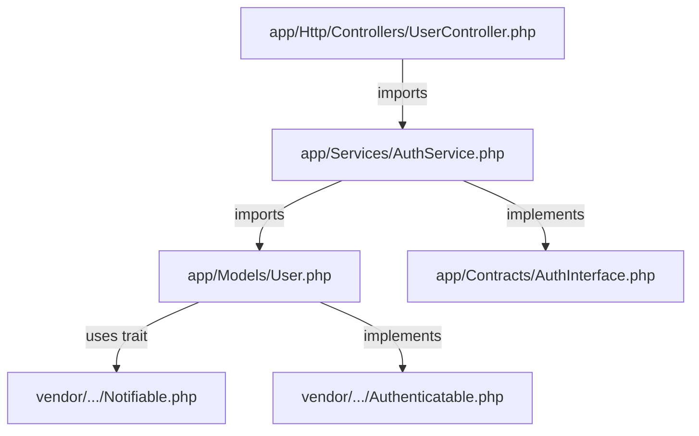

# PHP Code Search Plan

> **Version**: 1.0 | **Date**: 2025-12-09 | **Type**: Search Plan | **Language**: PHP (Generic)

## 📋 Overview

Specialized search plan for generic PHP projects (all versions). Adapted to PSR-4 conventions, Composer, and common PHP frameworks (Laravel, Symfony, WordPress, Drupal).

**Use cases**: PHP projects with or without a framework, PSR-4 autoloading, Composer dependencies.

## 🔍 File Patterns

### PHP Extensions
```text
*.php      # Main PHP files
*.phtml    # PHP templates
*.inc      # Legacy includes
*.module   # Modules (Drupal)
*.install  # Installation scripts
*.test     # Unit tests
```

### Configuration & Dependencies
```text
composer.json    # Composer dependencies
composer.lock    # Lock file
*.env            # Environment variables
config/*.php     # Configuration files
```

### PHP-specific Exclusions
```text
vendor/          # Composer dependencies
storage/         # Laravel storage
cache/           # Symfony/Laravel cache
var/cache/       # Symfony cache
bootstrap/cache/ # Laravel bootstrap cache
*.cache.php      # Generated cache files
```

## 🎯 Search Method

**Type**: `naive` + **PSR-4 aware**

### Phase 1: PSR-4 Discovery
The Node configuration resolver confines Composer mappings to the approved
root. The result contains candidate paths only; revalidate before opening files
because concurrent filesystem changes are not locked.
```javascript
import { query as configQuery } from '../../config-query.mjs';

const namespaces = configQuery('psr4-list', composerFile, '', approvedRoot);
```

### Phase 2: Class/Method Search
```javascript
import { search } from '../../search-engine.mjs';

const results = search({
  root: approvedRoot,
  paths: selectedPaths,
  language: 'php',
  query,
  mode: 'literal',
  context: 1,
});
```

## 📦 Search Patterns

### 1. PHP Imports/Dependencies
```regex
# Use statements (PSR-4)
^use\s+([\w\\]+)(\s+as\s+\w+)?;

# Require/Include (legacy)
^(require|require_once|include|include_once)\s+['"](.*?)['"];

# Composer autoload
^require\s+__DIR__\s*\.\s*['"]/vendor/autoload\.php['"];
```

### 2. Class/Interface/Trait Declarations
```regex
# Namespace declaration
^namespace\s+([\w\\]+);

# Class declaration
^(abstract\s+)?class\s+(\w+)(\s+extends\s+(\w+))?(\s+implements\s+([\w,\s]+))?

# Interface declaration
^interface\s+(\w+)(\s+extends\s+([\w,\s]+))?

# Trait declaration
^trait\s+(\w+)
```

### 3. Methods/Functions
```regex
# Method declaration (with visibility)
^\s*(public|protected|private|static|final|abstract)*\s*function\s+(\w+)\s*\(

# Function declaration (global)
^function\s+(\w+)\s*\(

# Magic methods
^\s*(public|protected|private)\s+function\s+__(\w+)\s*\(
```

### 4. Properties/Constants
```regex
# Class properties
^\s*(public|protected|private|static|const)\s+(\$?\w+)

# Class constants
^\s*const\s+(\w+)\s*=

# Global constants
^define\(['"](.*?)['"],
```

### 5. PHP-specific keywords
```text
# Inheritance/Implementation
extends
implements

# Traits
use [Trait]
trait

# Type hints
: int
: string
: array
: bool
: float
: void
: callable
: iterable
: object
: mixed

# Framework-specific (Laravel)
@extends
@section
@yield
@include
```

## 🔄 Extension Strategy

### 1. PSR-4 Resolution
```javascript
import { query as configQuery } from '../../config-query.mjs';

const candidates = configQuery('psr4-resolve', composerFile, namespace, approvedRoot);
```

### 2. Following Use Statements
```javascript
import { extractPhpUses } from '../../search-engine.mjs';

const imports = extractPhpUses(sourceText);
```

### 3. Framework Detection
```javascript
import { detectPhpFramework } from '../../search-engine.mjs';

const framework = detectPhpFramework({ root: approvedRoot });
```

## 📤 Output Format

### PHP-specific structure

```markdown
# PHP Code Search Results

**Query**: [keyword]
**Framework**: [Laravel|Symfony|WordPress|Generic]
**PSR-4 Namespaces**: [App\\, Tests\\, ...]
**Files Indexed**: X

## 📄 `app/Models/User.php`

**Namespace**: `App\Models`

**Classes** (1):
  - `User` (lines 15-145): 130 lines
    - Extends: `Illuminate\Database\Eloquent\Model`
    - Implements: `Authenticatable`
    - Traits: `Notifiable`, `HasApiTokens`
    - Properties: 3 (fillable, hidden, casts)
    - Methods: 8

**Interfaces** (0):

**Traits** (0):

**Functions** (0):

**Dependencies** (7):
  - `Illuminate\Database\Eloquent\Model` (line 5)
  - `Illuminate\Contracts\Auth\Authenticatable` (line 6)
  - `Illuminate\Notifications\Notifiable` (line 7)
  - `Laravel\Sanctum\HasApiTokens` (line 8)
  - `App\Repositories\UserRepository` (line 10)

**Public Methods** (8):
  - `posts(): HasMany` (line 42)
  - `roles(): BelongsToMany` (line 56)
  - `permissions(): array` (line 73)
  - `hasRole(string $role): bool` (line 89)

---

## 📄 `app/Services/AuthService.php`

**Namespace**: `App\Services`

**Classes** (1):
  - `AuthService` (lines 12-198): 186 lines
    - Implements: `AuthInterface`
    - Methods: 12

**Interfaces** (0):

**Public Methods** (8):
  - `login(array $credentials): bool` (line 35)
  - `logout(): void` (line 67)
  - `verify(string $token): User` (line 89)
  - `refresh(string $token): string` (line 123)

**Dependencies** (5):
  - `App\Contracts\AuthInterface` (line 5)
  - `App\Repositories\UserRepository` (line 6)
  - `Illuminate\Hashing\HashInterface` (line 7)

---

## 🔗 Relationships Graph



**Summary**: 5 relationships detected

## 📊 Statistics

- **Total Files Scanned**: X
- **Relevant Matches**: Y
- **Classes**: A
- **Interfaces**: B
- **Traits**: C
- **Functions**: D
- **Dependencies**: E

---
*Generated by agent-aikido-explore-code using php/plan.md*
```

## 🧠 Context Extraction PHP

### Classes
```markdown
- **Name**: Full class name
- **Namespace**: Full namespace (ex: App\Models)
- **Line Range**: Start-end lines (ex: lines 15-145)
- **Length**: Number of lines
- **Extends**: Parent class with full namespace
- **Implements**: Interfaces (comma-separated) with full namespaces
- **Traits**: Used traits with full namespaces
- **Properties**: Count and categories (public, protected, private)
- **Methods**: Count of methods (NOT full code)
- **Constants**: Count of class constants
```

### Interfaces
```markdown
- **Name**: Interface name
- **Namespace**: Full namespace
- **Line Range**: Start-end lines
- **Length**: Number of lines
- **Extends**: Parent interfaces (if any)
- **Methods**: List of method signatures (name + params + return type), max 5
```

### Traits
```markdown
- **Name**: Trait name
- **Namespace**: Full namespace
- **Line**: Line number
- **Methods**: Count of methods provided by trait
```

### Methods
```markdown
- **Visibility**: public|protected|private
- **Static**: yes|no
- **Signature**: Full signature with types
- **Line**: Line number
- **Return Type**: Return type hint (if any)
- **Parameters**: Parameter types and names
```

### Functions
```markdown
- **Signature**: Full signature with parameters
- **Line**: Line number
- **Parameters**: Parameter names and types
- **Return Type**: Return type if declared
```

### Dependencies
```markdown
- **Use Statement**: Full namespace being imported
- **Line**: Line number where use occurs
- **Alias**: Alias if using 'as' keyword
- **Type**: class|interface|trait|function|const
```

## ⚡ Performance Optimization

### Optimized PHP commands
```javascript
import { listFiles, search } from '../../search-engine.mjs';

const results = search({
  root: approvedRoot,
  paths: selectedPaths,
  language: 'php',
  query,
  context: 1,
  maxResults: 100,
});
const phpFiles = listFiles({ root: approvedRoot, paths: selectedPaths, language: 'php' });
```

### Optimization Strategies
1. **PSR-4 awareness** : Use composer.json for fast resolution
2. **Exclude vendor early** : The Node engine excludes dependencies before reading files
3. **Framework patterns** : Adapt patterns according to detected framework
4. **Cache PSR-4 map** : Parse composer.json once, reuse

## 🎓 Framework-Specific Patterns

### Laravel
```regex
# Controllers
class\s+\w+Controller\s+extends\s+Controller

# Models
class\s+\w+\s+extends\s+Model

# Routes
Route::(get|post|put|delete|patch)

# Blade templates
@extends\(['"].*?['"]\)
@section\(['"].*?['"]\)

# Eloquent relationships
public\s+function\s+\w+\(\)\s*:\s*(hasMany|belongsTo|hasOne|belongsToMany)
```

### Symfony
```regex
# Controllers
class\s+\w+Controller\s+extends\s+AbstractController

# Services
#\[AsService\]

# Routes
#\[Route\(['"](.*?)['"]\)\]

# Dependency Injection
public\s+function\s+__construct\([^)]*\)
```

### WordPress
```regex
# Hooks
add_action\(['"]([^'"]+)['"]
add_filter\(['"]([^'"]+)['"]

# Template tags
<?php\s+(get_|the_|wp_)

# Custom post types
register_post_type\(['"]([^'"]+)['"]
```

## 📋 Usage Example

```javascript
import {
  detectPhpFramework, extractFileMetadata, listFiles, search,
} from '../../search-engine.mjs';
import { query as configQuery } from '../../config-query.mjs';

const framework = detectPhpFramework({ root: approvedRoot });
const namespaces = configQuery('psr4-list', composerFile, '', approvedRoot);
const phpFiles = listFiles({ root: approvedRoot, paths: selectedPaths, language: 'php' });
const matches = search({
  root: approvedRoot,
  paths: selectedPaths,
  language: 'php',
  query: 'authenticate',
});
const metadata = phpFiles.map(file => ({
  file,
  ...extractFileMetadata({ root: approvedRoot, file, language: 'php' }),
}));
```

## 🔧 Customization Points

This plan can be extended/customized via:
- **PSR-4 mapping** : Adapt according to project composer.json
- **Framework patterns** : Refine according to framework used
- **Legacy patterns** : Add patterns for legacy code (non-PSR-4)
- **Performance tuning** : Adjust according to project size

---
*PHP plan created on 2025-12-09 for agent-aikido-explore-code*
*Compatible with PSR-4, Composer, Laravel, Symfony, WordPress*
