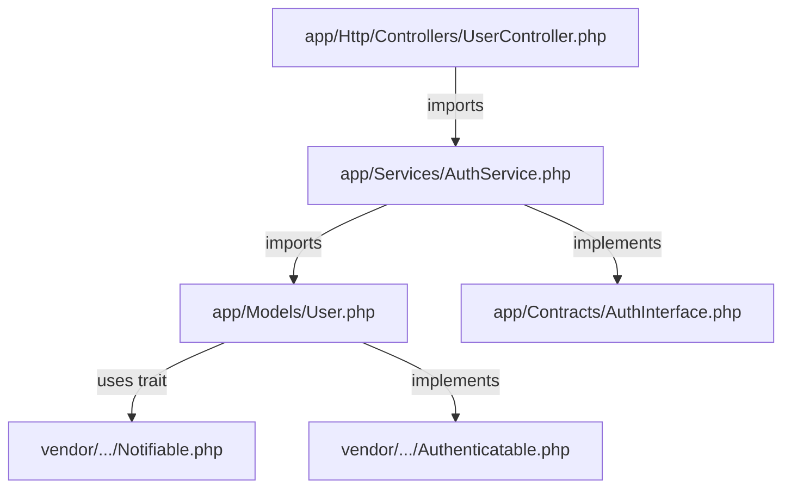

# PHP Code Search Plan

> **Version**: 1.0 | **Date**: 2025-12-09 | **Type**: Search Plan | **Language**: PHP (Generic)

## 📋 Overview

Specialized search plan for generic PHP projects (all versions). Adapted to PSR-4 conventions, Composer, and common PHP frameworks (Laravel, Symfony, WordPress, Drupal).

**Use cases**: PHP projects with or without a framework, PSR-4 autoloading, Composer dependencies.

## 🔍 File Patterns

### PHP Extensions
```bash
*.php      # Main PHP files
*.phtml    # PHP templates
*.inc      # Legacy includes
*.module   # Modules (Drupal)
*.install  # Installation scripts
*.test     # Unit tests
```

### Configuration & Dependencies
```bash
composer.json    # Composer dependencies
composer.lock    # Lock file
*.env            # Environment variables
config/*.php     # Configuration files
```

### PHP-specific Exclusions
```bash
vendor/          # Composer dependencies
storage/         # Laravel storage
cache/           # Symfony/Laravel cache
var/cache/       # Symfony cache
bootstrap/cache/ # Laravel bootstrap cache
*.cache.php      # Generated cache files
```

## 🎯 Search Method

**Type**: `naive` + **PSR-4 aware**

### Phase 1: PSR-4 Discovery
```bash
# Detect PSR-4 structure via composer.json
function detect_psr4_namespaces() {
    if [[ -f "composer.json" ]]; then
        jq -r '.autoload."psr-4" | to_entries[] | "\(.key):\(.value)"' composer.json 2>/dev/null
    fi
}

# Example output: "App\\:app/", "Tests\\:tests/"
```

### Phase 2: Class/Method Search
```bash
# PHP-specific search with context
grep -rn --include="*.php" \
  --exclude-dir={vendor,storage,cache,var} \
  -E "(class|interface|trait|function|namespace)\s+$KEYWORD" .
```

## 📦 Search Patterns

### 1. PHP Imports/Dependencies
```regex
# Use statements (PSR-4)
^use\s+([\w\\]+)(\s+as\s+\w+)?;

# Require/Include (legacy)
^(require|require_once|include|include_once)\s+['"](.*?)['"];

# Composer autoload
^require\s+__DIR__\s*\.\s*['"]/vendor/autoload\.php['"];
```

### 2. Class/Interface/Trait Declarations
```regex
# Namespace declaration
^namespace\s+([\w\\]+);

# Class declaration
^(abstract\s+)?class\s+(\w+)(\s+extends\s+(\w+))?(\s+implements\s+([\w,\s]+))?

# Interface declaration
^interface\s+(\w+)(\s+extends\s+([\w,\s]+))?

# Trait declaration
^trait\s+(\w+)
```

### 3. Methods/Functions
```regex
# Method declaration (with visibility)
^\s*(public|protected|private|static|final|abstract)*\s*function\s+(\w+)\s*\(

# Function declaration (global)
^function\s+(\w+)\s*\(

# Magic methods
^\s*(public|protected|private)\s+function\s+__(\w+)\s*\(
```

### 4. Properties/Constants
```regex
# Class properties
^\s*(public|protected|private|static|const)\s+(\$?\w+)

# Class constants
^\s*const\s+(\w+)\s*=

# Global constants
^define\(['"](.*?)['"],
```

### 5. PHP-specific keywords
```text
# Inheritance/Implementation
extends
implements

# Traits
use [Trait]
trait

# Type hints
: int
: string
: array
: bool
: float
: void
: callable
: iterable
: object
: mixed

# Framework-specific (Laravel)
@extends
@section
@yield
@include
```

## 🔄 Extension Strategy

### 1. PSR-4 Resolution
```bash
# Resolve namespace to file path
function resolve_psr4_path() {
    local namespace="$1"
    local composer_file="composer.json"

    if [[ ! -f "$composer_file" ]]; then
        return 1
    fi

    # Extract PSR-4 mapping
    local psr4_map=$(jq -r '.autoload."psr-4"' "$composer_file" 2>/dev/null)

    # Find the matching mapping
    local base_ns=$(echo "$namespace" | cut -d'\\' -f1)
    local base_dir=$(echo "$psr4_map" | jq -r --arg ns "$base_ns\\\\" '.[$ns] // empty')

    if [[ -n "$base_dir" ]]; then
        # Convert namespace to path: App\Models\User → app/Models/User.php
        local rel_path="${namespace//$base_ns/}"
        local file_path="${rel_path//\\/\/}.php"
        echo "${base_dir}${file_path}"
    fi
}
```

### 2. Following Use Statements
```bash
# Extract all use statements from a file
function extract_php_uses() {
    local file="$1"
    grep -E "^use\s+" "$file" | \
      sed -E 's/^use\s+(.*?)(;| as .*)/\1/' | \
      grep -v "^function " | \
      grep -v "^const "
}
```

### 3. Framework Detection
```bash
# Detect framework used
function detect_php_framework() {
    [[ -f "artisan" ]] && echo "laravel" && return
    [[ -f "bin/console" ]] && [[ -d "vendor/symfony" ]] && echo "symfony" && return
    [[ -d "wp-content" ]] && echo "wordpress" && return
    [[ -f "index.php" ]] && grep -q "Drupal" index.php && echo "drupal" && return
    echo "generic"
}
```

## 📤 Output Format

### PHP-specific structure

```markdown
# PHP Code Search Results

**Query**: [keyword]
**Framework**: [Laravel|Symfony|WordPress|Generic]
**PSR-4 Namespaces**: [App\\, Tests\\, ...]
**Files Indexed**: X

## 📄 `app/Models/User.php`

**Namespace**: `App\Models`

**Classes** (1):
  - `User` (lines 15-145): 130 lines
    - Extends: `Illuminate\Database\Eloquent\Model`
    - Implements: `Authenticatable`
    - Traits: `Notifiable`, `HasApiTokens`
    - Properties: 3 (fillable, hidden, casts)
    - Methods: 8

**Interfaces** (0):

**Traits** (0):

**Functions** (0):

**Dependencies** (7):
  - `Illuminate\Database\Eloquent\Model` (line 5)
  - `Illuminate\Contracts\Auth\Authenticatable` (line 6)
  - `Illuminate\Notifications\Notifiable` (line 7)
  - `Laravel\Sanctum\HasApiTokens` (line 8)
  - `App\Repositories\UserRepository` (line 10)

**Public Methods** (8):
  - `posts(): HasMany` (line 42)
  - `roles(): BelongsToMany` (line 56)
  - `permissions(): array` (line 73)
  - `hasRole(string $role): bool` (line 89)

---

## 📄 `app/Services/AuthService.php`

**Namespace**: `App\Services`

**Classes** (1):
  - `AuthService` (lines 12-198): 186 lines
    - Implements: `AuthInterface`
    - Methods: 12

**Interfaces** (0):

**Public Methods** (8):
  - `login(array $credentials): bool` (line 35)
  - `logout(): void` (line 67)
  - `verify(string $token): User` (line 89)
  - `refresh(string $token): string` (line 123)

**Dependencies** (5):
  - `App\Contracts\AuthInterface` (line 5)
  - `App\Repositories\UserRepository` (line 6)
  - `Illuminate\Hashing\HashInterface` (line 7)

---

## 🔗 Relationships Graph



**Summary**: 5 relationships detected

## 📊 Statistics

- **Total Files Scanned**: X
- **Relevant Matches**: Y
- **Classes**: A
- **Interfaces**: B
- **Traits**: C
- **Functions**: D
- **Dependencies**: E

---
*Generated by agent-aikido-explore-code using php/plan.md*
```

## 🧠 Context Extraction PHP

### Classes
```markdown
- **Name**: Full class name
- **Namespace**: Full namespace (ex: App\Models)
- **Line Range**: Start-end lines (ex: lines 15-145)
- **Length**: Number of lines
- **Extends**: Parent class with full namespace
- **Implements**: Interfaces (comma-separated) with full namespaces
- **Traits**: Used traits with full namespaces
- **Properties**: Count and categories (public, protected, private)
- **Methods**: Count of methods (NOT full code)
- **Constants**: Count of class constants
```

### Interfaces
```markdown
- **Name**: Interface name
- **Namespace**: Full namespace
- **Line Range**: Start-end lines
- **Length**: Number of lines
- **Extends**: Parent interfaces (if any)
- **Methods**: List of method signatures (name + params + return type), max 5
```

### Traits
```markdown
- **Name**: Trait name
- **Namespace**: Full namespace
- **Line**: Line number
- **Methods**: Count of methods provided by trait
```

### Methods
```markdown
- **Visibility**: public|protected|private
- **Static**: yes|no
- **Signature**: Full signature with types
- **Line**: Line number
- **Return Type**: Return type hint (if any)
- **Parameters**: Parameter types and names
```

### Functions
```markdown
- **Signature**: Full signature with parameters
- **Line**: Line number
- **Parameters**: Parameter names and types
- **Return Type**: Return type if declared
```

### Dependencies
```markdown
- **Use Statement**: Full namespace being imported
- **Line**: Line number where use occurs
- **Alias**: Alias if using 'as' keyword
- **Type**: class|interface|trait|function|const
```

## ⚡ Performance Optimization

### Optimized PHP commands
```bash
# Ultra-fast search with ripgrep
rg --type php \
  --glob '!vendor' \
  --glob '!storage' \
  --glob '!cache' \
  -i "$KEYWORD"

# Find all classes
rg --type php -n "^class\s+(\w+)" -r '$1' --no-heading --glob '!vendor'

# Find namespaces
rg --type php -n "^namespace\s+(.*?);" -r '$1' --no-heading --glob '!vendor'

# Find use statements
rg --type php -n "^use\s+([\w\\]+)" --no-heading --glob '!vendor'

# Statistics per file
rg --type php -c -i "$KEYWORD" --glob '!vendor' | sort -t: -k2 -nr | head -20
```

### Optimization Strategies
1. **PSR-4 awareness** : Use composer.json for fast resolution
2. **Exclude vendor early** : Always exclude from the start with find/rg
3. **Framework patterns** : Adapt patterns according to detected framework
4. **Cache PSR-4 map** : Parse composer.json once, reuse

## 🎓 Framework-Specific Patterns

### Laravel
```regex
# Controllers
class\s+\w+Controller\s+extends\s+Controller

# Models
class\s+\w+\s+extends\s+Model

# Routes
Route::(get|post|put|delete|patch)

# Blade templates
@extends\(['"].*?['"]\)
@section\(['"].*?['"]\)

# Eloquent relationships
public\s+function\s+\w+\(\)\s*:\s*(hasMany|belongsTo|hasOne|belongsToMany)
```

### Symfony
```regex
# Controllers
class\s+\w+Controller\s+extends\s+AbstractController

# Services
#\[AsService\]

# Routes
#\[Route\(['"](.*?)['"]\)\]

# Dependency Injection
public\s+function\s+__construct\([^)]*\)
```

### WordPress
```regex
# Hooks
add_action\(['"]([^'"]+)['"]
add_filter\(['"]([^'"]+)['"]

# Template tags
<?php\s+(get_|the_|wp_)

# Custom post types
register_post_type\(['"]([^'"]+)['"]
```

## 📋 Usage Example

```bash
# Example usage of the PHP plan
KEYWORD="authenticate"
FRAMEWORK=$(detect_php_framework)

echo "Framework detected: $FRAMEWORK"

# Phase 1: Extract PSR-4 namespaces
PSR4_NAMESPACES=$(detect_psr4_namespaces)
echo "PSR-4 namespaces: $PSR4_NAMESPACES"

# Phase 2: Find PHP files
FILES=$(rg --files --type php --glob '!vendor')
echo "PHP files found: $(echo "$FILES" | wc -l)"

# Phase 3: Search for keyword
MATCHES=$(rg --type php -n -i "$KEYWORD" --glob '!vendor')

# Phase 4: Extract metadata
for file in $FILES; do
    # Extract namespace
    NAMESPACE=$(grep -m1 "^namespace" "$file" | sed 's/namespace\s*//;s/;//')

    # Extract class name
    CLASS=$(grep -m1 "^class\s" "$file" | sed -E 's/^class\s+(\w+).*/\1/')

    # Extract use statements
    USES=$(grep "^use\s" "$file" | wc -l)

    # Extract methods
    METHODS=$(grep -E "^\s*(public|protected|private)\s+function\s+" "$file" | wc -l)

    # Format output
    if [[ -n "$CLASS" ]]; then
        echo "## 📄 \`$file\`"
        echo ""
        echo "**Namespace**: \`$NAMESPACE\`"
        echo ""
        echo "**Classes** (1):"
        echo "  - \`$CLASS\` (lines X-Y)"
        echo "    - Methods: $METHODS"
        echo ""
        echo "**Dependencies** ($USES):"
        grep "^use\s" "$file" | sed 's/^use\s*/  - /' | head -5
        echo ""
        echo "---"
        echo ""
    fi
done
```

## 🔧 Customization Points

This plan can be extended/customized via:
- **PSR-4 mapping** : Adapt according to project composer.json
- **Framework patterns** : Refine according to framework used
- **Legacy patterns** : Add patterns for legacy code (non-PSR-4)
- **Performance tuning** : Adjust according to project size

---
*PHP plan created on 2025-12-09 for agent-aikido-explore-code*
*Compatible with PSR-4, Composer, Laravel, Symfony, WordPress*
