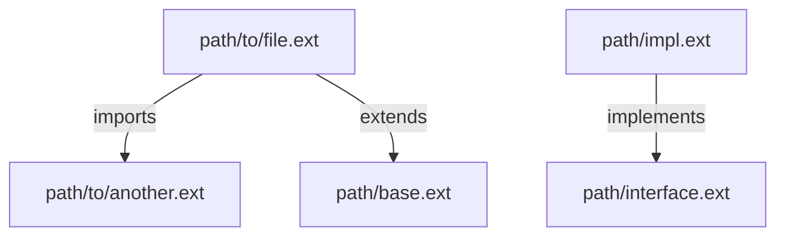

# Generic Code Search Plan

> **Version**: 1.0 | **Date**: 2025-12-09 | **Type**: Search Plan

## 📋 Overview

Generic search plan for any type of source code. Used as a fallback when no technology-specific plan is found.

**Use cases**: Multi-language projects, unsupported technologies, exploratory discovery without any technology assumption.

## 🔍 File Patterns

### Priority extensions
```text
# Source code (all common languages)
*.js *.ts *.jsx *.tsx *.mjs *.cjs
*.py *.pyc *.pyw
*.java *.class *.jar
*.cpp *.c *.cc *.cxx *.h *.hpp
*.cs *.csx
*.rb *.rake
*.go
*.rs
*.php
*.swift
*.kt *.kts
*.scala
*.sh *.bash
*.sql

# Configuration
*.json *.yaml *.yml *.toml *.ini *.env *.properties

# Documentation
*.md *.rst *.txt
```

### Standard exclusions
```text
# Directories to ignore (respect .gitignore)
node_modules/
vendor/
dist/
build/
out/
target/
.git/
.svn/
__pycache__/
*.egg-info/
.venv/
venv/

# Binary files
*.bin *.exe *.dll *.so *.dylib
*.jpg *.jpeg *.png *.gif *.ico *.svg
*.pdf *.zip *.tar *.gz
```

## 🎯 Search Method

**Type**: `naive` (literal or regular-expression matching, no semantic understanding required)

### Phase 1: Quick Discovery
```javascript
import { listFiles } from '../search-engine.mjs';

const files = listFiles({
  root: approvedRoot,
  paths: selectedPaths,
  language: 'generic',
});
```

### Phase 2: Keyword Search
```javascript
import { search } from '../search-engine.mjs';

const results = search({
  root: approvedRoot,
  paths: selectedPaths,
  language: 'generic',
  query,
  mode: 'literal',
  caseSensitive: false,
  context: 1,
});
```

## 📦 Search Patterns

### 1. Imports/Dependencies (multi-language)
```regex
# JavaScript/TypeScript
^import\s+.*\s+from\s+['"](.*?)['"]
^const\s+.*\s+=\s+require\(['"](.*?)['"]\)

# Python
^import\s+(.*)
^from\s+(.*)\s+import

# Java
^import\s+([\w\.]+);

# Go
^import\s+\(?\s*"(.*?)"

# Rust
^use\s+(.*);

# PHP
^use\s+([\w\\]+);

# Ruby
^require\s+['"](.*?)['"]
```

### 2. Class/Interface/Trait Declarations
```regex
# Classes (multi-language)
^(export\s+)?(public\s+|private\s+|protected\s+)?(class|interface|trait|struct|enum)\s+(\w+)

# Namespace/Package
^(namespace|package)\s+([\w\\\.]+)
```

### 3. Functions/Methods
```regex
# Function declarations (multi-language)
^(export\s+)?(public\s+|private\s+|protected\s+|static\s+)?(function|def|fn|func)\s+(\w+)\s*\(

# Arrow functions (JavaScript/TypeScript)
^(export\s+)?(const|let|var)\s+(\w+)\s*=\s*\(.*\)\s*=>

# Methods (in classes)
^\s+(public|protected|private)\s+function\s+(\w+)\s*\(
```

### 4. Common keywords
```text
# Inheritance/Extension
extends
implements
inherits
derive
use (trait)

# Visibility
public
private
protected
static
final
abstract

# Types/Annotations
interface
trait
struct
enum
@
#[
```

## 🔄 Extension Strategy

### 1. Language Detection by Extension
```javascript
import { detectLanguageFromExtension } from '../search-engine.mjs';

const language = detectLanguageFromExtension(filePath);
```

### 2. Generic Import Resolution
```javascript
import { resolveGenericImport } from '../search-engine.mjs';

const resolvedPath = resolveGenericImport({
  root: approvedRoot,
  paths: selectedPaths,
  importPath,
  currentFile,
});
```

## 📤 Output Format

### Generic structure

```markdown
# Code Search Results

**Query**: [keyword]
**Technologies Detected**: [auto-detected list]
**Files Indexed**: X

## 📄 `path/to/file.ext`

**Classes** (X):
  - `ClassName` (lines 15-145): 130 lines
    - Extends: `ParentClass`
    - Implements: `InterfaceA, InterfaceB`
    - Methods: 8

**Interfaces** (X):
  - `InterfaceName` (lines 5-20): 15 lines
    - Methods: `method1()`, `method2()`, `method3()`

**Traits/Structs** (X):
  - `TraitName` (line 25)

**Functions** (X):
  - `functionName(param1, param2): returnType` (line 42)
  - `anotherFunction(arg): void` (line 67)

**Dependencies** (X):
  - `package/module/path` (line 3)
  - `relative/import/path` (line 5)
  - `@framework/component` (line 7)

---

## 📄 `path/to/another/file.ext`

[Same structure...]

---

## 🔗 Relationships Graph



**Summary**: X relationships detected

## 📊 Statistics

- **Total Files Scanned**: X
- **Relevant Matches**: Y
- **Classes**: A
- **Interfaces**: B
- **Functions**: C
- **Dependencies**: D
- **Relationships**: E

---
*Generated by agent-aikido-explore-code using plan-generic.md*
```

## 🧠 Context Extraction

### Classes
```markdown
- **Name**: Full class name
- **Line Range**: Start-end lines (ex: lines 15-145)
- **Length**: Number of lines
- **Extends**: Parent class name (if any)
- **Implements**: Comma-separated interfaces (if any)
- **Traits/Mixins**: Traits used (if applicable)
- **Methods**: Count of methods (NOT full code)
- **Properties**: Count of properties (NOT full list)
```

### Interfaces
```markdown
- **Name**: Interface name
- **Line Range**: Start-end lines
- **Length**: Number of lines
- **Extends**: Parent interfaces (if any)
- **Methods**: List of method signatures (name + params), max 5
```

### Functions
```markdown
- **Signature**: Full signature with parameters and return type
- **Line**: Line number
- **Parameters**: Parameter names (NOT full code)
- **Return Type**: Return type if available
```

### Dependencies
```markdown
- **Import Path**: Full import/require path
- **Line**: Line number where import occurs
- **Type**: import|require|use|include
```

## ⚡ Performance Optimization

### Optimized multi-language commands
```javascript
const results = search({
  root: approvedRoot,
  paths: selectedPaths,
  language: 'generic',
  query,
  maxResults: 100,
});
const files = listFiles({ root: approvedRoot, paths: selectedPaths, language: 'generic' });
```

### Optimization Strategies
1. **Early filtering** : Exclude directories before reading files
2. **Pattern grouping** : Group similar patterns into a single Node search request
3. **Limit results** : Max 100 files per search (configurable)
4. **Cache .gitignore** : Parse .gitignore once, apply everywhere

## 📋 Usage Example

```javascript
import { detectLanguageFromExtension, detectTechnologies, extractFileMetadata, listFiles, search } from '../search-engine.mjs';

const technologies = detectTechnologies({ root: approvedRoot, paths: selectedPaths });
const files = listFiles({ root: approvedRoot, paths: selectedPaths, language: 'generic' });
const results = search({
  root: approvedRoot,
  paths: selectedPaths,
  language: 'generic',
  query: 'authenticate',
  context: 1,
});
const metadata = files.map(file => ({
  file,
  ...extractFileMetadata({ root: approvedRoot, file, language: detectLanguageFromExtension(file) }),
}));
```

## 🎓 Technology Detection

Auto-detection of technologies present in the project:

```javascript
import { detectTechnologies } from '../search-engine.mjs';

const technologies = detectTechnologies({ root: approvedRoot, paths: selectedPaths });
```

## 🔧 Customization Points

This plan can be extended/customized via:
- **File patterns** : Add specific extensions
- **Exclusions** : Adapt according to project structure
- **Regex patterns** : Refine for specific syntaxes
- **Output format** : Customize level of detail
- **Performance tuning** : Adjust limits and parallelism

---
*Generic plan created on 2025-12-09 for agent-aikido-explore-code*
*Used as fallback for technologies without a specific plan*
