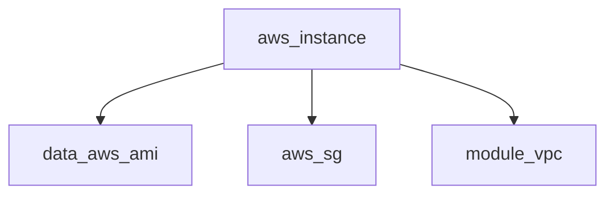

# Terraform (HCL) Code Search Plan

> **Version**: 2.0 | **Date**: 2025-12-10 | **Type**: Search Plan
> **Technology**: Terraform (HashiCorp Configuration Language)
> **Based on**: plan-generic.md with Terraform-specific adaptations

## 📋 Overview

Enhanced search plan for Infrastructure as Code Terraform (`.tf` and `.tfvars` files).

**Use cases**:
- Analysis of Terraform configurations
- Detection of resources, modules, variables, outputs, providers, data sources
- Dependency analysis between resources
- Security and compliance auditing
- Infrastructure mapping

## 🔍 File Patterns

### Priority extensions
```bash
*.tf          # Main Terraform configuration files
*.tfvars      # Variable definition files  
*.tfvars.json # JSON variable files
.terraform.lock.hcl  # Dependency lock file
```

### Standard files
```bash
main.tf           variables.tf      outputs.tf
providers.tf      versions.tf       backend.tf
locals.tf         data.tf           terraform.tfvars
*.auto.tfvars
```

### Standard exclusions
```bash
# Directories
.terraform/          .terragrunt-cache/   .git/
node_modules/        dist/                build/

# Sensitive/temporary files
*.tfstate            *.tfstate.backup     crash.log
override.tf          *_override.tf        *.pem
*.key                *.crt                secrets.tfvars
```

## 🎯 Search Method

**Type**: `structure-aware` (HCL syntax understanding)

### Phase 1: Quick Discovery
```bash
find . -type f \( -name "*.tf" -o -name "*.tfvars" \) \
  -not -path "*/.terraform/*" -not -path "*/.git/*" 2>/dev/null
```

### Phase 2: Resource & Module Discovery
```bash
# Resources
rg -n "^resource\s" --type-add 'tf:*.tf' --type tf --glob '!.terraform'

# Modules
rg -n "^module\s" --type-add 'tf:*.tf' --type tf --glob '!.terraform'

# Data sources
rg -n "^data\s" --type-add 'tf:*.tf' --type tf --glob '!.terraform'
```

### Phase 3: Dependency Analysis
```bash
# All references (var, module, data, resource)
rg -oE '\$\{[^}]+\}|([a-z_]+\.[a-z_]+\.[a-z_]+)' \
  --type-add 'tf:*.tf' --type tf --glob '!.terraform' | sort -u
```

## 📦 Search Patterns

### 1. Resource Blocks
```regex
^resource\s+"([^"]+)"\s+"([^"]+)"\s*\{
# $1 = resource type (aws_instance)
# $2 = resource name (web_server)
```

### 2. Data Sources
```regex
^data\s+"([^"]+)"\s+"([^"]+)"\s*\{
# $1 = data source type (aws_ami)
# $2 = data source name (ubuntu)
```

### 3. Modules
```regex
^module\s+"([^"]+)"\s*\{
^\s*source\s*=\s*"([^"]+)"
^\s*version\s*=\s*"([^"]+)"
```

### 4. Variables
```regex
^variable\s+"([^"]+)"\s*\{
^\s*type\s*=\s*(\w+|\w+\([^)]*\))
^\s*default\s*=\s*(.*)
^\s*description\s*=\s*"([^"]+)"
^\s*sensitive\s*=\s*(true|false)
```

### 5. Outputs
```regex
^output\s+"([^"]+)"\s*\{
^\s*value\s*=\s*(.+)
^\s*description\s*=\s*"([^"]+)"
^\s*sensitive\s*=\s*(true|false)
```

### 6. Locals
```regex
^locals\s*\{
^\s+([a-z_][a-z0-9_]*)\s*=\s*(.*)
```

### 7. Providers
```regex
^provider\s+"([^"]+)"\s*\{
^provider\s+"([^"]+)"\s+"([^"]+)"\s*\{  # with alias
```

### 8. Terraform Block
```regex
^terraform\s*\{
^\s*required_version\s*=\s*"([^"]+)"
^\s*required_providers\s*\{
^\s*backend\s+"([^"]+)"\s*\{
```

### 9. Dependencies & References
```regex
# Variable refs
var\.([a-z_][a-z0-9_]*)
\$\{var\.([a-z_][a-z0-9_]*)\}

# Local refs
local\.([a-z_][a-z0-9_]*)

# Module outputs
module\.([a-z_][a-z0-9_]*)\.([a-z_][a-z0-9_]*)

# Data source refs
data\.([a-z_]+)\.([a-z_][a-z0-9_]*)\.([a-z_][a-z0-9_]*)

# Resource refs
([a-z_]+)\.([a-z_][a-z0-9_]*)\.([a-z_][a-z0-9_]*)
```

### 10. Meta-Arguments
```regex
^\s*count\s*=\s*(.+)
^\s*for_each\s*=\s*(.+)
^\s*depends_on\s*=\s*\[(.*)\]
^\s*provider\s*=\s*([a-z_]+)\.([a-z_]+)
^\s*lifecycle\s*\{
^\s*(create_before_destroy|prevent_destroy|ignore_changes)\s*=
```

### 11. Provisioners
```regex
^\s*provisioner\s+"([^"]+)"\s*\{
# Types: local-exec, remote-exec, file
```

### 12. Dynamic Blocks
```regex
^\s*dynamic\s+"([^"]+)"\s*\{
^\s*for_each\s*=\s*(.+)
^\s*content\s*\{
```

## 🔄 Extension Strategy

### Provider Detection
```bash
detect_provider_from_resource() {
    local prefix="${1%%_*}"
    case "$prefix" in
        aws) echo "aws (Amazon Web Services)" ;;
        azurerm) echo "azurerm (Microsoft Azure)" ;;
        google) echo "google (Google Cloud)" ;;
        kubernetes) echo "kubernetes" ;;
        docker) echo "docker" ;;
        helm) echo "helm" ;;
        *) echo "$prefix (unknown)" ;;
    esac
}
```

### Module Source Resolution
```bash
resolve_module_source() {
    local source="$1"
    if [[ "$source" =~ ^\.\.?/ ]]; then
        echo "Local: $(realpath "$source" 2>/dev/null)"
    elif [[ "$source" =~ ^git:: ]]; then
        echo "Git: ${source#git::}"
    else
        echo "Registry: registry.terraform.io/$source"
    fi
}
```

### Dependency Extraction
```bash
extract_dependencies() {
    local file="$1"
    echo "=== Variables ===" && rg -oE 'var\.[a-z_]+' "$file" | sort -u
    echo "=== Locals ===" && rg -oE 'local\.[a-z_]+' "$file" | sort -u
    echo "=== Modules ===" && rg -oE 'module\.[a-z_]+\.[a-z_]+' "$file" | sort -u
    echo "=== Data ===" && rg -oE 'data\.[a-z_]+\.[a-z_]+\.[a-z_]+' "$file" | sort -u
}
```

## 📤 Output Format

```markdown
# Terraform Code Search Results

**Query**: [keyword]
**Providers**: aws, azurerm, kubernetes
**Terraform Version**: >= 1.0
**Files Indexed**: X

## 📄 `main.tf`

**Resources** (X):
  - `aws_instance.web` (lines 15-45): 30 lines
    - Type: aws_instance | Provider: AWS
    - Meta: count = 2
    - Deps: var.ami_id, aws_security_group.web.id
    - Lifecycle: create_before_destroy = true

**Modules** (X):
  - `module.vpc` (lines 80-95): 15 lines
    - Source: terraform-aws-modules/vpc/aws
    - Version: ~> 3.0

**Variables** (X):
  - `var.region` (line 3): string, default = "us-east-1"

**Outputs** (X):
  - `output.instance_ips` (line 100): aws_instance.web[*].public_ip

**Providers** (X):
  - `provider.aws` (lines 1-5): region = var.region, version ~> 4.0

## 🔗 Dependency Graph



## 📊 Statistics
- Resources: X (aws: A, azure: B)
- Modules: Y
- Variables: Z
- Outputs: W

---
*Generated by agent-aikido-explore-code using terraform/plan.md*
```

## ⚡ Performance Optimization

### Optimized commands
```bash
# Resources of a type
rg -n "^resource\s+\"aws_instance\"" --type-add 'tf:*.tf' --type tf

# Count by type
rg "^resource\s+\"(\w+)\"" -r '$1' --type tf | sort | uniq -c | sort -rn

# Refs to a variable
rg "var\.region" --type tf

# Modules with sources
rg -A 2 "^module\s" --type tf | rg "source\s*=" 

# Resources with count/for_each
rg -B 1 "^\s*(count|for_each)\s*=" --type tf | rg "^resource"

# Sensitive outputs
rg -A 3 "^output" --type tf | rg -B 3 "sensitive\s*=\s*true"

# Global statistics
echo "Resources: $(rg -c '^resource\s' --type tf | awk -F: '{s+=$2} END {print s}')"
echo "Modules: $(rg -c '^module\s' --type tf | awk -F: '{s+=$2} END {print s}')"
```

### Strategies
1. **Early filtering**: Exclude `.terraform/` from the start
2. **Type-specific**: Use `--type tf` 
3. **Provider grouping**: Analyze by provider
4. **Parallel processing**: GNU parallel for large projects

## 🔧 Terraform-Specific Features

### State Inspection (Read-Only)
```bash
# View state
terraform state list 2>/dev/null

# JSON format
terraform show -json terraform.tfstate 2>/dev/null | jq .
```

### Provider Versions
```bash
rg -A 10 "required_providers\s*\{" --type tf | \
  rg "(\w+)\s*=" -A 3 | rg "version\s*="
```

### Security Audit
```bash
# Hardcoded secrets (RISK!)
rg -i "(password|secret|api_key)\s*=\s*\"[^\"]+\"" --type tf

# Public access
rg "(0\.0\.0\.0/0|publicly_accessible.*true)" --type tf
```

## 🎓 Auto-Detection

### Providers
```bash
detect_providers() {
    # From resources
    rg "^resource\s+\"(\w+)_" -r '$1' --type tf | sort -u

    # From explicit providers
    rg "^provider\s+\"(\w+)\"" -r '$1' --type tf | sort -u
}
```

### Module Inventory
```bash
list_modules() {
    rg -n "^module\s+\"([^\"]+)\"" --type tf | while IFS=: read f l m; do
        name=$(echo "$m" | rg "\"([^\"]+)\"" -r '$1')
        src=$(rg -A 10 "^module\s+\"$name\"" "$f" | rg "source\s*=" | head -1)
        echo "Module: $name | File: $f:$l | $src"
    done
}
```

---

*Terraform search plan v2.0 created 2025-12-10 for agent-aikido-explore-code*
*Enhanced with detailed patterns, examples, and security auditing*
