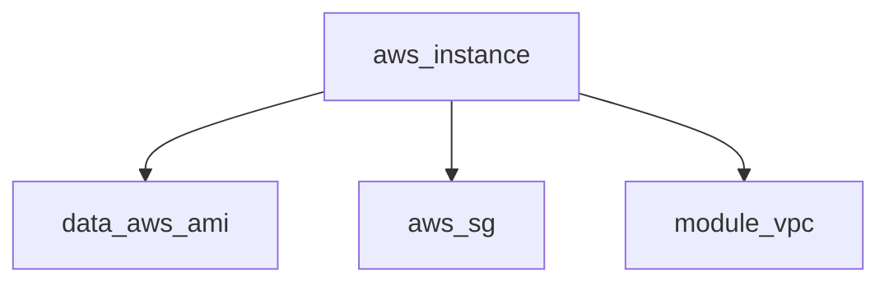

# Terraform (HCL) Code Search Plan

> **Version**: 2.0 | **Date**: 2025-12-10 | **Type**: Search Plan
> **Technology**: Terraform (HashiCorp Configuration Language)
> **Based on**: plan-generic.md with Terraform-specific adaptations

## 📋 Overview

Enhanced search plan for Infrastructure as Code Terraform (`.tf` and `.tfvars` files).

**Use cases**:
- Analysis of Terraform configurations
- Detection of resources, modules, variables, outputs, providers, data sources
- Dependency analysis between resources
- Security and compliance auditing
- Infrastructure mapping

## 🔍 File Patterns

### Priority extensions
```text
*.tf          # Main Terraform configuration files
*.tfvars      # Variable definition files  
*.tfvars.json # JSON variable files
.terraform.lock.hcl  # Dependency lock file
```

### Standard files
```text
main.tf           variables.tf      outputs.tf
providers.tf      versions.tf       backend.tf
locals.tf         data.tf           terraform.tfvars
*.auto.tfvars
```

### Standard exclusions
```text
# Directories
.terraform/          .terragrunt-cache/   .git/
node_modules/        dist/                build/

# Sensitive/temporary files
*.tfstate            *.tfstate.backup     crash.log
override.tf          *_override.tf        *.pem
*.key                *.crt                secrets.tfvars
```

## 🎯 Search Method

**Type**: `structure-aware` (HCL syntax understanding)

### Phase 1: Quick Discovery
```javascript
import { listFiles } from '../../search-engine.mjs';

const terraformFiles = listFiles({
  root: approvedRoot,
  paths: selectedPaths,
  language: 'terraform',
});
```

### Phase 2: Resource & Module Discovery
```javascript
import { search } from '../../search-engine.mjs';

const resources = search({ root: approvedRoot, paths: selectedPaths, language: 'terraform', query: '^resource\\s', mode: 'regex' });
const modules = search({ root: approvedRoot, paths: selectedPaths, language: 'terraform', query: '^module\\s', mode: 'regex' });
const dataSources = search({ root: approvedRoot, paths: selectedPaths, language: 'terraform', query: '^data\\s', mode: 'regex' });
```

### Phase 3: Dependency Analysis
```javascript
import { extractTerraformDependencies, listFiles, readScopedFile } from '../../search-engine.mjs';

const dependencies = listFiles({
  root: approvedRoot,
  paths: selectedPaths,
  language: 'terraform',
}).filter(file => file.endsWith('.tf'))
  .map(file => ({
    file,
    ...extractTerraformDependencies(readScopedFile({ root: approvedRoot, file })),
  }));
```

## 📦 Search Patterns

### 1. Resource Blocks
```regex
^resource\s+"([^"]+)"\s+"([^"]+)"\s*\{
# $1 = resource type (aws_instance)
# $2 = resource name (web_server)
```

### 2. Data Sources
```regex
^data\s+"([^"]+)"\s+"([^"]+)"\s*\{
# $1 = data source type (aws_ami)
# $2 = data source name (ubuntu)
```

### 3. Modules
```regex
^module\s+"([^"]+)"\s*\{
^\s*source\s*=\s*"([^"]+)"
^\s*version\s*=\s*"([^"]+)"
```

### 4. Variables
```regex
^variable\s+"([^"]+)"\s*\{
^\s*type\s*=\s*(\w+|\w+\([^)]*\))
^\s*default\s*=\s*(.*)
^\s*description\s*=\s*"([^"]+)"
^\s*sensitive\s*=\s*(true|false)
```

### 5. Outputs
```regex
^output\s+"([^"]+)"\s*\{
^\s*value\s*=\s*(.+)
^\s*description\s*=\s*"([^"]+)"
^\s*sensitive\s*=\s*(true|false)
```

### 6. Locals
```regex
^locals\s*\{
^\s+([a-z_][a-z0-9_]*)\s*=\s*(.*)
```

### 7. Providers
```regex
^provider\s+"([^"]+)"\s*\{
^provider\s+"([^"]+)"\s+"([^"]+)"\s*\{  # with alias
```

### 8. Terraform Block
```regex
^terraform\s*\{
^\s*required_version\s*=\s*"([^"]+)"
^\s*required_providers\s*\{
^\s*backend\s+"([^"]+)"\s*\{
```

### 9. Dependencies & References
```regex
# Variable refs
var\.([a-z_][a-z0-9_]*)
\$\{var\.([a-z_][a-z0-9_]*)\}

# Local refs
local\.([a-z_][a-z0-9_]*)

# Module outputs
module\.([a-z_][a-z0-9_]*)\.([a-z_][a-z0-9_]*)

# Data source refs
data\.([a-z_]+)\.([a-z_][a-z0-9_]*)\.([a-z_][a-z0-9_]*)

# Resource refs
([a-z_]+)\.([a-z_][a-z0-9_]*)\.([a-z_][a-z0-9_]*)
```

### 10. Meta-Arguments
```regex
^\s*count\s*=\s*(.+)
^\s*for_each\s*=\s*(.+)
^\s*depends_on\s*=\s*\[(.*)\]
^\s*provider\s*=\s*([a-z_]+)\.([a-z_]+)
^\s*lifecycle\s*\{
^\s*(create_before_destroy|prevent_destroy|ignore_changes)\s*=
```

### 11. Provisioners
```regex
^\s*provisioner\s+"([^"]+)"\s*\{
# Types: local-exec, remote-exec, file
```

### 12. Dynamic Blocks
```regex
^\s*dynamic\s+"([^"]+)"\s*\{
^\s*for_each\s*=\s*(.+)
^\s*content\s*\{
```

## 🔄 Extension Strategy

### Provider Detection
```javascript
import { detectTerraformProvider } from '../../search-engine.mjs';

const provider = detectTerraformProvider(resourceType);
```

### Module Source Resolution
```javascript
import { resolveTerraformModuleSource } from '../../search-engine.mjs';

const moduleSource = resolveTerraformModuleSource(source, {
  root: approvedRoot,
  file: currentFile,
});
```

### Dependency Extraction
```javascript
import { extractTerraformDependencies } from '../../search-engine.mjs';

const dependencies = extractTerraformDependencies(terraformSource);
```

## 📤 Output Format

```markdown
# Terraform Code Search Results

**Query**: [keyword]
**Providers**: aws, azurerm, kubernetes
**Terraform Version**: >= 1.0
**Files Indexed**: X

## 📄 `main.tf`

**Resources** (X):
  - `aws_instance.web` (lines 15-45): 30 lines
    - Type: aws_instance | Provider: AWS
    - Meta: count = 2
    - Deps: var.ami_id, aws_security_group.web.id
    - Lifecycle: create_before_destroy = true

**Modules** (X):
  - `module.vpc` (lines 80-95): 15 lines
    - Source: terraform-aws-modules/vpc/aws
    - Version: ~> 3.0

**Variables** (X):
  - `var.region` (line 3): string, default = "us-east-1"

**Outputs** (X):
  - `output.instance_ips` (line 100): aws_instance.web[*].public_ip

**Providers** (X):
  - `provider.aws` (lines 1-5): region = var.region, version ~> 4.0

## 🔗 Dependency Graph



## 📊 Statistics
- Resources: X (aws: A, azure: B)
- Modules: Y
- Variables: Z
- Outputs: W

---
*Generated by agent-aikido-explore-code using terraform/plan.md*
```

## ⚡ Performance Optimization

### Optimized commands
```javascript
import { detectTerraformProviders, listTerraformModules, search } from '../../search-engine.mjs';

const resourceMatches = search({
  root: approvedRoot, paths: selectedPaths, language: 'terraform',
  query: '^resource\\s+"aws_instance"', mode: 'regex',
});
const variableMatches = search({
  root: approvedRoot, paths: selectedPaths, language: 'terraform',
  query: 'var\\.region', mode: 'regex',
});
const providers = detectTerraformProviders({ root: approvedRoot, paths: selectedPaths });
const modules = listTerraformModules({ root: approvedRoot, paths: selectedPaths });
```

### Strategies
1. **Early filtering**: Exclude `.terraform/` from the start
2. **Type-specific**: Use the Terraform plan's `.tf` / `.tfvars` allowlist
3. **Provider grouping**: Analyze by provider
4. **Parallel processing**: Use the host's supported parallel tool calls for independent scopes

## 🔧 Terraform-Specific Features

### State Inspection (Sensitive)

Terraform state may contain secrets even when values are marked sensitive.
Do not read, export or print state by default. Inspect it only when explicitly
authorized, using a narrowly scoped local procedure that does not expose
values in logs or agent output.

### Provider Versions
```javascript
import { search } from '../../search-engine.mjs';

const requiredProviderBlocks = search({
  root: approvedRoot,
  paths: selectedPaths,
  language: 'terraform',
  query: 'required_providers|version\\s*=',
  mode: 'regex',
  context: 3,
});
```

### Security Audit
Terraform state and sensitive variable files are excluded and never opened by the
search engine. Search results redact assignment values for sensitive key names.
```javascript
import { findSensitiveTerraformFiles, search } from '../../search-engine.mjs';

const possibleHardcodedSecrets = findSensitiveTerraformFiles({
  root: approvedRoot,
  paths: selectedPaths,
});
const publicAccessCandidates = search({
  root: approvedRoot,
  paths: selectedPaths,
  language: 'terraform',
  query: '0\\.0\\.0\\.0/0|publicly_accessible\\s*=\\s*true',
  mode: 'regex',
});
```

## 🎓 Auto-Detection

### Providers
```javascript
import { detectTerraformProviders } from '../../search-engine.mjs';

const providers = detectTerraformProviders({ root: approvedRoot, paths: selectedPaths });
```

### Module Inventory
```javascript
import { listTerraformModules } from '../../search-engine.mjs';

const modules = listTerraformModules({ root: approvedRoot, paths: selectedPaths });
```

---

*Terraform search plan v2.0 created 2025-12-10 for agent-aikido-explore-code*
*Enhanced with detailed patterns, examples, and security auditing*
