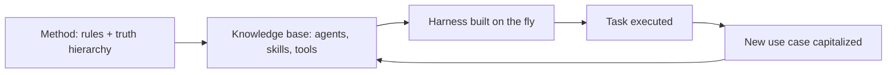

# AI-KIDO - Practical Guide for LLMs

> **Version**: 1.3.1-LLM | **Usage**: Direct reference for LLM interactions
>
> This document contains the detail of rules not present in ai-kido.md and essential structures of AI-KIDO for use by LLMs.

### Method and Meta-Harness

**AI-KIDO is a method, not a tool.** The method is the set of rules (tree, truth hierarchy, bidirectional links, capitalization) that frames any collaboration with an LLM, whatever the assistant, model or host.

**The tools form a meta-harness.** A harness is the context, agents, tools and checks wrapped around a model for a given task. AI-KIDO does not ship one fixed harness: the functions built into the knowledge base generate the right harness on the fly.

| Meta-harness function | Provided by | Role in the generated harness |
|---|---|---|
| Context selection | `prompts/index.md`, `agent-aikido-explore-*` | Loads only the knowledge useful to the task |
| Truth arbitration | `agent-aikido-truth-evaluator`, `hard_points/` | Sets the authoritative sources and constraints |
| Composition and routing | `agent-aikido-orchestrator`, `agents_list.md`, `skills_list.md` | Picks agents, personas, skills, tools and model routes |
| Control | `agent-aikido-validator`, `agent-aikido-doc-header` | Checks compliance of every output |
| Capitalization | `agent-aikido-bank-populate`, `agent-aikido-raci-delegator` | Stores the result back in the Memory Bank |
| Extension | `/create-persona`, `/create-skill`, `/create-command`, `/compile-agent-from-use` | Adds new building blocks to future harnesses |

**Generated use cases.** Each harness assembled for a task is captured as a use case (`gen/use_cases/`, then `hard_points/use_cases/` once validated). The base therefore grows its own catalogue of reusable harnesses: the more it is used, the more use cases it can generate.



### Creation and Maintenance Rules

1. **Existing Rule**: Always check existence before creating
2. **Structure Rule**: Systematically consult the tree structure [`/prompts/gen/`](../gen/)
3. **Density Rule**: Maximize relevance per word used
4. **Enrichment Rule**: Continuously improve the truth tables
5. **Consistency Rule**: Maintain alignment between all elements
6. **Traceability Rule**: Document all important decisions

**CRITICAL RULE V1.3**: Always consult `/prompts/index.md` first, regardless of project type (mono or multi).

**Multi-Project Navigation**:

1. `/prompts/index.md` → Lists and points to all projects
2. `/prompts/[project-n]/index.md` → Project-specific entry point
3. `/prompts/[project-n]/gen/index.md` → Internal project navigation

### Rules for Distribution by Human Roles

1. **Responsibility Assignment**: Each subdirectory MUST have a designated human owner
2. **Git Lifecycle**: Owners manage MR/PR for their domain
3. **Cross-cutting Consistency**: An "AI-KIDO Architect" owner supervises overall consistency
4. **RACI Matrix for Subdirectories**:
   - **R** (Responsible): Team member assigned to the subdirectory
   - **A** (Accountable): AI-KIDO Architect for consistency validation
   - **C** (Consulted): Other owners for cross-cutting impacts
   - **I** (Informed): Entire team via Git notifications

**Distribution Example**:

```
concepts/
├── architecture/     # R: Lead Architect, A: AI-KIDO Architect
├── business/         # R: Product Owner, A: AI-KIDO Architect
├── security/         # R: Security Officer, A: AI-KIDO Architect
└── glossaire/        # R: Tech Writer, A: AI-KIDO Architect

techniques/
├── backend/          # R: Backend Tech Lead, A: AI-KIDO Architect
├── frontend/         # R: Frontend Tech Lead, A: AI-KIDO Architect
└── devops/           # R: DevOps Lead, A: AI-KIDO Architect

use_cases/
├── user-stories/     # R: Product Owner, A: AI-KIDO Architect
├── technical/        # R: Tech Lead, A: AI-KIDO Architect
└── operational/      # R: DevOps Lead, A: AI-KIDO Architect
```

## STANDARD FORMAT FOR TRUTH TABLES

```markdown
# [Title of Concept/Component]
> Version: X.Y | Date: YYYY-MM-DD | Status: [Status]

## Overview
[Concise description of the concept]

## Key Definitions
[Essential terminology]

## Guiding Principles
[Rules and axioms]

## Technical Specifications
[Implementation details, constraints, standards]

## Application Examples
[Concrete use cases]

## Relationships and Dependencies
[Connections with other components]
```

**QUALITY CONSTRAINTS**:

- Standardized format: Markdown with mandatory metadata
- Maximum length: 500 lines per file
- Semantic density: Maximum information, minimum words
- Self-sufficiency: Understandable without external context

## STANDARD AI-KIDO PROMPT STRUCTURE

```markdown
[PERSONA] [Reference to the appropriate persona in /prompts/gen/personas/]

[CONTEXT]
- Relevant truth tables: [Specific references]
- Project constraints: [From hard_points if applicable]
- Information specific to this request

[TASK]
[Precise description of what is requested]

[FORMAT]
[Instructions on how to present results]

[VALIDATION]
[Quality criteria according to established standards]
```

## LOGS

**FEATURE_FLIPPING**: Only log questions if the feature is enabled LLM_TRACIBILITY=TRUE in the file [`/prompts/index.md`](../index.md).

**LOG FORMAT**:

```markdown
# DATE: YYYY-MM-DD HH-MM-SS
## PROMPT [Mode used]
[User's question]

```

**MANDATORY PROCESSING**:

1. Verify that the LLM_TRACIBILITY=TRUE feature is enabled
2. Create the file [`/prompts/spec/logs/prompts.log`](../spec/logs/prompts.log) if it does not exist
3. Log the user's question at the end of the file

## AGENTS.MD COMPLIANCE RULES

### Rule 16: AGENTS.md Interface for Complete Memory Bank

**CRITICAL**: AGENTS.md <= 100 lines.
**PRINCIPLE**: The `AGENTS.md` file serves as a **standardized interface** exposing the entire AI-KIDO Memory Bank according to the LLM standard, integrating personas among other elements.

**LINK-BASED ARCHITECTURE**:

1. **External index**: `AGENTS.md` = **mirror** of [`/prompts/index.md`](../index.md) in LLM standard format
2. **Link-based navigation**: Exclusive references to [`/prompts/gen/`](../gen/) without content duplication
3. **Bidirectional synchronization**: Automatic consistency with [`/prompts/index.md`](../index.md)
4. **Standardized interface**: Entry point compliant with AGENTS.md standard for interoperability

### Rule 17: AGENTS.md ↔ /prompts/index.md Synchronization

**PRINCIPLE**: AGENTS.md = **external equivalent** of [`/prompts/index.md`](../index.md) with links to the Memory Bank, never a copy of content.

**BIDIRECTIONAL SYNCHRONIZATION**:

1. **Project Context**: **Links** to [`/prompts/index.md`](../index.md) and [`/prompts/gen/concepts/architecture-systeme.md`](../gen/concepts/architecture-systeme.md)
2. **Available Agents**: **References** to [`/prompts/gen/concepts/`](../gen/concepts/), [`/prompts/gen/techniques/`](../gen/techniques/), [`/prompts/gen/use_cases/`](../gen/use_cases/), [`/prompts/gen/personas/`](../gen/personas/)
3. **Agent Categories**: **Navigation** to AI-KIDO taxonomy via relative links
4. **Knowledge Base**: **Exclusive pointers** to source files, no duplication

### Rule 18: AGENTS.md Structure by Links

**PRINCIPLE**: AGENTS.md = **external index** with exclusive links to [`/prompts/gen/`](../gen/), no content duplication.

### AGENTS.md Structure by Links

**MANDATORY STRUCTURE**:

```markdown
# AI Agents Configuration

## Project Context
- **Project Name**: [Link to /prompts/index.md]
- **Domain**: [Link to /prompts/gen/concepts/]
- **Architecture**: [Link to /prompts/gen/concepts/architecture-systeme.md]
- **Tech Stack**: [Link to /prompts/gen/techniques/stack-technique.md]

## Available Agents

### Concept Specialists
[Links to /prompts/gen/concepts/*.md - conceptual expertise]

### Technical Specialists  
[Links to /prompts/gen/techniques/*.md - technical expertise]

### Domain Experts
[Links to /prompts/gen/use_cases/*.md - business expertise]

### Role-Based Agents
[Links to /prompts/gen/personas/*.md - specialized roles]

## Agent Interaction Matrix
[Links to matrice-raci.md and RACI specifications]

## Usage Guidelines
[Links to /prompts/gen/use_cases/index.md and RACI documentation]
```

**LINKING CONSTRAINTS**:

- **Exclusive links**: No content copying, only references
- **Index synchronization**: Consistency with [`/prompts/index.md`](../index.md)
- **External navigation**: Interface for LLM tools to AI-KIDO Memory Bank
- **Automatic updates**: Links updated when changes occur in [`/prompts/gen/`](../gen/)

## AI-KIDO PERSONA TAXONOMY

### Hierarchical Taxonomic Organization

```
Level 1: Fundamental category
└── Level 2: Functional family
    └── Level 3: Specific persona
        └── Level 4: Contextual specialization
```

#### Level 1: Fundamental Categories

- **DESIGN**: Architecture and design-oriented personas
- **DEVELOPMENT**: Technical implementation-oriented personas
- **SECURITY**: Protection and compliance-oriented personas
- **QUALITY**: Validation and improvement-oriented personas
- **DEPLOYMENT**: Infrastructure and delivery-oriented personas

#### Levels 2-4: Detailed Structure

**Level 2 - Families**: System Architecture, Backend Services, Security Audit, Automated Testing, Cloud Infrastructure
**Level 3 - Personas**: Solutions Architect, REST API Developer, Application Security Expert, QA Engineer, DevOps Engineer
**Level 4 - Contexts**: Business Domain (Finance, Healthcare), Technology (React, Node.js), Scale (Startup, Enterprise)

### Persona Development Rules

1. **Taxonomic Inheritance**: Each persona inherits characteristics from its parent levels
2. **Progressive Specialization**: Each level adds specifics without contradicting higher levels
3. **Controlled Evolution**: Modifications only through versioning with impact analysis
4. **Documentation**: Trace all taxonomic modifications

## PERSONA EXAMPLES

> **Note**: These personas are illustrative examples. AI-KIDO is adaptable to different contexts (functional, technical, code, documentation, etc.) and does not require mandatory creation of these specific personas.

| Persona (Example) | Responsibility | Illustrative Usage |
|---------|---------------|-------|
| **Architect** | Structure and major technical decisions | Architecture, design patterns |
| **Backend Developer** | Server logic and robustness | APIs, databases, services |
| **Frontend Developer** | User experience | UI/UX, components, interactions |
| **Security Expert** | Protection and compliance | Security validation, audit |
| **QA Engineer** | Quality and issue detection | Testing, validation, debugging |
| **DevOps Engineer** | Automation and continuity | CI/CD, infrastructure, monitoring |

**USAGE**: Adapt personas according to the specific project context. Consult [`/prompts/gen/personas/`](../gen/personas/) for personas defined in your context.

### AGENTS.md ↔ AI-KIDO Synchronization Rules

#### Project Context Synchronization

1. **Project Name**: Automatically extracted from [`/prompts/index.md`](../index.md)
2. **Domain**: Inferred from the business context in [`/prompts/gen/concepts/`](../gen/concepts/)
3. **Architecture**: References [`/prompts/gen/concepts/architecture-systeme.md`](../gen/concepts/architecture-systeme.md)
4. **Tech Stack**: References [`/prompts/gen/techniques/stack-technique.md`](../gen/techniques/stack-technique.md)

#### Agent Synchronization

1. **Available Agents**: Generated from [`/prompts/gen/personas/`](../gen/personas/)
2. **Categorization**: According to AI-KIDO taxonomy (DESIGN, DEVELOPMENT, SECURITY, QUALITY, DEPLOYMENT)
3. **Specializations**: Adapted to the detected project context
4. **Responsibilities**: Aligned with RACI specifications if available

#### AGENTS.md Compliance Validation

**Structural Validation**:

- ✅ Presence of 4 mandatory sections
- ✅ Standard Markdown format
- ✅ Version metadata present
- ✅ Links to AI-KIDO documentation

**Consistency Validation**:

- ✅ Project context synchronized with AI-KIDO
- ✅ Agents mapped with existing personas
- ✅ AI-KIDO taxonomy respected
- ✅ RACI specifications aligned

#### Standard Persona Format

```markdown
# [Persona Name]
> Taxonomy: [Category] > [Family] > [Specific] > [Contextual]
> Version: X.Y | Date: YYYY-MM-DD

## Identity
- **Primary role**: [Core responsibility]
- **Domain of expertise**: [Field of competencies]
- **Hierarchical level**: [Position in the taxonomy]

## Inherited Characteristics
[Traits from higher taxonomic levels]

## Specializations
[Traits specific to this persona]

## Application Contexts
[Situations where this persona is optimal]

## Taxonomic Relationships
- **Parent**: [Functional family]
- **Children**: [Contextual specializations]
- **Peers**: [Other personas at the same level]
```

### Practical Usage

#### Persona Selection

1. **Identify the category**: What type of activity?
2. **Specify the family**: What specific function?
3. **Choose the persona**: What level of specialization?
4. **Adapt to context**: What particular constraints?

## HARD POINTS - ABSOLUTE PRIORITY

**DEFINITION**: Immutable truths that cannot be questioned.

**MANDATORY PROCESSING**:

1. Check existence of Hard Points for the relevant domain
2. ABSOLUTELY respect all listed constraints
3. In case of conflict: Hard Points > truth tables > user request

**HARD POINT FORMAT**:

```markdown
# Hard Point: [Decision Name]
> Promoted on: YYYY-MM-DD | Validated by: [Authority]

## Frozen Decision
[What cannot be modified]

## Justification
[Detailed reasoning]

## Impact and Dependencies
[System elements concerned]
```

## VALIDATION MECHANISMS

### Mandatory Validation

1. **Consistency with truth tables**: Verify that the response respects established standards
2. **Respect for Hard Points**: No violation of immutable constraints
3. **Persona Compliance**: The response corresponds to the assigned role
4. **Traceability**: Clear references to consulted sources

### Alert Signals to Detect

- Contradictions between response elements
- Deviations from established standards
- Lack of context for technical decisions
- Terminological inconsistencies

## OPTIMIZATION PATTERNS

### Token Optimization

- Reference existing tables instead of repeating information
- Use the hierarchical structure for efficient navigation
- Prioritize semantic density in responses

### Reuse

- Consult existing content before creating
- Adapt rather than recreate
- Maintain consistency with the established ecosystem

## STANDARD LLM WORKFLOW

1. **LOGS**: Log the question if LLM_TRACIBILITY=TRUE
2. **ANALYSIS**: Identify the domain and type of request
3. **CONSULTATION**: Check [`/prompts/index.md`](../index.md) and relevant tables
4. **HARD POINTS**: Control immutable constraints
5. **AGENTS.md**: Consult the central registry of available agents
6. **PERSONA**: Adopt the persona mapped from AGENTS.md
7. **RESPONSE**: Generate according to established standards
8. **VALIDATION**: Verify consistency and traceability
9. **SYNC AGENTS.md**: Update AGENTS.md if personas are modified

**ROO-CODE SPECIFICITY**: The recursive traversal from [`/prompts/index.md`](../index.md) must be performed automatically before any response (except aikido agents).

## DOMAIN ADAPTATION

| Domain | Priority Tables | Main Personas | Specific Constraints |
|---------|-------------------|-------------------|------------------------|
| **Backend** | [`/concepts/architecture_backend.md`](../gen/concepts/architecture_backend.md) | Backend Developer, Security Expert | Performance, scalability, security |
| **Frontend** | [`/concepts/design_system.md`](../gen/concepts/design_system.md) | Frontend Developer, UI/UX Designer | Accessibility, responsive, UX |
| **Architecture** | [`/concepts/architecture_overview.md`](../gen/concepts/architecture_overview.md) | Architect, Security Expert | Global consistency, scalability |
| **DevOps** | [`/concepts/infrastructure.md`](../gen/concepts/infrastructure.md) | DevOps Engineer | Automation, monitoring, reliability |

## ERROR HANDLING

### Errors to Correct Automatically

- Inconsistencies with existing truth tables
- Non-compliance with standard formats
- Incorrect or missing references

### Errors to Report

- Conflicts with Hard Points
- Requests requiring creation of new truth tables
- Expertise needs not covered by existing personas

## QUALITY METRICS

- **Compliance**: % of responses respecting established standards
- **Traceability**: Presence of references to consulted sources
- **Consistency**: Absence of internal contradictions
- **Density**: Ratio of useful information / tokens used
- **AGENTS.md Synchronization**: % of compliance personas ↔ centralized agents
- **Interoperability**: Compatibility with standard LLM tools via AGENTS.md

---

**CRITICAL REMINDER**: Always start by consulting [`/prompts/index.md`](../index.md) to understand the project context before any interaction.

**CRITICAL REMINDER**: Internal agents `agent-aikido-*` always return to the mode or agent that called them by executing `switch_mode` with the caller's `mode_slug`. Returns between internal modes/agents are done in JSON format (it cannot invoke itself autonomously). Internal agents must always be named in full with the `agent-aikido-` prefix.
