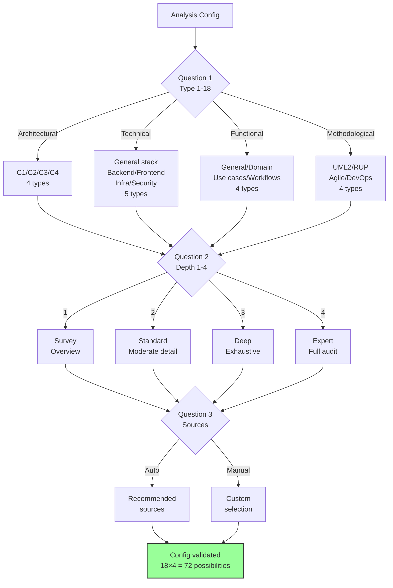
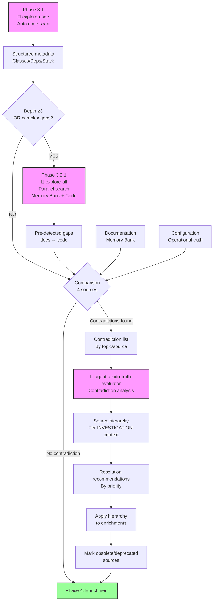
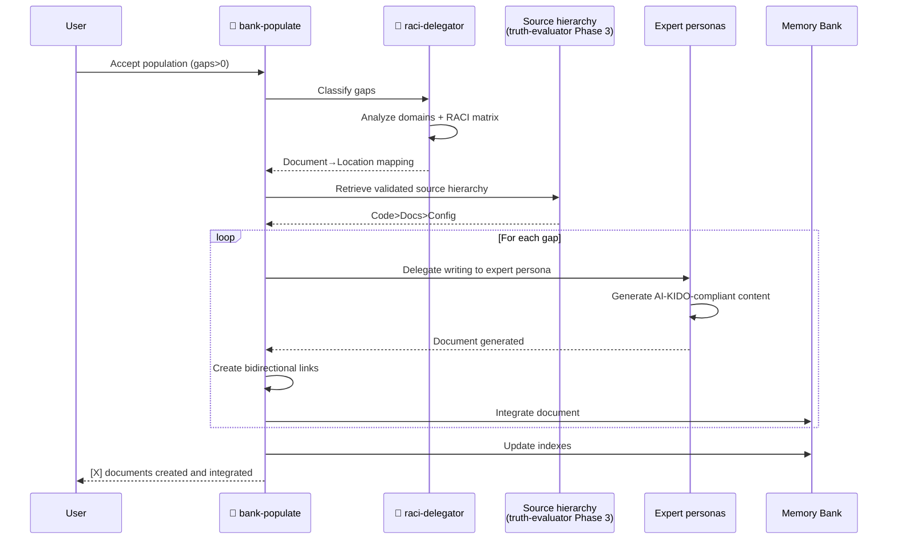

# Command: /analyse-project

Analyze existing project sources (code, documentation, configuration) to populate and enrich AI-KIDO Truth Tables in [`/prompts/gen/`](../prompts/gen/). Prioritizes code truth over documentation. Handles contradictions via user validation.

**Related concept**: [Project Analysis](../prompts/gen/concepts/analyse-projet.md) (AI-KIDO Rule 2: theory/practice separation)

### Workflow Overview

```mermaid
graph TB
    START[Start] --> P1[Phase 1: Polymorphic Config<br/>18 types × 4 depths]
    P1 --> P1_5[Phase 1.5: Plan Resolution 📋<br/>User validation]
    P1_5 -->|Plan accepted| P2[Phase 2: Memory Bank Scan<br/>+ RACI detection]
    P1_5 -.->|Plan rejected| CREATE[/create-analyse-plan]
    CREATE -.-> P1
    P2 --> P3_1[Phase 3.1: 🤖 explore-code<br/>Auto source scan<br/>Metadata + line numbers]

    P3_1 --> DEPTH{Depth ≥3<br/>OR complex gaps?}
    DEPTH -->|YES| P3_2[Phase 3.2: 🤖 agent-aikido-explore-all<br/>Parallel search<br/>Memory Bank + Code]
    DEPTH -->|NO| P3_3
    P3_2 --> P3_3[Phase 3.2: Gap Detection<br/>Code/Docs/Config]

    P3_3 -->|IF contradictions| A1[🤖 truth-evaluator<br/>Source hierarchy + justification]
    A1 --> P4
    P3_3 --> P4[Phase 4: Enrichment<br/>Concepts/Techniques/Uses/Personas<br/>from explore-code metadata]

    P4 --> P5[Phase 5: RACI Distribution]
    P5 -->|IF RACI active| A2[🤖 agent-aikido-raci-delegator<br/>Auto classification]
    A2 --> P6
    P5 --> P6[Phase 6: AI-KIDO Balancing<br/>≤500 lines, 3-7 children, ≤4 levels]
    P6 --> P7[Phase 7: Indexing<br/>6 index files]
    P7 --> P8[Phase 8: Auto Population]
    P8 -->|IF gaps>0 AND accepted| A3[🤖 agent-aikido-bank-populate<br/>+ raci-delegator + personas]
    A3 --> P9
    P8 --> P9[Phase 9: 🤖 validator<br/>Compliance Validation]
    P9 -->|IF non-compliant| FIX[Apply quick fixes]
    FIX --> P9
    P9 --> END[✅ Memory Bank synced and validated]

    style P3_1 fill:#f9f,stroke:#333,stroke-width:2px
    style P3_2 fill:#f9f,stroke:#333,stroke-width:2px
    style A1 fill:#f9f,stroke:#333,stroke-width:2px
    style A2 fill:#f9f,stroke:#333,stroke-width:2px
    style A3 fill:#f9f,stroke:#333,stroke-width:2px
    style P9 fill:#f9f,stroke:#333,stroke-width:2px
    style END fill:#9f9,stroke:#333,stroke-width:2px
```

---

## Steps

### Phase 1: Polymorphic Analysis Configuration

#### 1.1 Analysis Type

Ask **Question 1: Analysis type**
```
What type of analysis do you want to perform?

ARCHITECTURAL:
1. Simple global analysis (general overview)
2. C1 system analysis (context and users)
3. C2 container analysis (high-level components)
4. C3 component analysis (component detail)
5. C4 code analysis (detailed implementation)

TECHNICAL:
6. General tech stack (global technologies)
7. Specific backend stack (server, APIs, data)
8. Specific frontend stack (UI, UX, client)
9. Infrastructure stack (deployment, ops, monitoring)
10. Security stack (auth, authorization, encryption)

FUNCTIONAL:
11. General functional analysis (global business processes)
12. Domain-specific analysis (particular activity sector)
13. Use case analysis (usage scenarios)
14. Workflow analysis (operational processes)

METHODOLOGICAL:
15. UML2 analysis (object-oriented modeling)
16. RUP analysis (unified process)
17. Agile analysis (iterative methods)
18. DevOps analysis (continuous integration)

Your choice (1-18):
```

### Configuration Architecture



#### 1.2 Analysis Depth

Ask **Question 2: Analysis depth**
```
What depth of analysis do you want to apply?

DEPTH LEVELS:

LEVEL 1 - SURVEY (Quick, overview)
- Identify main elements
- Basic mapping
- Major pattern detection
- Estimated duration: Short

LEVEL 2 - STANDARD (Balanced, moderate detail)
- Analyze relationships and dependencies
- Identify issues
- Document architectural decisions
- Estimated duration: Medium

LEVEL 3 - DEEP (Detailed, exhaustive)
- Fine implementation analysis
- Anti-pattern detection
- Optimization recommendations
- Estimated duration: Long

LEVEL 4 - EXPERT (Very detailed, specialized)
- Full audit and recommendations
- Performance and security analysis
- Refactoring plan if needed
- Estimated duration: Very long

Your choice (1/2/3/4):
```

#### 1.3 Source Selection

Auto-adapt sources based on type and depth chosen:
```
🎯 SELECTED ANALYSIS CONFIGURATION:

Type: [ANALYSIS_TYPE] - [DESCRIPTION]
Depth: Level [LEVEL] - [DEPTH_DESCRIPTION]

Recommended sources for this configuration:
[Adapted list based on chosen analysis type]

Use recommended sources? (y/n)
If no, customize your selection:
```

**If custom**, ask **Question 3: Custom analysis sources**
```
Which sources for [ANALYSIS_TYPE] analysis?

Options:
1. Code sources only (src/, lib/, components/, etc.)
2. Documentation only (docs/, README, etc.)
3. Configuration only (package.json, docker, CI/CD, etc.)
4. Full combined analysis (code + docs + config)
5. Manual directory selection

Your choice (1/2/3/4/5):
```

- **Choice 1**: Auto-scan code directories
- **Choice 2**: Auto-scan documentation
- **Choice 3**: Auto-scan configuration
- **Choice 4**: Full combined automatic analysis
- **Choice 5**: List paths to analyze (comma-separated)

---

### Phase 1.5: Analysis Plan Resolution 📋

Resolve the most specific available analysis plan:

#### 1.5.1 Plan Resolution Logic

Map nature (1-18) → category + sub-type:

| Choice | Category | Sub-type |
|--------|----------|----------|
| 1 | generale | — |
| 2 | architectural | c1 |
| 3 | architectural | c2 |
| 4 | architectural | c3 |
| 5 | architectural | c4 |
| 6 | technical | stack-general |
| 7 | technical | backend |
| 8 | technical | frontend |
| 9 | technical | infrastructure |
| 10 | technical | security |
| 11 | functional | general |
| 12 | functional | domain |
| 13 | functional | use-cases |
| 14 | functional | workflows |
| 15 | methodological | uml2 |
| 16 | methodological | rup |
| 17 | methodological | agile |
| 18 | methodological | devops |

Map depth (1-4) → name: `1=survey`, `2=standard`, `3=deep`, `4=expert`

**Resolution priority** (most specific first):
1. `plans/{category}/{sub-type}/plan-{depth}.md`
2. `plans/{category}/plan-{depth}.md`
3. `plans/plan-{depth}.md` (generic fallback — always available)

Base path: `prompts/hard_points/system/analyse/plans`

#### 1.5.2 Display Resolved Plan

```
📋 RESOLVED ANALYSIS PLAN

Plan selected: {RESOLVED_PLAN}
Type: {PLAN_TYPE} (specific / category / generic)

Selection criteria: {PLAN_SELECTION_CRITERIA}

Analysis strategy:
- Priority sources: {PRIORITY_SOURCES}
- Agents: {AGENTS_LIST}
- Extraction method: {EXTRACTION_METHOD}
- Estimated duration: {ESTIMATED_TIME}

Plan specifics: {PLAN_SPECIFIC_FEATURES}
```

#### 1.5.3 User Validation

```
✅ Use this plan for analysis? (y/n/i)
  y - Yes, use this plan (RECOMMENDED)
  n - No, I want a different or custom plan
  i - Show full plan details
```

**If "n"** — offer alternatives:
1. Create custom plan → run `/create-analyse-plan` then re-run `/analyse-project`
2. Change configuration → return to Phase 1
3. Use generic fallback plan

**If "o"** — load plan strategy and proceed:
```
✅ Plan validated: {RESOLVED_PLAN}
📖 Loading analysis strategy...
```

#### 1.5.4 Phase Adaptation

Phases 2–9 use the plan strategy automatically:
```
📌 PHASE ADAPTATION PER PLAN

Phase 2 (Memory Bank scan): {ADAPTED_STRATEGY}
Phase 3.1 (explore-code): Prompt from plan
Phase 3.2 (explore-all): {CONDITIONAL_USAGE}
Phase 4 (Enrichment): Focus on {ENRICHMENT_AREAS}
Phase 5 (RACI): {RACI_STRATEGY}
Phase 8 (Populate): {POPULATE_STRATEGY}
Phase 9 (Validation): {VALIDATION_RULES}

▶️  Moving to Phase 2...
```

---

### Phase 2: Memory Bank and RACI Scan

#### 2.1 Current Memory Bank State

```
📊 CURRENT TRUTH TABLE STATE:

Existing concepts: [COUNT] files in /prompts/gen/concepts/
Existing techniques: [COUNT] files in /prompts/gen/techniques/
Existing use cases: [COUNT] files in /prompts/gen/use_cases/
Existing personas: [COUNT] files in /prompts/gen/personas/

Last updated: [DATE]
```

#### 2.2 RACI Specs Check

Search for RACI specs in [`/prompts/index.md`](../prompts/index.md) and [`/prompts/hard_points/index.md`](../prompts/hard_points/index.md):

```
🏗️ DETECTED RACI SPECIFICATIONS:

Configured organizations:
[List of aikido-raci-*.md files found in hard_points]

If RACI specs found:
- Organization: [TEAM-NAME]
- Defined roles: [COUNT]
- Workflow: [WORKFLOW_STEPS]
- Role structure: ✅/❌

Use these specs for enrichment organization? (y/n)
```

**If no RACI specs**:
```
⚠️ NO RACI SPECIFICATIONS DETECTED

Options:
1. Continue without role organization (flat structure)
2. Run init-raci-aikido first
3. Create temporary organization for this analysis

Your choice (1/2/3):
```

---

### Phase 3: Source Extraction and Analysis

#### 3.1 Code Analysis (Primary truth source)

Invoke `agent-aikido-explore-code`:

```markdown
🤖 AGENT: agent-aikido-explore-code

Prompt:
"FORMAT: JSON

Analyze project source code per selected configuration:

Configuration:
- Type: [ANALYSIS_TYPE from Phase 1]
- Depth: Level [LEVEL from Phase 1]
- Sources: [SELECTED_PATHS from Phase 1]

Extract:
1. Real architecture: Classes, interfaces, modules, components
2. Dependencies: Imports, extends, implements, uses
3. Tech stack: Technologies, frameworks, versions (package.json, composer.json, etc.)
4. Patterns: Architectural pattern detection (MVC, MVVM, microservices, etc.)

Technology-aware:
- Auto-detect main language (PHP, JavaScript/TypeScript, Python, Java, etc.)
- Use appropriate search plan (generic/php/javascript)
- Resolve PSR-4 (PHP) and ES Modules (JS/TS) if applicable

Output:
- Structured metadata with line numbers
- Dependency graph (Mermaid)
- ~50 lines per analyzed file
- Compact format (<2500 tokens total)"
```

#### 3.1.2 Interpret explore-code Results

**A. Real architecture** (from explore-code metadata):
- Detected patterns: [MVC/MVVM/Microservices/etc.]
- Directory/module organization
- Entry points with line numbers
- Main classes and interfaces: [LIST with lines]
- Critical dependencies: [Mermaid graph]

**B. Real tech stack** (from explore-code metadata):
- Main language: [PHP/JavaScript/TypeScript/etc.]
- Detected frameworks: [Laravel/Symfony/React/Vue/etc.]
- Versions: [From package.json/composer.json]
- External dependencies: [LIST]

**C. Implemented business logic** (from explore-code metadata):
- Detected data entities: [LIST with lines]
- Entity relationships: [Graph]
- Detected API endpoints: [LIST]
- Public methods: [LIST with signatures]

**D. Operational configuration**:
- Configured environments
- Services and dependencies
- Deployment parameters

#### 3.2 Gap and Contradiction Detection

##### 3.2.1 Parallel Search (Optional — use if depth ≥3 or complex gaps)

Invoke `agent-aikido-explore-all`:

```markdown
🤖 AGENT: agent-aikido-explore-all (OPTIONAL)

When to use:
- Analysis depth ≥ 3 (DEEP or EXPERT)
- OR need full documentation + implementation view
- OR complex gap detection between specs and code

Prompt:
"FORMAT: JSON

Parallel search in Memory Bank AND source code to detect gaps:

Memory Bank (/prompts/gen/):
- Documented architecture concepts
- Documented stack techniques
- Documented process use cases
- Business term glossary

Source Code (outside /prompts/):
- Actually implemented architecture
- Actually used tech stack
- Actually coded processes
- Business terms in code

Search keywords: [LIST per ANALYSIS_TYPE]

Output:
- Full Memory Bank + Code view in parallel
- Cross-references between documentation and implementation
- Auto-detected gaps"
```

**If explore-all NOT used**: proceed directly to 3.2.2

##### 3.2.2 Systematic Source Comparison

Compare systematically:
1. **Code vs Documentation**: Implemented vs documented architecture
2. **Code vs Configuration**: Declared vs used dependencies
3. **Documentation vs Configuration**: Described vs configured processes
4. **Existing vs New**: Truth Tables vs detected reality

### Contradiction Resolution Process



##### 3.2.3 Contradiction Validation

For each detected contradiction:
```
⚠️ CONTRADICTION DETECTED:

Topic: [Architecture/Stack/Process/etc.]
CODE source (explore-code): [What is implemented, with line numbers]
DOCS source (Memory Bank): [What is documented]
CONFIG source: [What is configured]
Current Truth Tables: [What is recorded]

Which truth to adopt?
1. Prioritize code (implemented truth — explore-code metadata)
2. Prioritize documentation (intentional truth — Memory Bank)
3. Prioritize configuration (operational truth — config files)
4. Prioritize existing tables (established truth — Memory Bank)
5. Use truth-evaluator agent (automatic hierarchy analysis)
```

##### 3.2.4 Automatic Contradiction Resolution

**If choice 5 OR multiple complex contradictions**, invoke `agent-aikido-truth-evaluator`:

```markdown
🤖 AGENT: agent-aikido-truth-evaluator

Prompt:
"FORMAT: JSON

Analyze detected contradictions between sources:

Code (from explore-code):
- [Summary with line numbers of contradictory elements]

Documentation (from Memory Bank or explore-all):
- [Summary of contradictory elements]

Configuration:
- [Summary of contradictory elements]

Context: Existing project analysis (scenario: INVESTIGATION)

Determine which source represents truth for each contradiction and provide source hierarchy with justification."
```

Apply the returned hierarchy to:
- Prioritize reliable sources during extraction
- Mark obsolete/deprecated sources in Memory Bank
- Guide updates with precise references (line numbers from explore-code)

**Resolution example**:
```
✅ HIERARCHY DETERMINED BY TRUTH-EVALUATOR:

Contradiction: Backend architecture
Scenario: INVESTIGATION
Recommended hierarchy: CODE (95%) > CONFIG (80%) > DOCS (20% - obsolete)

Justification:
- Code (src/gateway/index.ts:15): Active and tested microservices implementation
- Config (docker-compose.yml): Confirms distributed architecture (5 services)
- Docs (/prompts/gen/concepts/architecture.md): Describes monolithic architecture (outdated)

Action: Update Memory Bank with microservices reality from explore-code
Sources to mark obsolete: concepts/architecture.md (section "Monolithic Backend")
```

---

### Phase 4: Truth Table Enrichment

Enrich all four areas with detected reality:

**[`/prompts/gen/concepts/`](../prompts/gen/concepts/)**:
- Update system architecture with detected reality
- Enrich glossary with terms found in code
- Add newly identified business concepts
- Correct contradictory definitions

**[`/prompts/gen/techniques/`](../prompts/gen/techniques/)**:
- Update tech stack with real technologies
- Add detected patterns and practices from code
- Document configured deployment techniques
- Enrich observed development methods

**[`/prompts/gen/use_cases/`](../prompts/gen/use_cases/)**:
- Add use cases implemented in code
- Update workflows with operational reality
- Document real APIs and interfaces
- Correct obsolete scenarios

**[`/prompts/gen/personas/`](../prompts/gen/personas/)**:
- Adapt personas to actually used technologies
- Update responsibilities per real architecture
- Add skills required by detected stack

---

### Phase 5: RACI Distribution (AI-KIDO Rule 15)

#### 5.1 Load RACI Organizational Specs

If RACI specs available, load from [`/prompts/hard_points/aikido-raci-[TEAM-NAME].md`](../prompts/hard_points/aikido-raci-[TEAM-NAME].md):
```
📋 LOADING RACI SPECIFICATIONS:

Organization: [TEAM-NAME]
Defined roles: [ROLES_LIST]
Organizational workflow: [WORKFLOW_STEPS]
Domain-role mapping: [DOMAIN_MAPPING]

Existing structure detected:
- /prompts/gen/concepts/: ✅/❌
- /prompts/gen/techniques/: ✅/❌
- /prompts/gen/use_cases/: ✅/❌

Use this organization for enrichments? (y/n)
```

#### 5.2 Auto-classification

Invoke `agent-aikido-raci-delegator`:

```markdown
🤖 AGENT: agent-aikido-raci-delegator

Prompt:
"FORMAT: JSON

Auto-classify all documents extracted from project analysis:
- Architectural concepts: [LIST]
- Implemented techniques: [LIST]
- Detected use cases: [LIST]
- Business glossary: [LIST]

Context: [Mono/Multi-project]
RACI Matrix: [Loaded from /prompts/hard_points/ or AI-KIDO default]

For each document, return:
1. Type (concept/technique/use_case/glossary)
2. Domain (architecture/backend/frontend/devops/business/security)
3. Responsible role per RACI
4. Recommended target path
5. Confidence level"
```

### RACI Classification Workflow

```mermaid
graph LR
    DOCS[Extracted documents] --> PREP[Data prep<br/>Concepts/Techniques/Uses]
    PREP --> AGENT[🤖 agent-aikido-raci-delegator<br/>Batch classification]

    RACI[RACI Matrix<br/>from hard_points] --> AGENT
    CTX[Context<br/>Mono/Multi-project] --> AGENT

    AGENT --> MAP[Full mapping<br/>Document→Location]
    MAP --> TYPE[Type: concept/technique/<br/>use_case/glossary]
    MAP --> DOMAIN[Domain: architecture/<br/>backend/frontend/etc.]
    MAP --> ROLE[Responsible role<br/>per RACI]
    MAP --> PATH[Target path<br/>Memory Bank]
    MAP --> CONF[Confidence level<br/>+ alternatives]

    TYPE --> APPLY
    DOMAIN --> APPLY
    ROLE --> APPLY
    PATH --> APPLY
    CONF --> APPLY

    APPLY[Apply role structure] --> CREATE[Create directories<br/>roles/[slug]/]
    CREATE --> ASSIGN[Assign docs<br/>to directories]

    style AGENT fill:#f9f,stroke:#333,stroke-width:2px
    style ASSIGN fill:#9f9,stroke:#333,stroke-width:2px
```

#### 5.3 RACI Structure Application

Map enrichments per RACI specs:
- Detected enrichments → Responsible roles (per RACI matrix)
- Knowledge domains → Appropriate subdirectories
- Validation workflow → Defined approval process

Role-based subdirectory structure:
```
/prompts/gen/concepts/
├── [role-1-slug]/
├── [role-2-slug]/
└── [role-N-slug]/

/prompts/gen/techniques/
└── [same structure]

/prompts/gen/use_cases/
└── [same structure]
```

#### 5.4 Enrichment Assignment

```
🎯 ENRICHMENT ASSIGNMENT:

Detected System Architecture → [Architecture Responsible Role]
Real Tech Stack → [Development Responsible Role]
Implemented Business Logic → [Business Responsible Role]
Operational Configuration → [Operations Responsible Role]

Detected contradictions → RACI validation workflow applied
Cross-cutting enrichments → Multi-role validation required

Confirm automatic assignment? (y/n)
```

#### 5.5 Update RACI Matrix

Enrich [`/prompts/hard_points/aikido-raci-[TEAM-NAME].md`](../prompts/hard_points/aikido-raci-[TEAM-NAME].md):
```markdown
## Project Analysis Enrichments

### Integrated New Information
- **Real architecture**: [Details] → Assigned to [Role]
- **Tech stack**: [Details] → Assigned to [Role]
- **Business processes**: [Details] → Assigned to [Role]
- **Ops configuration**: [Details] → Assigned to [Role]

### Resolved Contradictions
- **Code vs Docs**: [Resolution] → Approved by [Approver Role]

### Workflow Update
- **Last analysis**: [DATE]
- **Integrated enrichments**: [COUNT]
- **Roles involved**: [ROLES_LIST]
```

---

### Phase 6: AI-KIDO Balancing and Taxonomy

#### 6.1 Balancing Rules Check

```
🌳 TREE BALANCING VERIFICATION:

Current structure analysis:
- Maximum depth: [LEVEL] (limit: 4 levels)
- Branching factor: [MIN-MAX] children/parent (optimal: 3-7)
- File sizes: [STATS] lines (limit: 500 lines)

Required balancing actions:
[List of rebalancing actions if needed]
```

#### 6.2 Automatic Restructuring

If imbalance detected:
1. **Auto-split**: Divide files > 500 lines
2. **Smart grouping**: Merge related concepts
3. **Taxonomic reorganization**: Adjust hierarchy
4. **Link update**: Preserve bidirectional references

#### 6.3 Taxonomy Validation

```
📋 TAXONOMY VALIDATION:

concepts/ structure:
- [COUNT] core concepts — Coherence: ✅/❌

techniques/ structure:
- [COUNT] practical techniques — Coherence: ✅/❌

use_cases/ structure:
- [COUNT] use cases — Coherence: ✅/❌

personas/ structure:
- [COUNT] personas — Coherence: ✅/❌
```

---

### Phase 7: AI-KIDO Index Update

Update automatically with modifications:
- [`/prompts/gen/concepts/index.md`](../prompts/gen/concepts/index.md)
- [`/prompts/gen/techniques/index.md`](../prompts/gen/techniques/index.md)
- [`/prompts/gen/use_cases/index.md`](../prompts/gen/use_cases/index.md)
- [`/prompts/gen/personas/index.md`](../prompts/gen/personas/index.md)
- [`/prompts/index.md`](../prompts/index.md): Updated project info, confirmed real stack, updated architecture, enriched memory bank stats
- [`AGENTS.md`](../AGENTS.md): Updated project context, agents adapted to real technologies

---

### Phase 8: Auto Population Proposal 🤖

#### 8.1 Gap Inventory

```
📋 GAPS IDENTIFIED AFTER PROJECT ANALYSIS

Undocumented code elements: [COUNT]
- Architecture [X] detected but no corresponding concept
- Technique [Y] implemented but no documentation
- Use case [Z] in code but not in /use_cases/

Invalid documents: [COUNT]
- /prompts/gen/concepts/[topic].md - Contradicts real implementation
- /prompts/gen/techniques/[topic].md - Obsolete tech stack

New knowledge to capitalize: [COUNT]
- Pattern [A] detected in code (undocumented)
- Process [B] configured (undescribed)

Total gaps to fill: [COUNT]
```

#### 8.2 Population Proposal

**If gaps > 0**:

```
💡 AUTO POPULATION PROPOSAL

Project analysis identified [COUNT] gap(s) in the Memory Bank.

Invoke agent-aikido-bank-populate to auto-create these documents?

The agent will:
1. Use information collected during analysis (code/docs/config)
2. Classify each gap via agent-aikido-raci-delegator
3. Apply source hierarchy (truth-evaluator already run in Phase 3)
4. Delegate writing to appropriate expert personas
5. Create AI-KIDO-compliant documents with bidirectional links
6. Integrate into Memory Bank with index update

Launch auto population? (y/n):
```

### Auto Population Orchestration



**If user accepts**: Invoke `agent-aikido-bank-populate` with gaps list, collected info, and source hierarchy from Phase 3.

**If user declines**: Display "Gaps listed for manual action — info available in context"

---

### Phase 9: AI-KIDO Compliance Validation 🤖

Invoke `agent-aikido-validator`:

```markdown
🤖 AGENT: agent-aikido-validator

Prompt:
"FORMAT: JSON

Validate all files modified/created by project analysis:

Files to validate:
- Modified concepts: [LIST from Phase 4]
- Modified techniques: [LIST from Phase 4]
- Modified use cases: [LIST from Phase 4]
- Modified personas: [LIST from Phase 4]
- New documents (if Phase 8 run): [LIST of filled gaps]

Rules to check:
- Rule 4: Size ≤500 lines
- Rule 6: Complete bidirectional links
- Rule 7: Balancing respected (3-7 children, ≤4 levels)
- Frontmatter present and valid
- Correct location in Memory Bank

For each non-compliant file:
- Generate actionable quick fix
- Prioritize corrections (P0/P1/P2)

Mode: Fast batch validation (<2k tokens/file)"
```

For each non-compliant file:
```
⚠️ NON-COMPLIANT FILE:

File: /prompts/gen/concepts/[name].md
Issue: Exceeds 500 lines (623 detected)
Quick Fix: Split into 2 files
  - /prompts/gen/concepts/[name].md (300 lines)
  - /prompts/gen/concepts/[name]-detail.md (323 lines)
  - Add bidirectional link between both

Apply quick fix? (y/n)
```

**Final validation report**:
```
📊 AI-KIDO VALIDATION REPORT

Files validated: [COUNT]
├─ Compliant (100%): [COUNT] ✅
├─ Compliant with warnings: [COUNT] ⚠️
└─ Non-compliant (corrections applied): [COUNT] ✅

Rules verified:
✅ Rule 4: [X]/[Y] files ≤500 lines
✅ Rule 6: [X]/[Y] files with bidirectional links
✅ Rule 7: Balancing respected (factor [MIN-MAX])
✅ Frontmatter: [X]/[Y] valid files
✅ Location: [X]/[Y] correctly placed files

Global compliance score: [PERCENTAGE]% ✅
Quick fixes applied: [COUNT]
```

---

## Output

### Success — Complete Analysis
```
✅ Project analysis completed successfully!

Sources analyzed:
- Code: [COUNT] files in [COUNT] directories
- Documentation: [COUNT] files
- Configuration: [COUNT] files

Changes made:
- [X] concepts updated
- [Y] techniques enriched
- [Z] use cases added/modified
- [W] personas adapted

Contradictions resolved: [COUNT]
Gaps detected: [COUNT]
Gaps auto-populated: [COUNT if accepted]

Balancing applied: ✅
Indexes updated: ✅
Compliance validation: ✅ ([PERCENTAGE]% compliant)

🎯 AI-KIDO Truth Tables synced with project reality!
```

### Contradiction Report
```
📊 RESOLVED CONTRADICTIONS REPORT:

Architecture:
- Code vs Docs: [COUNT] gaps resolved
- Implementation vs Intent: [DETAILS]

Tech Stack:
- Declared vs Used: [COUNT] differences corrected
- Versions vs Configuration: [DETAILS]

Processes:
- Documented vs Configured: [COUNT] adjustments
- Theory vs Practice: [DETAILS]
```

---

## Notes

**Error handling**:
- Inaccessible sources: List inaccessible directories and continue with available sources
- Non-analyzable code: Report problematic files and continue
- Corrupted documentation: Skip unreadable files and report
- Invalid configuration: Report parsing errors and continue
- Unresolved contradictions: Create "Pending conflicts" section for later resolution
- Impossible balancing: Report structural issues and propose manual solutions
- Corrupted indexes: Recreate from source files

**Agents used (6 total)**:

| Agent | Phase | Role |
|-------|-------|------|
| **explore-code** | 3.1 | Auto code scan with structured metadata |
| **explore-all** | 3.2 (optional) | Parallel Memory Bank + Code search for gap detection |
| **truth-evaluator** | 3.2 | Contradiction resolution with source hierarchy |
| **raci-delegator** | 5.2 | Auto-classification of extracted documents |
| **bank-populate** | 8 | Auto-population of detected gaps |
| **validator** | 9 | Final AI-KIDO compliance validation |

**AI-KIDO Rules respected**:
- Code truth prioritized over documentation (truth-evaluator INVESTIGATION scenario)
- Contradictions handled via user validation + agent (5 choices + auto if complex)
- Existing Truth Tables enriched (from explore-code metadata)
- Tree balancing constraints respected (3-7 children, ≤4 levels, ≤500 lines)
- Bidirectional links preserved (validator + bank-populate)
- Consistent taxonomic hierarchy (raci-delegator)
- Automatic index updates (6 index files)
