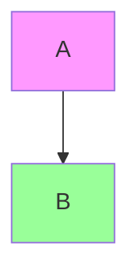

# Example

> **Version**: 1.0 | **Date**: 2026-01-01 | **Type**: Analysis Plan | **Nature**: Generic | **Depth**: 2 - Standard

## Overview
Example.
## Selection Criteria
Nature: generic; Depth: 2; Context: projects; vs other plans.
## Sources to Analyze
Source Code: *.js; exclusions: node_modules
Documentation and Configuration.
## AI-KIDO Agents to Use
### Phase 3.1: Code Scan
**Agent**: agent-aikido-explore-code
**Specialized prompt**:
```
Scan selected files.
```
### Final Validation
**Agent**: agent-aikido-validator
**Specialized prompt**:
```
Validate results.
```
## Extraction Strategy
Detection, Architecture, Tech Stack, Domain, Configuration; estimated time 2 min.
## Full Workflow

2 min.
## Output Format
```markdown
## Configuration
Results, Technical Details, Gaps, Enrichments, Compliance.
Date, Duration, sources and plan.
```
