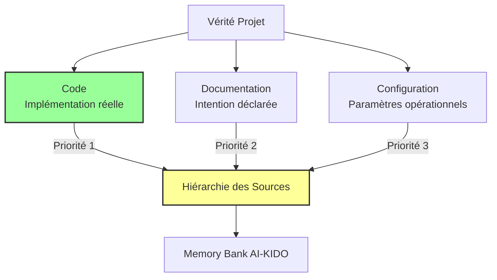
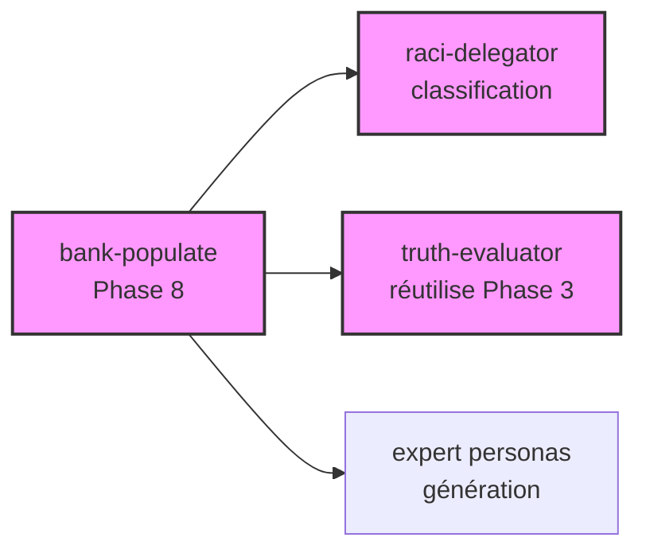

# Analyse de Projet pour Enrichissement Memory Bank AI-KIDO

> **Version** : 1.0
> **Date** : 2025-12-05
> **Statut** : Concept fondamental
> **Lié à** : [Technique analyse-projet](../techniques/analyse-projet.md) *(à créer ultérieurement)*

---

## 🎯 Concept Fondamental

L'**analyse de projet** dans AI-KIDO est le processus de synchronisation entre la **réalité d'un projet** (code, documentation, configuration) et sa **représentation dans la Memory Bank** (concepts, techniques, use cases, personas).

### Principe Directeur

**"Code is Truth"** : En cas de contradiction entre sources, la vérité implémentée (code) prime sur la vérité déclarative (documentation) ou opérationnelle (configuration).

---

## 📊 Architecture Conceptuelle

### Trois Sources de Vérité

### Polymorphisme de l'Analyse

L'analyse s'adapte à **18 natures** × **4 profondeurs** = **72 configurations possibles** :

**Natures d'analyse** :
- **Architecturales** (5) : C1/C2/C3/C4 + globale
- **Techniques** (5) : Stack générale/backend/frontend/infra/sécurité
- **Fonctionnelles** (4) : Générale/domaine/use cases/workflows
- **Méthodologiques** (4) : UML2/RUP/Agile/DevOps

**Profondeurs** :
1. **Survol** : Vue d'ensemble rapide
2. **Standard** : Détail modéré équilibré
3. **Approfondi** : Analyse exhaustive
4. **Expert** : Audit complet avec recommandations

---

## 🔄 Cycle de Synchronisation

### Phase 1 : Extraction (Code → Connaissance)

Extraire de la réalité projet :
- Architecture système réelle
- Stack technique utilisée
- Logique métier implémentée
- Workflows opérationnels

### Phase 2 : Détection (Écarts)

Détecter les contradictions :
- Code vs Documentation (implémentation ≠ spécification)
- Code vs Configuration (dépendances déclarées ≠ utilisées)
- Memory Bank vs Réalité (tables obsolètes)

### Phase 3 : Résolution (Arbitrage)

Arbitrer via **agent-aikido-truth-evaluator** :
- Déterminer source de référence par contexte
- Établir hiérarchie de confiance
- Marquer sources obsolètes

### Phase 4 : Enrichissement (Connaissance → Memory Bank)

Mettre à jour Memory Bank :
- Corriger concepts erronés
- Ajouter techniques détectées
- Documenter use cases implémentés
- Adapter personas aux technologies réelles

### Phase 5 : Organisation (RACI)

Classifier via **agent-aikido-raci-delegator** :
- Attribuer responsabilités par domaine
- Structurer par rôles si multi-projet
- Appliquer matrice RACI organisationnelle

### Phase 6 : Équilibrage (Contraintes AI-KIDO)

Garantir conformité :
- Règle 4 : ≤500 lignes/fichier
- Règle 7 : 3-7 enfants/parent, ≤4 niveaux
- Règle 6 : Liens bidirectionnels préservés

### Phase 7 : Indexation (Navigation)

Synchroniser tous les index :
- Index sectoriels (concepts/techniques/uses/personas)
- Index principal Memory Bank
- Interface AGENTS.md

### Phase 8 : Peuplement (Gaps)

Combler lacunes via **agent-aikido-bank-populate** :
- Identifier documents manquants
- Générer contenu conforme
- Intégrer dans Memory Bank

### Phase 9 : Validation (Qualité)

Valider via **agent-aikido-validator** :
- Vérifier conformité règles AI-KIDO
- Générer quick fixes si écarts
- Garantir qualité globale

---

## 🤖 Orchestration Multi-Agents

L'analyse de projet orchestre **3 agents AI-KIDO** :

### agent-aikido-truth-evaluator (Phase 3)
**Rôle** : Arbitrer contradictions entre sources
**Input** : Résumés contradictions + contexte INVESTIGATION
**Output** : Hiérarchie sources + recommandations
**Gain** : ~60% vs résolution manuelle

### agent-aikido-raci-delegator (Phase 5)
**Rôle** : Classifier documents par domaine/rôle
**Input** : Documents extraits + RACI matrix + contexte mono/multi
**Output** : Mapping Document→Emplacement + confidence
**Gain** : ~85% vs classification manuelle
**Précision** : Near-perfect accuracy

### agent-aikido-bank-populate (Phase 8)
**Rôle** : Générer documents manquants
**Input** : Liste gaps + informations collectées + hiérarchie sources
**Output** : Documents créés et intégrés
**Gain** : ~95% vs rédaction manuelle

### Dépendances Inter-Agents

---

## 📈 Efficacité et ROI

### Sans Agents AI-KIDO
- **Durée** : 4-6 heures (analyse + enrichissement + classification manuels)
- **Erreurs** : Élevées (contradictions mal résolues, classification imprécise)
- **Effort** : 9/10 (cognitif intense)

### Avec 3 Agents AI-KIDO
- **Durée** : 30-45 minutes (automatisation étapes critiques)
- **Erreurs** : Faibles (agents haute précision)
- **Effort** : 3/10 (supervision uniquement)

**Gains globaux** :
- ⚡ Temps : ~85% plus rapide
- 🎯 Erreurs : ~90% moins d'erreurs
- 🧠 Effort : ~70% moins d'effort cognitif

---

## 🎓 Concepts Associés

### Hiérarchie de Vérité

Ordre de priorité des sources en cas de contradiction :
1. **Code** (vérité implémentée) - Priorité absolue
2. **Documentation** (vérité intentionnelle) - Si code ambigu
3. **Configuration** (vérité opérationnelle) - Si code + docs absents
4. **Memory Bank** (vérité établie) - Si aucune source externe

### Configuration Polymorphe

Adaptation automatique de l'analyse selon :
- **Nature** : Quel aspect analyser (architecture, technique, fonctionnel, méthodologique)
- **Profondeur** : Niveau de détail (survol, standard, approfondi, expert)
- **Sources** : Où chercher (code, docs, config, ou combinaison)

### Équilibrage Memory Bank

Application systématique des contraintes AI-KIDO :
- **Split automatique** : Fichiers >500 lignes divisés
- **Regroupement intelligent** : Concepts connexes fusionnés
- **Réorganisation taxonomique** : Hiérarchie ajustée si déséquilibre
- **Préservation liens** : Bidirectionnalité maintenue

---

## 🔗 Références

### Commande d'Exécution
- [Commande analyse-project.md](../../prompts/hard_points/commands/analyse-project.md) - Workflow complet

### Agents Utilisés
- [agent-aikido-truth-evaluator](../personas/agent-aikido-truth-evaluator.md) - Arbitrage contradictions
- [agent-aikido-raci-delegator](../personas/agent-aikido-raci-delegator.md) - Classification RACI
- [agent-aikido-bank-populate](../personas/agent-aikido-bank-populate.md) - Peuplement automatique
- [agent-aikido-validator](../personas/agent-aikido-validator.md) - Validation conformité

### Règles AI-KIDO Appliquées
- [Règle 2](../../hard_points/ai-kido.md) - Séparation théorie/pratique
- [Règle 4](../../hard_points/ai-kido.md) - Contrainte ≤500 lignes
- [Règle 6](../../hard_points/ai-kido.md) - Liens bidirectionnels
- [Règle 7](../../hard_points/ai-kido.md) - Équilibrage d'arbre
- [Règle 8](../../hard_points/ai-kido.md) - Priorité hard_points
- [Règle 11](../../hard_points/ai-kido.md) - Densité sémantique (2 diagrammes Mermaid)
- [Règle 15](../../hard_points/ai-kido.md) - Répartition par rôles

---

*Concept créé le 2025-12-05*
*Conformité AI-KIDO : Règles 2, 4, 6, 11, 12*
