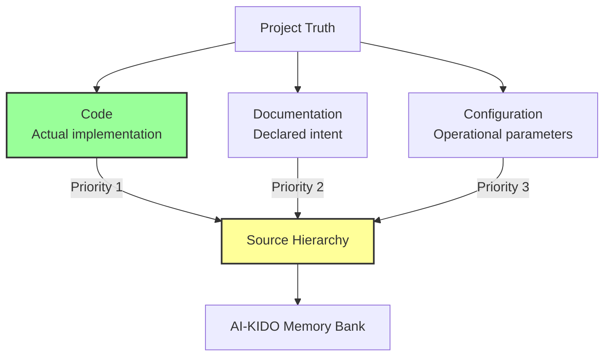
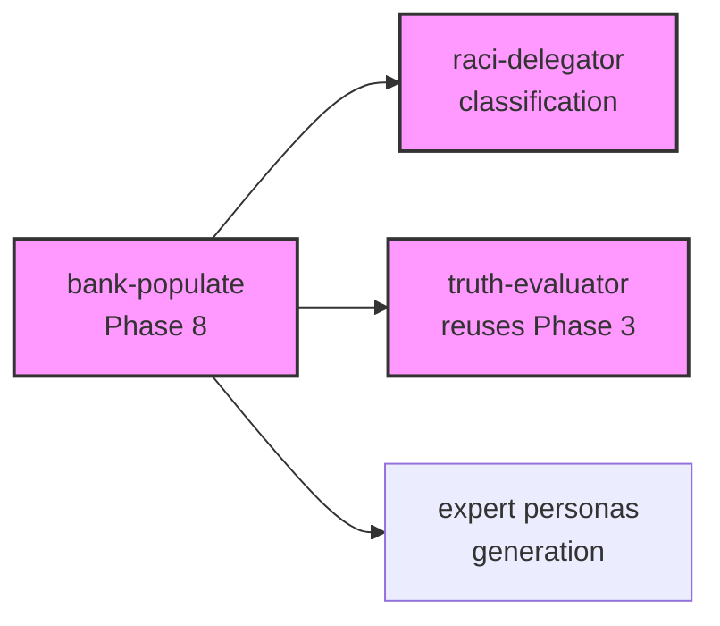

# Project Analysis for AI-KIDO Memory Bank Enrichment

> **Version**: 1.0
> **Date**: 2025-12-05
> **Status**: Fundamental concept
> **Linked to**: [Technique analyse-projet](../techniques/analyse-projet.md) *(to be created later)*

---

## 🎯 Fundamental Concept

**Project analysis** in AI-KIDO is the synchronization process between the **reality of a project** (code, documentation, configuration) and its **representation in the Memory Bank** (concepts, techniques, use cases, personas).

### Guiding Principle

**"Code is Truth"**: In case of contradiction between sources, the implemented truth (code) takes precedence over the declarative truth (documentation) or operational truth (configuration).

---

## 📊 Conceptual Architecture

### Three Sources of Truth

### Polymorphism of Analysis

The analysis adapts to **18 natures** × **4 depths** = **72 possible configurations**:

**Analysis natures**:
- **Architectural** (5): C1/C2/C3/C4 + global
- **Technical** (5): General/backend/frontend/infra/security stack
- **Functional** (4): General/domain/use cases/workflows
- **Methodological** (4): UML2/RUP/Agile/DevOps

**Depths**:
1. **Overview**: Quick high-level view
2. **Standard**: Balanced moderate detail
3. **In-depth**: Exhaustive analysis
4. **Expert**: Complete audit with recommendations

---

## 🔄 Synchronization Cycle

### Phase 1: Extraction (Code → Knowledge)

Extract from project reality:
- Actual system architecture
- Technology stack in use
- Implemented business logic
- Operational workflows

### Phase 2: Detection (Gaps)

Detect contradictions:
- Code vs Documentation (implementation ≠ specification)
- Code vs Configuration (declared dependencies ≠ used)
- Memory Bank vs Reality (outdated tables)

### Phase 3: Resolution (Arbitration)

Arbitrate via **agent-aikido-truth-evaluator**:
- Determine reference source by context
- Establish trust hierarchy
- Mark obsolete sources

### Phase 4: Enrichment (Knowledge → Memory Bank)

Update Memory Bank:
- Correct erroneous concepts
- Add detected techniques
- Document implemented use cases
- Adapt personas to actual technologies

### Phase 5: Organization (RACI)

Classify via **agent-aikido-raci-delegator**:
- Assign responsibilities by domain
- Structure by roles if multi-project
- Apply organizational RACI matrix

### Phase 6: Balancing (AI-KIDO Constraints)

Ensure compliance:
- Rule 4: ≤500 lines/file
- Rule 7: 3-7 children/parent, ≤4 levels
- Rule 6: Bidirectional links preserved

### Phase 7: Indexing (Navigation)

Synchronize all indexes:
- Domain indexes (concepts/techniques/uses/personas)
- Main Memory Bank index
- AGENTS.md interface

### Phase 8: Population (Gaps)

Fill gaps via **agent-aikido-bank-populate**:
- Identify missing documents
- Generate compliant content
- Integrate into Memory Bank

### Phase 9: Validation (Quality)

Validate via **agent-aikido-validator**:
- Verify compliance with AI-KIDO rules
- Generate quick fixes if gaps found
- Ensure overall quality

---

## 🤖 Multi-Agent Orchestration

Project analysis orchestrates **3 AI-KIDO agents**:

### agent-aikido-truth-evaluator (Phase 3)
**Role**: Arbitrate contradictions between sources
**Input**: Contradiction summaries + INVESTIGATION context
**Output**: Source hierarchy + recommendations
**Gain**: ~60% vs manual resolution

### agent-aikido-raci-delegator (Phase 5)
**Role**: Classify documents by domain/role
**Input**: Extracted documents + RACI matrix + mono/multi context
**Output**: Document→Location mapping + confidence
**Gain**: ~85% vs manual classification
**Precision**: Near-perfect accuracy

### agent-aikido-bank-populate (Phase 8)
**Role**: Generate missing documents
**Input**: Gap list + collected information + source hierarchy
**Output**: Created and integrated documents
**Gain**: ~95% vs manual writing

### Inter-Agent Dependencies

---

## 📈 Efficiency and ROI

### Without AI-KIDO Agents
- **Duration**: 4-6 hours (manual analysis + enrichment + classification)
- **Errors**: High (poorly resolved contradictions, imprecise classification)
- **Effort**: 9/10 (cognitively intensive)

### With 3 AI-KIDO Agents
- **Duration**: 30-45 minutes (automation of critical steps)
- **Errors**: Low (high-precision agents)
- **Effort**: 3/10 (supervision only)

**Overall gains**:
- ⚡ Time: ~85% faster
- 🎯 Errors: ~90% fewer errors
- 🧠 Effort: ~70% less cognitive effort

---

## 🎓 Related Concepts

### Truth Hierarchy

Source priority order in case of contradiction:
1. **Code** (implemented truth) - Absolute priority
2. **Documentation** (intentional truth) - If code is ambiguous
3. **Configuration** (operational truth) - If code + docs are absent
4. **Memory Bank** (established truth) - If no external source

### Polymorphic Configuration

Automatic adaptation of analysis based on:
- **Nature**: Which aspect to analyze (architectural, technical, functional, methodological)
- **Depth**: Level of detail (overview, standard, in-depth, expert)
- **Sources**: Where to look (code, docs, config, or combination)

### Memory Bank Balancing

Systematic application of AI-KIDO constraints:
- **Automatic split**: Files >500 lines divided
- **Intelligent grouping**: Related concepts merged
- **Taxonomic reorganization**: Hierarchy adjusted if unbalanced
- **Link preservation**: Bidirectionality maintained

---

## 🔗 References

### Execution Command
- [Command analyse-project.md](../../prompts/hard_points/commands/analyse-project.md) - Complete workflow

### Agents Used
- [agent-aikido-truth-evaluator](../personas/agent-aikido-truth-evaluator.md) - Contradiction arbitration
- [agent-aikido-raci-delegator](../personas/agent-aikido-raci-delegator.md) - RACI classification
- [agent-aikido-bank-populate](../personas/agent-aikido-bank-populate.md) - Automatic population
- [agent-aikido-validator](../personas/agent-aikido-validator.md) - Compliance validation

### AI-KIDO Rules Applied
- [Rule 2](../../hard_points/ai-kido.md) - Theory/practice separation
- [Rule 4](../../hard_points/ai-kido.md) - ≤500 lines constraint
- [Rule 6](../../hard_points/ai-kido.md) - Bidirectional links
- [Rule 7](../../hard_points/ai-kido.md) - Tree balancing
- [Rule 8](../../hard_points/ai-kido.md) - Hard points priority
- [Rule 11](../../hard_points/ai-kido.md) - Semantic density (2 Mermaid diagrams)
- [Rule 15](../../hard_points/ai-kido.md) - Distribution by roles

---

*Concept created on 2025-12-05*
*AI-KIDO Compliance: Rules 2, 4, 6, 11, 12*
