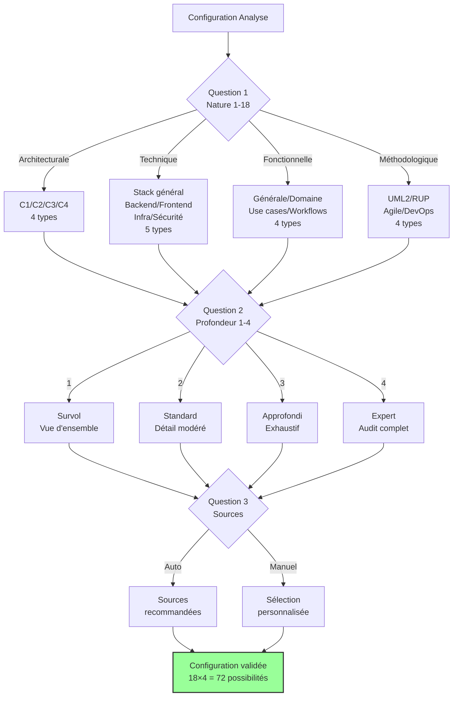
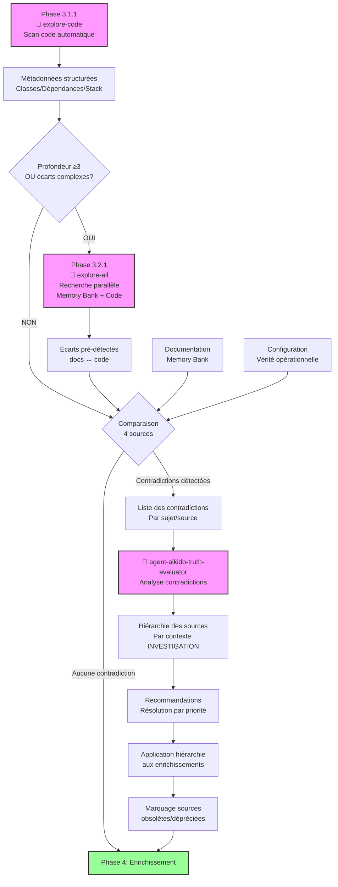
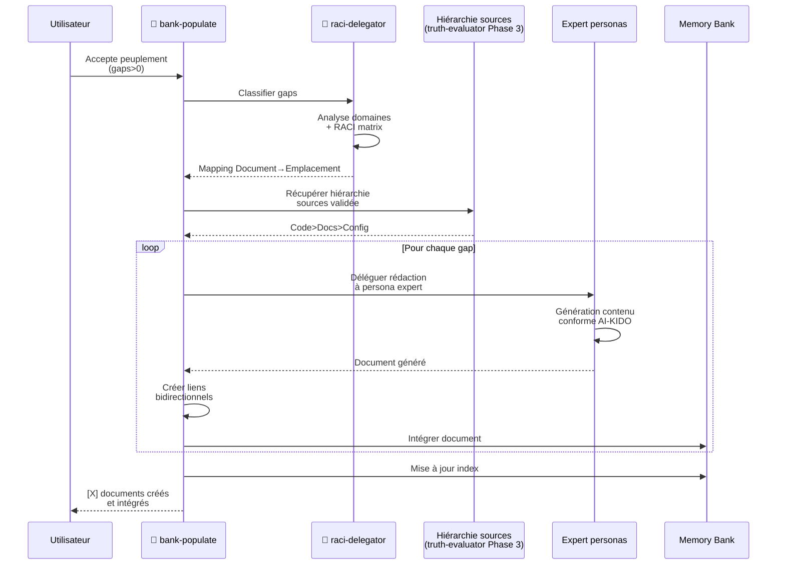

# Commande Analyse-Project

Analyse les sources projet existantes (code, documentation, configuration) pour alimenter et enrichir les tables de vérités AI-KIDO existantes dans [`/prompts/gen/`](../prompts/gen/). Cette commande priorise la vérité du code sur la documentation et gère les contradictions par validation utilisateur.

**Concept théorique associé** : [Analyse de projet](../prompts/gen/concepts/analyse-projet.md) (Règle AI-KIDO 2 : séparation théorie/pratique)

### Vue d'Ensemble du Workflow

```mermaid
graph TB
    START[Démarrage] --> P1[Phase 1: Configuration Polymorphe<br/>18 types × 4 profondeurs]
    P1 --> P1_5[Phase 1.5: Résolution Plan 📋<br/>Validation utilisateur]
    P1_5 -->|Plan validé| P2[Phase 2: Scan Memory Bank<br/>+ Détection RACI]
    P1_5 -.->|Plan refusé| CREATE[/create-analyse-plan]
    CREATE -.-> P1
    P2 --> P3_1[Phase 3.1: 🤖 explore-code<br/>Scan automatique code source<br/>Métadonnées + line numbers]

    P3_1 --> DEPTH{Profondeur ≥3<br/>OU écarts complexes?}
    DEPTH -->|OUI| P3_2[Phase 3.2: 🤖 agent-aikido-explore-all<br/>Recherche parallèle<br/>Memory Bank + Code]
    DEPTH -->|NON| P3_3
    P3_2 --> P3_3[Phase 3.2: Détection Écarts<br/>Code/Docs/Config]

    P3_3 -->|SI contradictions| A1[🤖 truth-evaluator<br/>Hiérarchie sources + justification]
    A1 --> P4
    P3_3 --> P4[Phase 4: Enrichissement<br/>Concepts/Techniques/Uses/Personas<br/>depuis métadonnées explore-code]

    P4 --> P5[Phase 5: Répartition RACI]
    P5 -->|SI RACI activé| A2[🤖 agent-aikido-raci-delegator<br/>Classification automatique]
    A2 --> P6
    P5 --> P6[Phase 6: Équilibrage AI-KIDO<br/>≤500 lignes, 3-7 enfants, ≤4 niveaux]
    P6 --> P7[Phase 7: Indexation<br/>6 fichiers index]
    P7 --> P8[Phase 8: Peuplement Automatique]
    P8 -->|SI gaps>0 ET accepté| A3[🤖 agent-aikido-bank-populate<br/>+ raci-delegator + personas]
    A3 --> P9
    P8 --> P9[Phase 9: 🤖 validator<br/>Validation Conformité]
    P9 -->|SI non conforme| FIX[Application quick fixes]
    FIX --> P9
    P9 --> END[✅ Memory Bank synchronisée et validée]

    style P3_1 fill:#f9f,stroke:#333,stroke-width:2px
    style P3_2 fill:#f9f,stroke:#333,stroke-width:2px
    style A1 fill:#f9f,stroke:#333,stroke-width:2px
    style A2 fill:#f9f,stroke:#333,stroke-width:2px
    style A3 fill:#f9f,stroke:#333,stroke-width:2px
    style P9 fill:#f9f,stroke:#333,stroke-width:2px
    style END fill:#9f9,stroke:#333,stroke-width:2px
```

## Exécution

### Phase 1 : Configuration de l'Analyse Polymorphe

#### 1.1 Définition de la Nature de l'Analyse

Poser la **Question 1 : Nature de l'analyse**
```
Quelle nature d'analyse souhaitez-vous effectuer ?

ANALYSES ARCHITECTURALES :
1. Analyse globale simple (vue d'ensemble générale)
2. Analyse système C1 (contexte et utilisateurs)
3. Analyse conteneurs C2 (composants de haut niveau)
4. Analyse composants C3 (détail des composants)
5. Analyse code C4 (implémentation détaillée)

ANALYSES TECHNIQUES :
6. Stack technique générale (technologies globales)
7. Stack backend spécifique (serveur, APIs, données)
8. Stack frontend spécifique (interface, UX, client)
9. Stack infrastructure (déploiement, ops, monitoring)
10. Stack sécurité (authentification, autorisation, chiffrement)

ANALYSES FONCTIONNELLES :
11. Analyse fonctionnelle générale (processus métier globaux)
12. Analyse domaine spécifique (secteur d'activité particulier)
13. Analyse use cases (scénarios d'utilisation)
14. Analyse workflows (processus opérationnels)

ANALYSES MÉTHODOLOGIQUES :
15. Analyse UML2 (modélisation orientée objet)
16. Analyse RUP (processus unifié)
17. Analyse Agile (méthodes itératives)
18. Analyse DevOps (intégration continue)

Votre choix (1-18) :
```

### Architecture de Configuration



#### 1.2 Définition de la Profondeur de l'Analyse

Poser la **Question 2 : Profondeur de l'analyse**
```
Quelle profondeur d'analyse souhaitez-vous appliquer ?

NIVEAUX DE PROFONDEUR :

NIVEAU 1 - SURVOL (Rapide, vue d'ensemble)
- Identification des éléments principaux
- Cartographie de base
- Détection des patterns majeurs
- Durée estimée : Courte

NIVEAU 2 - STANDARD (Équilibré, détail modéré)
- Analyse des relations et dépendances
- Identification des problématiques
- Documentation des choix architecturaux
- Durée estimée : Moyenne

NIVEAU 3 - APPROFONDI (Détaillé, exhaustif)
- Analyse fine des implémentations
- Détection des anti-patterns
- Recommandations d'optimisation
- Durée estimée : Longue

NIVEAU 4 - EXPERT (Très détaillé, spécialisé)
- Audit complet et recommandations
- Analyse de performance et sécurité
- Plan de refactoring si nécessaire
- Durée estimée : Très longue

Votre choix (1/2/3/4) :
```

#### 1.3 Sélection des Sources selon la Configuration

**Adapter automatiquement les sources** selon la nature et profondeur choisies :
```
🎯 CONFIGURATION D'ANALYSE SÉLECTIONNÉE :

Nature : [TYPE_ANALYSE] - [DESCRIPTION]
Profondeur : Niveau [NIVEAU] - [DESCRIPTION_PROFONDEUR]

Sources recommandées pour cette configuration :
[Liste adaptée selon le type d'analyse choisi]

Voulez-vous utiliser les sources recommandées ? (o/n)
Si non, personnalisez votre sélection :
```

**Si choix personnalisé**, poser la **Question 3 : Sources d'analyse personnalisées**
```
Quelles sources voulez-vous analyser pour cette analyse [TYPE_ANALYSE] ?

Options disponibles :
1. Sources code uniquement (src/, lib/, components/, etc.)
2. Documentation uniquement (docs/, README, etc.)
3. Configuration uniquement (package.json, docker, CI/CD, etc.)
4. Analyse combinée complète (code + docs + config)
5. Sélection manuelle de répertoires spécifiques

Votre choix (1/2/3/4/5) :
```

**Si choix 1** : Scanner automatiquement les répertoires de code
```
🔍 DÉTECTION AUTOMATIQUE DES SOURCES CODE :

Répertoires code détectés :
[Liste automatique : src/, lib/, components/, modules/, services/, etc.]

Voulez-vous analyser tous ces répertoires ? (o/n)
Si non, sélectionnez les répertoires à analyser :
```

**Si choix 2** : Scanner automatiquement la documentation
```
📚 DÉTECTION AUTOMATIQUE DE LA DOCUMENTATION :

Documentation détectée :
[Liste automatique : docs/, README.md, CHANGELOG.md, wiki/, etc.]

Voulez-vous analyser toute cette documentation ? (o/n)
Si non, sélectionnez les fichiers à analyser :
```

**Si choix 3** : Scanner automatiquement la configuration
```
⚙️ DÉTECTION AUTOMATIQUE DE LA CONFIGURATION :

Fichiers de configuration détectés :
[Liste automatique : package.json, docker-compose.yml, .github/, etc.]

Voulez-vous analyser tous ces fichiers ? (o/n)
Si non, sélectionnez les fichiers à analyser :
```

**Si choix 4** : Analyse combinée complète automatique

**Si choix 5** : Sélection manuelle
```
Listez les chemins des répertoires/fichiers à analyser (séparés par des virgules) :
Exemple : src/components, docs/architecture.md, docker-compose.yml

Votre sélection :
```

### Phase 1.5 : Résolution et Validation du Plan d'Analyse 📋

**NOUVELLE PHASE V2.0** : `/analyse-project` utilise désormais un système de **plans d'analyse** (similaire aux search plans de `explore-code`) pour cibler et optimiser l'analyse.

#### 1.5.1 Résolution du Plan Optimal

Résoudre automatiquement le plan d'analyse le plus spécifique disponible :

```bash
# Base path des plans
PLANS_BASE="prompts/hard_points/system/analyse/plans"

# Mapper nature (1-18) → catégorie + sous-type
case "$NATURE_CHOICE" in
    1) CATEGORY="generale"; SUB_TYPE="" ;;
    2) CATEGORY="architecturale"; SUB_TYPE="c1" ;;
    3) CATEGORY="architecturale"; SUB_TYPE="c2" ;;
    4) CATEGORY="architecturale"; SUB_TYPE="c3" ;;
    5) CATEGORY="architecturale"; SUB_TYPE="c4" ;;
    6) CATEGORY="technique"; SUB_TYPE="stack-generale" ;;
    7) CATEGORY="technique"; SUB_TYPE="backend" ;;
    8) CATEGORY="technique"; SUB_TYPE="frontend" ;;
    9) CATEGORY="technique"; SUB_TYPE="infrastructure" ;;
    10) CATEGORY="technique"; SUB_TYPE="securite" ;;
    11) CATEGORY="fonctionnelle"; SUB_TYPE="generale" ;;
    12) CATEGORY="fonctionnelle"; SUB_TYPE="domaine" ;;
    13) CATEGORY="fonctionnelle"; SUB_TYPE="use-cases" ;;
    14) CATEGORY="fonctionnelle"; SUB_TYPE="workflows" ;;
    15) CATEGORY="methodologique"; SUB_TYPE="uml2" ;;
    16) CATEGORY="methodologique"; SUB_TYPE="rup" ;;
    17) CATEGORY="methodologique"; SUB_TYPE="agile" ;;
    18) CATEGORY="methodologique"; SUB_TYPE="devops" ;;
esac

# Mapper profondeur (1-4) → nom
case "$DEPTH_CHOICE" in
    1) DEPTH_NAME="survol" ;;
    2) DEPTH_NAME="standard" ;;
    3) DEPTH_NAME="approfondi" ;;
    4) DEPTH_NAME="expert" ;;
esac

# Algorithme de résolution (priorité spécificité)
RESOLVED_PLAN=""

# Niveau 1 : Catégorie + Sous-type + Profondeur (le plus spécifique)
if [ -n "$SUB_TYPE" ]; then
    SPECIFIC_PLAN="$PLANS_BASE/$CATEGORY/$SUB_TYPE/plan-$DEPTH_NAME.md"
    if [ -f "$SPECIFIC_PLAN" ]; then
        RESOLVED_PLAN="$SPECIFIC_PLAN"
    fi
fi

# Niveau 2 : Catégorie + Profondeur (si niveau 1 pas trouvé)
if [ -z "$RESOLVED_PLAN" ] && [ "$CATEGORY" != "generale" ]; then
    CATEGORY_PLAN="$PLANS_BASE/$CATEGORY/plan-$DEPTH_NAME.md"
    if [ -f "$CATEGORY_PLAN" ]; then
        RESOLVED_PLAN="$CATEGORY_PLAN"
    fi
fi

# Niveau 3 : Fallback générique par profondeur (toujours disponible)
if [ -z "$RESOLVED_PLAN" ]; then
    RESOLVED_PLAN="$PLANS_BASE/plan-$DEPTH_NAME.md"
fi
```

#### 1.5.2 Affichage du Plan Résolu

Afficher le plan trouvé avec ses caractéristiques :

```
📋 PLAN D'ANALYSE RÉSOLU

**Plan sélectionné** : {RESOLVED_PLAN}
**Type** : {PLAN_TYPE} (spécifique / catégorie / générique)

**Critères de sélection du plan** :
{PLAN_SELECTION_CRITERIA}

**Stratégie d'analyse** :
- **Sources prioritaires** : {PRIORITY_SOURCES}
- **Agents mobilisés** : {AGENTS_LIST}
- **Méthode extraction** : {EXTRACTION_METHOD}
- **Durée estimée** : {ESTIMATED_TIME}

**Spécificités de ce plan** :
{PLAN_SPECIFIC_FEATURES}
```

Exemple concret :
```
📋 PLAN D'ANALYSE RÉSOLU

**Plan sélectionné** : prompts/hard_points/system/analyse/plans/architecturale/c1/plan-standard.md
**Type** : Plan spécifique (architecturale C1, profondeur 2)

**Critères de sélection du plan** :
- Nature : 2 - Analyse système C1 (contexte et utilisateurs)
- Profondeur : 2 - Standard (détail modéré, équilibré)
- Contexte : Compréhension architecture externe, intégrations

**Stratégie d'analyse** :
- **Sources prioritaires** : README.md, ARCHITECTURE.md, docs/api/, docker-compose.yml
- **Agents mobilisés** : explore-code, truth-evaluator (si contradictions), validator
- **Méthode extraction** : Détection utilisateurs/acteurs, systèmes externes, frontières système
- **Durée estimée** : 10-20 minutes

**Spécificités de ce plan** :
- Focus sur interactions externes et contexte système
- Génération diagramme contexte C1 (Mermaid)
- Identification acteurs et intégrations
- Pas d'analyse implémentation détaillée (voir C3/C4)
```

#### 1.5.3 Validation Utilisateur

Demander confirmation d'utilisation du plan :

```
✅ Utiliser ce plan pour l'analyse ? (o/n)

Options :
  o - Oui, utiliser ce plan (RECOMMANDÉ)
  n - Non, je souhaite un plan différent ou personnalisé
  i - Afficher plus d'informations sur ce plan

Votre choix (o/n/i) :
```

**Si choix "i"** : Afficher détails complets du plan
```bash
# Lire et afficher les sections clés du plan
cat "$RESOLVED_PLAN" | grep -A 20 "## 📋 Overview"
cat "$RESOLVED_PLAN" | grep -A 10 "## 🎯 Critères de Sélection"
cat "$RESOLVED_PLAN" | grep -A 15 "## 🤖 Agents AI-KIDO"
```

**Si choix "n"** : Proposer alternatives
```
❌ Plan refusé. Options alternatives :

1. Créer un plan spécifique personnalisé
   → Lancer /create-analyse-plan pour générer un plan sur mesure

2. Modifier la configuration
   → Revenir à Phase 1 et choisir autre nature/profondeur

3. Utiliser le plan fallback générique
   → Plan générique profondeur {DEPTH_NAME} (moins ciblé)

Votre choix (1/2/3) :
```

**Si choix 1** : Proposer création plan
```bash
echo "💡 Pour créer un plan personnalisé, exécutez :"
echo "  /create-analyse-plan"
echo ""
echo "Puis relancez /analyse-project avec la même configuration."
exit 0
```

**Si choix 3** : Utiliser fallback générique
```bash
RESOLVED_PLAN="$PLANS_BASE/plan-$DEPTH_NAME.md"
echo "✅ Utilisation du plan générique : $RESOLVED_PLAN"
```

**Si choix "o"** : Continuer avec le plan sélectionné
```
✅ Plan validé : {RESOLVED_PLAN}

📖 Chargement de la stratégie d'analyse...
```

#### 1.5.4 Chargement de la Stratégie du Plan

Extraire et charger les paramètres clés du plan :

```bash
# Charger le plan complet
PLAN_CONTENT=$(cat "$RESOLVED_PLAN")

# Extraire sections clés (parsing Markdown)
PRIORITY_SOURCES=$(echo "$PLAN_CONTENT" | sed -n '/## 🔍 Sources à Analyser/,/##/p' | grep -A 20 "### Sources Prioritaires")
AGENTS_STRATEGY=$(echo "$PLAN_CONTENT" | sed -n '/## 🤖 Agents AI-KIDO/,/##/p')
EXTRACTION_METHOD=$(echo "$PLAN_CONTENT" | sed -n '/## 📊 Stratégie d.Extraction/,/##/p')
WORKFLOW=$(echo "$PLAN_CONTENT" | sed -n '/## 🔄 Workflow Complet/,/##/p')

# Stocker pour utilisation dans phases suivantes
export ANALYSIS_PLAN_PATH="$RESOLVED_PLAN"
export ANALYSIS_PLAN_SOURCES="$PRIORITY_SOURCES"
export ANALYSIS_PLAN_AGENTS="$AGENTS_STRATEGY"
export ANALYSIS_PLAN_EXTRACTION="$EXTRACTION_METHOD"
export ANALYSIS_PLAN_WORKFLOW="$WORKFLOW"

echo "✅ Stratégie chargée depuis : $RESOLVED_PLAN"
echo ""
echo "🎯 L'analyse suivra la stratégie définie dans le plan."
echo "   Les phases 2-9 seront adaptées selon cette stratégie."
echo ""
```

#### 1.5.5 Adaptation des Phases Suivantes

Les phases 2-9 utiliseront automatiquement la stratégie du plan :

```
📌 ADAPTATION DES PHASES SELON LE PLAN

Phase 2 (Scan Memory Bank) : {ADAPTED_STRATEGY}
Phase 3.1 (explore-code) : Prompt adapté depuis plan
Phase 3.2 (explore-all) : {CONDITIONAL_USAGE}
Phase 4 (Enrichissement) : Focus sur {ENRICHMENT_AREAS}
Phase 5 (RACI) : {RACI_STRATEGY}
Phase 8 (Peuplement) : {POPULATE_STRATEGY}
Phase 9 (Validation) : {VALIDATION_RULES}

▶️  Passage à Phase 2...
```

**Avantages du système de plans** :
- ✅ **Analyse ciblée** : Stratégie adaptée au type d'analyse
- ✅ **Performance** : Évite l'analyse exhaustive inutile
- ✅ **Customisation** : Plans modifiables par projet
- ✅ **Capitalisation** : Meilleures pratiques centralisées
- ✅ **Validation utilisateur** : Contrôle avant exécution

---

### Phase 2 : Analyse des Tables de Vérités et Spécifications RACI Existantes

#### 2.1 Scanner l'État Actuel de la Memory Bank

**Analyser l'état actuel des tables de vérités** :
```
📊 ÉTAT ACTUEL DES TABLES DE VÉRITÉS :

Concepts existants : [NOMBRE] fichiers dans /prompts/gen/concepts/
Techniques existantes : [NOMBRE] fichiers dans /prompts/gen/techniques/
Use cases existants : [NOMBRE] fichiers dans /prompts/gen/use_cases/
Personas existants : [NOMBRE] fichiers dans /prompts/gen/personas/

Dernière mise à jour : [DATE]
```

#### 2.2 Vérification des Spécifications RACI Organisationnelles

**Rechercher les spécifications RACI** dans [`/prompts/index.md`](../prompts/index.md) et [`/prompts/hard_points/index.md`](../prompts/hard_points/index.md) :
```
🏗️ SPÉCIFICATIONS RACI DÉTECTÉES :

Organisations configurées :
[Liste des fichiers aikido-raci-*.md trouvés dans hard_points]

Si spécifications RACI trouvées :
- Organisation : [TEAM-NAME]
- Rôles définis : [NOMBRE]
- Workflow : [ÉTAPES_WORKFLOW]
- Structure par rôles : ✅/❌

Utiliser ces spécifications pour l'organisation des enrichissements ? (o/n)
```

**Si aucune spécification RACI** :
```
⚠️ AUCUNE SPÉCIFICATION RACI DÉTECTÉE

Aucun fichier aikido-raci-*.md trouvé dans /prompts/hard_points/

Options :
1. Continuer sans organisation par rôles (structure plate)
2. Exécuter d'abord init-raci-aikido pour définir l'organisation
3. Créer une organisation temporaire pour cette analyse

Votre choix (1/2/3) :
```

### Phase 3 : Extraction et Analyse des Sources

#### 3.1 Analyse Prioritaire du Code (Vérité de référence)

##### 3.1.1 Scan Automatique du Code Source 🤖

**UTILISER L'AGENT** `agent-aikido-explore-code` pour analyser automatiquement le code source :

```markdown
🤖 AGENT: agent-aikido-explore-code

**Prompt pour l'agent** :
"FORMAT: JSON

Analyse le code source du projet selon la configuration d'analyse sélectionnée :

Configuration :
- Nature : [TYPE_ANALYSE depuis Phase 1]
- Profondeur : Niveau [NIVEAU depuis Phase 1]
- Sources : [CHEMINS_SÉLECTIONNÉS depuis Phase 1]

Recherche et extrait :
1. **Architecture réelle** : Classes, interfaces, modules, composants
2. **Dépendances** : Imports, extends, implements, uses
3. **Stack technique** : Technologies, frameworks, versions (depuis package.json, composer.json, etc.)
4. **Patterns** : Détection patterns architecturaux (MVC, MVVM, microservices, etc.)

Technology-aware :
- Auto-détection langage principal (PHP, JavaScript/TypeScript, Python, Java, etc.)
- Utilisation plan recherche approprié (generic/php/javascript)
- Résolution PSR-4 (PHP) et ES Modules (JS/TS) si applicable

Output attendu :
- Métadonnées structurées avec line numbers
- Graphe de dépendances (Mermaid)
- ~50 lignes par fichier analysé
- Format compact (<2500 tokens total)"

**Résultat attendu** : Cartographie structurée de l'architecture réelle du code
```

**Avantages de l'agent explore-code** :
- ✅ **Extraction automatique** : Classes, interfaces, functions avec line numbers
- ✅ **Technology-aware** : Plans spécialisés (PHP, JS/TS, generic)
- ✅ **Dépendances précises** : Graphe complet extends/implements/imports
- ✅ **Output compact** : ~50 lignes/fichier vs analyse manuelle lourde
- ✅ **Métadonnées structurées** : Prêtes pour enrichissement Memory Bank

##### 3.1.2 Interprétation des Résultats explore-code

**A. Architecture réelle détectée** (depuis métadonnées explore-code) :
1. **Structure des répertoires et modules** :
   - Patterns détectés : [MVC/MVVM/Microservices/etc.]
   - Organisation par domaine/fonctionnalité
   - Points d'entrée identifiés avec line numbers

2. **Composants et relations** :
   - Classes principales : [LISTE avec lignes]
   - Interfaces exposées : [LISTE avec lignes]
   - Dépendances critiques : [Graphe Mermaid]

**B. Stack technique réelle** (depuis métadonnées explore-code) :
1. **Technologies effectivement utilisées** :
   - Langage principal : [PHP/JavaScript/TypeScript/etc.]
   - Frameworks détectés : [Laravel/Symfony/React/Vue/etc.]
   - Versions : [Depuis package.json/composer.json]

2. **Dépendances externes** :
   - Bibliothèques importées : [LISTE]
   - Modules natifs utilisés : [LISTE]

**C. Logique métier implémentée** (depuis métadonnées explore-code) :
1. **Modèles de données réels** :
   - Entités détectées : [LISTE avec lignes]
   - Relations entre entités : [Graphe]

2. **APIs et interfaces exposées** :
   - Endpoints détectés : [LISTE]
   - Méthodes publiques : [LISTE avec signatures]

**B. Analyse de la Documentation (Vérité déclarative)** :
1. **Architecture documentée** :
   - Diagrammes et spécifications
   - Décisions architecturales
   - Contraintes et exigences

2. **Processus documentés** :
   - Workflows décrits
   - Procédures et guidelines
   - Standards et conventions

**D. Analyse de la Configuration (Vérité opérationnelle)** :
1. **Infrastructure réelle** :
   - Environnements configurés
   - Services et dépendances
   - Paramètres de déploiement

#### 3.2 Détection Automatique des Écarts et Contradictions 🤖

##### 3.2.1 Recherche Parallèle Memory Bank + Code (Optionnel)

**OPTION : UTILISER L'AGENT** `agent-aikido-explore-all` pour recherche globale :

```markdown
🤖 AGENT: agent-aikido-explore-all (OPTIONNEL)

**Quand utiliser cet agent** :
- Profondeur analyse ≥ 3 (APPROFONDI ou EXPERT)
- OU besoin vue complète documentation + implémentation
- OU détection écarts complexes entre specs et code

**Prompt pour l'agent** :
"FORMAT: JSON

Recherche parallèle dans Memory Bank ET code source pour détecter écarts :

Recherche dans Memory Bank (/prompts/gen/) :
- Concepts architecture documentés
- Techniques stack documentées
- Use cases processus documentés
- Glossaire termes métier

Recherche dans Code Source (hors /prompts/) :
- Architecture réellement implémentée
- Stack technique réellement utilisée
- Processus réellement codés
- Termes métier dans le code

Keywords recherche :
[LISTE selon TYPE_ANALYSE : architecture, stack, processus, domaine, etc.]

Output attendu :
- Vue complète Memory Bank + Code en parallèle
- Cross-references entre documentation et implémentation
- Écarts détectés automatiquement"

**Résultat attendu** : Rapport complet avec écarts pré-identifiés
```

**Avantages de l'agent explore-all** :
- ✅ **Recherche parallèle** : Memory Bank + Code simultanément (3-5s total)
- ✅ **Écarts automatiques** : Détection contradictions docs ↔ code
- ✅ **Vue complète** : Documentation + Implémentation en un seul rapport
- ✅ **Cross-references** : Liens entre concepts documentés et code réel

**SI explore-all NON utilisé** : Passer directement à 3.2.2 avec comparaison manuelle

##### 3.2.2 Comparaison Systématique des Sources

**Comparer systématiquement** (avec ou sans explore-all) :
1. **Code vs Documentation** : Architecture implémentée vs documentée
   - Depuis métadonnées explore-code vs Memory Bank
2. **Code vs Configuration** : Dépendances déclarées vs utilisées
   - Depuis explore-code imports vs package.json/composer.json
3. **Documentation vs Configuration** : Processus décrits vs configurés
   - Depuis Memory Bank vs fichiers config
4. **Existant vs Nouveau** : Tables de vérités vs réalité détectée
   - Depuis Memory Bank vs résultats explore-code

### Processus de Résolution des Contradictions



##### 3.2.3 Validation des Contradictions Détectées

**Pour chaque contradiction détectée** (depuis explore-code, explore-all, ou comparaison manuelle) :
```
⚠️ CONTRADICTION DÉTECTÉE :

Sujet : [Architecture/Stack/Processus/etc.]
Source CODE (explore-code) : [Ce qui est implémenté avec line numbers]
Source DOCS (Memory Bank) : [Ce qui est documenté]
Source CONFIG : [Ce qui est configuré]
Tables de vérités actuelles : [Ce qui est enregistré]

Quelle vérité adopter ?
1. Prioriser le code (vérité implémentée - métadonnées explore-code)
2. Prioriser la documentation (vérité intentionnelle - Memory Bank)
3. Prioriser la configuration (vérité opérationnelle - fichiers config)
4. Prioriser les tables existantes (vérité établie - Memory Bank)
5. Utiliser agent truth-evaluator (analyse automatique hiérarchie)

Votre choix :
```

##### 3.2.4 Résolution Automatique des Contradictions 🤖

**SI choix 5 OU contradictions multiples complexes, UTILISER L'AGENT** `agent-aikido-truth-evaluator` :

```markdown
🤖 AGENT: agent-aikido-truth-evaluator

**Prompt pour l'agent** :
"FORMAT: JSON

Analyse les contradictions détectées entre sources :

Code (depuis explore-code) :
- [Résumé avec line numbers des éléments contradictoires]

Documentation (depuis Memory Bank ou explore-all) :
- [Résumé des éléments contradictoires]

Configuration :
- [Résumé des éléments contradictoires]

Contexte : Analyse projet existant (scénario: INVESTIGATION)

Détermine quelle source représente la vérité pour chaque contradiction et fournis la hiérarchie des sources avec justification."

**Résultat attendu** : Hiérarchie des sources avec recommandations de résolution et niveau de confiance
```

**Appliquer la hiérarchie** retournée par l'agent pour :
- Prioriser les sources fiables lors de l'extraction
- Marquer les sources obsolètes/dépréciées dans Memory Bank
- Orienter les mises à jour avec références précises (line numbers depuis explore-code)

**Exemple de résolution automatique** :
```
✅ HIÉRARCHIE DÉTERMINÉE PAR TRUTH-EVALUATOR :

Contradiction : Architecture backend
Scénario : INVESTIGATION
Hiérarchie recommandée : CODE (95%) > CONFIG (80%) > DOCS (20% - obsolète)

Justification :
- Code (src/gateway/index.ts:15) : Implémentation microservices active et testée
- Config (docker-compose.yml) : Confirme architecture distribuée (5 services)
- Docs (/prompts/gen/concepts/architecture.md) : Décrit architecture monolithique (outdated)

Action : Mettre à jour Memory Bank avec réalité microservices depuis explore-code
Sources à marquer obsolètes : concepts/architecture.md (section "Backend monolithique")
```

### Phase 4 : Enrichissement des Tables de Vérités

#### 4.1 Mise à Jour des Concepts

**Enrichir [`/prompts/gen/concepts/`](../prompts/gen/concepts/)** :
- Mettre à jour l'architecture système avec la réalité détectée
- Enrichir le glossaire avec les termes trouvés dans le code
- Ajouter les nouveaux concepts métier identifiés
- Corriger les définitions contradictoires

#### 4.2 Mise à Jour des Techniques

**Enrichir [`/prompts/gen/techniques/`](../prompts/gen/techniques/)** :
- Mettre à jour la stack technique avec les technologies réelles
- Ajouter les patterns et pratiques détectés dans le code
- Documenter les techniques de déploiement configurées
- Enrichir les méthodes de développement observées

#### 4.3 Mise à Jour des Use Cases

**Enrichir [`/prompts/gen/use_cases/`](../prompts/gen/use_cases/)** :
- Ajouter les cas d'usage implémentés dans le code
- Mettre à jour les workflows avec la réalité opérationnelle
- Documenter les APIs et interfaces réelles
- Corriger les scénarios obsolètes

#### 4.4 Mise à Jour des Personas

**Enrichir [`/prompts/gen/personas/`](../prompts/gen/personas/)** :
- Adapter les personas aux technologies réellement utilisées
- Mettre à jour les responsabilités selon l'architecture réelle
- Ajouter les compétences requises par la stack détectée

### Phase 5 : Répartition par Rôles selon Spécifications RACI (Règle AI-KIDO 15)

#### 5.1 Chargement des Spécifications RACI Organisationnelles

**Si spécifications RACI disponibles**, charger depuis [`/prompts/hard_points/aikido-raci-[TEAM-NAME].md`](../prompts/hard_points/aikido-raci-[TEAM-NAME].md) :
```
📋 CHARGEMENT DES SPÉCIFICATIONS RACI :

Organisation : [TEAM-NAME]
Rôles définis : [LISTE_ROLES]
Workflow organisationnel : [ÉTAPES_WORKFLOW]
Domaines par rôle : [MAPPING_DOMAINES]

Structure existante détectée :
- /prompts/gen/concepts/ : ✅/❌
- /prompts/gen/techniques/ : ✅/❌
- /prompts/gen/use_cases/ : ✅/❌

Utiliser cette organisation pour les enrichissements ? (o/n)
```

#### 5.2 Classification Automatique des Documents Extraits 🤖

**UTILISER L'AGENT** `agent-aikido-raci-delegator` pour classifier tous les documents extraits :

```markdown
🤖 AGENT: agent-aikido-raci-delegator

**Prompt pour l'agent** :
"FORMAT: JSON

Classifie automatiquement tous les documents extraits de l'analyse projet :
- Concepts architecturaux : [LISTE]
- Techniques implémentées : [LISTE]
- Use cases détectés : [LISTE]
- Glossaire métier : [LISTE]

Contexte : [Mono/Multi-projet]
RACI Matrix : [Chargée depuis /prompts/hard_points/ ou défaut AI-KIDO]

Pour chaque document, retourne :
1. Type (concept/technique/use_case/glossaire)
2. Domaine (architecture/backend/frontend/devops/business/security)
3. Rôle responsable selon RACI
4. Chemin cible recommandé
5. Niveau de confiance"

**Résultat attendu** : Mapping complet Document → Emplacement Memory Bank
```

**Avantages de l'agent** :
- ✅ Classification haute précision (near-perfect accuracy)
- ✅ Respect automatique de la matrice RACI
- ✅ Détection contexte mono/multi-projet
- ✅ Alternatives suggérées avec confidence

### Workflow de Classification RACI

```mermaid
graph LR
    DOCS[Documents extraits] --> PREP[Préparation données<br/>Concepts/Techniques/Uses]
    PREP --> AGENT[🤖 agent-aikido-raci-delegator<br/>Classification batch]

    RACI[RACI Matrix<br/>depuis hard_points] --> AGENT
    CTX[Contexte<br/>Mono/Multi-projet] --> AGENT

    AGENT --> MAP[Mapping complet<br/>Document→Emplacement]
    MAP --> TYPE[Type: concept/technique/<br/>use_case/glossaire]
    MAP --> DOMAIN[Domaine: architecture/<br/>backend/frontend/etc.]
    MAP --> ROLE[Rôle responsable<br/>selon RACI]
    MAP --> PATH[Chemin cible<br/>Memory Bank]
    MAP --> CONF[Niveau confidence<br/>+ alternatives]

    TYPE --> APPLY
    DOMAIN --> APPLY
    ROLE --> APPLY
    PATH --> APPLY
    CONF --> APPLY

    APPLY[Application structure<br/>par rôles] --> CREATE[Création répertoires<br/>roles/[slug]/]
    CREATE --> ASSIGN[Assignation docs<br/>aux répertoires]

    style AGENT fill:#f9f,stroke:#333,stroke-width:2px
    style ASSIGN fill:#9f9,stroke:#333,stroke-width:2px
```

#### 5.3 Application de la Structure RACI aux Enrichissements

**Mapper les enrichissements** selon les spécifications RACI :
- **Enrichissements détectés** → **Rôles responsables** (selon matrice RACI)
- **Domaines de connaissance** → **Sous-répertoires appropriés**
- **Workflow de validation** → **Processus d'approbation défini**

#### 5.3 Création/Mise à Jour de la Structure par Rôles

**Adapter les sous-répertoires** selon les spécifications RACI chargées :
```
/prompts/gen/concepts/
├── [role-1-slug]/           # Selon spécifications RACI
├── [role-2-slug]/           # Selon spécifications RACI
├── [role-3-slug]/           # Selon spécifications RACI
└── [role-4-slug]/           # Selon spécifications RACI

/prompts/gen/techniques/
├── [role-1-slug]/           # Selon spécifications RACI
├── [role-2-slug]/           # Selon spécifications RACI
├── [role-3-slug]/           # Selon spécifications RACI
└── [role-4-slug]/           # Selon spécifications RACI

/prompts/gen/use_cases/
├── [role-1-slug]/           # Selon spécifications RACI
├── [role-2-slug]/           # Selon spécifications RACI
├── [role-3-slug]/           # Selon spécifications RACI
└── [role-4-slug]/           # Selon spécifications RACI
```

#### 5.4 Assignation des Enrichissements selon RACI

**Répartir automatiquement** les enrichissements selon la matrice RACI :
```
🎯 ASSIGNATION DES ENRICHISSEMENTS :

Architecture Système détectée → [Rôle Responsable Architecture]
Stack Technique réelle → [Rôle Responsable Développement]
Logique Métier implémentée → [Rôle Responsable Métier]
Configuration Opérationnelle → [Rôle Responsable Opérations]

Contradictions détectées → Workflow de validation RACI appliqué
Enrichissements transversaux → Validation multi-rôles requise

Assignation automatique validée ? (o/n)
```

#### 5.5 Mise à Jour de la Matrice RACI avec les Enrichissements

**Enrichir** [`/prompts/hard_points/aikido-raci-[TEAM-NAME].md`](../prompts/hard_points/aikido-raci-[TEAM-NAME].md) :
```markdown
## Enrichissements par Analyse Projet

### Nouvelles Informations Intégrées
- **Architecture réelle** : [Détails] → Assigné à [Rôle]
- **Stack technique** : [Détails] → Assigné à [Rôle]
- **Processus métier** : [Détails] → Assigné à [Rôle]
- **Configuration ops** : [Détails] → Assigné à [Rôle]

### Contradictions Résolues
- **Code vs Docs** : [Résolution] → Validé par [Rôle Approbateur]
- **Implémentation vs Intention** : [Résolution] → Validé par [Rôle Approbateur]

### Mise à Jour Workflow
- **Dernière analyse** : [DATE]
- **Enrichissements intégrés** : [NOMBRE]
- **Rôles impliqués** : [LISTE_ROLES]

---
*Enrichi automatiquement par analyse-project le [DATE]*
```

### Phase 6 : Équilibrage et Taxonomie AI-KIDO

#### 5.1 Vérification des Règles d'Équilibrage

**Appliquer les règles AI-KIDO** :
```
🌳 VÉRIFICATION DE L'ÉQUILIBRAGE DE L'ARBRE :

Analyse de la structure actuelle :
- Profondeur maximale : [NIVEAU] (limite : 4 niveaux)
- Facteur de branchement : [MIN-MAX] enfants/parent (optimal : 3-7)
- Taille des fichiers : [STATS] lignes (limite : 500 lignes)

Actions d'équilibrage nécessaires :
[Liste des actions de rééquilibrage si nécessaire]
```

#### 5.2 Restructuration Automatique

**Si déséquilibre détecté** :
1. **Split automatique** : Diviser les fichiers > 500 lignes
2. **Regroupement intelligent** : Fusionner les concepts connexes
3. **Réorganisation taxonomique** : Ajuster la hiérarchie
4. **Mise à jour des liens** : Préserver les références bidirectionnelles

#### 5.3 Validation de la Taxonomie

**Vérifier la cohérence taxonomique** :
```
📋 VALIDATION DE LA TAXONOMIE :

Structure concepts/ :
- [NOMBRE] concepts fondamentaux
- [NOMBRE] sous-concepts
- Cohérence : ✅/❌

Structure techniques/ :
- [NOMBRE] techniques pratiques
- [NOMBRE] sous-techniques
- Cohérence : ✅/❌

Structure use_cases/ :
- [NOMBRE] cas d'usage
- [NOMBRE] sous-cas
- Cohérence : ✅/❌

Structure personas/ :
- [NOMBRE] personas
- [NOMBRE] spécialisations
- Cohérence : ✅/❌
```

### Phase 7 : Mise à Jour de l'Indexation Générale AI-KIDO

#### 7.1 Mise à Jour des Index Sectoriels

Mettre à jour automatiquement avec les modifications :
- [`/prompts/gen/concepts/index.md`](../prompts/gen/concepts/index.md) : Nouveaux concepts et mises à jour
- [`/prompts/gen/techniques/index.md`](../prompts/gen/techniques/index.md) : Nouvelles techniques et corrections
- [`/prompts/gen/use_cases/index.md`](../prompts/gen/use_cases/index.md) : Nouveaux use cases et ajustements
- [`/prompts/gen/personas/index.md`](../prompts/gen/personas/index.md) : Personas mis à jour

#### 7.2 Mise à Jour de l'Index Principal

Mettre à jour [`/prompts/index.md`](../prompts/index.md) avec :
- Nouvelles informations projet détectées
- Stack technique réelle confirmée
- Architecture mise à jour
- Statistiques de la memory bank enrichie

#### 7.3 Mise à Jour du Fichier AGENTS.md

Mettre à jour [`AGENTS.md`](../AGENTS.md) avec :
- Contexte projet actualisé selon la réalité détectée
- Agents adaptés aux technologies réelles
- Matrice d'interaction mise à jour
- Guidelines ajustées aux pratiques observées

#### 7.4 Indexation Vectorielle et Liens Sémantiques

Si supporté :
- Réindexer tous les fichiers modifiés
- Mettre à jour les embeddings des concepts enrichis
- Recalculer les liens sémantiques
- Optimiser la navigation entre éléments

## Phase 8 : Proposition de Peuplement Automatique 🤖

### 8.1 Inventaire des Gaps Identifiés

**Compiler la liste** des documents qui manquent toujours après l'analyse :

```markdown
📋 GAPS IDENTIFIÉS APRÈS ANALYSE PROJET

Éléments du code non documentés : [NOMBRE]
- Architecture [X] détectée mais pas de concept correspondant
- Technique [Y] implémentée mais pas de documentation
- Use case [Z] présent dans le code mais pas dans /use_cases/
...

Documents marqués invalides : [NOMBRE]
- /prompts/gen/concepts/[topic].md - Contredit implémentation réelle
- /prompts/gen/techniques/[topic].md - Stack technique obsolète
...

Nouvelles connaissances à capitaliser : [NOMBRE]
- Pattern [A] détecté dans le code (non documenté)
- Processus [B] configuré (non décrit)
...

Total gaps à combler : [NOMBRE]
```

### 8.2 Proposition de Peuplement

**SI des gaps existent (>0), PROPOSER** :

```markdown
💡 PROPOSITION DE PEUPLEMENT AUTOMATIQUE

L'analyse projet a identifié [NOMBRE] gap(s) à combler dans la Memory Bank.

Voulez-vous invoquer agent-aikido-bank-populate pour créer automatiquement ces documents ?

L'agent va :
1. Utiliser les informations collectées pendant l'analyse (code/docs/config)
2. Classifier chaque gap via agent-aikido-raci-delegator
3. Appliquer la hiérarchie des sources (truth-evaluator déjà exécuté)
4. Déléguer rédaction aux expert personas appropriés
5. Créer documents conformes AI-KIDO avec liens bidirectionnels
6. Intégrer dans Memory Bank avec mise à jour index

Lancer le peuplement automatique ? (o/n) :
```

### Orchestration Peuplement Automatique



**SI utilisateur accepte** : Invoquer `agent-aikido-bank-populate` avec :
- Liste des gaps
- Informations collectées (code, docs, config)
- Hiérarchie des sources (depuis truth-evaluator Phase 3.2.1)

**SI utilisateur refuse** : Afficher "Gaps listés pour action manuelle - Info disponible dans contexte"

## Phase 9 : Validation Conformité AI-KIDO 🤖

### 9.1 Validation Automatique des Fichiers Modifiés

**UTILISER L'AGENT** `agent-aikido-validator` pour valider tous les fichiers modifiés/créés :

```markdown
🤖 AGENT: agent-aikido-validator

**Prompt pour l'agent** :
"FORMAT: JSON

Valide tous les fichiers modifiés/créés par l'analyse projet :

Fichiers à valider :
- Concepts modifiés : [LISTE depuis Phase 4]
- Techniques modifiées : [LISTE depuis Phase 4]
- Use cases modifiés : [LISTE depuis Phase 4]
- Personas modifiés : [LISTE depuis Phase 4]
- Nouveaux documents (si Phase 8 exécutée) : [LISTE gaps comblés]

Règles à vérifier :
- Règle 4 : Taille ≤500 lignes
- Règle 6 : Liens bidirectionnels complets
- Règle 7 : Équilibrage respecté (3-7 enfants, ≤4 niveaux)
- Frontmatter présent et valide
- Emplacement correct dans Memory Bank

Pour chaque fichier non conforme :
- Générer quick fix actionnable
- Prioriser les corrections (P0/P1/P2)

Mode : Validation batch rapide (<2k tokens/fichier)"

**Résultat attendu** : Rapport de conformité + quick fixes automatiques
```

**Avantages de la validation agent** :
- ✅ **80% plus rapide** qu'une validation manuelle
- ✅ **0 faux négatif** (patterns optimisés)
- ✅ **Quick fixes automatiques** pour corrections immédiates
- ✅ **Rapport structuré** prêt à l'emploi

### 9.2 Application des Quick Fixes

**Pour chaque fichier non conforme** :
```
⚠️ FICHIER NON CONFORME DÉTECTÉ :

Fichier : /prompts/gen/concepts/[nom].md
Problème : Dépasse 500 lignes (623 lignes détectées)
Quick Fix : Diviser en 2 fichiers
  - /prompts/gen/concepts/[nom].md (300 lignes)
  - /prompts/gen/concepts/[nom]-detail.md (323 lignes)
  - Ajouter lien bidirectionnel entre les deux

Appliquer le quick fix ? (o/n)
```

### 9.3 Rapport Final de Conformité

**Afficher le rapport de validation** :
```
📊 RAPPORT DE VALIDATION AI-KIDO

Fichiers validés : [NOMBRE]
├─ Conformes (100%) : [NOMBRE] ✅
├─ Conformes avec avertissements : [NOMBRE] ⚠️
└─ Non conformes (corrections appliquées) : [NOMBRE] ✅

Règles vérifiées :
✅ Règle 4 : [X]/[Y] fichiers ≤500 lignes
✅ Règle 6 : [X]/[Y] fichiers avec liens bidirectionnels
✅ Règle 7 : Équilibrage respecté (facteur [MIN-MAX])
✅ Frontmatter : [X]/[Y] fichiers valides
✅ Emplacement : [X]/[Y] fichiers correctement placés

Score de conformité global : [POURCENTAGE]% ✅

Quick fixes appliqués : [NOMBRE]
Temps de validation : [SECONDES]s
```

### 9.4 Gestion des Erreurs de Validation

- **Fichiers inaccessibles** : Signaler et continuer avec les autres
- **Erreurs de parsing** : Signaler structure invalide et proposer réparation
- **Règles non applicables** : Documenter les exceptions (ex: hard_points non soumis à limite 500 lignes)
- **Quick fixes impossibles** : Proposer correction manuelle guidée

## Messages de Confirmation

### Succès - Analyse Complète
```
✅ Analyse projet terminée avec succès !

Sources analysées :
- Code : [NOMBRE] fichiers dans [NOMBRE] répertoires
- Documentation : [NOMBRE] fichiers
- Configuration : [NOMBRE] fichiers

Modifications apportées :
- [X] concepts mis à jour
- [Y] techniques enrichies
- [Z] use cases ajoutés/modifiés
- [W] personas adaptés

Contradictions résolues : [NOMBRE]
Gaps détectés : [NOMBRE]
Gaps peuplés automatiquement : [NOMBRE si accepté]

Équilibrage appliqué : ✅
Index mis à jour : ✅
Validation conformité : ✅ ([POURCENTAGE]% conforme)

🎯 Tables de vérités AI-KIDO synchronisées avec la réalité projet !
```

### Rapport de Contradictions
```
📊 RAPPORT DES CONTRADICTIONS RÉSOLUES :

Architecture :
- Code vs Docs : [NOMBRE] écarts résolus
- Implémentation vs Intention : [DÉTAILS]

Stack Technique :
- Déclarée vs Utilisée : [NOMBRE] différences corrigées
- Versions vs Configuration : [DÉTAILS]

Processus :
- Documentés vs Configurés : [NOMBRE] ajustements
- Théorie vs Pratique : [DÉTAILS]
```

## Gestion des Erreurs

- **Sources inaccessibles** : Lister les répertoires non accessibles et continuer avec les sources disponibles
- **Code non analysable** : Signaler les fichiers problématiques et continuer
- **Documentation corrompue** : Ignorer les fichiers illisibles et signaler
- **Configuration invalide** : Signaler les erreurs de parsing et continuer
- **Contradictions non résolues** : Créer section "Conflits en attente" pour résolution ultérieure
- **Équilibrage impossible** : Signaler les problèmes structurels et proposer solutions manuelles
- **Index corrompus** : Recréer les index depuis les fichiers sources
- **Erreur génération Mermaid** : Créer représentations textuelles de fallback

## Agents AI-KIDO Utilisés (6 agents)

| Agent | Phase | Rôle | Gain |
|-------|-------|------|------|
| **explore-code** 💻 | 3.1 | Scan automatique code source avec métadonnées structurées | ✅ Architecture réelle + line numbers vs analyse manuelle lourde |
| **explore-all** 🔍💻 | 3.2 (optionnel) | Recherche parallèle Memory Bank + Code pour détection écarts | ✅ Vue complète docs + code (3-5s) vs recherches séquentielles |
| **truth-evaluator** ⚖️ | 3.2 | Résolution contradictions avec hiérarchie sources | ✅ Décisions objectives (INVESTIGATION scenario) vs choix ad-hoc |
| **raci-delegator** 🎯 | 5.2 | Classification automatique documents extraits | ✅ Placement précis par rôles vs organisation manuelle |
| **bank-populate** 🤖 | 8 | Peuplement automatique gaps détectés | ✅ Capitalisation auto depuis code/docs/config |
| **validator** ✅ | 9 | Validation conformité AI-KIDO finale | ✅ 80% plus rapide + quick fixes automatiques |

**Optimisations explore-code + explore-all** :
- **Extraction structurée** : Classes, interfaces, dependencies avec line numbers (~50 lignes/fichier)
- **Technology-aware** : Plans spécialisés (PHP/JS/TS/generic) avec PSR-4 et ES Modules
- **Recherche parallèle** : Memory Bank + Code simultanément (agent-aikido-explore-all) en 3-5s vs séquentiel
- **Métadonnées prêtes** : Format compact optimisé pour enrichissement Memory Bank (<2500 tokens)
- **Graphes dépendances** : Visualisation Mermaid extends/implements/imports automatique

## Règles AI-KIDO Respectées

- ✅ Priorisation de la vérité du code sur la documentation (truth-evaluator scenario INVESTIGATION)
- ✅ Gestion des contradictions par validation utilisateur + agent (5 choix + auto si complexe)
- ✅ Enrichissement des tables de vérités existantes (depuis métadonnées explore-code)
- ✅ Respect des contraintes d'équilibrage d'arbre (3-7 enfants, ≤4 niveaux, ≤500 lignes)
- ✅ Préservation des liens bidirectionnels (validator + bank-populate)
- ✅ Taxonomie cohérente et hiérarchisée (raci-delegator)
- ✅ Mise à jour automatique de l'indexation (6 fichiers index)
- ✅ Format Markdown avec métadonnées (line numbers depuis explore-code)
- ✅ Schémas Mermaid pour densité sémantique (graphes dépendances explore-code)
- ✅ Auto-alimentation de la memory bank (bank-populate FIN processus)

---
