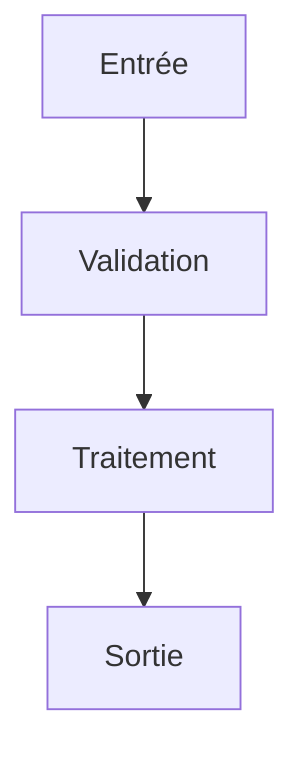

# Commande Create-Skill

**IMPORTANT** : Cette commande doit être exécutée DIRECTEMENT par le LLM.

- ❌ NE PAS créer de script bash/shell
- ❌ NE PAS proposer de code à exécuter
- ✅ POSER les questions à l'utilisateur IMMÉDIATEMENT via `ask_followup_question`
- ✅ CRÉER les fichiers DIRECTEMENT avec `write_to_file`

Cette commande génère un squelette de Skill AI-KIDO en posant les questions essentielles et en produisant tous les fichiers nécessaires.

## Concept fondamental

**Un Skill est un module de capacité spécialisée** packagé comme un répertoire avec une structure normalisée :

```
prompts/hard_points/system/[nom-skill]/
├── SKILL.md           # Fichier principal (OBLIGATOIRE)
├── references/        # Documentation de référence (optionnel)
├── examples/          # Exemples d'usage (optionnel)
├── scripts/           # Scripts utilitaires (optionnel)
│   └── helper.py
├── templates/         # Modèles de fichiers (optionnel)
│   └── template.txt
└── documentation/     # Documentation détaillée (optionnel)
    └── documentation.md
```

**Progressive disclosure** (3 niveaux) :
- **Niveau 1** : Métadonnées (~100 tokens, toujours chargées)
- **Niveau 2** : Instructions (<5k tokens, chargées à l'activation)
- **Niveau 3** : Ressources (illimité, chargées à la demande)

**Source** : [`prompts/hard_points/system/Skills.md`](prompts/hard_points/system/Skills.md)

---

## Exécution IMMÉDIATE

### Étape 0 : Inventaire des Skills existants

**Lister rapidement les skills existants** pour éviter les doublons :

```bash
# Scan rapide des SKILL.md existants
find prompts/hard_points/system -name "SKILL.md" -type f 2>/dev/null | while read f; do
  DIR=$(dirname "$f")
  NAME=$(basename "$DIR")
  DESC=$(grep -m1 '^## Description' -A1 "$f" | tail -1 | sed 's/^[[:space:]]*//')
  echo "  - $NAME : $DESC"
done
```

**Afficher à l'utilisateur** :
```
📦 Skills existants :
[LISTE DES SKILLS]

Référence complète : skills_list.md
```

---

### Étape 1 : Nom du Skill (ask_followup_question)

Utiliser l'outil `ask_followup_question` pour demander :

**Question** : "Quel est le nom du Skill à créer ? (format kebab-case, ex: `code-review`, `deploy-check`)"

Suggestions à proposer :
- `"code-review – Analyse qualité et revue de code"`
- `"deploy-check – Vérification pré-déploiement"`
- `"doc-generator – Génération de documentation"`
- `"test-runner – Exécution et analyse de tests"`

**Validation** :
- Format attendu : `kebab-case` uniquement (lettres minuscules + tirets)
- Vérifier l'unicité : le répertoire `prompts/hard_points/system/[nom]` ne doit pas exister
- Si conflit → proposer `[nom]-v2`, `[nom]-extended`, etc.

**Enregistrer** : `SKILL_NAME=[nom-skill]`

---

### Étape 2 : Description courte (ask_followup_question)

Utiliser l'outil `ask_followup_question` pour demander :

**Question** : "Décrivez en une phrase ce que fait ce Skill (sera utilisée dans les métadonnées et skills_list.md)"

Suggestions à proposer :
- `"Analyse la qualité du code source et produit un rapport structuré"`
- `"Vérifie la conformité d'un projet avant déploiement en production"`
- `"Génère de la documentation technique à partir du code source"`

**Enregistrer** : `SKILL_DESC=[description courte]`

---

### Étape 3 : Catégorie (ask_followup_question)

Utiliser l'outil `ask_followup_question` pour demander :

**Question** : "Quelle est la catégorie de ce Skill ?"

Suggestions à proposer :
- `"analyse / compréhension"`
- `"génération / création"`
- `"validation / vérification"`
- `"recherche / exploration"`

**Enregistrer** : `SKILL_CATEGORY=[catégorie]`

---

### Étape 4 : Instructions principales (ask_followup_question)

Utiliser l'outil `ask_followup_question` pour demander :

**Question** : "Décrivez les étapes principales que ce Skill doit exécuter (liste numérotée, ex : 1. Recevoir l'entrée 2. Analyser 3. Retourner un résultat JSON)"

Suggestions à proposer :
- `"1. Recevoir fichier ou texte  2. Détecter le type de contenu  3. Appliquer l'analyse  4. Retourner JSON structuré"`
- `"1. Scanner les fichiers cibles  2. Extraire les entités clés  3. Valider contre règles  4. Générer rapport"`
- `"1. Charger le contexte  2. Appliquer transformations  3. Valider résultat  4. Retourner structure normalisée"`

**Enregistrer** : `SKILL_INSTRUCTIONS=[instructions]`

---

### Étape 5 : Format de sortie (ask_followup_question)

Utiliser l'outil `ask_followup_question` pour demander :

**Question** : "Quel format de sortie ce Skill doit-il produire ?"

Suggestions à proposer :
- `"JSON structuré avec champs : status, result, summary, details"`
- `"Markdown formaté avec sections : Résumé, Détails, Recommandations"`
- `"JSON avec : matches[], summary, total_count"`
- `"Texte brut UTF-8 sans mise en forme"`

**Enregistrer** : `SKILL_OUTPUT=[format sortie]`

---

### Étape 6 : Ressources et outils (ask_followup_question)

Utiliser l'outil `ask_followup_question` pour demander :

**Question** : "Quelles ressources ou bibliothèques ce Skill utilise-t-il ? (optionnel, appuyez sur Entrée pour passer)"

Suggestions à proposer :
- `"Aucune dépendance externe (Skill autonome)"`
- `"Bash natif + outils POSIX (grep, sed, awk)"`
- `"Python : pathlib, re, json (standard library)"`
- `"Python : nltk, spacy (NLP) + tree-sitter (code parsing)"`

**Enregistrer** : `SKILL_RESOURCES=[ressources]`

---

### Étape 7 : Agents AI-KIDO associés (ask_followup_question)

Utiliser l'outil `ask_followup_question` pour demander :

**Question** : "Quels agents AI-KIDO utilisent ou sont liés à ce Skill ? (optionnel)"

Suggestions à proposer :
- `"agent-aikido-explore-bank – recherche dans la Memory Bank"`
- `"agent-aikido-explore-code – exploration du code source"`
- `"agent-aikido-bank-populate – peuplement de la Memory Bank"`
- `"Aucun agent associé pour l'instant"`

**Enregistrer** : `SKILL_AGENTS=[agents associés]`

---

### Étape 8 : Fichiers optionnels (ask_followup_question)

Utiliser l'outil `ask_followup_question` pour demander :

**Question** : "Quels fichiers optionnels souhaitez-vous générer avec ce Skill ? (structure officielle AI-KIDO)"

Suggestions à proposer :
- `"SKILL.md uniquement (squelette minimal)"`
- `"SKILL.md + references/ (répertoire de documentation de référence)"`
- `"SKILL.md + examples/ (répertoire d'exemples d'usage)"`
- `"SKILL.md + references/ + examples/ + documentation/ (package complet)"`

**Enregistrer** :
- `SKILL_WITH_REFERENCE=[oui|non]`
- `SKILL_WITH_EXAMPLES=[oui|non]`
- `SKILL_WITH_SCRIPTS=[oui|non]`
- `SKILL_WITH_TEMPLATES=[oui|non]`
- `SKILL_WITH_DOCUMENTATION=[oui|non]`

---

### Étape 9 : Génération des fichiers

Après collecte de toutes les informations, afficher un récapitulatif :

```
📋 RÉCAPITULATIF DU SKILL À CRÉER

Nom         : [SKILL_NAME]
Description : [SKILL_DESC]
Catégorie   : [SKILL_CATEGORY]
Répertoire  : prompts/hard_points/system/[SKILL_NAME]/

Fichiers à créer :
  ✅ prompts/hard_points/system/[SKILL_NAME]/SKILL.md  (obligatoire)
  [Si references]     ✅ prompts/hard_points/system/[SKILL_NAME]/references/README.md
  [Si examples]       ✅ prompts/hard_points/system/[SKILL_NAME]/examples/README.md
  [Si scripts]        ✅ prompts/hard_points/system/[SKILL_NAME]/scripts/helper.sh
  [Si templates]      ✅ prompts/hard_points/system/[SKILL_NAME]/templates/template.txt
  [Si documentation]  ✅ prompts/hard_points/system/[SKILL_NAME]/documentation/documentation.md

Génération en cours...
```

#### 9.1 Créer `SKILL.md` principal (write_to_file) — OBLIGATOIRE

Utiliser `write_to_file` pour créer `prompts/hard_points/system/[SKILL_NAME]/SKILL.md` :

```markdown
# [Nom formaté] – Skill interne d'AI‑KIDO

## Description
[SKILL_DESC]

## Métadonnées
```yaml
nom: "[SKILL_NAME]"
version: "1.0.0"
auteur: "AI‑KIDO Team"
catégorie: "[SKILL_CATEGORY]"
tokens_métadonnées: ~100
```

## Instructions (niveau 2)
[Reformuler SKILL_INSTRUCTIONS en étapes numérotées claires]
1. [Étape 1]
2. [Étape 2]
3. [Étape 3]
4. Retourner un résultat structuré :
   ```[json|markdown|text]
   [SKILL_OUTPUT – exemple de format de sortie]
   ```

## Ressources (niveau 3)
[SKILL_RESOURCES]
[Si references]    - Documentation de référence : `references/`
[Si examples]      - Exemples d'usage : `examples/`
[Si scripts]       - Scripts utilitaires : `scripts/`
[Si templates]     - Modèles : `templates/`
[Si documentation] - Documentation détaillée : `documentation/documentation.md`

## Utilisation
Claude invoque ce Skill automatiquement lorsqu'une requête [décrire le déclenchement].
Le Skill charge d'abord les métadonnées, puis les instructions, et enfin les ressources
supplémentaires uniquement si nécessaire (progressive disclosure).

## Remarques
- Le Skill est **stateless** : chaque appel est indépendant.
- Limite de taille : [préciser la limite d'entrée].
- Les résultats sont renvoyés en UTF‑8.

## Agents Aikido associés
[Pour chaque agent dans SKILL_AGENTS]
- `[agent-slug]` – [rôle de l'agent et lien avec ce Skill].
```

#### 9.2 Si `references` demandé – Créer `references/README.md` (write_to_file)

Utiliser `write_to_file` pour créer `prompts/hard_points/system/[SKILL_NAME]/references/README.md` :

```markdown
# Références – Skill [SKILL_NAME]

## Vue d'ensemble

[Description synthétique du Skill et de son rôle dans AI-KIDO]

## Paramètres d'entrée

| Paramètre | Type | Obligatoire | Description |
|-----------|------|-------------|-------------|
| [param1]  | string | oui | [description] |
| [param2]  | string | non | [description] |

## Format de sortie

[Décrire le format de sortie avec un exemple concret]

## Contraintes

- [Contrainte 1]
- [Contrainte 2]

## Voir aussi

- [`SKILL.md`](../SKILL.md) – Instructions principales
- [`examples/`](../examples/) – Exemples d'usage (si présent)
```

#### 9.3 Si `examples` demandé – Créer `examples/README.md` (write_to_file)

Utiliser `write_to_file` pour créer `prompts/hard_points/system/[SKILL_NAME]/examples/README.md` :

```markdown
# Exemples d'usage – Skill [SKILL_NAME]

## Exemple 1 : [Cas d'usage basique]

**Entrée** :
```
[Exemple d'entrée]
```

**Sortie attendue** :
```
[Exemple de sortie]
```

## Exemple 2 : [Cas d'usage avancé]

**Entrée** :
```
[Exemple d'entrée avancé]
```

**Sortie attendue** :
```
[Exemple de sortie avancé]
```

## Notes

- [Note 1 sur les exemples]
- [Note 2 sur les limites]
```

#### 9.4 Si `scripts` demandé – Créer `scripts/helper.sh` (write_to_file)

Utiliser `write_to_file` pour créer `prompts/hard_points/system/[SKILL_NAME]/scripts/helper.sh` :

```bash
#!/usr/bin/env bash
# helper.sh – Script utilitaire pour le Skill [SKILL_NAME]
# Usage : ./helper.sh [arguments]

set -euo pipefail

# [Description de la fonction principale]
main() {
  echo "Skill [SKILL_NAME] – helper script"
  # TODO: implémenter la logique principale
}

main "$@"
```

#### 9.5 Si `templates` demandé – Créer `templates/template.txt` (write_to_file)

Utiliser `write_to_file` pour créer `prompts/hard_points/system/[SKILL_NAME]/templates/template.txt` :

```
# Template – Skill [SKILL_NAME]
# Utiliser ce modèle pour [décrire l'usage du template]

[SECTION_1]
[Contenu de la section 1]

[SECTION_2]
[Contenu de la section 2]

# Variables disponibles :
# {{VARIABLE_1}} – [description]
# {{VARIABLE_2}} – [description]
```

#### 9.6 Si `documentation` demandé – Créer `documentation/documentation.md` (write_to_file)

Utiliser `write_to_file` pour créer `prompts/hard_points/system/[SKILL_NAME]/documentation/documentation.md` :

```markdown
# Documentation détaillée – Skill [SKILL_NAME]

## Architecture

[Décrire l'architecture interne du Skill]

## Flux d'exécution



## Décisions de conception

### [Décision 1]
**Contexte** : [Pourquoi cette décision a été nécessaire]
**Décision** : [Ce qui a été choisi]
**Conséquences** : [Impact de cette décision]

## Limitations connues

- [Limitation 1]
- [Limitation 2]

## Historique des versions

| Version | Date | Changements |
|---------|------|-------------|
| 1.0.0   | [DATE] | Version initiale |
```

---

### Étape 10 : Mise à jour `skills_list.md` (apply_diff)

Utiliser l'outil `apply_diff` pour ajouter la nouvelle entrée dans [`skills_list.md`](skills_list.md) :

```markdown
- **[SKILL_NAME]** – [SKILL_DESC] – [`prompts/hard_points/system/[SKILL_NAME]/SKILL.md`](prompts/hard_points/system/[SKILL_NAME]/SKILL.md)
```

**Règle** : Insérer en respectant l'ordre alphabétique des noms de skills existants.

---

### Étape 11 : Rapport final (attempt_completion)

Utiliser l'outil `attempt_completion` pour afficher le message de confirmation :

```
✅ Skill AI-KIDO "[SKILL_NAME]" créé avec succès !

📦 Ce Skill fournit des capacités de [SKILL_CATEGORY] :
   - Catégorie : [SKILL_CATEGORY]
   - Version    : 1.0.0
   - Stateless  : oui (chaque appel est indépendant)

📁 Fichiers créés :
   ✅ prompts/hard_points/system/[SKILL_NAME]/SKILL.md  (obligatoire)
   [Si references]     ✅ .../references/README.md
   [Si examples]       ✅ .../examples/README.md
   [Si scripts]        ✅ .../scripts/helper.sh
   [Si templates]      ✅ .../templates/template.txt
   [Si documentation]  ✅ .../documentation/documentation.md

📄 Fichiers mis à jour :
   ✅ skills_list.md (nouvelle entrée ajoutée)

🤖 Agents associés :
   [Pour chaque agent] - [agent-slug]

🚀 NEXT STEPS

1. Compléter SKILL.md avec les détails d'implémentation réels
2. Enrichir references/README.md avec les paramètres exacts (si créé)
3. Ajouter des cas concrets dans examples/README.md (si créé)
4. Implémenter les scripts utilitaires dans scripts/ (si créé)
5. Lier ce Skill aux agents concernés dans leurs fichiers personas
6. Valider la conformité : /analyse-aikido
```

---

## Options de la Commande

```bash
# Mode interactif complet (recommandé)
/create-skill

# Mode avec nom pré-rempli
/create-skill "nom-du-skill"

# Mode verbose (affiche tous les détails de génération)
/create-skill --verbose
```

## Gestion des Erreurs

| Erreur | Action |
|--------|--------|
| Nom skill invalide (pas kebab-case) | Proposer la correction automatique |
| Skill déjà existant | Proposer `[nom]-v2` ou annuler |
| Description vide | Redemander avec exemples |
| Catégorie invalide | Proposer la liste des catégories valides |
| Erreur écriture fichier | Signaler l'erreur et proposer de réessayer |

## Règles AI-KIDO Respectées

- ✅ Structure officielle conforme à [`Skills.md`](prompts/hard_points/system/Skills.md) : `SKILL.md` + `references/` + `examples/` + `scripts/` + `templates/` + `documentation/`
- ✅ Progressive disclosure 3 niveaux (métadonnées / instructions / ressources)
- ✅ Métadonnées YAML conformes au format standard
- ✅ Ajout automatique dans `skills_list.md`
- ✅ Respect de la convention de nommage kebab-case
- ✅ Vérification anti-doublon systématique
- ✅ Fichiers optionnels à la carte selon les besoins réels
- ✅ Mode interactif guidé avec suggestions pertinentes

## Intégration avec Autres Commandes

Cette commande s'intègre avec :
- `/create-persona` : Créer les agents qui utiliseront ce Skill
- `/create-command` : Créer une commande qui orchestre ce Skill
- `/analyse-aikido` : Valider la conformité du Skill créé
- `/reindex-projet` : Mettre à jour l'index du projet

**Workflow recommandé** :
1. `/create-skill` → Créer le squelette du Skill
2. Compléter `SKILL.md` avec le contenu réel
3. `/create-persona` → Créer ou lier les agents associés
4. `/analyse-aikido` → Valider la conformité

---

*Commande créée pour faciliter la création de Skills AI-KIDO*
*Pattern : interactif guidé avec ask_followup_question + write_to_file*
