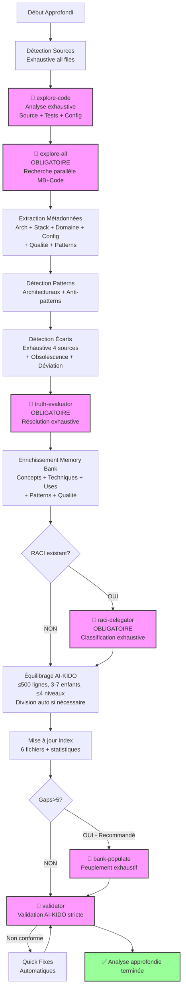

# Plan d'Analyse Générique - Approfondi (Profondeur 3)

> **Version**: 1.0 | **Date**: 2025-12-10 | **Type**: Analysis Plan | **Nature**: Générique | **Profondeur**: 3 - Approfondi

## 📋 Overview

Plan d'analyse **générique approfondi** offrant une analyse exhaustive du projet avec détection de patterns, anti-patterns, et recommandations d'optimisation. Utilisé comme **fallback** pour profondeur 3 quand aucun plan spécifique n'existe.

**Philosophie Approfondi** :
- ✅ Exhaustif (~20-40 min)
- ✅ Analyse fine implémentation
- ✅ Détection patterns/anti-patterns
- ✅ Recommandations optimisation
- ✅ Analyse qualité code
- ❌ Pas d'audit sécurité/performance complet
- ❌ Pas de plan refactoring détaillé

## 🎯 Critères de Sélection

Ce plan est sélectionné quand :
- **Nature** : N'importe quel type d'analyse (1-18)
- **Profondeur** : 3 - Approfondi (exhaustif, détection patterns)
- **Contexte** : Refactoring, amélioration qualité, audit technique, migration majeure

**Différence vs autres profondeurs** :
- vs Survol (1) : Analyse complète vs vue d'ensemble
- vs Standard (2) : Détection patterns/anti-patterns, analyse qualité, recommandations avancées
- vs Expert (4) : Pas d'audit sécurité/perfs complet, pas de plan refactoring étape par étape

## 🔍 Sources à Analyser

### Sources Prioritaires

**Code Source** (analyse exhaustive) :
- **Tous** répertoires source (profondeur complète)
- **Tous** langages détectés
- **Inclure** tests (analyse couverture, qualité tests)
- **Exclusions** : Uniquement node_modules, vendor, dist, build, .git

**Documentation** (analyse approfondie) :
- Toute documentation technique
- Architecture, API, processus, conventions
- Commentaires inline significatifs (TODOs, FIXMEs, design decisions)
- Changelog et historique décisions

**Configuration** (analyse exhaustive) :
- Tous fichiers config (build, déploiement, environnement)
- Scripts (npm scripts, make targets, bash scripts)
- CI/CD complet (tous workflows/pipelines)
- Infrastructure as Code (Terraform, Ansible, K8s manifests)

### Critères de Filtrage

**Analyse sans limite** :
- Tous fichiers source (aucune limite)
- Tous fichiers tests (analyse qualité)
- Tous scripts et config
- Extraction commentaires significatifs

## 🤖 Agents AI-KIDO à Mobiliser

### Phase 3.1 : Scan Code (Obligatoire - Exhaustif)

**Agent** : `agent-aikido-explore-code`

**Prompt spécialisé** :
```
"FORMAT: JSON

Analyse approfondie (profondeur 3) du projet :

FOCUS :
- Architecture exhaustive (tous éléments, tous niveaux)
- Stack technique complète (toutes dépendances, versions, compatibilité)
- Dépendances complexes (graphe complet multi-niveaux)
- Logique métier détaillée (tous processus, toutes règles)
- Tests (frameworks, couverture estimée, qualité)
- Commentaires significatifs (TODOs, FIXMEs, design decisions)

DÉTAIL MAXIMAL :
- Tous fichiers source ET tests
- Métadonnées exhaustives :
  - Classes : full inheritance tree, all methods (public/private), properties, decorators/annotations
  - Interfaces : all methods, extending interfaces
  - Functions : full signature, complexity hints, side effects
  - Imports : complete dependency tree (multi-level)
  - Tests : test files, test frameworks, assertions count
- Graphes multi-niveaux (Mermaid)
- Extraction commentaires design (TODO, FIXME, NOTE, HACK)

AUCUNE EXCLUSION source/tests

Output attendu :
- Index architectural exhaustif
- Graphes dépendances multi-niveaux
- Analyse qualité (complexity, coupling)
- ~80-120 lignes par fichier analysé
- Budget total < 20k tokens"
```

**Résultat attendu** : Index exhaustif + graphes + qualité en < 20k tokens

### Phase 3.2 : Recherche Parallèle (Obligatoire)

**Condition** : **TOUJOURS** utilisé en profondeur 3

**Agent** : `agent-aikido-explore-all`

**Prompt spécialisé** :
```
"FORMAT: JSON

Recherche parallèle exhaustive Memory Bank + Code :

Memory Bank (/prompts/gen/) :
- Tous concepts architecture
- Toutes techniques implémentation
- Tous use cases processus
- Glossaire complet
- Hard points (contraintes, règles)

Code Source (hors /prompts/) :
- Implémentation réelle exhaustive
- Patterns détectés vs documentés
- Déviation des standards
- Obsolescence détectée

Keywords recherche : {TYPE_DEPENDENT_KEYWORDS} + patterns architecturaux

Output attendu :
- Cross-references complètes Memory Bank ↔ Code
- Écarts exhaustifs (contradictions, obsolescence, manques)
- Patterns vs anti-patterns détectés
- Recommandations alignement"
```

**Résultat attendu** : Rapport exhaustif écarts + patterns en ~5-8 sec

### Résolution Contradictions (Systématique)

**Condition** : **TOUJOURS** exécuté en profondeur 3

**Agent** : `agent-aikido-truth-evaluator`

**Stratégie hiérarchie** : Scénario INVESTIGATION + analyse multi-sources
- Évaluation systématique toutes contradictions
- Hiérarchie adaptative selon contexte
- Recommandations résolution avec confiance

### Classification RACI (Obligatoire si existant)

**Condition** : Si structure RACI existante → Obligatoire

**Agent** : `agent-aikido-raci-delegator`

**Mapping** : Classification exhaustive avec alternatives et confidence

### Peuplement Automatique (Recommandé)

**Condition** : **RECOMMANDÉ** en profondeur 3 si gaps > 5

**Agent** : `agent-aikido-bank-populate`

**Stratégie** : Capitalisation exhaustive depuis toutes sources avec validation experts

### Validation Finale (Obligatoire - Stricte)

**Agent** : `agent-aikido-validator`

**Règles strictes** :
- Règle 4 : ≤ 500 lignes (division auto si dépassement)
- Règle 6 : Liens bidirectionnels complets (vérification exhaustive)
- Règle 7 : Équilibrage strict (3-7 enfants, ≤ 4 niveaux)
- Règle 11 : Densité sémantique (schémas Mermaid obligatoires)
- Frontmatter complet
- Emplacement RACI vérifié

## 📊 Stratégie d'Extraction

### 1. Détection Automatique (Exhaustive + Patterns)

**Algorithme approfondi** :
1. Scanner **tous** répertoires (source + tests + scripts + config)
2. Détecter **toutes** technologies (langages, frameworks, outils)
3. Extraire **toutes** déclarations (classes, interfaces, functions, tests)
4. Construire graphe dépendances **multi-niveaux** (3+ niveaux profondeur)
5. **Détecter patterns architecturaux** (MVC, MVVM, Repository, Factory, etc.)
6. **Détecter anti-patterns** (God Class, Circular Dependencies, etc.)
7. **Analyser qualité** (complexité cyclomatique, couplage, cohésion)
8. **Extraire commentaires design** (TODOs, FIXMEs, design decisions)

**Patterns de recherche** (exhaustifs + patterns) :
```regex
# (Patterns standards de plan-standard.md) +

# Patterns architecturaux
# Singleton
(private\s+)?constructor.*\n.*static.*instance

# Factory
(class|interface).*Factory

# Repository
(class|interface).*Repository

# Observer
(interface.*Observer|class.*Subject)

# Anti-patterns détection
# God Class (heuristique : classe > 500 lignes + > 20 méthodes)
class\s+\w+.*\{[\s\S]{5000,}\}

# Circular dependencies (détection via graphe)

# Commentaires design
(TODO|FIXME|HACK|NOTE|XXX|BUG):\s*(.+)

# Code duplication (blocks similaires)
```

**Heuristiques avancées** :
- Complexité cyclomatique : Nombre branches / fonction
- Couplage : Nombre dépendances externes / classe
- Cohésion : Ratio méthodes utilisant propriétés / classe
- Qualité tests : Ratio assertions / tests, couverture estimée
- Dette technique : Nombre TODOs + FIXMEs + HACKs

### 2. Extraction Métadonnées (Exhaustive)

**Architecture** :
- Structure complète avec métriques (LOC, complexité par répertoire)
- Patterns architecturaux détectés avec exemples
- Anti-patterns détectés avec localisation
- Graphes multi-niveaux (architecture, dépendances, séquence)

**Stack Technique** :
- Tous langages avec métriques détaillées
- Tous frameworks avec usage pattern
- Toutes bibliothèques avec raison d'usage
- Compatibilité versions et conflits potentiels

**Domaine Métier** :
- Toutes entités avec relations complètes (ORM mappings)
- Tous processus avec workflows détaillés
- Glossaire exhaustif avec contexte d'usage
- Règles métier extraites (validations, invariants)

**Configuration** :
- Tous environnements avec différences
- Tous services avec configuration réseau
- Secrets management (détection, sécurité)
- Performance settings (cache, pool sizes, etc.)

**Qualité Code** :
- Complexité cyclomatique moyenne/max
- Couplage (afferent/efferent)
- Cohésion (LCOM metrics si calculable)
- Dette technique (TODOs count, duplication estimate)
- Couverture tests (estimation depuis test files)

### 3. Analyse Profondeur Spécifique

**Profondeur 3 - Approfondi** :
- **Niveau de détail** : Exhaustif avec analyse qualité
- **Métriques collectées** :
  - Toutes métriques standard + qualité
  - Complexité cyclomatique (moyenne, max, distribution)
  - Couplage (CBO, afferent, efferent)
  - Cohésion (LCOM estimate)
  - Dette technique (TODOs, duplication estimate)
  - Couverture tests (estimation)
- **Graphes générés** :
  - Architecture multi-niveaux
  - Dépendances multi-niveaux (3+ niveaux)
  - Séquences processus critiques
  - Patterns détectés
  - Anti-patterns localisés
- **Temps estimé** : 20-40 minutes

## 🔄 Workflow Complet

### Phases d'Exécution (Exhaustif)



**Toutes phases activées** :
- ✅ Phase 3.2 (explore-all) : **OBLIGATOIRE**
- ✅ Résolution contradictions : **OBLIGATOIRE**
- ✅ Classification RACI : **OBLIGATOIRE** si existant
- ✅ Peuplement : **RECOMMANDÉ** si gaps > 5
- ✅ Validation stricte avec quick fixes

### Temps d'Exécution Estimé

- **Détection sources** : ~3 min
- **Scan exhaustif (explore-code)** : ~8-12 min
- **Recherche parallèle (explore-all)** : ~5-8 min
- **Détection patterns/anti-patterns** : ~3-5 min
- **Résolution contradictions** : ~3-5 min
- **Enrichissement exhaustif** : ~5-8 min
- **Classification RACI** : ~3 min
- **Peuplement** : ~5-10 min
- **Validation stricte** : ~2-3 min

**Total** : ~20-40 minutes

## 📤 Output Format

### Structure de Sortie (Exhaustive)

```markdown
# Rapport d'Analyse Approfondie (Profondeur 3)

**Date** : {DATE}
**Durée** : {DURATION}
**Sources analysées** : {SOURCE_COUNT} fichiers (exhaustif)

## 🎯 Configuration

- **Nature** : {ANALYSIS_TYPE_DESCRIPTION}
- **Profondeur** : 3 - Approfondi (exhaustif, patterns, qualité)
- **Plan utilisé** : `plans/plan-approfondi.md`

## 📊 Architecture Exhaustive

[Section similaire plan-standard.md mais enrichie avec]

### Patterns Architecturaux Détectés

**Patterns positifs** ({COUNT}) :
- **{PATTERN_1}** (ex: {EXAMPLE_FILE}:{LINE}) - {DESCRIPTION}
- **{PATTERN_2}** (ex: {EXAMPLE_FILE}:{LINE}) - {DESCRIPTION}

**Anti-patterns détectés** ({COUNT}) ⚠️ :
- **{ANTI_PATTERN_1}** (ex: {FILE}:{LINE}) - {IMPACT} - Recommandation : {FIX}
- **{ANTI_PATTERN_2}** (ex: {FILE}:{LINE}) - {IMPACT} - Recommandation : {FIX}

### Graphes Multi-Niveaux

**Architecture (3 niveaux)** :
```mermaid
{ARCHITECTURE_GRAPH_MULTI_LEVEL}
```

**Dépendances (3+ niveaux)** :
```mermaid
{DEPENDENCY_GRAPH_DEEP}
```

**Séquence Processus Critique** :
```mermaid
{SEQUENCE_DIAGRAM}
```

## 📈 Analyse Qualité Code

### Métriques Complexité

| Métrique | Moyenne | Max | Distribution |
|----------|---------|-----|--------------|
| **Complexité Cyclomatique** | {AVG} | {MAX} | {DISTRIBUTION} |
| **LOC par fichier** | {AVG} | {MAX} | {DISTRIBUTION} |
| **Méthodes par classe** | {AVG} | {MAX} | {DISTRIBUTION} |

**Fichiers complexes** (top 10 par complexité) :
- `{FILE_1}` (complexité: {SCORE}) - Recommandation : {REFACTOR_HINT}
- `{FILE_2}` (complexité: {SCORE}) - Recommandation : {REFACTOR_HINT}

### Métriques Couplage/Cohésion

- **Couplage moyen** : {CBO_AVG} (cible: < 10)
- **Classes fortement couplées** ({COUNT}) :
  - `{CLASS_1}` (CBO: {SCORE}) - {DEPENDENCIES} dépendances
  - `{CLASS_2}` (CBO: {SCORE}) - {DEPENDENCIES} dépendances

- **Cohésion moyenne** : {LCOM_AVG} (cible: < 0.5)
- **Classes faiblement cohésives** ({COUNT}) :
  - `{CLASS_1}` (LCOM: {SCORE}) - Recommandation : Split responsibilities

### Dette Technique

- **TODOs** : {COUNT} items
  - {FILE}:{LINE} - "{TODO_TEXT}"
- **FIXMEs** : {COUNT} items
  - {FILE}:{LINE} - "{FIXME_TEXT}"
- **HACKs** : {COUNT} items ⚠️
  - {FILE}:{LINE} - "{HACK_TEXT}"

**Estimation dette** : {HOURS} heures de refactoring

### Couverture Tests (Estimation)

- **Fichiers tests** : {COUNT}
- **Tests détectés** : {COUNT}
- **Couverture estimée** : {PERCENT}% (basée sur ratio tests/source)
- **Frameworks tests** : {TEST_FRAMEWORKS}

## 🛠️  Stack Technique Exhaustive

[Section similaire plan-standard.md mais enrichie avec]

### Analyse Dépendances

**Bibliothèques critiques** (impact élevé) :
- {LIB_1} {VERSION} - Utilisée par {COUNT} modules - Dernière version : {LATEST}
- {LIB_2} {VERSION} - Utilisée par {COUNT} modules - Dernière version : {LATEST}

**Bibliothèques obsolètes** ⚠️ :
- {LIB_OLD} {VERSION} (publié {DATE}) - Dernière version : {LATEST} ({DATE_LATEST})

**Conflits potentiels** ⚠️ :
- {CONFLICT_DESCRIPTION}

## ⚠️  Écarts et Contradictions Exhaustifs

[Section similaire plan-standard.md mais exhaustive]

### Code vs Documentation (Détaillé)

**Contradictions majeures** ({COUNT}) :
- {CONTRADICTION_1} - Résolution : {RESOLUTION} - Confiance : {CONFIDENCE}%

### Obsolescence Détectée

**Documentation obsolète** ({COUNT} sections) :
- {DOC_SECTION} : Décrit {OLD_BEHAVIOR} mais code implémente {NEW_BEHAVIOR}

**Code deprecated** ({COUNT} éléments) :
- `{FUNCTION}` ({FILE}:{LINE}) - Marqué deprecated mais utilisé par {COUNT} callsites

## 💡 Recommandations Avancées

### Priorité Haute (P0)

1. **{RECOMMENDATION_P0_1}**
   - Impact : {IMPACT}
   - Effort : {EFFORT}
   - Fichiers concernés : {FILES}

### Priorité Moyenne (P1)

1. **{RECOMMENDATION_P1_1}**
   - Impact : {IMPACT}
   - Effort : {EFFORT}

### Priorité Basse (P2)

1. **{RECOMMENDATION_P2_1}**
   - Impact : {IMPACT}
   - Effort : {EFFORT}

### Plan d'Action Suggéré

1. **Phase 1** (Immédiat) : {P0_ITEMS}
2. **Phase 2** (Court terme) : {P1_ITEMS}
3. **Phase 3** (Moyen terme) : {P2_ITEMS}

## 📝 Enrichissements Appliqués

[Section similaire plan-standard.md + patterns et qualité]

### Nouveaux Concepts Capitalisés

- **{CONCEPT_1}** (patterns/{CATEGORY}/pattern-{NAME}.md)
- **{CONCEPT_2}** (qualite-code/{CATEGORY}/{NAME}.md)

## ✅ Conformité AI-KIDO (Stricte)

- **Documents créés/modifiés** : {COUNT}
- **Règles respectées** : {COMPLIANCE_SCORE}%
- **Quick fixes appliqués** : {FIXES_COUNT}
- **Divisions automatiques** : {SPLIT_COUNT} (fichiers > 500 lignes)

## 📊 Métriques Finales

- **Fichiers analysés** : {COUNT} (100% source + tests + config)
- **LOC totales** : {LOC}
- **Complexité globale** : {COMPLEXITY_SCORE}
- **Dette technique** : {DEBT_HOURS}h estimées
- **Agents utilisés** : 6 (explore-code, explore-all, truth-evaluator, raci-delegator, bank-populate, validator)
- **Temps total** : {DURATION}
- **Budget tokens** : ~{TOKENS} (< 20k cible)

---
*Généré par /analyse-project avec plan plan-approfondi.md*
*Analyse exhaustive avec patterns et qualité*
```

## 🎓 Cas d'Usage Idéaux

Le plan approfondi est idéal pour :
- ✅ Refactoring majeur du codebase
- ✅ Amélioration qualité code (réduction dette technique)
- ✅ Audit technique pré-migration
- ✅ Détection patterns/anti-patterns systématique
- ✅ Optimisation architecture
- ✅ Préparation release majeure

## 📚 Références

- **Plan profondeur inférieure** : `plan-standard.md` (profondeur 2)
- **Plan profondeur supérieure** : `plan-expert.md` (profondeur 4)
- **Agents** : Tous agents AI-KIDO (6 agents mobilisés)
- **Commande** : `prompts/hard_points/commands/analyse-project.md`
- **Documentation AI-KIDO** : `prompts/hard_points/ai-kido.md`

---
*Plan Approfondi créé le 2025-12-10 pour /analyse-project*
*Analyse exhaustive avec détection patterns et qualité*
