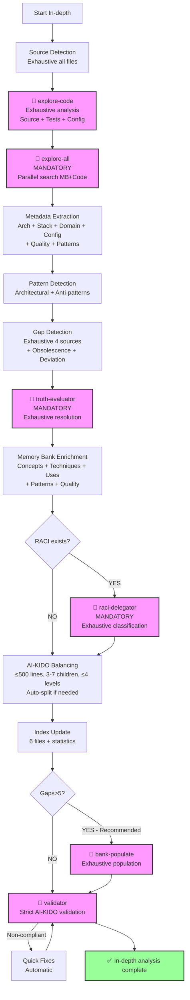

# Generic Analysis Plan - In-depth (Depth 3)

> **Version**: 1.0 | **Date**: 2025-12-10 | **Type**: Analysis Plan | **Nature**: Generic | **Depth**: 3 - In-depth

## 📋 Overview

**Generic in-depth** analysis plan offering an exhaustive analysis of the project with pattern detection, anti-patterns, and optimization recommendations. Used as a **fallback** for depth 3 when no specific plan exists.

**In-depth Philosophy** :
- ✅ Exhaustive (~20-40 min)
- ✅ Fine implementation analysis
- ✅ Pattern/anti-pattern detection
- ✅ Optimization recommendations
- ✅ Code quality analysis
- ❌ No complete security/performance audit
- ❌ No detailed refactoring plan

## 🎯 Selection Criteria

This plan is selected when:
- **Nature** : Any analysis type (1-18)
- **Depth** : 3 - In-depth (exhaustive, pattern detection)
- **Context** : Refactoring, quality improvement, technical audit, major migration

**Difference vs other depths** :
- vs Overview (1) : Complete analysis vs high-level view
- vs Standard (2) : Pattern/anti-pattern detection, quality analysis, advanced recommendations
- vs Expert (4) : No complete security/performance audit, no step-by-step refactoring plan

## 🔍 Sources to Analyze

### Priority Sources

**Source Code** (exhaustive analysis) :
- **All** source directories (full depth)
- **All** detected languages
- **Include** tests (coverage analysis, test quality)
- **Exclusions** : Only node_modules, vendor, dist, build, .git

**Documentation** (in-depth analysis) :
- All technical documentation
- Architecture, API, processes, conventions
- Significant inline comments (TODOs, FIXMEs, design decisions)
- Changelog and decision history

**Configuration** (exhaustive analysis) :
- All config files (build, deployment, environment)
- Scripts (npm scripts, make targets, bash scripts)
- Complete CI/CD (all workflows/pipelines)
- Infrastructure as Code (Terraform, Ansible, K8s manifests)

### Filtering Criteria

**Analysis without limit** :
- All source files (no limit)
- All test files (quality analysis)
- All scripts and config
- Extraction of significant comments

## 🤖 AI-KIDO Agents to Mobilize

### Phase 3.1 : Code Scan (Mandatory - Exhaustive)

**Agent** : `agent-aikido-explore-code`

**Specialized prompt** :
```
"FORMAT: JSON

In-depth analysis (depth 3) of the project:

FOCUS:
- Exhaustive architecture (all elements, all levels)
- Complete technical stack (all dependencies, versions, compatibility)
- Complex dependencies (complete multi-level graph)
- Detailed business logic (all processes, all rules)
- Tests (frameworks, estimated coverage, quality)
- Significant comments (TODOs, FIXMEs, design decisions)

MAXIMUM DETAIL:
- All source AND test files
- Exhaustive metadata:
  - Classes: full inheritance tree, all methods (public/private), properties, decorators/annotations
  - Interfaces: all methods, extending interfaces
  - Functions: full signature, complexity hints, side effects
  - Imports: complete dependency tree (multi-level)
  - Tests: test files, test frameworks, assertions count
- Multi-level graphs (Mermaid)
- Design comment extraction (TODO, FIXME, NOTE, HACK)

NO EXCLUSION of source/tests

Expected output:
- Exhaustive architectural index
- Multi-level dependency graphs
- Quality analysis (complexity, coupling)
- ~80-120 lines per analyzed file
- Total budget < 20k tokens"
```

**Expected result** : Exhaustive index + graphs + quality in < 20k tokens

### Phase 3.2 : Parallel Search (Mandatory)

**Condition** : **ALWAYS** used at depth 3

**Agent** : `agent-aikido-explore-all`

**Specialized prompt** :
```
"FORMAT: JSON

Exhaustive parallel Memory Bank + Code search:

Memory Bank (/prompts/gen/):
- All architecture concepts
- All implementation techniques
- All process use cases
- Complete glossary
- Hard points (constraints, rules)

Source Code (outside /prompts/):
- Exhaustive real implementation
- Detected patterns vs documented
- Deviation from standards
- Detected obsolescence

Search keywords: {TYPE_DEPENDENT_KEYWORDS} + architectural patterns

Expected output:
- Complete Memory Bank ↔ Code cross-references
- Exhaustive gaps (contradictions, obsolescence, missing)
- Detected patterns vs anti-patterns
- Alignment recommendations"
```

**Expected result** : Exhaustive gap + pattern report in ~5-8 sec

### Contradiction Resolution (Systematic)

**Condition** : **ALWAYS** executed at depth 3

**Agent** : `agent-aikido-truth-evaluator`

**Hierarchy strategy** : INVESTIGATION scenario + multi-source analysis
- Systematic evaluation of all contradictions
- Adaptive hierarchy based on context
- Resolution recommendations with confidence

### RACI Classification (Mandatory if existing)

**Condition** : If existing RACI structure → Mandatory

**Agent** : `agent-aikido-raci-delegator`

**Mapping** : Exhaustive classification with alternatives and confidence

### Automatic Population (Recommended)

**Condition** : **RECOMMENDED** at depth 3 if gaps > 5

**Agent** : `agent-aikido-bank-populate`

**Strategy** : Exhaustive capitalization from all sources with expert validation

### Final Validation (Mandatory - Strict)

**Agent** : `agent-aikido-validator`

**Strict rules** :
- Rule 4: ≤ 500 lines (auto-split if exceeded)
- Rule 6: Complete bidirectional links (exhaustive verification)
- Rule 7: Strict balancing (3-7 children, ≤ 4 levels)
- Rule 11: Semantic density (Mermaid diagrams mandatory)
- Complete frontmatter
- RACI location verified

## 📊 Extraction Strategy

### 1. Automatic Detection (Exhaustive + Patterns)

**In-depth algorithm** :
1. Scan **all** directories (source + tests + scripts + config)
2. Detect **all** technologies (languages, frameworks, tools)
3. Extract **all** declarations (classes, interfaces, functions, tests)
4. Build **multi-level** dependency graph (3+ levels deep)
5. **Detect architectural patterns** (MVC, MVVM, Repository, Factory, etc.)
6. **Detect anti-patterns** (God Class, Circular Dependencies, etc.)
7. **Analyze quality** (cyclomatic complexity, coupling, cohesion)
8. **Extract design comments** (TODOs, FIXMEs, design decisions)

**Search patterns** (exhaustive + patterns) :
```regex
# (Patterns standards de plan-standard.md) +

# Patterns architecturaux
# Singleton
(private\s+)?constructor.*\n.*static.*instance

# Factory
(class|interface).*Factory

# Repository
(class|interface).*Repository

# Observer
(interface.*Observer|class.*Subject)

# Anti-patterns détection
# God Class (heuristique : classe > 500 lignes + > 20 méthodes)
class\s+\w+.*\{[\s\S]{5000,}\}

# Circular dependencies (détection via graphe)

# Commentaires design
(TODO|FIXME|HACK|NOTE|XXX|BUG):\s*(.+)

# Code duplication (blocks similaires)
```

**Advanced heuristics** :
- Cyclomatic complexity: Number of branches / function
- Coupling: Number of external dependencies / class
- Cohesion: Ratio of methods using properties / class
- Test quality: Ratio of assertions / tests, estimated coverage
- Technical debt: Number of TODOs + FIXMEs + HACKs

### 2. Metadata Extraction (Exhaustive)

**Architecture** :
- Complete structure with metrics (LOC, complexity per directory)
- Detected architectural patterns with examples
- Detected anti-patterns with location
- Multi-level graphs (architecture, dependencies, sequence)

**Technical Stack** :
- All languages with detailed metrics
- All frameworks with usage pattern
- All libraries with reason for usage
- Version compatibility and potential conflicts

**Business Domain** :
- All entities with complete relations (ORM mappings)
- All processes with detailed workflows
- Exhaustive glossary with usage context
- Extracted business rules (validations, invariants)

**Configuration** :
- All environments with differences
- All services with network configuration
- Secrets management (detection, security)
- Performance settings (cache, pool sizes, etc.)

**Code Quality** :
- Average/max cyclomatic complexity
- Coupling (afferent/efferent)
- Cohesion (LCOM metrics if calculable)
- Technical debt (TODOs count, duplication estimate)
- Test coverage (estimation from test files)

### 3. Depth-Specific Analysis

**Depth 3 - In-depth** :
- **Level of detail** : Exhaustive with quality analysis
- **Collected metrics** :
  - All standard metrics + quality
  - Cyclomatic complexity (average, max, distribution)
  - Coupling (CBO, afferent, efferent)
  - Cohesion (LCOM estimate)
  - Technical debt (TODOs, duplication estimate)
  - Test coverage (estimation)
- **Generated graphs** :
  - Multi-level architecture
  - Multi-level dependencies (3+ levels)
  - Critical process sequences
  - Detected patterns
  - Located anti-patterns
- **Estimated time** : 20-40 minutes

## 🔄 Full Workflow

### Execution Phases (Exhaustive)



**All phases enabled** :
- ✅ Phase 3.2 (explore-all) : **MANDATORY**
- ✅ Contradiction resolution : **MANDATORY**
- ✅ RACI classification : **MANDATORY** if existing
- ✅ Population : **RECOMMENDED** if gaps > 5
- ✅ Strict validation with quick fixes

### Estimated Execution Time

- **Source detection** : ~3 min
- **Exhaustive scan (explore-code)** : ~8-12 min
- **Parallel search (explore-all)** : ~5-8 min
- **Pattern/anti-pattern detection** : ~3-5 min
- **Contradiction resolution** : ~3-5 min
- **Exhaustive enrichment** : ~5-8 min
- **RACI classification** : ~3 min
- **Population** : ~5-10 min
- **Strict validation** : ~2-3 min

**Total** : ~20-40 minutes

## 📤 Output Format

### Output Structure (Exhaustive)

```markdown
# In-depth Analysis Report (Depth 3)

**Date** : {DATE}
**Duration** : {DURATION}
**Analyzed sources** : {SOURCE_COUNT} files (exhaustive)

## 🎯 Configuration

- **Nature** : {ANALYSIS_TYPE_DESCRIPTION}
- **Depth** : 3 - In-depth (exhaustive, patterns, quality)
- **Plan used** : `plans/plan-approfondi.md`

## 📊 Exhaustive Architecture

[Similar section to plan-standard.md but enriched with]

### Detected Architectural Patterns

**Positive patterns** ({COUNT}) :
- **{PATTERN_1}** (e.g.: {EXAMPLE_FILE}:{LINE}) - {DESCRIPTION}
- **{PATTERN_2}** (e.g.: {EXAMPLE_FILE}:{LINE}) - {DESCRIPTION}

**Detected anti-patterns** ({COUNT}) ⚠️ :
- **{ANTI_PATTERN_1}** (e.g.: {FILE}:{LINE}) - {IMPACT} - Recommendation: {FIX}
- **{ANTI_PATTERN_2}** (e.g.: {FILE}:{LINE}) - {IMPACT} - Recommendation: {FIX}

### Multi-Level Graphs

**Architecture (3 levels)** :
```mermaid
{ARCHITECTURE_GRAPH_MULTI_LEVEL}
```

**Dependencies (3+ levels)** :
```mermaid
{DEPENDENCY_GRAPH_DEEP}
```

**Critical Process Sequence** :
```mermaid
{SEQUENCE_DIAGRAM}
```

## 📈 Code Quality Analysis

### Complexity Metrics

| Metric | Average | Max | Distribution |
|--------|---------|-----|--------------|
| **Cyclomatic Complexity** | {AVG} | {MAX} | {DISTRIBUTION} |
| **LOC per file** | {AVG} | {MAX} | {DISTRIBUTION} |
| **Methods per class** | {AVG} | {MAX} | {DISTRIBUTION} |

**Complex files** (top 10 by complexity) :
- `{FILE_1}` (complexity: {SCORE}) - Recommendation: {REFACTOR_HINT}
- `{FILE_2}` (complexity: {SCORE}) - Recommendation: {REFACTOR_HINT}

### Coupling/Cohesion Metrics

- **Average coupling** : {CBO_AVG} (target: < 10)
- **Highly coupled classes** ({COUNT}) :
  - `{CLASS_1}` (CBO: {SCORE}) - {DEPENDENCIES} dependencies
  - `{CLASS_2}` (CBO: {SCORE}) - {DEPENDENCIES} dependencies

- **Average cohesion** : {LCOM_AVG} (target: < 0.5)
- **Low-cohesion classes** ({COUNT}) :
  - `{CLASS_1}` (LCOM: {SCORE}) - Recommendation: Split responsibilities

### Technical Debt

- **TODOs** : {COUNT} items
  - {FILE}:{LINE} - "{TODO_TEXT}"
- **FIXMEs** : {COUNT} items
  - {FILE}:{LINE} - "{FIXME_TEXT}"
- **HACKs** : {COUNT} items ⚠️
  - {FILE}:{LINE} - "{HACK_TEXT}"

**Debt estimate** : {HOURS} hours of refactoring

### Test Coverage (Estimate)

- **Test files** : {COUNT}
- **Detected tests** : {COUNT}
- **Estimated coverage** : {PERCENT}% (based on tests/source ratio)
- **Test frameworks** : {TEST_FRAMEWORKS}

## 🛠️  Exhaustive Technical Stack

[Similar section to plan-standard.md but enriched with]

### Dependency Analysis

**Critical libraries** (high impact) :
- {LIB_1} {VERSION} - Used by {COUNT} modules - Latest version: {LATEST}
- {LIB_2} {VERSION} - Used by {COUNT} modules - Latest version: {LATEST}

**Obsolete libraries** ⚠️ :
- {LIB_OLD} {VERSION} (published {DATE}) - Latest version: {LATEST} ({DATE_LATEST})

**Potential conflicts** ⚠️ :
- {CONFLICT_DESCRIPTION}

## ⚠️  Exhaustive Gaps and Contradictions

[Similar section to plan-standard.md but exhaustive]

### Code vs Documentation (Detailed)

**Major contradictions** ({COUNT}) :
- {CONTRADICTION_1} - Resolution: {RESOLUTION} - Confidence: {CONFIDENCE}%

### Detected Obsolescence

**Obsolete documentation** ({COUNT} sections) :
- {DOC_SECTION} : Describes {OLD_BEHAVIOR} but code implements {NEW_BEHAVIOR}

**Deprecated code** ({COUNT} elements) :
- `{FUNCTION}` ({FILE}:{LINE}) - Marked deprecated but used by {COUNT} callsites

## 💡 Advanced Recommendations

### High Priority (P0)

1. **{RECOMMENDATION_P0_1}**
   - Impact: {IMPACT}
   - Effort: {EFFORT}
   - Affected files: {FILES}

### Medium Priority (P1)

1. **{RECOMMENDATION_P1_1}**
   - Impact: {IMPACT}
   - Effort: {EFFORT}

### Low Priority (P2)

1. **{RECOMMENDATION_P2_1}**
   - Impact: {IMPACT}
   - Effort: {EFFORT}

### Suggested Action Plan

1. **Phase 1** (Immediate): {P0_ITEMS}
2. **Phase 2** (Short term): {P1_ITEMS}
3. **Phase 3** (Medium term): {P2_ITEMS}

## 📝 Applied Enrichments

[Similar section to plan-standard.md + patterns and quality]

### New Capitalized Concepts

- **{CONCEPT_1}** (patterns/{CATEGORY}/pattern-{NAME}.md)
- **{CONCEPT_2}** (qualite-code/{CATEGORY}/{NAME}.md)

## ✅ AI-KIDO Compliance (Strict)

- **Documents created/modified** : {COUNT}
- **Rules respected** : {COMPLIANCE_SCORE}%
- **Quick fixes applied** : {FIXES_COUNT}
- **Automatic splits** : {SPLIT_COUNT} (files > 500 lines)

## 📊 Final Metrics

- **Analyzed files** : {COUNT} (100% source + tests + config)
- **Total LOC** : {LOC}
- **Global complexity** : {COMPLEXITY_SCORE}
- **Technical debt** : {DEBT_HOURS}h estimated
- **Agents used** : 6 (explore-code, explore-all, truth-evaluator, raci-delegator, bank-populate, validator)
- **Total time** : {DURATION}
- **Token budget** : ~{TOKENS} (< 20k target)

---
*Generated by /analyse-project with plan plan-approfondi.md*
*Exhaustive analysis with patterns and quality*
```

## 🎓 Ideal Use Cases

The in-depth plan is ideal for:
- ✅ Major codebase refactoring
- ✅ Code quality improvement (technical debt reduction)
- ✅ Pre-migration technical audit
- ✅ Systematic pattern/anti-pattern detection
- ✅ Architecture optimization
- ✅ Major release preparation

## 📚 References

- **Lower depth plan** : `plan-standard.md` (depth 2)
- **Higher depth plan** : `plan-expert.md` (depth 4)
- **Agents** : All AI-KIDO agents (6 agents mobilized)
- **Command** : `prompts/hard_points/commands/analyse-project.md`
- **AI-KIDO documentation** : `prompts/hard_points/ai-kido.md`

---
*In-depth Plan created on 2025-12-10 for /analyse-project*
*Exhaustive analysis with pattern detection and quality*
