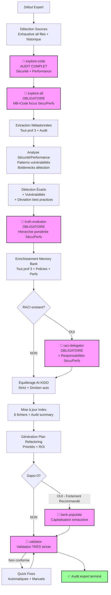

# Plan d'Analyse Générique - Expert (Profondeur 4)

> **Version**: 1.0 | **Date**: 2025-12-10 | **Type**: Analysis Plan | **Nature**: Générique | **Profondeur**: 4 - Expert

## 📋 Overview

Plan d'analyse **générique expert** offrant un audit complet du projet incluant sécurité, performance, et plan de refactoring détaillé. **Analyse la plus poussée** avec recommandations actionnables et ROI estimé. Utilisé comme **fallback** pour profondeur 4 quand aucun plan spécifique n'existe.

**Philosophie Expert** :
- ✅ Audit complet (~40-60 min)
- ✅ Analyse sécurité (OWASP, CVE)
- ✅ Analyse performance (bottlenecks, optimisations)
- ✅ Plan refactoring détaillé (étapes, ROI)
- ✅ Recommandations priorisées avec effort/impact
- ✅ Roadmap technique

## 🎯 Critères de Sélection

Ce plan est sélectionné quand :
- **Nature** : N'importe quel type d'analyse (1-18)
- **Profondeur** : 4 - Expert (audit complet, sécurité, performance, refactoring)
- **Contexte** : Audit pré-production, certification, migration critique, due diligence technique

**Différence vs autres profondeurs** :
- vs Survol (1) : Audit complet vs vue d'ensemble
- vs Standard (2) : + Sécurité + Performance + Refactoring
- vs Approfondi (3) : + Audit sécurité/perfs complet + Plan refactoring étape par étape + ROI

## 🔍 Sources à Analyser

### Sources Prioritaires (Exhaustives + Sécurité/Performance)

**Code Source** (audit complet) :
- **Tous** fichiers (source + tests + scripts + config)
- **Analyse sécurité** : Recherche vulnérabilités (injection, XSS, CSRF, etc.)
- **Analyse performance** : Détection bottlenecks (N+1, memory leaks, etc.)
- **Aucune exclusion** sauf binaires

**Documentation** (exhaustive + historique) :
- Toute documentation technique
- Historique décisions (ADRs si présents)
- Security policies (si existantes)
- Performance requirements (si documentées)
- Changelog complet (analyse évolution)

**Configuration** (audit sécurité/performance) :
- **Sécurité** : Secrets management, permissions, network policies
- **Performance** : Cache configs, pool sizes, timeout settings
- **Infrastructure** : Scaling policies, resource limits
- **Monitoring** : Logs, metrics, alerting

**Externes** (si applicable) :
- CVE databases (vulnérabilités connues)
- Benchmarks performance (comparaisons industry)
- Best practices (OWASP, SANS, etc.)

### Critères de Filtrage

**Aucune limite** :
- Analyse exhaustive de tous fichiers
- Analyse historique (git history si accessible)
- Analyse dépendances transitives (multi-niveaux)
- Recherche patterns sécurité/performance

## 🤖 Agents AI-KIDO à Mobiliser

### Phase 3.1 : Scan Code (Obligatoire - Audit Complet)

**Agent** : `agent-aikido-explore-code`

**Prompt spécialisé** :
```
"FORMAT: JSON

Analyse expert (profondeur 4) - Audit complet :

FOCUS PRINCIPAL :
- (Tout de profondeur 3) +
- SÉCURITÉ : Patterns vulnérabilités (injection, XSS, CSRF, auth bypass, etc.)
- PERFORMANCE : Bottlenecks (N+1, loops inefficients, memory leaks potentiels)
- CONFIGURATION : Hardcoded secrets, insecure settings

DÉTAIL AUDIT :
- Tous éléments profondeur 3 +
- Security patterns : SQL injection, XSS, CSRF, auth/authz issues
- Performance patterns : N+1 queries, inefficient loops, large data loads
- Insecure configurations : Hardcoded credentials, weak crypto, permissive CORS
- Deprecated APIs : Usage fonctions obsolètes/insecure
- Error handling : Try/catch coverage, error exposure

MÉTADONNÉES AUDIT :
- Security score par fichier (heuristique)
- Performance score par fichier (heuristique)
- Critical issues avec severity (CRITICAL/HIGH/MEDIUM/LOW)

Output attendu :
- Index exhaustif + audit sécurité/performance
- Issues critiques avec localisation exacte
- ~120-150 lignes par fichier analysé
- Budget total < 30k tokens"
```

**Résultat attendu** : Index exhaustif + audit sécurité/perfs en < 30k tokens

### Phase 3.2 : Recherche Parallèle (Obligatoire)

**Condition** : **OBLIGATOIRE** en profondeur 4

**Agent** : `agent-aikido-explore-all`

**Prompt spécialisé** :
```
"FORMAT: JSON

Recherche parallèle exhaustive avec focus sécurité/performance :

Memory Bank :
- (Tout de profondeur 3) +
- Security policies documentées
- Performance requirements documentés

Code Source :
- (Tout de profondeur 3) +
- Vulnérabilités potentielles vs policies
- Bottlenecks vs requirements

Keywords recherche :
- Patterns sécurité : password, token, secret, auth, crypto, hash, sql, query, input, sanitize
- Patterns performance : cache, pool, connection, query, loop, memory, async, promise

Output attendu :
- Écarts sécurité (policies vs implémentation)
- Écarts performance (requirements vs implémentation)
- Vulnérabilités potentielles détectées"
```

**Résultat attendu** : Rapport audit exhaustif avec focus sécurité/perfs

### Résolution Contradictions (Obligatoire)

**Agent** : `agent-aikido-truth-evaluator`

**Stratégie hiérarchie** : Scénario INVESTIGATION + pondération sécurité/performance
- Sécurité : Policies > Code > Config > Docs
- Performance : Requirements > Code > Config > Docs

### Classification RACI (Obligatoire si existant)

**Agent** : `agent-aikido-raci-delegator`

**Mapping** : Classification exhaustive + assignation responsabilités sécurité/performance

### Peuplement Automatique (Fortement Recommandé)

**Condition** : **FORTEMENT RECOMMANDÉ** si gaps > 3

**Agent** : `agent-aikido-bank-populate`

**Stratégie** : Capitalisation exhaustive incluant :
- Security policies extraites du code
- Performance patterns détectés
- Best practices identifiées

### Validation Finale (Obligatoire - Très Stricte)

**Agent** : `agent-aikido-validator`

**Règles strictes** :
- Toutes règles profondeur 3 +
- Validation sécurité documentation
- Validation performance documentation
- Liens vers issues critiques

## 📊 Stratégie d'Extraction

### 1. Détection Automatique (Audit Complet)

**Algorithme expert** :
1. (Tout de profondeur 3) +
2. **Scan sécurité** : Patterns vulnérabilités OWASP Top 10
3. **Scan performance** : Bottlenecks connus (N+1, memory leaks, etc.)
4. **Analyse dépendances** : CVE checking (si data disponible)
5. **Analyse configuration** : Security misconfigurations
6. **Analyse historique** : Evolution code (git blame sur zones critiques)

**Patterns de recherche** (sécurité/performance) :
```regex
# (Tout de profondeur 3) +

# SÉCURITÉ

# SQL Injection potentiel
(query|execute|prepare)\s*\(\s*[^\?].*\+.*\)
SELECT.*WHERE.*\$.*\+
INSERT.*VALUES.*\$.*\+

# XSS potentiel
innerHTML\s*=
dangerouslySetInnerHTML
eval\(
document.write\(

# Hardcoded secrets
(password|secret|key|token)\s*=\s*['"][^'"]+['"]
(api_key|api_secret|private_key)\s*=

# Insecure crypto
md5\(
sha1\(
des_encrypt

# Auth/Authz issues
(auth|authorize|permission).*false
if\s*\(\s*true\s*\).*admin

# PERFORMANCE

# N+1 queries potentiel
for.*\n.*query|select
forEach.*\n.*find|findOne

# Inefficient loops
for.*for.*for  # nested loops 3+
while.*\n.*sleep

# Memory leaks potentiels
addEventListener.*\n(?!.*removeEventListener)
setInterval.*\n(?!.*clearInterval)

# Synchronous operations (blocking)
(readFileSync|execSync|sleep)\(

# Large data loads
SELECT\s+\*\s+FROM  # select all
findAll\(\)  # ORM load all
```

**Heuristiques avancées** :
- (Tout de profondeur 3) +
- **Security score** : Nombre issues / LOC * 1000
- **Performance score** : Nombre bottlenecks / LOC * 1000
- **Criticality** : Localisation (auth, payment, admin = CRITICAL)

### 2. Extraction Métadonnées (Audit)

**(Tout de profondeur 3) +**

**Sécurité** :
- Vulnérabilités détectées avec severity (CRITICAL/HIGH/MEDIUM/LOW)
- CVE matches (si dépendances connues)
- Security misconfigurations
- Hardcoded secrets localisés
- Insecure crypto usage
- Missing security headers/validations

**Performance** :
- Bottlenecks détectés avec impact estimé
- Inefficient queries/loops localisés
- Memory leak risks
- Missing caching opportunities
- Synchronous blocking operations
- Resource limits (connections, memory)

### 3. Analyse Profondeur Spécifique

**Profondeur 4 - Expert** :
- **Niveau de détail** : Audit complet sécurité + performance + refactoring
- **Métriques collectées** :
  - (Toutes métriques profondeur 3) +
  - Security score global + par catégorie
  - Performance score global + par zone
  - Issues CRITICAL count
  - CVE count (si data disponible)
  - Effort refactoring estimé (heures)
  - ROI refactoring (impact vs effort)
- **Graphes générés** :
  - (Tous graphes profondeur 3) +
  - Heatmap sécurité (zones vulnérables)
  - Heatmap performance (bottlenecks)
  - Roadmap refactoring (timeline)
- **Temps estimé** : 40-60 minutes

## 🔄 Workflow Complet

### Phases d'Exécution (Audit Complet)



**Phase unique Expert** :
- ✅ Génération Plan Refactoring (après index, avant peuplement)

### Temps d'Exécution Estimé

- **Détection sources** : ~4 min
- **Scan audit (explore-code)** : ~12-18 min
- **Recherche parallèle sécu/perfs** : ~8-12 min
- **Analyse sécurité/performance** : ~5-8 min
- **Résolution contradictions** : ~5 min
- **Enrichissement exhaustif** : ~8-12 min
- **Génération plan refactoring** : ~5-8 min
- **Classification RACI** : ~4 min
- **Peuplement** : ~8-12 min
- **Validation très stricte** : ~3-5 min

**Total** : ~40-60 minutes

## 📤 Output Format

### Structure de Sortie (Audit Complet)

```markdown
# Rapport d'Audit Expert (Profondeur 4)

**Date** : {DATE}
**Durée** : {DURATION}
**Sources analysées** : {SOURCE_COUNT} fichiers (100% + historique)

## 🎯 Configuration

- **Nature** : {ANALYSIS_TYPE_DESCRIPTION}
- **Profondeur** : 4 - Expert (audit complet, sécurité, performance, refactoring)
- **Plan utilisé** : `plans/plan-expert.md`

## 🔒 Analyse Sécurité

### Score Sécurité Global

**Score** : {SECURITY_SCORE}/100
- ✅ Vert (80-100) : Sécurité solide
- ⚠️  Orange (50-79) : Améliorations nécessaires
- 🔴 Rouge (0-49) : Risques critiques

### Issues Critiques (CRITICAL) 🔴

**{CRITICAL_COUNT} issue(s) critique(s) détectée(s)** :

1. **{ISSUE_TYPE}** ({FILE}:{LINE}) - Severity: CRITICAL
   - **Description** : {DESCRIPTION}
   - **Impact** : {IMPACT}
   - **Exploitation** : {EXPLOIT_SCENARIO}
   - **Recommandation** : {FIX}
   - **Effort** : {EFFORT}
   - **Priorité** : P0 - Immédiat

### Issues Haute Priorité (HIGH) ⚠️

**{HIGH_COUNT} issue(s) haute priorité** :

1. **{ISSUE_TYPE}** ({FILE}:{LINE}) - Severity: HIGH
   - **Description** : {DESCRIPTION}
   - **Impact** : {IMPACT}
   - **Recommandation** : {FIX}
   - **Effort** : {EFFORT}
   - **Priorité** : P1 - Court terme

### Vulnérabilités par Catégorie (OWASP Top 10)

| Catégorie OWASP | Issues | Severity Max | Fichiers Affectés |
|-----------------|--------|--------------|-------------------|
| A01: Broken Access Control | {COUNT} | {MAX_SEV} | {FILES} |
| A02: Cryptographic Failures | {COUNT} | {MAX_SEV} | {FILES} |
| A03: Injection | {COUNT} | {MAX_SEV} | {FILES} |
| A04: Insecure Design | {COUNT} | {MAX_SEV} | {FILES} |
| A05: Security Misconfiguration | {COUNT} | {MAX_SEV} | {FILES} |
| ... | | | |

### Dépendances Vulnérables (CVE)

**{CVE_COUNT} dépendance(s) avec CVE connue(s)** :

- **{LIBRARY} {VERSION}** - CVE-{YEAR}-{ID} (Severity: {CRITICAL/HIGH/MEDIUM})
  - Description : {CVE_DESC}
  - Fix : Upgrade to {VERSION_FIXED}

### Heatmap Sécurité

```mermaid
{SECURITY_HEATMAP}
```

Zones critiques (rouge) :
- `{CRITICAL_ZONE_1}` - {ISSUE_COUNT} issues
- `{CRITICAL_ZONE_2}` - {ISSUE_COUNT} issues

## ⚡ Analyse Performance

### Score Performance Global

**Score** : {PERFORMANCE_SCORE}/100
- ✅ Vert (80-100) : Performance optimale
- ⚠️  Orange (50-79) : Optimisations possibles
- 🔴 Rouge (0-49) : Bottlenecks critiques

### Bottlenecks Critiques 🔴

**{CRITICAL_BOTTLENECK_COUNT} bottleneck(s) critique(s)** :

1. **{BOTTLENECK_TYPE}** ({FILE}:{LINE})
   - **Description** : {DESCRIPTION}
   - **Impact** : {IMPACT_DESCRIPTION} (ex: +{MS}ms par requête)
   - **Fréquence** : {FREQUENCY} (si détectable)
   - **Recommandation** : {FIX}
   - **Gain estimé** : {GAIN_MS}ms ({GAIN_PERCENT}%)
   - **Effort** : {EFFORT}
   - **ROI** : {ROI_SCORE}/10

### Bottlenecks Haute Priorité ⚠️

**{HIGH_BOTTLENECK_COUNT} bottleneck(s) haute priorité** :

1. **{BOTTLENECK_TYPE}** ({FILE}:{LINE})
   - **Description** : {DESCRIPTION}
   - **Impact** : {IMPACT}
   - **Recommandation** : {FIX}
   - **Gain estimé** : {GAIN}
   - **Effort** : {EFFORT}

### Opportunités Caching

**{CACHE_OPP_COUNT} opportunité(s) caching détectée(s)** :

- **{FUNCTION}** ({FILE}:{LINE}) - Gain estimé : {GAIN_MS}ms
  - Appels : {CALL_COUNT}/min (si détectable)
  - Stratégie : {CACHE_STRATEGY}

### Heatmap Performance

```mermaid
{PERFORMANCE_HEATMAP}
```

Zones critiques (rouge) :
- `{CRITICAL_ZONE_1}` - {BOTTLENECK_COUNT} bottlenecks
- `{CRITICAL_ZONE_2}` - {BOTTLENECK_COUNT} bottlenecks

## 📊 (Toutes sections profondeur 3)

[Architecture, Stack, Qualité, Écarts, etc. depuis plan-approfondi.md]

## 🛠️  Plan de Refactoring Détaillé

### Vue d'Ensemble

**Effort total estimé** : {HOURS}h ({DAYS} jours-homme)
**ROI global** : {ROI_SCORE}/10
**Priorités** :
- P0 (Immédiat) : {P0_COUNT} items - {P0_HOURS}h
- P1 (Court terme) : {P1_COUNT} items - {P1_HOURS}h
- P2 (Moyen terme) : {P2_COUNT} items - {P2_HOURS}h

### Phase 1 : Sécurité (Immédiat - P0)

**Durée** : {PHASE1_DURATION}
**Effort** : {PHASE1_EFFORT}h

**Étapes** :
1. **Fix {CRITICAL_ISSUE_1}** ({FILE}:{LINE})
   - Action : {ACTION_STEPS}
   - Tests : {TEST_STEPS}
   - Validation : {VALIDATION_STEPS}
   - Effort : {EFFORT}h
   - Impact : 🔴 Critique

2. **Fix {CRITICAL_ISSUE_2}** ({FILE}:{LINE})
   - Action : {ACTION_STEPS}
   - Tests : {TEST_STEPS}
   - Validation : {VALIDATION_STEPS}
   - Effort : {EFFORT}h
   - Impact : 🔴 Critique

### Phase 2 : Performance (Court terme - P1)

**Durée** : {PHASE2_DURATION}
**Effort** : {PHASE2_EFFORT}h

**Étapes** :
1. **Optimiser {BOTTLENECK_1}** ({FILE}:{LINE})
   - Stratégie : {OPTIMIZATION_STRATEGY}
   - Gain estimé : {GAIN_MS}ms ({GAIN_PERCENT}%)
   - Tests performance : {PERF_TEST_STEPS}
   - Effort : {EFFORT}h
   - ROI : {ROI}/10

### Phase 3 : Qualité (Moyen terme - P2)

**Durée** : {PHASE3_DURATION}
**Effort** : {PHASE3_EFFORT}h

**Étapes** :
1. **Refactor {ANTI_PATTERN_1}** ({FILE}:{LINE})
   - Stratégie : {REFACTOR_STRATEGY}
   - Impact qualité : {QUALITY_IMPACT}
   - Effort : {EFFORT}h

### Roadmap Visuelle

```mermaid
gantt
    title Plan Refactoring
    dateFormat YYYY-MM-DD
    section Phase 1 Sécurité
    {TASK_1} :crit, {START}, {DURATION}d
    {TASK_2} :crit, {START}, {DURATION}d
    section Phase 2 Performance
    {TASK_3} : {START}, {DURATION}d
    {TASK_4} : {START}, {DURATION}d
    section Phase 3 Qualité
    {TASK_5} : {START}, {DURATION}d
```

### Checklist Complète

**Phase 1 - Sécurité** :
- [ ] {TASK_1} ({EFFORT}h) - {OWNER}
- [ ] {TASK_2} ({EFFORT}h) - {OWNER}

**Phase 2 - Performance** :
- [ ] {TASK_1} ({EFFORT}h) - {OWNER}
- [ ] {TASK_2} ({EFFORT}h) - {OWNER}

**Phase 3 - Qualité** :
- [ ] {TASK_1} ({EFFORT}h) - {OWNER}
- [ ] {TASK_2} ({EFFORT}h) - {OWNER}

## 💡 Recommandations Stratégiques

### Sécurité

**Immédiat (P0)** :
- {SECURITY_REC_1}

**Court terme (P1)** :
- {SECURITY_REC_2}

**Politiques à établir** :
- {POLICY_REC_1}

### Performance

**Quick Wins (ROI élevé, effort faible)** :
- {PERF_QUICKWIN_1} - Gain : {GAIN}, Effort : {EFFORT}h, ROI : {ROI}/10

**Optimisations majeures (ROI moyen, effort élevé)** :
- {PERF_MAJOR_1} - Gain : {GAIN}, Effort : {EFFORT}h, ROI : {ROI}/10

### Architecture

**Evolution recommandée** :
- {ARCH_REC_1}

**Migration suggérée** :
- {MIGRATION_REC_1}

## 📝 Enrichissements Appliqués

[Section similaire profondeur 3 + policies sécurité + patterns performance]

## ✅ Conformité AI-KIDO (Très Stricte)

[Section similaire profondeur 3 avec validation renforcée]

## 📊 Métriques Finales

- **Fichiers analysés** : {COUNT} (100% exhaustif)
- **LOC auditées** : {LOC}
- **Security issues** : {COUNT} ({CRITICAL}🔴 / {HIGH}⚠️  / {MEDIUM}/ {LOW})
- **Performance issues** : {COUNT} ({CRITICAL}🔴 / {HIGH}⚠️)
- **Dette technique** : {DEBT_HOURS}h
- **Effort refactoring** : {REFACTOR_HOURS}h
- **ROI refactoring** : {ROI}/10
- **Agents utilisés** : 6 (tous agents AI-KIDO)
- **Temps total** : {DURATION}
- **Budget tokens** : ~{TOKENS} (< 30k cible)

---
*Généré par /analyse-project avec plan plan-expert.md*
*Audit complet : sécurité + performance + refactoring*
```

## 🎓 Cas d'Usage Idéaux

Le plan expert est idéal pour :
- ✅ Audit pré-production (go/no-go critique)
- ✅ Certification sécurité (SOC2, ISO27001, etc.)
- ✅ Due diligence technique (M&A)
- ✅ Migration critique (refonte majeure)
- ✅ Optimisation performance (SLA critiques)
- ✅ Réduction dette technique (planning pluriannuel)

## 📚 Références

- **Plan profondeur inférieure** : `plan-approfondi.md` (profondeur 3)
- **Agents** : Tous agents AI-KIDO (6 agents)
- **Commande** : `prompts/hard_points/commands/analyse-project.md`
- **OWASP Top 10** : https://owasp.org/Top10/
- **Documentation AI-KIDO** : `prompts/hard_points/ai-kido.md`

---
*Plan Expert créé le 2025-12-10 pour /analyse-project*
*Audit complet : sécurité + performance + refactoring + ROI*
