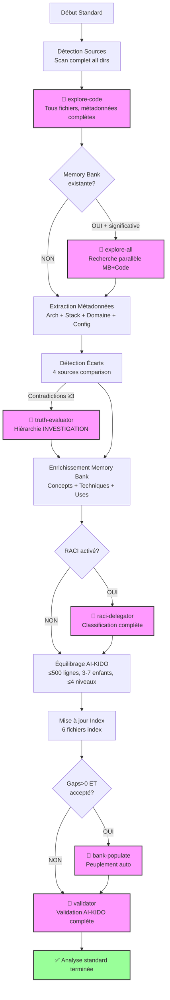

# Plan d'Analyse Générique - Standard (Profondeur 2)

> **Version**: 1.0 | **Date**: 2025-12-10 | **Type**: Analysis Plan | **Nature**: Générique | **Profondeur**: 2 - Standard

## 📋 Overview

Plan d'analyse **générique standard** offrant un équilibre entre détail et performance. Analyse complète de l'architecture, des dépendances et de la logique métier avec un niveau de détail modéré. Utilisé comme **fallback** pour profondeur 2 quand aucun plan spécifique n'existe.

**Philosophie Standard** :
- ✅ Équilibré (~10-20 min)
- ✅ Analyse architecture complète
- ✅ Dépendances et relations
- ✅ Logique métier principale
- ❌ Pas d'audit détaillé
- ❌ Pas de recommandations avancées

## 🎯 Critères de Sélection

Ce plan est sélectionné quand :
- **Nature** : N'importe quel type d'analyse (1-18)
- **Profondeur** : 2 - Standard (détail modéré, équilibré)
- **Contexte** : Analyse régulière, mise à jour tables de vérités, compréhension architecture

**Différence vs autres profondeurs** :
- vs Survol (1) : Analyse complète architecture, détection dépendances, graphes relations
- vs Approfondi (3) : Pas d'analyse fine implémentation, pas de détection anti-patterns systématique
- vs Expert (4) : Pas d'audit sécurité/performance, pas de plan refactoring

## 🔍 Sources à Analyser

### Sources Prioritaires

**Code Source** (scan complet) :
- Tous répertoires source : `src/`, `lib/`, `app/`, `components/`, `modules/`, `services/`
- Extensions complètes : Tous langages détectés
- Profondeur : Tous niveaux
- **Exclusions** : node_modules, vendor, dist, build, target, tests (analysés séparément si requis)

**Documentation** (lecture complète) :
- `README.md` (obligatoire)
- `ARCHITECTURE.md`, `DESIGN.md`, docs/architecture
- `API.md`, docs/api
- Glossaire métier (si existe)
- CHANGELOG.md

**Configuration** (analyse détaillée) :
- Package managers : package.json, composer.json, requirements.txt, go.mod, Cargo.toml, Gemfile
- Build : Makefile, webpack.config.js, tsconfig.json
- Docker : Dockerfile, docker-compose.yml
- CI/CD : .github/workflows/, .gitlab-ci.yml, Jenkinsfile
- Environnement : .env.example, config/*.yml

### Critères de Filtrage

**Analyse sélective** :
- Tous fichiers source principaux (pas de limite)
- Fichiers > 1000 lignes : analyse complète mais extraction métadonnées prioritaires
- Tests : scan métadonnées uniquement (couverture, frameworks)

## 🤖 Agents AI-KIDO à Mobiliser

### Phase 3.1 : Scan Code (Obligatoire)

**Agent** : `agent-aikido-explore-code`

**Prompt spécialisé** :
```
"FORMAT: JSON

Analyse standard (profondeur 2) du projet :

FOCUS :
- Architecture complète (tous répertoires source)
- Stack technique détaillée (langages, frameworks, bibliothèques)
- Dépendances et relations (imports, extends, implements)
- Logique métier principale (classes, interfaces, modules)
- Points d'API et interfaces publiques

DÉTAIL :
- Tous fichiers source (pas de limite)
- Métadonnées complètes par élément :
  - Classes : name, extends, implements, methods (signatures), properties
  - Interfaces : name, methods (signatures)
  - Functions : name, signature, parameters, return type
  - Imports : all dependencies avec line numbers
- Graphe dépendances complet (Mermaid)

EXCLUSIONS :
- Tests (scan séparé si requis)
- Fichiers générés (dist, build)

Output attendu :
- Index complet architecture
- Graphe dépendances détaillé
- ~50-80 lignes par fichier analysé
- Budget total < 10k tokens"
```

**Résultat attendu** : Index architectural complet + graphes dépendances en < 10k tokens

### Phase 3.2 : Recherche Parallèle (Optionnel)

**Condition** : Si Memory Bank existante avec contenu significatif (> 10 documents)

**Agent** : `agent-aikido-explore-all`

**Prompt spécialisé** :
```
"FORMAT: JSON

Recherche parallèle Memory Bank + Code pour analyse standard :

Memory Bank (/prompts/gen/) :
- Concepts architecture documentés
- Techniques stack documentées
- Use cases processus documentés
- Glossaire termes métier

Code Source (hors /prompts/) :
- Architecture réellement implémentée
- Stack technique réellement utilisée
- Processus réellement codés
- Termes métier dans le code

Keywords recherche : {TYPE_DEPENDENT_KEYWORDS}

Output attendu :
- Cross-references Memory Bank ↔ Code
- Écarts détectés (docs vs implémentation)
- Éléments obsolètes potentiels"
```

**Résultat attendu** : Rapport écarts + cross-references en ~3-5 sec

### Résolution Contradictions (Si besoin)

**Condition** : Contradictions détectées (>= 3 contradictions majeures)

**Agent** : `agent-aikido-truth-evaluator`

**Stratégie hiérarchie** : Scénario INVESTIGATION
- Code (implémentation) > Config (opérationnel) > Docs (intentionnel) > Memory Bank (historique)

### Classification RACI (Si activé)

**Condition** : Structure RACI activée dans /prompts/hard_points/

**Agent** : `agent-aikido-raci-delegator`

**Mapping** : Classification complète des documents extraits par domaine et rôle

### Peuplement Automatique (Si accepté)

**Condition** : Gaps > 0 ET utilisateur accepte

**Agent** : `agent-aikido-bank-populate`

**Stratégie** : Capitalisation depuis code/docs/config avec personas experts

### Validation Finale (Obligatoire)

**Agent** : `agent-aikido-validator`

**Règles strictes** :
- Règle 4 : Taille ≤ 500 lignes
- Règle 6 : Liens bidirectionnels complets
- Règle 7 : Équilibrage (3-7 enfants, ≤ 4 niveaux)
- Frontmatter présent et valide
- Emplacement correct selon RACI

## 📊 Stratégie d'Extraction

### 1. Détection Automatique (Complète)

**Algorithme standard** :
1. Scanner tous répertoires source (profondeur complète)
2. Détecter tous langages et frameworks (package managers + imports)
3. Identifier tous points d'entrée (mains, routers, controllers)
4. Extraire toutes classes/interfaces/modules avec métadonnées
5. Construire graphe dépendances complet (extends, implements, imports)
6. Détecter patterns architecturaux (MVC, MVVM, microservices, etc.)

**Patterns de recherche** (complets) :
```regex
# Points d'entrée
(index|main|app|server|router|controller)\.(js|ts|php|py|java|go|rs|rb)

# Imports/Dépendances (multi-langage)
^import\s+.*from\s+['"]([^'"]+)['"]          # JS/TS
^require\(['"]([^'"]+)['"]\)                  # JS CommonJS
^use\s+([\w\\]+);                             # PHP
^from\s+(\S+)\s+import                        # Python
^import\s+([\w\.]+)                           # Java/Go
^use\s+([\w:]+);                              # Rust

# Déclarations classes/interfaces
^(export\s+)?(default\s+)?class\s+(\w+)       # JS/TS
^class\s+(\w+)(\s+extends\s+(\w+))?           # PHP/Python/Java
^interface\s+(\w+)                            # TS/Java/PHP
^trait\s+(\w+)                                # PHP/Rust
^type\s+(\w+)\s+struct                        # Go
^pub\s+struct\s+(\w+)                         # Rust

# Fonctions/Méthodes
^(export\s+)?(async\s+)?function\s+(\w+)      # JS/TS
^(public|private|protected)\s+function\s+(\w+) # PHP
^def\s+(\w+)\s*\(                             # Python
^func\s+(\w+)\s*\(                            # Go
^pub\s+fn\s+(\w+)                             # Rust
```

**Heuristiques** :
- Ratio langages → Langage principal vs secondaires
- Profondeur import tree → Complexité architecture
- Nombre classes abstraites/interfaces → Niveau abstraction
- Pattern noms fichiers → Convention architecture (MVC, etc.)

### 2. Extraction Métadonnées (Détaillée)

**Architecture** :
- Structure répertoires complète (tous niveaux)
- Pattern architecture détecté avec confidence
- Composants principaux identifiés (controllers, models, services, etc.)
- Relations entre composants (graphe Mermaid)

**Stack Technique** :
- Langages (tous) avec pourcentages
- Frameworks (tous) avec versions
- Bibliothèques majeures (top 20) avec versions
- Outils build/deploy détectés

**Domaine Métier** :
- Entités métier détectées (depuis noms classes/tables)
- Processus métier identifiés (depuis workflows code)
- Glossaire termes métier (extraction automatique)
- APIs exposées (endpoints, méthodes publiques)

**Configuration** :
- Environnements (dev, staging, prod)
- Services externes (databases, APIs, queues)
- Variables d'environnement requises
- Ports et protocoles utilisés

### 3. Analyse Profondeur Spécifique

**Profondeur 2 - Standard** :
- **Niveau de détail** : Complet mais sans optimisation
- **Métriques collectées** :
  - LOC par langage
  - Nombre classes/interfaces/modules
  - Profondeur arbre dépendances
  - Complexité cyclomatique moyenne (si détectable)
  - Couverture tests (si tests présents)
- **Graphes générés** :
  - Arbre répertoires complet
  - Graphe dépendances (Mermaid)
  - Diagramme composants (si applicable)
- **Temps estimé** : 10-20 minutes

**Métriques Standard** :
```markdown
- **Fichiers totaux** : {COUNT}
- **LOC totales** : {LOC_COUNT}
- **Langages** : {LANG_LIST} ({PERCENTAGES}%)
- **Frameworks** : {FRAMEWORKS}
- **Classes** : {CLASS_COUNT}
- **Interfaces** : {INTERFACE_COUNT}
- **Fonctions** : {FUNCTION_COUNT}
- **Dépendances externes** : {DEP_COUNT}
- **Complexité** : Faible/Moyenne/Haute (calculée)
```

## 🔄 Workflow Complet

### Phases d'Exécution (Complet Standard)



**Toutes phases activées en standard** sauf :
- Phase 3.2 (explore-all) : Optionnel selon Memory Bank
- Phase 8 (bank-populate) : Si gaps détectés et accepté

### Temps d'Exécution Estimé

- **Détection sources** : ~2 min
- **Scan code (explore-code)** : ~5-8 min
- **Recherche parallèle (opt)** : ~3-5 min
- **Résolution contradictions** : ~2-3 min
- **Enrichissement** : ~3-5 min
- **Classification RACI (opt)** : ~2 min
- **Peuplement (opt)** : ~3-5 min
- **Validation** : ~1-2 min

**Total** : ~10-20 minutes (selon options)

## 📤 Output Format

### Structure de Sortie

```markdown
# Rapport d'Analyse Standard (Profondeur 2)

**Date** : {DATE}
**Durée** : {DURATION}
**Sources analysées** : {SOURCE_COUNT} fichiers

## 🎯 Configuration

- **Nature** : {ANALYSIS_TYPE_DESCRIPTION}
- **Profondeur** : 2 - Standard (détail modéré, équilibré)
- **Plan utilisé** : `plans/plan-standard.md`

## 📊 Architecture Complète

### Structure Répertoires

```
{PROJECT_ROOT}/
├── src/ ({FILE_COUNT} fichiers, {LOC} LOC)
│   ├── components/
│   ├── services/
│   └── models/
├── lib/ ({FILE_COUNT} fichiers)
├── tests/ ({FILE_COUNT} fichiers)
└── docs/ ({FILE_COUNT} fichiers)
```

**Pattern architecture** : {PATTERN} avec confidence {CONFIDENCE}%

### Composants Principaux

**Controllers** ({COUNT}) :
- `{CONTROLLER_1}` ({LINES} lignes) - Gère {RESPONSIBILITY}
- `{CONTROLLER_2}` ({LINES} lignes) - Gère {RESPONSIBILITY}
- ...

**Services** ({COUNT}) :
- `{SERVICE_1}` ({LINES} lignes) - {DESCRIPTION}
- `{SERVICE_2}` ({LINES} lignes) - {DESCRIPTION}
- ...

**Models/Entities** ({COUNT}) :
- `{MODEL_1}` ({PROPERTIES} propriétés) - {DESCRIPTION}
- `{MODEL_2}` ({PROPERTIES} propriétés) - {DESCRIPTION}
- ...

### Graphe Dépendances

```mermaid
{DEPENDENCY_GRAPH}
```

## 🛠️  Stack Technique Détaillée

### Langages

| Langage | Fichiers | LOC | Pourcentage |
|---------|----------|-----|-------------|
| {LANG_1} | {COUNT} | {LOC} | {PERCENT}% |
| {LANG_2} | {COUNT} | {LOC} | {PERCENT}% |
| {LANG_3} | {COUNT} | {LOC} | {PERCENT}% |

### Frameworks & Bibliothèques

**Frameworks majeurs** :
- {FRAMEWORK_1} {VERSION} - {USAGE_DESCRIPTION}
- {FRAMEWORK_2} {VERSION} - {USAGE_DESCRIPTION}

**Bibliothèques principales** (top 10) :
- {LIB_1} {VERSION}
- {LIB_2} {VERSION}
- ...

### Configuration

**Environnements** : {ENV_LIST}
**Services externes** :
- Database : {DB_TYPE} (port {PORT})
- Cache : {CACHE_TYPE} (port {PORT})
- Message Queue : {MQ_TYPE} (port {PORT})

## 📋 Domaine Métier

### Entités Métier Détectées

| Entité | Fichier | Properties | Relations |
|--------|---------|------------|-----------|
| {ENTITY_1} | {FILE}:{LINE} | {COUNT} | {RELATIONS} |
| {ENTITY_2} | {FILE}:{LINE} | {COUNT} | {RELATIONS} |

### Processus Métier Identifiés

- **{PROCESS_1}** : {DESCRIPTION} (implémenté dans {FILES})
- **{PROCESS_2}** : {DESCRIPTION} (implémenté dans {FILES})

### APIs Exposées

**Endpoints** ({COUNT}) :
- `{METHOD} {PATH}` - {DESCRIPTION} ({CONTROLLER}:{LINE})
- `{METHOD} {PATH}` - {DESCRIPTION} ({CONTROLLER}:{LINE})

**Méthodes publiques** ({COUNT}) :
- `{CLASS}.{METHOD}({PARAMS})` ({FILE}:{LINE})

## ⚠️  Écarts et Contradictions

### Code vs Documentation

{CODE_VS_DOCS_GAPS}

### Stack Déclarée vs Utilisée

{DECLARED_VS_USED_STACK}

### Processus Documentés vs Implémentés

{DOCUMENTED_VS_IMPLEMENTED_PROCESSES}

## 📝 Enrichissements Appliqués

- **Concepts** : {CONCEPTS_COUNT} mis à jour
  - {CONCEPT_1} (nouveau/mis à jour)
  - {CONCEPT_2} (nouveau/mis à jour)
- **Techniques** : {TECHNIQUES_COUNT} enrichies
  - {TECHNIQUE_1} (stack détaillée)
  - {TECHNIQUE_2} (patterns détectés)
- **Use Cases** : {USE_CASES_COUNT} ajoutés/modifiés
  - {USE_CASE_1} (processus métier)
  - {USE_CASE_2} (workflow)
- **Personas** : {PERSONAS_COUNT} adaptés
  - {PERSONA_1} (compétences ajustées)

### Répartition RACI (si activé)

| Domaine | Rôle Responsable | Documents |
|---------|------------------|-----------|
| Architecture | {ROLE} | {COUNT} docs |
| Backend | {ROLE} | {COUNT} docs |
| Frontend | {ROLE} | {COUNT} docs |

## 💡 Recommandations Initiales

### Architecture
- {RECOMMENDATION_1}
- {RECOMMENDATION_2}

### Stack Technique
- {RECOMMENDATION_1}
- {RECOMMENDATION_2}

### Documentation
- {RECOMMENDATION_1}
- {RECOMMENDATION_2}

**Pour analyse plus poussée** :
- Profondeur 3 (Approfondi) : Détection anti-patterns, optimisations
- Profondeur 4 (Expert) : Audit sécurité/performance, plan refactoring

## ✅ Conformité AI-KIDO

- **Documents créés/modifiés** : {COUNT}
- **Règles respectées** : {COMPLIANCE_SCORE}%
  - Règle 4 (≤500 lignes) : {R4_STATUS}
  - Règle 6 (liens bidirectionnels) : {R6_STATUS}
  - Règle 7 (équilibrage) : {R7_STATUS}
- **Quick fixes appliqués** : {FIXES_COUNT}

## 📊 Métriques Finales

- **Fichiers analysés** : {COUNT}
- **LOC totales** : {LOC}
- **Agents utilisés** : {AGENTS_LIST}
- **Temps total** : {DURATION}
- **Budget tokens** : ~{TOKENS} (< 10k cible)

---
*Généré par /analyse-project avec plan plan-standard.md*
*Analyse complète équilibrée performance/détail*
```

## 🎓 Cas d'Usage Idéaux

Le plan standard est idéal pour :
- ✅ Analyse régulière d'un projet existant
- ✅ Mise à jour tables de vérités après changements
- ✅ Compréhension architecture complète
- ✅ Onboarding nouveaux développeurs
- ✅ Documentation technique à jour
- ✅ Détection écarts code/docs

## 📚 Références

- **Plan profondeur inférieure** : `plan-survol.md` (profondeur 1)
- **Plan profondeur supérieure** : `plan-approfondi.md` (profondeur 3)
- **Agents principaux** : explore-code, explore-all, truth-evaluator, raci-delegator, bank-populate, validator
- **Commande** : `prompts/hard_points/commands/analyse-project.md`
- **Documentation AI-KIDO** : `prompts/hard_points/ai-kido.md`

---
*Plan Standard créé le 2025-12-10 pour /analyse-project*
*Équilibre optimal entre détail et performance*
