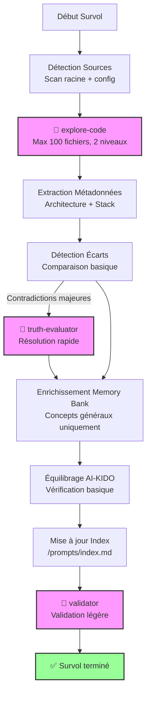

# Plan d'Analyse Générique - Survol (Profondeur 1)

> **Version**: 1.0 | **Date**: 2025-12-10 | **Type**: Analysis Plan | **Nature**: Générique | **Profondeur**: 1 - Survol

## 📋 Overview

Plan d'analyse **générique de survol** pour obtenir une vue d'ensemble rapide du projet sans entrer dans les détails. Utilisé comme **fallback** quand aucun plan spécifique n'existe, ou pour une première découverte du projet.

**Philosophie Survol** :
- ✅ Rapide (~5-10 min)
- ✅ Vue d'ensemble
- ✅ Identification éléments principaux
- ❌ Pas de détails techniques
- ❌ Pas d'analyse exhaustive

## 🎯 Critères de Sélection

Ce plan est sélectionné quand :
- **Nature** : N'importe quel type d'analyse (1-18)
- **Profondeur** : 1 - Survol (vue d'ensemble générale)
- **Contexte** : Première découverte, audit rapide, décision go/no-go

**Différence vs autres profondeurs** :
- vs Standard (2) : Moins de détails techniques, pas d'analyse dépendances
- vs Approfondi (3) : Pas de détection patterns, pas d'analyse exhaustive
- vs Expert (4) : Pas d'audit, pas de recommandations détaillées

## 🔍 Sources à Analyser

### Sources Prioritaires

**Code Source** (scan superficiel) :
- Répertoires racine uniquement : `src/`, `lib/`, `app/`, `components/`
- Extensions principales : `*.{js,ts,php,py,java,go,rs,rb}`
- **Exclusions** : node_modules, vendor, dist, build, target, .git

**Documentation** (lecture rapide) :
- `README.md` (obligatoire)
- `ARCHITECTURE.md` ou `docs/architecture.*` (si existe)
- `CHANGELOG.md` (si existe)

**Configuration** (scan minimal) :
- Package managers : `package.json`, `composer.json`, `requirements.txt`, `go.mod`, `Cargo.toml`, `Gemfile`
- Build : `Makefile`, `docker-compose.yml`
- CI/CD : `.github/workflows/*.yml` (scan rapide)

### Critères de Filtrage

**Limiter le scan** :
- Max 100 fichiers code analysés
- Profondeur répertoire : ≤ 2 niveaux
- Fichiers > 1000 lignes : scan header uniquement (50 premières lignes)

## 🤖 Agents AI-KIDO à Mobiliser

### Phase 3.1 : Scan Code (Obligatoire)

**Agent** : `agent-aikido-explore-code`

**Prompt spécialisé** :
```
"FORMAT: JSON

Analyse survol (profondeur 1) du projet :

FOCUS :
- Architecture générale (répertoires principaux)
- Stack technique principale (langages, frameworks majeurs)
- Points d'entrée (main files, index, routes)

LIMITE :
- Max 100 fichiers
- Profondeur 2 niveaux max
- Métadonnées essentielles uniquement (classes principales, imports majeurs)

EXCLUSIONS :
- Tests unitaires
- Fichiers de configuration détaillés
- Dépendances externes

Output attendu :
- Structure répertoires (arbre 2 niveaux)
- Stack technique détectée (langages + frameworks principaux)
- Points d'entrée identifiés (fichiers main)
- ~30 lignes par fichier analysé max
- Budget total < 1500 tokens"
```

**Résultat attendu** : Vue d'ensemble architecture + stack en < 2000 tokens

### Phase 3.2 : Recherche Parallèle

**Condition** : **NON UTILISÉ** pour profondeur 1 (survol)

agent-aikido-explore-all est **skip** pour survol (trop lourd)

### Résolution Contradictions

**Condition** : Si contradictions majeures détectées (rares en survol)

**Agent** : `agent-aikido-truth-evaluator`

**Stratégie hiérarchie** : Code > Config > Docs (simple et rapide)

### Classification RACI

**Condition** : **OPTIONNEL** - Uniquement si structure RACI déjà présente

**Agent** : `agent-aikido-raci-delegator`

**Mapping** : Classification de haut niveau uniquement (catégories générales)

### Peuplement Automatique

**Condition** : **NON RECOMMANDÉ** pour survol (prématuré)

Le peuplement automatique est **skip** en profondeur 1. Attendre une analyse plus profonde (profondeur ≥ 2).

### Validation Finale (Obligatoire)

**Agent** : `agent-aikido-validator`

**Règles strictes** :
- Vérification frontmatter documents créés
- Conformité taille ≤ 500 lignes
- Liens bidirectionnels si documents multiples

## 📊 Stratégie d'Extraction

### 1. Détection Automatique (Légère)

**Algorithme survol** :
1. Lister répertoires racine (ls -d src lib app components services)
2. Détecter stack technique (package.json, composer.json, etc.)
3. Identifier fichiers main (index.*, main.*, app.*, server.*)
4. Scanner 50 premières lignes de chaque fichier principal
5. Extraire imports majeurs uniquement

**Patterns de recherche** (basiques) :
```regex
# Points d'entrée
(index|main|app|server)\.(js|ts|php|py|java|go|rs|rb)

# Imports majeurs uniquement
^import\s+.*from\s+['"]([^'"]+)['"]
^require\(['"]([^'"]+)['"]\)
^use\s+([\w\\]+);

# Classes principales (top-level seulement)
^(export\s+)?(default\s+)?class\s+(\w+)
^class\s+(\w+)
```

**Heuristiques** :
- Taille répertoire `src/` ou équivalent → Estimation complexité
- Nombre de fichiers config → Estimation maturité projet
- Présence README structuré → Qualité documentation

### 2. Extraction Métadonnées (Minimale)

**Architecture** :
- Structure répertoires (arbre 2 niveaux)
- Pattern détecté (MVC, microservices, monolithe) - heuristique basique

**Stack Technique** :
- Langage principal (détection automatique)
- Framework majeur (depuis package manager)
- Version (depuis package manager)

**Domaine Métier** :
- Nom projet (depuis README ou package.json)
- Description 1 ligne (depuis README)
- Domaines métier suggérés (depuis noms répertoires/fichiers)

**Configuration** :
- Environnements détectés (dev, prod) - basique
- Services externes majeurs (depuis config) - heuristique

### 3. Analyse Profondeur Spécifique

**Profondeur 1 - Survol** :
- **Niveau de détail** : Vue d'ensemble uniquement
- **Métriques collectées** : Nombre fichiers, taille codebase (LOC estimé), langages détectés
- **Graphes générés** : Arbre répertoires 2 niveaux (Mermaid simplifié)
- **Temps estimé** : 5-10 minutes

**Métriques Survol** :
```markdown
- **Fichiers totaux** : ~{COUNT} (estimation)
- **Taille codebase** : ~{SIZE_MB} MB
- **Langages détectés** : {LANG_LIST}
- **Framework principal** : {FRAMEWORK}
- **Complexité estimée** : Faible/Moyenne/Haute (heuristique)
```

## 🔄 Workflow Complet

### Phases d'Exécution (Simplifié)



**Phases skip en survol** :
- ❌ Phase 3.2 : explore-all (trop lourd)
- ❌ Phase 5 : RACI détaillé (optionnel seulement)
- ❌ Phase 8 : Peuplement automatique (prématuré)

### Temps d'Exécution Estimé

- **Détection sources** : ~1 min
- **Scan code (explore-code)** : ~3-5 min
- **Enrichissement basique** : ~2-3 min
- **Validation** : ~1 min

**Total** : ~5-10 minutes

## 📤 Output Format

### Structure de Sortie

```markdown
# Rapport d'Analyse Survol (Profondeur 1)

**Date** : {DATE}
**Durée** : {DURATION}
**Sources analysées** : {SOURCE_COUNT} fichiers (~{PERCENT}% du total)

## 🎯 Configuration

- **Nature** : Analyse générique survol
- **Profondeur** : 1 - Survol (vue d'ensemble rapide)
- **Plan utilisé** : `plans/plan-survol.md`

## 📊 Vue d'Ensemble

### Architecture Générale

**Structure répertoires** (2 niveaux) :
```
{PROJECT_ROOT}/
├── src/ ({FILE_COUNT} fichiers)
├── lib/ ({FILE_COUNT} fichiers)
├── tests/ (ignoré)
└── docs/ ({FILE_COUNT} fichiers)
```

**Pattern détecté** : {PATTERN} (MVC / Microservices / Monolithe / Autre)

### Stack Technique

- **Langage principal** : {MAIN_LANGUAGE} (~{PERCENT}% du code)
- **Framework majeur** : {MAIN_FRAMEWORK} {VERSION}
- **Langages secondaires** : {SECONDARY_LANGUAGES}

**Dépendances majeures** (top 5) :
- {DEPENDENCY_1}
- {DEPENDENCY_2}
- {DEPENDENCY_3}
- {DEPENDENCY_4}
- {DEPENDENCY_5}

### Domaine Métier

- **Nom projet** : {PROJECT_NAME}
- **Description** : {ONE_LINE_DESCRIPTION}
- **Domaines suggérés** : {DOMAIN_SUGGESTIONS} (depuis noms fichiers/répertoires)

### Métriques Globales

- **Fichiers totaux** : ~{COUNT} (estimation)
- **Taille codebase** : ~{SIZE_MB} MB
- **Complexité estimée** : {LOW|MEDIUM|HIGH}

## 🔍 Points d'Entrée Identifiés

- `{ENTRY_FILE_1}` (ligne {LINE})
- `{ENTRY_FILE_2}` (ligne {LINE})
- `{ENTRY_FILE_3}` (ligne {LINE})

## ⚠️  Écarts Détectés (Vue Globale)

{MAJOR_GAPS_ONLY}

*(Analyse superficielle - Profondeur 2+ recommandée pour détails)*

## 📝 Recommandations Initiales

1. **Documentation** : {README_QUALITY} - {RECOMMENDATION}
2. **Architecture** : {ARCH_CLARITY} - {RECOMMENDATION}
3. **Stack** : {STACK_MATURITY} - {RECOMMENDATION}

**Pour aller plus loin** :
- Profondeur 2 (Standard) : Analyse détaillée architecture
- Profondeur 3 (Approfondi) : Détection patterns et anti-patterns
- Profondeur 4 (Expert) : Audit complet avec recommandations

## ✅ Conformité AI-KIDO

- **Documents créés** : {COUNT} (concepts généraux uniquement)
- **Règles respectées** : {COMPLIANCE_SCORE}% (validation basique)
- **Quick fixes appliqués** : {FIXES_COUNT}

---
*Généré par /analyse-project avec plan plan-survol.md*
*Durée : {DURATION} | Budget tokens : ~{TOKENS} (< 2000 cible)*
```

## 📋 Limitations Survol

**Ce que le survol NE fait PAS** :
- ❌ Analyse détaillée des dépendances
- ❌ Détection patterns architecturaux complexes
- ❌ Analyse de la logique métier
- ❌ Détection anti-patterns
- ❌ Recommandations d'optimisation
- ❌ Audit sécurité
- ❌ Analyse performance

**Pour ces besoins** → Utiliser profondeur ≥ 2 (Standard, Approfondi, ou Expert)

## 🎓 Cas d'Usage Idéaux

Le plan survol est idéal pour :
- ✅ Première découverte d'un nouveau projet
- ✅ Décision go/no-go rapide
- ✅ Estimation de complexité avant analyse détaillée
- ✅ Audit rapide multi-projets (comparer plusieurs projets)
- ✅ Mise à jour rapide après changements majeurs

## 📚 Références

- **Plan profondeur supérieure** : `plan-standard.md` (profondeur 2)
- **Agent principal** : `prompts/hard_points/agents/agent-aikido-explore-code.md`
- **Commande** : `prompts/hard_points/commands/analyse-project.md`
- **Documentation AI-KIDO** : `prompts/hard_points/ai-kido.md`

---
*Plan Survol créé le 2025-12-10 pour /analyse-project*
*Optimisé pour vitesse et vue d'ensemble*
