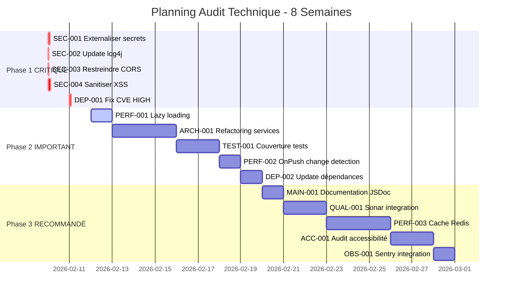

# Plan d'Analyse Technique - Audit Complet Expert

> **Version**: 1.0 | **Date**: 2026-02-10 | **Type**: Analysis Plan | **Nature**: technique/audit-complet | **Profondeur**: 4 - Expert

## 📋 Overview

Plan d'analyse spécialisé pour **Audit Technique Complet** avec profondeur **Expert**.

Ce plan réalise un audit technique approfondi et détaillé couvrant :
- Architecture & code (structure, patterns, bonnes pratiques)
- Stack technique (versions, obsolescence, configuration)
- Dépendances (librairies, vulnérabilités CVE)
- Sécurité (authentification, autorisation, vulnérabilités)
- Tests & qualité (couverture, CI/CD, analyse statique)
- Performance (lazy loading, cache, bundle size, optimisations)
- Observabilité (logging, monitoring, gestion erreurs)
- Maintenabilité (documentation, i18n, accessibilité)

**Philosophie Expert** :
- Analyse exhaustive et systématique de tous les aspects techniques
- Détection proactive des problèmes de sécurité et performance
- Recommandations concrètes et actionnables avec estimation d'effort
- Priorisation des actions (CRITIQUE/IMPORTANT/RECOMMANDÉ)
- Plan d'action phasé avec ROI estimé
- Génération de rapports détaillés par repository

## 🎯 Critères de Sélection

Ce plan est sélectionné quand :
- **Nature** : 6 (Stack générale) ou besoin d'audit technique complet multi-aspects
- **Profondeur** : 4 - Expert (audit complet ~40-60 min)
- **Contexte** : 
  - Audit avant migration majeure
  - Évaluation technique d'un projet existant
  - Préparation certification sécurité
  - Diagnostic dette technique
  - Audit pré-production

**Différence vs autres plans** :
- vs Plan générique : Spécialisé pour audit technique multi-repository (frontend + backend)
- vs Profondeur 3 (Approfondi) : Ajout sécurité CVE, performance approfondie, plan d'action phasé
- vs Plans spécifiques (backend/frontend) : Vue d'ensemble complète + analyse croisée

## 🔍 Sources à Analyser

### Configuration des Chemins

**⚠️ À CONFIGURER AVANT EXÉCUTION** :

```yaml
# Modifier ces chemins selon votre projet
repositories:
  frontend:
    path: "./frontend"  # ← MODIFIER ICI
    type: "frontend"
    priority: "high"
  backend:
    path: "./backend"   # ← MODIFIER ICI
    type: "backend"
    priority: "high"
  # Ajouter d'autres repositories si nécessaire
  # infrastructure:
  #   path: "./terraform"
  #   type: "infrastructure"
  #   priority: "medium"
```

### Sources Prioritaires

**Code Source Frontend** :
- Répertoires : `{frontend_path}/src/`, `{frontend_path}/components/`, `{frontend_path}/views/`
- Extensions : `.ts`, `.tsx`, `.js`, `.jsx`, `.vue`, `.svelte`, `.html`, `.css`, `.scss`
- Exclusions : `node_modules/`, `dist/`, `build/`, `.next/`, `coverage/`

**Code Source Backend** :
- Répertoires : `{backend_path}/src/`, `{backend_path}/api/`, `{backend_path}/services/`
- Extensions : `.java`, `.kt`, `.ts`, `.js`, `.py`, `.php`, `.go`, `.rs`, `.cs`
- Exclusions : `node_modules/`, `target/`, `build/`, `vendor/`, `__pycache__/`

**Documentation** :
- Fichiers : `README.md`, `ARCHITECTURE.md`, `CONTRIBUTING.md`, `docs/**/*.md`
- Sections prioritaires : Architecture, Stack technique, Déploiement, Sécurité

**Configuration** :
- **Frontend** : `package.json`, `tsconfig.json`, `angular.json`, `webpack.config.js`, `vite.config.js`, `.env.example`
- **Backend** : `pom.xml`, `build.gradle`, `package.json`, `requirements.txt`, `composer.json`, `application.yml`, `.env.example`
- **CI/CD** : `.github/workflows/`, `.gitlab-ci.yml`, `Jenkinsfile`, `docker-compose.yml`, `Dockerfile`
- **Sécurité** : `.npmrc`, `security.md`, `OWASP-*`, configurations CORS/CSP

### Critères de Filtrage

**Inclure** :
- Tous les fichiers source (pas de limite de profondeur)
- Fichiers de configuration (versions, build, déploiement)
- Tests (unitaires, intégration, e2e)
- Documentation technique
- Scripts CI/CD et déploiement

**Exclure** :
- Dépendances externes (`node_modules/`, `vendor/`, `target/`)
- Fichiers générés (`dist/`, `build/`, `coverage/`)
- Assets binaires (images, fonts, sauf analyse de taille)
- Logs et fichiers temporaires

## 🤖 Agents AI-KIDO à Mobiliser

### Phase 3.1 : Scan Code Multi-Repository (Obligatoire)

**Agent** : `agent-aikido-explore-code`

**Prompt spécialisé** :
```
"FORMAT: JSON

Analyse TECHNIQUE COMPLÈTE profondeur EXPERT :

REPOSITORIES :
- Frontend : {frontend_path}
- Backend : {backend_path}

FOCUS AUDIT COMPLET :

1. ARCHITECTURE & CODE
   - Structure modules/packages/composants
   - Patterns : services, repositories, guards, interceptors, dependency injection
   - SOLID, DRY, séparation responsabilités
   - Code smells : classes >300 lignes, méthodes >50 lignes, complexité cyclomatique >10
   - Duplications, dead code

2. STACK TECHNIQUE
   - Versions frameworks (Java, Spring Boot, Angular, React, Vue, Node)
   - EOL (End of Life) et support
   - Configuration TypeScript (strict mode, noImplicitAny)
   - Configuration build (Maven, Gradle, Webpack, Vite, esbuild)

3. DÉPENDANCES
   - package.json, pom.xml, build.gradle, requirements.txt
   - Librairies obsolètes (>2 versions majeures de retard)
   - Vulnérabilités CVE (npm audit, OWASP Dependency-Check)
   - Dépendances inutilisées ou redondantes

4. SÉCURITÉ
   - Authentification/Autorisation (JWT, OAuth2, guards, interceptors)
   - Secrets hardcodés (API keys, passwords, tokens)
   - Vulnérabilités OWASP Top 10 : XSS, CSRF, injection SQL/NoSQL
   - Configuration CORS, headers sécurité (CSP, HSTS, X-Frame-Options)
   - Chiffrement données sensibles

5. TESTS & QUALITÉ
   - Couverture tests unitaires (cible >80%)
   - Tests intégration, tests e2e
   - Qualité tests (assertions, mocks, fixtures)
   - CI/CD (GitLab CI, GitHub Actions, Jenkins)
   - Analyse statique (SonarQube, ESLint, Checkstyle, Prettier)

6. PERFORMANCE
   - Lazy loading : modules, routes, images
   - Stratégies cache : frontend (service worker) et backend (Redis, Caffeine)
   - Bundle size et tree shaking
   - Requêtes N+1, optimisation queries DB
   - Memory leaks : subscriptions RxJS non désabonnées, event listeners
   - Change detection strategy (Angular OnPush)
   - Code splitting et dynamic imports

7. OBSERVABILITÉ
   - Logging structuré (JSON vs texte)
   - Niveaux logs appropriés (DEBUG, INFO, WARN, ERROR)
   - Monitoring et métriques (Prometheus, Grafana, APM)
   - Gestion centralisée erreurs (Sentry, Rollbar)
   - Tracing distribué (OpenTelemetry, Jaeger)

8. MAINTENABILITÉ
   - Documentation code (JSDoc, JavaDoc, comments)
   - Internationalisation i18n (ngx-translate, i18next)
   - Accessibilité WCAG 2.1 AA (aria, semantic HTML)
   - Responsive design (mobile-first, breakpoints)

DÉTAIL REQUIS :
- Localisation précise (fichier:ligne) pour chaque problème
- Sévérité : 🔴 CRITIQUE / 🟠 IMPORTANT / 🟡 RECOMMANDÉ
- Impact business et technique
- Recommandation concrète avec exemple de code
- Estimation effort (heures/jours/semaines)

EXCLUSIONS :
- node_modules/, dist/, build/, target/, vendor/
- Fichiers générés, minifiés
- Assets binaires (sauf analyse taille)

Output attendu :
{
  \"synthese_executive\": \"Résumé 5 lignes\",
  \"repositories_analyses\": {
    \"frontend\": { ... },
    \"backend\": { ... }
  },
  \"points_amelioration\": [
    {
      \"id\": \"SEC-001\",
      \"priorite\": \"CRITIQUE\",
      \"categorie\": \"Sécurité\",
      \"titre\": \"Secrets hardcodés\",
      \"description\": \"...\",
      \"localisation\": \"src/config/api.ts:12\",
      \"impact\": \"...\",
      \"recommandation\": \"...\",
      \"effort_estime\": \"2 heures\"
    }
  ],
  \"plan_action_phase\": { ... },
  \"points_positifs\": [ ... ],
  \"diagrammes\": { ... }
}"
```

### Phase 3.2 : Recherche Parallèle Memory Bank + Code (Obligatoire pour Expert)

**Condition** : Profondeur = 4 (Expert)

**Agent** : `agent-aikido-explore-all`

**Prompt spécialisé** :
```
"FORMAT: JSON

Recherche parallèle Memory Bank + Code pour AUDIT TECHNIQUE EXPERT :

KEYWORDS :
- Architecture : layered, hexagonal, microservices, monolith, DDD, CQRS
- Sécurité : authentication, authorization, JWT, OAuth2, OWASP, XSS, CSRF, SQL injection
- Performance : cache, lazy loading, optimization, N+1, bundle size, memory leak
- Testing : unit test, integration test, e2e, coverage, TDD, BDD
- CI/CD : pipeline, deployment, docker, kubernetes, terraform
- Observability : logging, monitoring, tracing, metrics, APM

ÉCARTS RECHERCHÉS :
- Documentation architecture vs implémentation réelle
- Standards sécurité documentés vs appliqués
- Processus tests décrits vs couverture effective
- Configuration déploiement documentée vs scripts réels

Output attendu : Vue complète avec cross-references Memory Bank ↔ Code"
```

### Résolution Contradictions (Si détecté)

**Condition** : Contradictions entre documentation et code

**Agent** : `agent-aikido-truth-evaluator`

**Stratégie hiérarchie** :
1. **Code source** = vérité (implémentation réelle)
2. Documentation technique si à jour (< 6 mois)
3. Commentaires code si cohérents
4. README si validé récemment

### Validation Vulnérabilités CVE (Obligatoire pour Expert)

**Condition** : Profondeur = 4

**Commandes externes** :
```bash
# Frontend
cd {frontend_path}
npm audit --json > audit-frontend.json
# ou
yarn audit --json > audit-frontend.json

# Backend (selon stack)
# Node.js
cd {backend_path}
npm audit --json > audit-backend.json

# Java
mvn org.owasp:dependency-check-maven:check
# ou
gradle dependencyCheckAnalyze
```

**Agent** : `agent-aikido-explore-code` (analyse résultats audit)

### Classification RACI (Optionnel)

**Condition** : Structure RACI activée dans projet

**Agent** : `agent-aikido-raci-delegator`

**Mapping** :
- Architecture → `prompts/{project}/architecte/`
- Sécurité → `prompts/{project}/securite/`
- Performance → `prompts/{project}/performance/`
- Tests → `prompts/{project}/qualite/`

### Peuplement Automatique (Optionnel)

**Condition** : Gaps détectés > 3 ET utilisateur accepte

**Agent** : `agent-aikido-bank-populate`

**Stratégie** :
- Créer fiches techniques pour stack détectée
- Documenter patterns architecturaux identifiés
- Générer use cases à partir des endpoints API
- Créer fiches vulnérabilités détectées

### Validation Finale (Obligatoire)

**Agent** : `agent-aikido-validator`

**Règles strictes** :
- Rapport markdown conforme AI-KIDO (headers, structure)
- Tous les points d'amélioration documentés avec priorité
- Plan d'action avec estimations
- Références vers code source précises (fichier:ligne)
- Pas de faux positifs (validation manuelle recommandée)

## 📊 Stratégie d'Extraction

### 1. Détection Automatique

**Algorithme Expert** :

```python
def detect_audit_elements(repository_path, repo_type):
    """
    Détection exhaustive pour audit technique expert.
    """
    elements = {
        "architecture": detect_architecture_patterns(repository_path),
        "stack": detect_tech_stack(repository_path, repo_type),
        "dependencies": analyze_dependencies(repository_path, repo_type),
        "security": scan_security_issues(repository_path),
        "tests": analyze_test_coverage(repository_path),
        "performance": detect_performance_issues(repository_path, repo_type),
        "observability": analyze_observability(repository_path),
        "maintainability": assess_maintainability(repository_path)
    }
    return elements

def detect_architecture_patterns(path):
    """Détecte patterns architecturaux."""
    patterns = []
    
    # Layered architecture
    if exists(f"{path}/src/controllers") and exists(f"{path}/src/services"):
        patterns.append("Layered (MVC)")
    
    # Hexagonal/Ports & Adapters
    if exists(f"{path}/src/domain") and exists(f"{path}/src/infrastructure"):
        patterns.append("Hexagonal Architecture")
    
    # Microservices
    if exists(f"{path}/docker-compose.yml") or find_files(path, "*/Dockerfile"):
        patterns.append("Microservices (containerized)")
    
    return patterns

def detect_tech_stack(path, repo_type):
    """Détecte versions et EOL."""
    stack = {}
    
    if repo_type == "frontend":
        # Angular
        if exists(f"{path}/angular.json"):
            pkg = load_json(f"{path}/package.json")
            angular_version = pkg.get("dependencies", {}).get("@angular/core", "")
            stack["framework"] = f"Angular {angular_version}"
            stack["eol_check"] = check_angular_eol(angular_version)
        
        # React
        elif "@react" in load_json(f"{path}/package.json").get("dependencies", {}):
            react_version = load_json(f"{path}/package.json")["dependencies"]["react"]
            stack["framework"] = f"React {react_version}"
        
        # TypeScript
        if exists(f"{path}/tsconfig.json"):
            ts_config = load_json(f"{path}/tsconfig.json")
            stack["typescript"] = {
                "version": load_json(f"{path}/package.json")["devDependencies"]["typescript"],
                "strict": ts_config.get("compilerOptions", {}).get("strict", False)
            }
    
    elif repo_type == "backend":
        # Spring Boot (Java)
        if exists(f"{path}/pom.xml"):
            pom = parse_xml(f"{path}/pom.xml")
            spring_version = pom.find(".//spring-boot.version").text
            java_version = pom.find(".//java.version").text
            stack["framework"] = f"Spring Boot {spring_version}"
            stack["language"] = f"Java {java_version}"
            stack["eol_check"] = check_java_eol(java_version)
        
        # Node.js
        elif exists(f"{path}/package.json"):
            pkg = load_json(f"{path}/package.json")
            if "express" in pkg.get("dependencies", {}):
                stack["framework"] = f"Express {pkg['dependencies']['express']}"
            node_version = load_file(f"{path}/.nvmrc") or "unknown"
            stack["runtime"] = f"Node.js {node_version}"
    
    return stack

def analyze_dependencies(path, repo_type):
    """Analyse dépendances et vulnérabilités."""
    vulnerabilities = []
    outdated = []
    
    if repo_type in ["frontend", "backend"] and exists(f"{path}/package.json"):
        # Exécuter npm audit
        audit_result = run_command(f"cd {path} && npm audit --json")
        audit_data = json.loads(audit_result)
        
        for vuln in audit_data.get("vulnerabilities", []):
            vulnerabilities.append({
                "package": vuln["name"],
                "severity": vuln["severity"],
                "cve": vuln.get("cves", []),
                "recommendation": vuln["fixAvailable"]
            })
        
        # Exécuter npm outdated
        outdated_result = run_command(f"cd {path} && npm outdated --json")
        outdated_data = json.loads(outdated_result)
        
        for pkg, info in outdated_data.items():
            if semver_major_diff(info["current"], info["latest"]) >= 2:
                outdated.append({
                    "package": pkg,
                    "current": info["current"],
                    "latest": info["latest"],
                    "type": "major_outdated"
                })
    
    return {"vulnerabilities": vulnerabilities, "outdated": outdated}

def scan_security_issues(path):
    """Scan problèmes sécurité."""
    issues = []
    
    # Secrets hardcodés
    secret_patterns = [
        r"(api[_-]?key|apikey)\s*[:=]\s*['\"]([^'\"]+)['\"]",
        r"(password|passwd|pwd)\s*[:=]\s*['\"]([^'\"]+)['\"]",
        r"(secret|token)\s*[:=]\s*['\"]([^'\"]+)['\"]",
        r"(aws|s3)[_-]?(access|secret)[_-]?key",
        r"['\"]([a-zA-Z0-9]{32,})['\"]"  # Long strings (potential keys)
    ]
    
    for file in find_files(path, "**/*.{ts,js,java,py,php}"):
        content = load_file(file)
        for pattern in secret_patterns:
            matches = re.findall(pattern, content, re.IGNORECASE)
            if matches:
                line_num = get_line_number(content, matches[0])
                issues.append({
                    "type": "hardcoded_secret",
                    "severity": "CRITICAL",
                    "file": file,
                    "line": line_num,
                    "pattern": pattern
                })
    
    # CORS configuration
    cors_files = find_files(path, "**/*{cors,security,config}*.{ts,js,java}")
    for file in cors_files:
        content = load_file(file)
        if "allowedOrigins" in content and '"*"' in content:
            issues.append({
                "type": "insecure_cors",
                "severity": "IMPORTANT",
                "file": file,
                "message": "CORS allows all origins (*)"
            })
    
    return issues

def analyze_test_coverage(path):
    """Analyse couverture tests."""
    coverage = {
        "unit_tests": 0,
        "integration_tests": 0,
        "e2e_tests": 0,
        "coverage_percent": 0
    }
    
    # Compter fichiers tests
    test_files = find_files(path, "**/*.{spec,test}.{ts,js,java}")
    coverage["unit_tests"] = len([f for f in test_files if "spec" in f or "test" in f])
    
    integration_files = find_files(path, "**/integration/**/*.{ts,js,java}")
    coverage["integration_tests"] = len(integration_files)
    
    e2e_files = find_files(path, "**/e2e/**/*.{ts,js}")
    coverage["e2e_tests"] = len(e2e_files)
    
    # Lire rapport coverage si existe
    if exists(f"{path}/coverage/coverage-summary.json"):
        cov_data = load_json(f"{path}/coverage/coverage-summary.json")
        coverage["coverage_percent"] = cov_data["total"]["lines"]["pct"]
    
    return coverage

def detect_performance_issues(path, repo_type):
    """Détecte problèmes performance."""
    issues = []
    
    if repo_type == "frontend":
        # Lazy loading modules (Angular)
        if exists(f"{path}/src/app/app-routing.module.ts"):
            routing = load_file(f"{path}/src/app/app-routing.module.ts")
            if "loadChildren" not in routing:
                issues.append({
                    "type": "no_lazy_loading",
                    "severity": "IMPORTANT",
                    "message": "Aucun lazy loading détecté dans routing"
                })
        
        # Bundle size
        if exists(f"{path}/dist") or exists(f"{path}/build"):
            bundle_size = get_directory_size(f"{path}/dist" or f"{path}/build")
            if bundle_size > 5_000_000:  # 5MB
                issues.append({
                    "type": "large_bundle",
                    "severity": "IMPORTANT",
                    "size": bundle_size,
                    "message": f"Bundle size {bundle_size / 1e6:.1f}MB > 5MB"
                })
        
        # OnPush change detection
        components = find_files(path, "**/*.component.ts")
        onpush_count = 0
        for comp in components:
            content = load_file(comp)
            if "ChangeDetectionStrategy.OnPush" in content:
                onpush_count += 1
        
        if onpush_count / len(components) < 0.5:
            issues.append({
                "type": "suboptimal_change_detection",
                "severity": "RECOMMENDED",
                "message": f"Seulement {onpush_count}/{len(components)} composants utilisent OnPush"
            })
        
        # Memory leaks (RxJS subscriptions)
        for file in find_files(path, "**/*.component.ts"):
            content = load_file(file)
            if ".subscribe(" in content and "ngOnDestroy" not in content:
                issues.append({
                    "type": "potential_memory_leak",
                    "severity": "IMPORTANT",
                    "file": file,
                    "message": "Subscription sans unsubscribe dans ngOnDestroy"
                })
    
    elif repo_type == "backend":
        # N+1 queries
        service_files = find_files(path, "**/service/**/*.{java,ts,js}")
        for file in service_files:
            content = load_file(file)
            # Détection pattern N+1 (loop avec query)
            if re.search(r"for\s*\([^)]+\)\s*\{[^}]*\.(find|query|select)", content):
                issues.append({
                    "type": "potential_n_plus_1",
                    "severity": "IMPORTANT",
                    "file": file,
                    "message": "Potentielle requête N+1 détectée"
                })
    
    return issues
```

**Patterns de recherche** :
```regex
# Secrets hardcodés
(api[_-]?key|apikey|password|passwd|secret|token)\s*[:=]\s*['"]([^'"]+)['"]

# CORS ouvert
allowedOrigins.*['"]?\*['"]?

# SQL Injection
(execute|query)\s*\(\s*['"].*\+.*['"]

# XSS
innerHTML\s*=|dangerouslySetInnerHTML

# Memory leaks RxJS
\.subscribe\([^)]*\)(?!.*\.unsubscribe)

# N+1 queries
for\s*\([^)]+\)\s*\{[^}]*\.(find|query|select)

# Unused imports
^import\s+.*from\s+['"]([^'"]+)['"];?\s*$
```

**Heuristiques** :
- Classe >300 lignes → candidate refactoring
- Méthode >50 lignes → candidate extraction
- Complexité cyclomatique >10 → simplifier
- Duplication >20 lignes → factoriser
- Coverage <80% → améliorer tests
- Vulnérabilités CVE HIGH/CRITICAL → corriger immédiatement

### 2. Extraction Métadonnées

**Architecture** :
- Patterns détectés (Layered, Hexagonal, Microservices)
- Nombre de modules/packages/composants
- Profondeur hiérarchie (max depth)
- Couplage inter-modules (dépendances)

**Stack Technique** :
- Frameworks et versions (Angular 15, Spring Boot 3.0, etc.)
- Langages et versions (Java 17, TypeScript 5.0, etc.)
- Build tools (Maven 3.8, Webpack 5, Vite 4)
- EOL status pour chaque technologie

**Domaine Métier** :
- Endpoints API détectés (REST, GraphQL)
- Entités métier (modèles, DTOs)
- Règles métier (validations, contraintes)
- Use cases implémentés

**Configuration** :
- Variables d'environnement (.env files)
- Configuration build (tsconfig, maven, gradle)
- Configuration déploiement (Docker, K8s)
- Configuration sécurité (CORS, headers, auth)

### 3. Analyse Profondeur Spécifique

**Profondeur 4 - Expert** :
- **Niveau de détail** : Exhaustif avec localisation précise (fichier:ligne)
- **Métriques collectées** :
  - Architecture : Nombre de modules, profondeur, couplage
  - Stack : Versions, EOL dates, compatibilités
  - Dépendances : Nombre total, obsolètes, vulnérabilités CVE avec scores CVSS
  - Sécurité : Secrets hardcodés, vulnérabilités OWASP, configuration CORS/CSP
  - Tests : Couverture %, nombre tests (unit/integration/e2e)
  - Performance : Bundle size, lazy loading %, memory leaks détectés
  - Code : Lignes code, duplication %, complexité cyclomatique moyenne
- **Graphes générés** :
  - Diagramme architecture (Mermaid C4)
  - Graphe dépendances modules
  - Matrice couplage composants
  - Timeline EOL technologies
  - Répartition vulnérabilités par sévérité
- **Temps estimé** : 40-60 min (selon taille projet)

## 🔄 Workflow Complet

### Phases d'Exécution

```mermaid
graph TB
    START[Début Audit Technique Expert] --> CONFIG[Configuration Chemins<br/>Frontend + Backend]
    CONFIG --> DETECT[Détection Sources<br/>Multi-repository]
    
    DETECT --> SCAN_FE[🤖 explore-code<br/>FRONTEND<br/>Architecture, Stack, Sécu]
    DETECT --> SCAN_BE[🤖 explore-code<br/>BACKEND<br/>Architecture, Stack, Sécu]
    
    SCAN_FE --> AUDIT_FE[Audit NPM/Yarn<br/>Vulnérabilités CVE]
    SCAN_BE --> AUDIT_BE[Audit Maven/Gradle/NPM<br/>Vulnérabilités CVE]
    
    AUDIT_FE --> PARALLEL[🤖 explore-all<br/>Recherche parallèle Bank+Code]
    AUDIT_BE --> PARALLEL
    
    PARALLEL --> EXTRACT[Extraction Métadonnées<br/>Architecture, Stack, Domaine]
    EXTRACT --> ANALYZE[Analyse Multi-Aspects<br/>8 catégories audit]
    
    ANALYZE --> GAPS[Détection Écarts<br/>Doc vs Code]
    
    GAPS -->|Contradictions| TRUTH[🤖 truth-evaluator<br/>Résolution hiérarchique]
    TRUTH --> PRIORITIZE
    GAPS --> PRIORITIZE[Priorisation Issues<br/>CRITIQUE/IMPORTANT/RECOMMANDÉ]
    
    PRIORITIZE --> ENRICH[Enrichissement Memory Bank<br/>Fiches techniques, patterns]
    
    ENRICH --> RACI{RACI activé?}
    RACI -->|OUI| CLASSIFY[🤖 raci-delegator<br/>Classification par domaine]
    RACI -->|NON| BALANCE
    
    CLASSIFY --> BALANCE[Équilibrage AI-KIDO<br/>≤500 lignes, 3-7 enfants]
    BALANCE --> INDEX[Mise à jour Index<br/>index.md]
    
    INDEX --> POPULATE{Gaps>3 ET<br/>accepté?}
    POPULATE -->|OUI| BANKPOP[🤖 bank-populate<br/>Peuplement auto]
    POPULATE -->|NON| VALIDATE
    
    BANKPOP --> VALIDATE[🤖 validator<br/>Validation conformité]
    VALIDATE --> REPORT[Génération Rapports<br/>Par repository + Synthèse]
    
    REPORT --> PLAN[Plan d'Action Phasé<br/>Estimations effort]
    PLAN --> END[✅ Audit terminé<br/>Rapports markdown générés]
    
    style SCAN_FE fill:#f9f,stroke:#333,stroke-width:2px
    style SCAN_BE fill:#f9f,stroke:#333,stroke-width:2px
    style PARALLEL fill:#f9f,stroke:#333,stroke-width:2px
    style TRUTH fill:#f9f,stroke:#333,stroke-width:2px
    style CLASSIFY fill:#f9f,stroke:#333,stroke-width:2px
    style BANKPOP fill:#f9f,stroke:#333,stroke-width:2px
    style VALIDATE fill:#f9f,stroke:#333,stroke-width:2px
    style END fill:#9f9,stroke:#333,stroke-width:2px
```



### Temps d'Exécution Estimé

**Par Phase** :
- Configuration et détection sources : ~2 min
- Scan code frontend (explore-code) : ~8 min
- Scan code backend (explore-code) : ~8 min
- Audit dépendances CVE (npm/maven) : ~5 min
- Recherche parallèle (explore-all) : ~10 min
- Extraction et analyse : ~8 min
- Résolution contradictions (si nécessaire) : ~3 min
- Priorisation et enrichissement : ~5 min
- Classification RACI (optionnel) : ~3 min
- Peuplement automatique (optionnel) : ~5 min
- Validation et génération rapports : ~5 min

**Total** : ~50-60 min (peut varier selon taille projet)

## 📤 Output Format

### Structure de Sortie

Le plan génère des rapports markdown séparés dans `audits/` :

```
audits/
├── audit-synthese.md              # Synthèse exécutive globale
├── audit-frontend.md              # Rapport détaillé frontend
├── audit-backend.md               # Rapport détaillé backend
├── plan-action.md                 # Plan d'action phasé
└── vulnerabilites-cve.json        # Export JSON vulnérabilités
```

### Template : audit-synthese.md

```markdown
# Audit Technique Complet - Synthèse Exécutive

**Date** : {DATE}
**Durée** : {DURATION}
**Repositories analysés** : {REPO_COUNT}

## 🎯 Configuration

- **Nature** : Audit Technique Complet (Stack générale + Sécurité + Performance)
- **Profondeur** : 4 - Expert
- **Plan utilisé** : `plans/technique/audit-complet/plan-expert.md`
- **Repositories** :
  - Frontend : `{frontend_path}`
  - Backend : `{backend_path}`

## 📋 SYNTHÈSE EXÉCUTIVE (5 lignes)

{EXECUTIVE_SUMMARY}

Exemple :
> L'audit révèle une base de code globalement bien structurée avec quelques points critiques à adresser immédiatement : 3 vulnérabilités CVE HIGH détectées dans les dépendances backend, absence de lazy loading frontend (impact performance), et 5 secrets hardcodés à externaliser. La couverture de tests est correcte (78%) mais nécessite amélioration sur les tests d'intégration. Le plan d'action priorisé estime 4 semaines d'effort pour corriger les points critiques et 8 semaines additionnelles pour les améliorations recommandées.

## 📊 TABLEAU DES POINTS D'AMÉLIORATION

### 🔴 CRITIQUE - À traiter immédiatement (Sécurité, EOL, CVE)

| ID | Catégorie | Titre | Localisation | Impact | Effort |
|----|-----------|-------|--------------|--------|--------|
| SEC-001 | Sécurité | Secrets API hardcodés | frontend/src/config/api.ts:12 | **CRITIQUE** - Exposition credentials | 2h |
| SEC-002 | Sécurité | Vulnérabilité CVE-2023-XXXX (HIGH) | backend/pom.xml (log4j 2.14) | **CRITIQUE** - RCE possible | 1h |
| SEC-003 | Sécurité | CORS ouvert à tous origins | backend/src/config/CorsConfig.java:18 | **CRITIQUE** - Attaques XSS | 30min |

**Total CRITIQUE : {CRITICAL_COUNT} points - Effort estimé : {CRITICAL_EFFORT}**

### 🟠 IMPORTANT - Dette technique majeure (à planifier rapidement)

| ID | Catégorie | Titre | Localisation | Impact | Effort |
|----|-----------|-------|--------------|--------|--------|
| PERF-001 | Performance | Absence lazy loading modules | frontend/src/app/app-routing.module.ts | **IMPORTANT** - Temps chargement initial élevé | 1j |
| ARCH-001 | Architecture | Services trop couplés | backend/src/services/*.java | **IMPORTANT** - Maintenabilité réduite | 3j |
| TEST-001 | Tests | Couverture tests intégration <50% | backend/src/test/integration/ | **IMPORTANT** - Risque régressions | 2j |

**Total IMPORTANT : {IMPORTANT_COUNT} points - Effort estimé : {IMPORTANT_EFFORT}**

### 🟡 RECOMMANDÉ - Améliorations continues (backlog)

| ID | Catégorie | Titre | Localisation | Impact | Effort |
|----|-----------|-------|--------------|--------|--------|
| MAIN-001 | Maintenabilité | Documentation JSDoc incomplète | frontend/src/services/*.ts | RECOMMANDÉ - Maintenabilité | 1j |
| PERF-002 | Performance | OnPush change detection 40% composants | frontend/src/components/*.component.ts | RECOMMANDÉ - Optimisation perf | 2j |
| QUAL-001 | Qualité | Dépendances obsolètes (2+ versions retard) | package.json, pom.xml | RECOMMANDÉ - Sécurité future | 1j |

**Total RECOMMANDÉ : {RECOMMENDED_COUNT} points - Effort estimé : {RECOMMENDED_EFFORT}**

## 📈 STATISTIQUES GLOBALES

| Métrique | Valeur | Status | Cible |
|----------|--------|--------|-------|
| **Couverture tests** | {COVERAGE}% | {STATUS_ICON} | ≥80% |
| **Vulnérabilités CVE** | {CVE_COUNT} ({HIGH_COUNT} HIGH, {MEDIUM_COUNT} MEDIUM) | {STATUS_ICON} | 0 HIGH |
| **Dépendances obsolètes** | {OUTDATED_COUNT} | {STATUS_ICON} | <5 |
| **Complexité cyclomatique** | {CYCLOMATIC_AVG} | {STATUS_ICON} | <10 |
| **Duplication code** | {DUPLICATION}% | {STATUS_ICON} | <5% |
| **Bundle size** | {BUNDLE_SIZE} MB | {STATUS_ICON} | <3 MB |

## 🎯 PRIORITÉS IMMÉDIATES (Semaine 1)

1. **SEC-001** : Externaliser secrets vers variables environnement (2h)
2. **SEC-002** : Mettre à jour log4j vers 2.20+ (1h)
3. **SEC-003** : Restreindre CORS aux domaines autorisés (30min)

## 📋 PLAN D'ACTION DÉTAILLÉ

Voir : [`plan-action.md`](./plan-action.md)

## ✅ POINTS POSITIFS IDENTIFIÉS

- ✅ Architecture backend bien structurée (Layered + DDD)
- ✅ TypeScript strict mode activé (frontend)
- ✅ CI/CD fonctionnel avec tests automatisés
- ✅ Logging structuré JSON (backend)
- ✅ Utilisation Docker pour déploiement
- ✅ Documentation README complète

## 🔗 RAPPORTS DÉTAILLÉS

- **Frontend** : [`audit-frontend.md`](./audit-frontend.md)
- **Backend** : [`audit-backend.md`](./audit-backend.md)
- **Plan d'action phasé** : [`plan-action.md`](./plan-action.md)
- **Export CVE** : [`vulnerabilites-cve.json`](./vulnerabilites-cve.json)

---
*Généré par /analyse-project avec plan `technique/audit-complet/plan-expert.md` le {DATE}*
```

### Template : audit-frontend.md

```markdown
# Audit Technique Frontend - Rapport Détaillé

**Repository** : `{frontend_path}`
**Date** : {DATE}
**Framework** : {FRAMEWORK} {VERSION}

## 🏗️ 1. ARCHITECTURE & CODE

### Structure Détectée

- **Pattern** : {PATTERN} (ex: Layered MVC, Feature-based)
- **Modules** : {MODULE_COUNT}
- **Composants** : {COMPONENT_COUNT}
- **Services** : {SERVICE_COUNT}
- **Profondeur max** : {MAX_DEPTH} niveaux

### Code Smells Détectés

#### CS-001 : Classe trop volumineuse
- **Fichier** : `src/services/data.service.ts`
- **Lignes** : 450 (limite recommandée : 300)
- **Recommandation** : Extraire en plusieurs services spécialisés
- **Effort** : 4h

#### CS-002 : Complexité cyclomatique élevée
- **Fichier** : `src/components/form/form.component.ts`
- **Méthode** : `validateForm()`
- **Complexité** : 15 (limite recommandée : 10)
- **Recommandation** : Extraire validations dans fonctions séparées
- **Effort** : 2h

### Respect Bonnes Pratiques

| Pratique | Status | Détail |
|----------|--------|--------|
| **SOLID** | 🟡 Partiel | SRP violé dans {COUNT} services |
| **DRY** | ✅ Bon | Duplication <5% |
| **Séparation responsabilités** | ✅ Bon | Composants, services, models séparés |
| **Dependency Injection** | ✅ Excellent | Utilisé systématiquement |

## 📦 2. STACK TECHNIQUE

### Frameworks et Versions

| Technologie | Version Actuelle | Version Stable | EOL Date | Status |
|-------------|------------------|----------------|----------|--------|
| **{FRAMEWORK}** | {CURRENT_VERSION} | {STABLE_VERSION} | {EOL_DATE} | {STATUS_ICON} |
| **TypeScript** | {TS_VERSION} | {TS_STABLE} | N/A | {STATUS_ICON} |
| **Node.js** | {NODE_VERSION} | {NODE_LTS} | {NODE_EOL} | {STATUS_ICON} |

### Configuration TypeScript

```json
{
  "compilerOptions": {
    "strict": {STRICT_MODE},              // ⚠️ Recommandé : true
    "noImplicitAny": {NO_IMPLICIT_ANY},   // ⚠️ Recommandé : true
    "strictNullChecks": {STRICT_NULL},    // ⚠️ Recommandé : true
    "target": "{TARGET}",
    "module": "{MODULE}"
  }
}
```

**Issues détectées** :
- {ISSUE_1}
- {ISSUE_2}

### Configuration Build

- **Tool** : {BUILD_TOOL} (Webpack, Vite, esbuild, etc.)
- **Version** : {BUILD_VERSION}
- **Optimisations activées** :
  - Tree shaking : {TREE_SHAKING}
  - Minification : {MINIFICATION}
  - Code splitting : {CODE_SPLITTING}

## 🔗 3. DÉPENDANCES

### Vulnérabilités CVE

```json
{
  "total": {CVE_TOTAL},
  "critical": {CVE_CRITICAL},
  "high": {CVE_HIGH},
  "medium": {CVE_MEDIUM},
  "low": {CVE_LOW}
}
```

#### CVE-001 : {PACKAGE_NAME} - {CVE_ID}
- **Sévérité** : **HIGH**
- **Score CVSS** : {CVSS_SCORE}
- **Description** : {CVE_DESCRIPTION}
- **Version affectée** : {AFFECTED_VERSION}
- **Fix disponible** : {FIX_VERSION}
- **Action** : `npm update {PACKAGE_NAME}@{FIX_VERSION}`

### Dépendances Obsolètes

| Package | Version Actuelle | Version Latest | Retard | Action |
|---------|------------------|----------------|--------|--------|
| {PACKAGE_1} | {CURRENT_1} | {LATEST_1} | {DIFF_1} versions majeures | Mettre à jour |
| {PACKAGE_2} | {CURRENT_2} | {LATEST_2} | {DIFF_2} versions majeures | Mettre à jour |

### Dépendances Inutilisées

- `{UNUSED_1}` : Aucune utilisation détectée dans le code
- `{UNUSED_2}` : Aucune utilisation détectée dans le code

**Action** : Nettoyer avec `npm prune` ou supprimer manuellement

## 🔒 4. SÉCURITÉ

### Secrets Hardcodés

#### SEC-FE-001 : API Key hardcodée
- **Fichier** : `src/config/api.ts:12`
- **Code** :
```typescript
export const API_CONFIG = {
  apiKey: "sk_live_XXXXXXXXXX",  // ⚠️ SECRET EXPOSÉ
  endpoint: "https://api.example.com"
};
```
- **Impact** : **CRITIQUE** - Credentials exposés dans le code source
- **Recommandation** : Utiliser variables d'environnement
```typescript
export const API_CONFIG = {
  apiKey: process.env.VITE_API_KEY || "",
  endpoint: process.env.VITE_API_ENDPOINT || ""
};
```
- **Effort** : 30min

### Vulnérabilités OWASP

#### XSS (Cross-Site Scripting)
- **Fichier** : `src/components/display/display.component.ts:45`
- **Code** :
```typescript
this.element.nativeElement.innerHTML = userInput;  // ⚠️ XSS
```
- **Impact** : **IMPORTANT** - Injection code malveillant possible
- **Recommandation** : Utiliser sanitization
```typescript
this.element.nativeElement.textContent = userInput;  // Safe
// ou
this.sanitizedContent = this.sanitizer.sanitize(SecurityContext.HTML, userInput);
```

### Configuration Sécurité

| Élément | Status | Recommandation |
|---------|--------|----------------|
| **CSP Headers** | {CSP_STATUS} | Implémenter Content-Security-Policy |
| **HTTPS Only** | {HTTPS_STATUS} | Forcer HTTPS en production |
| **Secure Cookies** | {COOKIE_STATUS} | Ajouter flags Secure, HttpOnly, SameSite |

## ✅ 5. TESTS & QUALITÉ

### Couverture Tests

| Type | Nombre | Couverture | Cible | Status |
|------|--------|-----------|-------|--------|
| **Tests unitaires** | {UNIT_COUNT} | {UNIT_COV}% | ≥80% | {UNIT_STATUS} |
| **Tests intégration** | {INTEGRATION_COUNT} | {INTEGRATION_COV}% | ≥70% | {INTEGRATION_STATUS} |
| **Tests e2e** | {E2E_COUNT} | {E2E_COV}% | ≥60% | {E2E_STATUS} |

**Recommandation** : Augmenter couverture tests intégration (actuellement {INTEGRATION_COV}%, cible 70%)

### Qualité Tests

**Points positifs** :
- ✅ Tests bien organisés (*.spec.ts à côté des fichiers)
- ✅ Utilisation de mocks et fixtures

**À améliorer** :
- ⚠️ {IMPROVEMENT_1}
- ⚠️ {IMPROVEMENT_2}

### CI/CD

- **Plateforme** : {CI_PLATFORM} (GitHub Actions, GitLab CI, etc.)
- **Pipeline** :
  - ✅ Build automatique
  - ✅ Tests automatiques
  - {LINTING_STATUS} Linting (ESLint)
  - {SONAR_STATUS} Analyse Sonar

### Analyse Statique

**ESLint** :
- Erreurs : {ESLINT_ERRORS}
- Warnings : {ESLINT_WARNINGS}

**Prettier** :
- Formatage : {PRETTIER_STATUS}

## ⚡ 6. PERFORMANCE

### Lazy Loading

**Modules** :
- Lazy loaded : {LAZY_COUNT} / {TOTAL_MODULES}
- Ratio : {LAZY_RATIO}%

**Recommandation** : Implémenter lazy loading pour {MISSING_LAZY_MODULES}

```typescript
// Exemple route à lazy load
{
  path: 'admin',
  loadChildren: () => import('./admin/admin.module').then(m => m.AdminModule)
}
```

### Bundle Size

| Fichier | Taille | Status | Recommandation |
|---------|--------|--------|----------------|
| **main.js** | {MAIN_SIZE} MB | {MAIN_STATUS} | {MAIN_RECOMMENDATION} |
| **vendor.js** | {VENDOR_SIZE} MB | {VENDOR_STATUS} | {VENDOR_RECOMMENDATION} |
| **polyfills.js** | {POLYFILLS_SIZE} MB | {POLYFILLS_STATUS} | {POLYFILLS_RECOMMENDATION} |

**Total** : {TOTAL_BUNDLE_SIZE} MB (cible <3 MB)

### Cache Strategy

- **Service Worker** : {SW_STATUS}
- **HTTP Caching** : {HTTP_CACHE_STATUS}
- **State Management** : {STATE_MGMT} ({NGRX_AKITA_ETC})

### Memory Leaks

#### PERF-FE-001 : Subscription non désabonnée
- **Fichier** : `src/components/user/user.component.ts:32`
- **Code** :
```typescript
ngOnInit() {
  this.userService.getUser().subscribe(user => {
    this.user = user;
  }); // ⚠️ Memory leak
}
```
- **Recommandation** :
```typescript
private destroy$ = new Subject<void>();

ngOnInit() {
  this.userService.getUser()
    .pipe(takeUntil(this.destroy$))
    .subscribe(user => this.user = user);
}

ngOnDestroy() {
  this.destroy$.next();
  this.destroy$.complete();
}
```

### Change Detection

- **Composants avec OnPush** : {ONPUSH_COUNT} / {COMPONENT_COUNT}
- **Ratio** : {ONPUSH_RATIO}%

**Recommandation** : Augmenter utilisation OnPush pour optimiser performances

## 📊 7. OBSERVABILITÉ

### Logging

- **Niveau** : {LOG_LEVEL}
- **Format** : {LOG_FORMAT} (JSON structuré recommandé)
- **Service centralisé** : {LOG_SERVICE_STATUS}

### Monitoring

- **APM** : {APM_STATUS} (ex: Datadog, New Relic)
- **Error Tracking** : {ERROR_TRACKING} (ex: Sentry, Rollbar)

### Gestion Erreurs

```typescript
// Exemple error handler global
@Injectable()
export class GlobalErrorHandler implements ErrorHandler {
  handleError(error: Error) {
    // ⚠️ Améliorer : envoyer vers service centralisé
    console.error(error);
  }
}
```

## 🛠️ 8. MAINTENABILITÉ

### Documentation Code

- **JSDoc** : {JSDOC_COVERAGE}% des fonctions/classes
- **Comments** : {COMMENT_STATUS}

**Recommandation** : Augmenter documentation pour fonctions publiques

### Internationalisation (i18n)

- **Library** : {I18N_LIB} (ngx-translate, i18next, etc.)
- **Langues supportées** : {LANGUAGES}
- **Couverture** : {I18N_COVERAGE}%

### Accessibilité (WCAG 2.1)

| Critère | Status | Issues |
|---------|--------|--------|
| **ARIA labels** | {ARIA_STATUS} | {ARIA_ISSUES} |
| **Semantic HTML** | {SEMANTIC_STATUS} | {SEMANTIC_ISSUES} |
| **Keyboard navigation** | {KEYBOARD_STATUS} | {KEYBOARD_ISSUES} |
| **Contrast ratio** | {CONTRAST_STATUS} | {CONTRAST_ISSUES} |

### Responsive Design

- **Mobile-first** : {MOBILE_FIRST_STATUS}
- **Breakpoints** : {BREAKPOINTS}
- **Media queries** : {MEDIA_QUERIES_COUNT}

---

**Rapport Frontend généré le {DATE}**
*Voir synthèse globale : [`audit-synthese.md`](./audit-synthese.md)*
```

### Template : plan-action.md

```markdown
# Plan d'Action Phasé - Audit Technique

**Date** : {DATE}
**Effort total estimé** : {TOTAL_EFFORT}
**Durée estimée** : {TOTAL_DURATION}

## 🎯 Objectifs

Corriger les points critiques identifiés et améliorer la qualité globale du code selon la priorisation :
1. **Phase 1** (Semaine 1) : CRITIQUE - Sécurité et EOL
2. **Phase 2** (Semaines 2-3) : IMPORTANT - Dette technique majeure
3. **Phase 3** (Semaines 4-8) : RECOMMANDÉ - Améliorations continues

## 📋 PHASE 1 : CRITIQUE (Semaine 1)

**Objectif** : Corriger toutes les vulnérabilités critiques et problèmes de sécurité

### 🔴 Tâches Critiques

| ID | Tâche | Repository | Effort | Responsable | Status |
|----|-------|------------|--------|-------------|--------|
| SEC-001 | Externaliser secrets hardcodés vers .env | Frontend | 2h | Dev Frontend | ⏳ À faire |
| SEC-002 | Mettre à jour log4j 2.14 → 2.20+ (CVE-2023-XXXX) | Backend | 1h | Dev Backend | ⏳ À faire |
| SEC-003 | Restreindre CORS aux domaines autorisés | Backend | 30min | Dev Backend | ⏳ À faire |
| SEC-004 | Sanitiser inputs utilisateur (XSS) | Frontend | 3h | Dev Frontend | ⏳ À faire |
| DEP-001 | Corriger 2 vulnérabilités CVE HIGH | Backend | 2h | Dev Backend | ⏳ À faire |

**Effort total Phase 1** : 8.5h (~1 jour)

### Détails Phase 1

#### SEC-001 : Externaliser secrets hardcodés

**Fichiers impactés** :
- `frontend/src/config/api.ts`
- `frontend/src/services/auth.service.ts`

**Actions** :
1. Créer fichier `.env.example` avec variables template
2. Créer `.env.local` (ignoré par git) avec vraies valeurs
3. Remplacer secrets hardcodés par `process.env.VITE_*`
4. Documenter dans README.md

**Validation** :
- ✅ Aucun secret dans git history
- ✅ Application démarre avec .env
- ✅ Variables documentées

#### SEC-002 : Mettre à jour log4j

**Actions** :
1. Modifier `pom.xml` : `<log4j.version>2.20.0</log4j.version>`
2. Exécuter `mvn clean install`
3. Tester application (logs fonctionnels)
4. Vérifier audit : `mvn org.owasp:dependency-check-maven:check`

**Validation** :
- ✅ Aucune vulnérabilité CVE HIGH/CRITICAL
- ✅ Tests passent
- ✅ Application fonctionne

## 📋 PHASE 2 : IMPORTANT (Semaines 2-3)

**Objectif** : Réduire dette technique majeure impactant maintenabilité et performance

### 🟠 Tâches Importantes

| ID | Tâche | Repository | Effort | Responsable | Status |
|----|-------|------------|--------|-------------|--------|
| PERF-001 | Implémenter lazy loading modules | Frontend | 1j | Dev Frontend | ⏳ À faire |
| ARCH-001 | Refactoring services couplés | Backend | 3j | Dev Backend | ⏳ À faire |
| TEST-001 | Augmenter couverture tests intégration | Backend | 2j | QA + Dev | ⏳ À faire |
| PERF-002 | Optimiser OnPush change detection | Frontend | 1j | Dev Frontend | ⏳ À faire |
| DEP-002 | Mettre à jour dépendances obsolètes | Frontend + Backend | 1j | Dev Full | ⏳ À faire |

**Effort total Phase 2** : 8j (~2 semaines)

### Détails Phase 2

#### PERF-001 : Lazy loading modules

**Modules à lazy load** :
- AdminModule (utilisé par <10% utilisateurs)
- ReportsModule (heavy dependencies)
- SettingsModule

**Actions** :
1. Modifier `app-routing.module.ts`
2. Remplacer `import` direct par `loadChildren`
3. Mesurer impact bundle size (avant/après)

**Bénéfice attendu** :
- 📉 Bundle initial : -1.2 MB (~40% réduction)
- ⚡ Temps chargement initial : -2s (~30% amélioration)

#### ARCH-001 : Refactoring services couplés

**Services impactés** :
- `UserService` (450 lignes, 12 dépendances)
- `DataService` (380 lignes, 8 dépendances)

**Actions** :
1. Extraire en services spécialisés (ex: UserAuthService, UserProfileService)
2. Appliquer principe SRP (Single Responsibility)
3. Ajouter tests unitaires pour chaque nouveau service

**Bénéfice attendu** :
- 🧪 Testabilité améliorée
- 🔧 Maintenabilité simplifiée
- 📉 Complexité réduite

## 📋 PHASE 3 : RECOMMANDÉ (Semaines 4-8)

**Objectif** : Améliorations continues pour qualité long terme

### 🟡 Tâches Recommandées

| ID | Tâche | Repository | Effort | Responsable | Status |
|----|-------|------------|--------|-------------|--------|
| MAIN-001 | Compléter documentation JSDoc | Frontend | 1j | Dev Frontend | ⏳ À faire |
| QUAL-001 | Implémenter analyse Sonar | CI/CD | 2j | DevOps | ⏳ À faire |
| PERF-003 | Implémenter cache Redis | Backend | 3j | Dev Backend | ⏳ À faire |
| ACC-001 | Audit accessibilité WCAG 2.1 AA | Frontend | 2j | Dev Frontend | ⏳ À faire |
| OBS-001 | Intégrer Sentry error tracking | Frontend + Backend | 1j | Dev Full | ⏳ À faire |

**Effort total Phase 3** : 9j (~2 semaines)

## 📊 Résumé Effort

| Phase | Durée | Effort | Priorité | ROI |
|-------|-------|--------|----------|-----|
| **Phase 1** | Semaine 1 | 1j | 🔴 CRITIQUE | Très élevé |
| **Phase 2** | Semaines 2-3 | 2 semaines | 🟠 IMPORTANT | Élevé |
| **Phase 3** | Semaines 4-8 | 2 semaines | 🟡 RECOMMANDÉ | Moyen |

**Total** : 4-8 semaines (selon ressources)

## 🎯 KPIs de Succès

| Indicateur | Avant | Cible | Mesure |
|-----------|-------|-------|--------|
| **Vulnérabilités CVE HIGH** | {CVE_HIGH_BEFORE} | 0 | npm audit, OWASP |
| **Couverture tests** | {COVERAGE_BEFORE}% | 85% | Coverage report |
| **Bundle size** | {BUNDLE_BEFORE} MB | <3 MB | Webpack bundle analyzer |
| **Temps chargement** | {LOAD_BEFORE}s | <2s | Lighthouse |
| **Dette technique** | {DEBT_BEFORE}h | -{DEBT_TARGET}h | SonarQube |

## 📅 Planning Recommandé



## ✅ Checklist de Validation

### Phase 1
- [ ] Toutes vulnérabilités CVE HIGH/CRITICAL corrigées
- [ ] Aucun secret hardcodé dans le code
- [ ] CORS configuré avec whitelist domaines
- [ ] Inputs utilisateur sanitisés (XSS protection)
- [ ] Tests de sécurité passent

### Phase 2
- [ ] Lazy loading implémenté (bundle size réduit >30%)
- [ ] Services refactorisés (complexité réduite)
- [ ] Couverture tests ≥80%
- [ ] OnPush utilisé sur composants principaux
- [ ] Dépendances à jour (<1 version majeure de retard)

### Phase 3
- [ ] Documentation JSDoc ≥80% couverture
- [ ] Analyse Sonar intégrée CI/CD
- [ ] Cache implémenté (réduction temps réponse API)
- [ ] Accessibilité WCAG 2.1 AA validée
- [ ] Error tracking opérationnel (Sentry)

---

**Plan d'action généré le {DATE}**
*Voir synthèse : [`audit-synthese.md`](./audit-synthese.md)*
```

## 🎓 Cas d'Usage Idéaux

Le plan **Audit Technique Complet - Expert** est idéal pour :

1. **Audit pré-production** : Validation complète avant mise en production majeure
2. **Due diligence technique** : Évaluation d'un projet existant (rachat, reprise)
3. **Migration framework** : Audit avant migration majeure (Angular 12→17, Java 11→17)
4. **Certification sécurité** : Préparation audit sécurité (ISO 27001, SOC 2)
5. **Diagnostic dette technique** : Évaluation exhaustive état du code
6. **Onboarding nouvelle équipe** : Compréhension approfondie du projet
7. **Roadmap refactoring** : Base pour planifier refactoring multi-mois
8. **Audit performance** : Détection goulots d'étranglement et optimisations

**Contexte idéal** :
- Projet existant (>6 mois de développement)
- Multi-repositories (frontend + backend minimum)
- Besoin diagnostic complet et actionnable
- Budget temps disponible (~1 jour d'analyse)
- Équipe prête à implémenter corrections

## 📚 Références

- **Plan profondeur inférieure** : `plan-approfondi.md` (profondeur 3, ~30 min)
- **Plans spécialisés** :
  - `technique/backend/plan-expert.md` (focus backend uniquement)
  - `technique/frontend/plan-expert.md` (focus frontend uniquement)
  - `technique/securite/plan-expert.md` (focus sécurité approfondi)
- **Plan générique** : `plan-expert.md` (fallback)
- **Agents** : `agent-aikido-explore-code`, `agent-aikido-explore-all`, `agent-aikido-truth-evaluator`, `agent-aikido-validator`
- **Commande** : `prompts/hard_points/commands/analyse-project.md`
- **Documentation AI-KIDO** : `prompts/hard_points/ai-kido.md`

---
*Plan Audit Technique Complet créé le 2026-02-10 pour /analyse-project*
*Généré pour audit approfondi multi-repository (frontend + backend)*
*Utilisation : /analyse-project avec nature=6 (Stack générale), profondeur=4 (Expert)*
