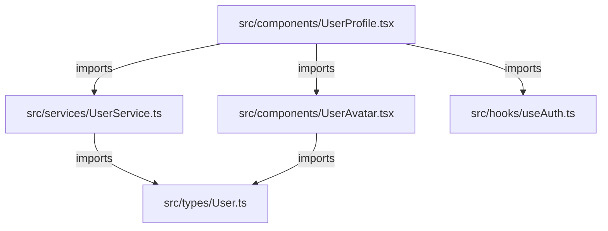

# JavaScript/TypeScript Code Search Plan

> **Version**: 1.0 | **Date**: 2025-12-09 | **Type**: Search Plan | **Language**: JavaScript + TypeScript

## 📋 Overview

Plan de recherche spécialisé pour projets JavaScript et TypeScript. Couvre ES6+, CommonJS, ES Modules, Node.js, React, Vue, Angular, et autres frameworks modernes.

**Cas d'usage** : Projets frontend/backend JavaScript, TypeScript, frameworks modernes (React, Vue, Angular, Svelte, Next.js, Nuxt).

## 🔍 File Patterns

### Extensions JavaScript/TypeScript
```bash
*.js       # JavaScript standard
*.mjs      # ES Module
*.cjs      # CommonJS
*.jsx      # React JSX
*.ts       # TypeScript
*.tsx      # TypeScript JSX
*.d.ts     # TypeScript declarations
*.vue      # Vue SFC
*.svelte   # Svelte components
```

### Configuration & Metadata
```bash
package.json       # Dependencies NPM/Yarn
tsconfig.json      # TypeScript config
.eslintrc.*        # ESLint config
.babelrc           # Babel config
webpack.config.*   # Webpack config
vite.config.*      # Vite config
next.config.*      # Next.js config
nuxt.config.*      # Nuxt config
```

### Exclusions JS-spécifiques
```bash
node_modules/      # Dependencies NPM
dist/              # Build output
build/             # Build output
.next/             # Next.js build
.nuxt/             # Nuxt.js build
out/               # Output directory
coverage/          # Test coverage
*.min.js           # Minified files
*.bundle.js        # Bundled files
```

## 🎯 Search Method

**Type**: `naive` + **Module-aware** (ES Modules + CommonJS)

### Phase 1: Module System Detection
```bash
# Detect module system used in project
function detect_module_system() {
    if [[ -f "package.json" ]]; then
        type=$(jq -r '.type' package.json 2>/dev/null)
        [[ "$type" == "module" ]] && echo "esm" && return
    fi

    # Check for ES Module usage
    if grep -rq "^import\s" --include="*.js" --include="*.ts" --glob '!node_modules' .; then
        echo "esm"
    # Check for CommonJS
    elif grep -rq "^const.*=.*require(" --include="*.js" --glob '!node_modules' .; then
        echo "commonjs"
    else
        echo "mixed"
    fi
}
```

### Phase 2: TypeScript Detection
```bash
# Check if project uses TypeScript
function has_typescript() {
    [[ -f "tsconfig.json" ]] || ls *.ts *.tsx &>/dev/null
}
```

## 📦 Patterns de Recherche

### 1. Imports/Exports (ES Modules)
```regex
# Named imports
^import\s+\{([^}]+)\}\s+from\s+['"]([^'"]+)['"]

# Default import
^import\s+(\w+)\s+from\s+['"]([^'"]+)['"]

# Namespace import
^import\s+\*\s+as\s+(\w+)\s+from\s+['"]([^'"]+)['"]

# Side-effect import
^import\s+['"]([^'"]+)['"]

# Dynamic import
import\(['"]([^'"]+)['"]\)

# Re-exports
^export\s+\{[^}]+\}\s+from\s+['"]([^'"]+)['"]
^export\s+\*\s+from\s+['"]([^'"]+)['"]
```

### 2. Require/Module.exports (CommonJS)
```regex
# Require
^const\s+.*=\s+require\(['"]([^'"]+)['"]\)
^const\s+\{([^}]+)\}\s+=\s+require\(['"]([^'"]+)['"]\)

# Module exports
^module\.exports\s*=
^exports\.\w+\s*=
```

### 3. Classes & Functions
```regex
# Class declaration
^(export\s+)?(default\s+)?class\s+(\w+)(\s+extends\s+(\w+))?

# Function declaration
^(export\s+)?(async\s+)?function\s+(\w+)\s*\(

# Arrow function (const/let/var)
^(export\s+)?(const|let|var)\s+(\w+)\s*=\s*(async\s+)?\(.*\)\s*=>

# Method (in class or object)
^\s+(async\s+)?(\w+)\s*\([^)]*\)\s*\{
```

### 4. React Components
```regex
# Function component
^(export\s+)?(default\s+)?function\s+(\w+)\s*\([^)]*\)\s*\{[^}]*return\s*\(?\s*<

# Arrow function component
^(export\s+)?(const|let)\s+(\w+)\s*=\s*\([^)]*\)\s*=>\s*\{?[^}]*return\s*\(?\s*<

# Class component
^(export\s+)?class\s+(\w+)\s+extends\s+(React\.)?Component
```

### 5. TypeScript Types/Interfaces
```regex
# Interface declaration
^(export\s+)?interface\s+(\w+)(\s+extends\s+([\w,\s]+))?

# Type alias
^(export\s+)?type\s+(\w+)\s*=

# Enum
^(export\s+)?enum\s+(\w+)\s*\{

# Namespace
^(export\s+)?namespace\s+(\w+)\s*\{
```

### 6. Decorators (TypeScript/Experimental)
```regex
# Class decorator
^@(\w+)(\([^)]*\))?\s*$

# Property decorator
^\s+@(\w+)(\([^)]*\))?\s*$

# Method decorator
^\s+@(\w+)(\([^)]*\))?\s*$
```

## 🔄 Extension Strategy

### 1. ES Module Resolution
```bash
# Resolve ES Module import to file
function resolve_esm_import() {
    local import_path="$1"
    local current_file="$2"
    local base_dir=$(dirname "$current_file")

    # Relative import (./,../)
    if [[ "$import_path" =~ ^\. ]]; then
        # Try with common extensions
        for ext in .js .jsx .ts .tsx .vue .svelte index.js index.tsx; do
            resolved="$base_dir/${import_path}${ext}"
            [[ -f "$resolved" ]] && echo "$resolved" && return
        done

        # Try directory/index
        if [[ -d "$base_dir/$import_path" ]]; then
            for ext in index.js index.jsx index.ts index.tsx; do
                resolved="$base_dir/$import_path/$ext"
                [[ -f "$resolved" ]] && echo "$resolved" && return
            done
        fi

    # Absolute/package import
    else
        # Check if it's a package (node_modules)
        if [[ -d "node_modules/$import_path" ]]; then
            # Read package.json main/module field
            main=$(jq -r '.main // .module // "index.js"' "node_modules/$import_path/package.json" 2>/dev/null)
            echo "node_modules/$import_path/$main"

        # Check for path alias (tsconfig.json)
        elif [[ -f "tsconfig.json" ]]; then
            # Parse paths from tsconfig
            alias_path=$(jq -r --arg imp "$import_path" \
              '.compilerOptions.paths[$imp][0] // empty' tsconfig.json 2>/dev/null)
            [[ -n "$alias_path" ]] && echo "$alias_path"
        fi
    fi
}
```

### 2. Framework Detection
```bash
# Detect JS framework used
function detect_js_framework() {
    if [[ -f "package.json" ]]; then
        # React
        grep -q '"react"' package.json && echo "react" && return

        # Vue
        grep -q '"vue"' package.json && echo "vue" && return

        # Angular
        grep -q '"@angular/core"' package.json && echo "angular" && return

        # Svelte
        grep -q '"svelte"' package.json && echo "svelte" && return

        # Next.js
        grep -q '"next"' package.json && echo "nextjs" && return

        # Nuxt
        grep -q '"nuxt"' package.json && echo "nuxt" && return
    fi

    echo "generic"
}
```

## 📤 Output Format

### Structure spécifique JavaScript/TypeScript

```markdown
# JavaScript/TypeScript Code Index

**Query**: [keyword]
**Module System**: [esm|commonjs|mixed]
**TypeScript**: [yes|no]
**Framework**: [React|Vue|Angular|None]
**Files Indexed**: X

## 📄 `src/components/UserProfile.tsx`

**Classes** (1):
  - `UserProfile` (lines 10-85): 75 lines
    - Extends: `React.Component<UserProfileProps, UserProfileState>`
    - Methods: 5

**Interfaces** (2):
  - `UserProfileProps` (lines 3-7): 4 lines
    - Properties: `userId: string`, `onUpdate: (user: User) => void`
  - `UserProfileState` (lines 8-9): 1 line
    - Properties: `loading: boolean`

**Types** (0):

**Functions** (3):
  - `fetchUserData(userId: string): Promise<User>` (line 45)
  - `handleUpdate(user: User): void` (line 67)
  - `validateUserData(data: unknown): boolean` (line 78)

**Dependencies** (8):
  - `react` (line 1): `React, { Component }`
  - `./types/User` (line 2): `User, UserRole`
  - `../services/UserService` (line 3): `UserService`
  - `./UserAvatar` (line 4): `UserAvatar` (component)
  - `../hooks/useAuth` (line 5): `useAuth` (hook)

**Exports**:
  - Default: `UserProfile` (class component)
  - Named: `UserProfileProps`, `UserProfileState` (types)

---

## 📄 `src/services/UserService.ts`

**Classes** (1):
  - `UserService` (lines 10-120): 110 lines
    - Methods: 8 (all public)

**Interfaces** (1):
  - `IUserService` (lines 5-8): 3 lines
    - Methods: `getUser()`, `updateUser()`, `deleteUser()`

**Functions** (0):

**Dependencies** (4):
  - `axios` (line 1): `axios, AxiosInstance`
  - `./types` (line 2): `User, UpdateUserPayload`
  - `../config` (line 3): `API_BASE_URL`

**Public Methods** (8):
  - `constructor(apiUrl: string)` (line 15)
  - `getUser(id: string): Promise<User>` (line 25)
  - `updateUser(id: string, data: UpdateUserPayload): Promise<User>` (line 45)
  - `deleteUser(id: string): Promise<void>` (line 67)
  - `listUsers(filters?: UserFilters): Promise<User[]>` (line 89)
  - `searchUsers(query: string): Promise<User[]>` (line 102)

---

## 🔗 Relationships Graph



**Summary**: 5 relationships detected

## 📊 Statistics

- **Total Files Scanned**: X
- **Relevant Matches**: Y
- **Classes**: A
- **Interfaces**: B
- **Types**: C
- **Functions**: D
- **Dependencies**: E

---
*Generated by agent-aikido-explore-code using javascript/plan.md*
```

## 🧠 Context Extraction JavaScript/TypeScript

### Classes
```markdown
- **Name**: Full class name
- **Line Range**: Start-end lines (ex: lines 10-85)
- **Length**: Number of lines
- **Extends**: Parent class (with full path if imported)
- **Implements**: Interfaces implemented (TypeScript)
- **Generic Types**: Type parameters (TypeScript)
- **Decorators**: Applied decorators (if any)
- **Methods**: Public method count
- **Properties**: Public properties with types (TypeScript)
```

### Interfaces/Types (TypeScript)
```markdown
- **Name**: Interface/type name
- **Line Range**: Start-end lines
- **Length**: Number of lines
- **Extends**: Parent interfaces (if any)
- **Properties**: Name : Type (max 5)
- **Methods**: Signatures (max 5)
- **Generic Parameters**: <T, U, V> (if any)
```

### Functions
```markdown
- **Name**: Function name
- **Signature**: Full signature with types
- **Line**: Line number
- **Async**: yes|no
- **Parameters**: Types and names
- **Return Type**: Return type (TypeScript)
- **Arrow Function**: yes|no
```

### React Components (specific)
```markdown
- **Component Type**: Functional|Class
- **Props Interface**: Name of props type (TypeScript)
- **State Interface**: Name of state type (class components)
- **Hooks Used**: List of hooks (useState, useEffect, etc.)
- **Lifecycle Methods**: componentDidMount, etc. (class components)
```

### Dependencies
```markdown
- **Import Path**: Full import path
- **Line**: Line number where import occurs
- **Type**: default|named|namespace|side-effect
- **Items**: Imported items (for named imports)
```

## ⚡ Performance Optimization

### Commandes optimisées JS/TS
```bash
# Recherche ultra-rapide avec ripgrep
rg --type js --type ts \
  --glob '!node_modules' \
  --glob '!dist' \
  --glob '!build' \
  -i "$KEYWORD"

# Trouver toutes les classes
rg --type js --type ts -n "^(export\s+)?class\s+(\w+)" -r '$2' --no-heading --glob '!node_modules'

# Trouver toutes les interfaces (TypeScript)
rg --type ts -n "^(export\s+)?interface\s+(\w+)" -r '$2' --no-heading --glob '!node_modules'

# Trouver imports ES Module
rg --type js --type ts -n "^import\s+.*from\s+['\"]" --no-heading --glob '!node_modules'

# Statistiques par fichier
rg --type js --type ts -c -i "$KEYWORD" --glob '!node_modules' | sort -t: -k2 -nr | head -20
```

### Stratégies d'Optimisation
1. **Module resolution** : Utiliser tsconfig.json paths pour résolution rapide
2. **Exclude node_modules early** : Toujours exclure dès le find/rg
3. **Framework patterns** : Adapter selon framework détecté (React, Vue, Angular)
4. **Cache package.json** : Parser une fois, réutiliser pour imports

## 🎓 Framework-Specific Patterns

### React
```regex
# Hooks
const\s+\[\w+,\s*\w+\]\s*=\s*use(State|Effect|Context|Reducer|Callback|Memo|Ref)

# Context
const\s+\w+Context\s*=\s*React\.createContext
const\s+\w+\s*=\s*useContext\(\w+Context\)

# HOC (Higher-Order Component)
function\s+with\w+\(.*\)\s*\{

# Styled components
const\s+\w+\s*=\s*styled\.\w+`
```

### Vue
```regex
# Options API
export\s+default\s+\{\s*(name|data|methods|computed|watch)

# Composition API
import\s+\{.*\}\s+from\s+['"']vue['"']
const\s+\w+\s*=\s*(ref|reactive|computed|watch)\(

# Single File Component
<template>[\s\S]*<\/template>
<script[\s\S]*>[\s\S]*<\/script>
<style[\s\S]*>[\s\S]*<\/style>
```

### Angular
```regex
# Component decorator
@Component\(\{

# Injectable decorator
@Injectable\(\{

# Directive decorator
@Directive\(\{

# NgModule
@NgModule\(\{
```

## 📋 Usage Example

```bash
# Exemple d'utilisation du plan JavaScript/TypeScript
KEYWORD="authentication"
FRAMEWORK=$(detect_js_framework)

echo "Framework detected: $FRAMEWORK"

# Phase 1: Detect module system and TypeScript
MODULE_SYSTEM=$(detect_module_system)
HAS_TS=$(has_typescript && echo "yes" || echo "no")

echo "Module system: $MODULE_SYSTEM"
echo "TypeScript: $HAS_TS"

# Phase 2: Find JS/TS files
FILES=$(rg --files --type js --type ts --glob '!node_modules')
echo "Files found: $(echo "$FILES" | wc -l)"

# Phase 3: Search for keyword
MATCHES=$(rg --type js --type ts -n -i "$KEYWORD" --glob '!node_modules')

# Phase 4: Extract metadata
for file in $FILES; do
    # Extract classes
    CLASSES=$(grep -n "^class\s" "$file" 2>/dev/null)

    # Extract interfaces (TypeScript)
    INTERFACES=$(grep -n "^interface\s" "$file" 2>/dev/null)

    # Extract functions
    FUNCTIONS=$(grep -n "^function\s" "$file" 2>/dev/null)

    # Extract imports
    IMPORTS=$(grep -n "^import\s" "$file" 2>/dev/null)

    # Format output
    echo "## 📄 \`$file\`"
    echo ""
    echo "**Classes**: $(echo "$CLASSES" | wc -l)"
    echo "**Interfaces**: $(echo "$INTERFACES" | wc -l)"
    echo "**Functions**: $(echo "$FUNCTIONS" | wc -l)"
    echo "**Dependencies**: $(echo "$IMPORTS" | wc -l)"
    echo ""
done
```

## 🔧 Customization Points

Ce plan peut être étendu/personnalisé via :
- **Module resolution** : Adapter tsconfig.json paths
- **Framework patterns** : Affiner selon framework utilisé
- **Component detection** : Patterns spécifiques React/Vue/Angular
- **Performance tuning** : Ajuster selon taille projet

---
*Plan JavaScript/TypeScript créé le 2025-12-09 pour agent-aikido-explore-code*
*Compatible avec ES6+, CommonJS, TypeScript, React, Vue, Angular*
