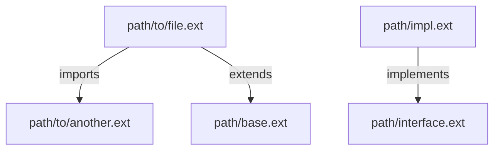

# Generic Code Search Plan

> **Version**: 1.0 | **Date**: 2025-12-09 | **Type**: Search Plan

## 📋 Overview

Plan de recherche générique pour tout type de code source. Utilisé comme fallback lorsqu'aucun plan spécifique à une technologie n'est trouvé.

**Cas d'usage** : Projets multi-langages, technologies non supportées, découverte exploratoire sans a priori technologique.

## 🔍 File Patterns

### Extensions prioritaires
```bash
# Source code (tous langages courants)
*.js *.ts *.jsx *.tsx *.mjs *.cjs
*.py *.pyc *.pyw
*.java *.class *.jar
*.cpp *.c *.cc *.cxx *.h *.hpp
*.cs *.csx
*.rb *.rake
*.go
*.rs
*.php
*.swift
*.kt *.kts
*.scala
*.sh *.bash
*.sql

# Configuration
*.json *.yaml *.yml *.toml *.ini *.env *.properties

# Documentation
*.md *.rst *.txt
```

### Exclusions standards
```bash
# Répertoires à ignorer (respecter .gitignore)
node_modules/
vendor/
dist/
build/
out/
target/
.git/
.svn/
__pycache__/
*.egg-info/
.venv/
venv/

# Fichiers binaires
*.bin *.exe *.dll *.so *.dylib
*.jpg *.jpeg *.png *.gif *.ico *.svg
*.pdf *.zip *.tar *.gz
```

## 🎯 Search Method

**Type**: `naive` (grep-based, no semantic understanding required)

### Phase 1: Quick Discovery
```bash
# Trouver tous les fichiers potentiellement pertinents
find . -type f \
  \( -name "*.js" -o -name "*.ts" -o -name "*.py" -o -name "*.java" -o -name "*.go" -o -name "*.rs" -o -name "*.cpp" -o -name "*.rb" -o -name "*.php" \) \
  -not -path "*/node_modules/*" \
  -not -path "*/vendor/*" \
  -not -path "*/.git/*" \
  -not -path "*/dist/*" \
  -not -path "*/build/*" \
  2>/dev/null
```

### Phase 2: Keyword Search
```bash
# Recherche par mot-clé avec contexte
grep -rn --include="*.{js,ts,py,java,go,rs,cpp,rb,php}" \
  --exclude-dir={node_modules,vendor,.git,dist,build} \
  -i "$KEYWORD" .
```

## 📦 Patterns de Recherche

### 1. Imports/Dépendances (multi-langage)
```regex
# JavaScript/TypeScript
^import\s+.*\s+from\s+['"](.*?)['"]
^const\s+.*\s+=\s+require\(['"](.*?)['"]\)

# Python
^import\s+(.*)
^from\s+(.*)\s+import

# Java
^import\s+([\w\.]+);

# Go
^import\s+\(?\s*"(.*?)"

# Rust
^use\s+(.*);

# PHP
^use\s+([\w\\]+);

# Ruby
^require\s+['"](.*?)['"]
```

### 2. Déclarations Classes/Interfaces/Traits
```regex
# Classes (multi-langage)
^(export\s+)?(public\s+|private\s+|protected\s+)?(class|interface|trait|struct|enum)\s+(\w+)

# Namespace/Package
^(namespace|package)\s+([\w\\\.]+)
```

### 3. Fonctions/Méthodes
```regex
# Function declarations (multi-langage)
^(export\s+)?(public\s+|private\s+|protected\s+|static\s+)?(function|def|fn|func)\s+(\w+)\s*\(

# Arrow functions (JavaScript/TypeScript)
^(export\s+)?(const|let|var)\s+(\w+)\s*=\s*\(.*\)\s*=>

# Methods (in classes)
^\s+(public|protected|private)\s+function\s+(\w+)\s*\(
```

### 4. Mots-clés communs
```text
# Héritage/Extension
extends
implements
inherits
derive
use (trait)

# Visibilité
public
private
protected
static
final
abstract

# Types/Annotations
interface
trait
struct
enum
@
#[
```

## 🔄 Extension Strategy

### 1. Détection de Langage par Extension
```bash
function detect_language_from_extension() {
    local file="$1"
    local ext="${file##*.}"

    case "$ext" in
        js|mjs|cjs|jsx) echo "javascript" ;;
        ts|tsx) echo "typescript" ;;
        py|pyw) echo "python" ;;
        java) echo "java" ;;
        go) echo "go" ;;
        rs) echo "rust" ;;
        php) echo "php" ;;
        rb) echo "ruby" ;;
        cpp|cc|cxx|c|h|hpp) echo "cpp" ;;
        cs) echo "csharp" ;;
        *) echo "unknown" ;;
    esac
}
```

### 2. Résolution d'Import Générique
```bash
function resolve_generic_import() {
    local import_path="$1"
    local current_file="$2"
    local base_dir=$(dirname "$current_file")

    # Try relative import first
    if [[ "$import_path" =~ ^\. ]]; then
        # Relative path
        realpath "$base_dir/$import_path" 2>/dev/null
    else
        # Search by filename
        find . -name "$(basename "$import_path")*" -type f | head -1
    fi
}
```

## 📤 Output Format

### Structure générique

```markdown
# Code Search Results

**Query**: [keyword]
**Technologies Detected**: [auto-detected list]
**Files Indexed**: X

## 📄 `path/to/file.ext`

**Classes** (X):
  - `ClassName` (lines 15-145): 130 lines
    - Extends: `ParentClass`
    - Implements: `InterfaceA, InterfaceB`
    - Methods: 8

**Interfaces** (X):
  - `InterfaceName` (lines 5-20): 15 lines
    - Methods: `method1()`, `method2()`, `method3()`

**Traits/Structs** (X):
  - `TraitName` (line 25)

**Functions** (X):
  - `functionName(param1, param2): returnType` (line 42)
  - `anotherFunction(arg): void` (line 67)

**Dependencies** (X):
  - `package/module/path` (line 3)
  - `relative/import/path` (line 5)
  - `@framework/component` (line 7)

---

## 📄 `path/to/another/file.ext`

[Same structure...]

---

## 🔗 Relationships Graph



**Summary**: X relationships detected

## 📊 Statistics

- **Total Files Scanned**: X
- **Relevant Matches**: Y
- **Classes**: A
- **Interfaces**: B
- **Functions**: C
- **Dependencies**: D
- **Relationships**: E

---
*Generated by agent-aikido-explore-code using plan-generic.md*
```

## 🧠 Context Extraction

### Classes
```markdown
- **Name**: Full class name
- **Line Range**: Start-end lines (ex: lines 15-145)
- **Length**: Number of lines
- **Extends**: Parent class name (if any)
- **Implements**: Comma-separated interfaces (if any)
- **Traits/Mixins**: Traits used (if applicable)
- **Methods**: Count of methods (NOT full code)
- **Properties**: Count of properties (NOT full list)
```

### Interfaces
```markdown
- **Name**: Interface name
- **Line Range**: Start-end lines
- **Length**: Number of lines
- **Extends**: Parent interfaces (if any)
- **Methods**: List of method signatures (name + params), max 5
```

### Functions
```markdown
- **Signature**: Full signature with parameters and return type
- **Line**: Line number
- **Parameters**: Parameter names (NOT full code)
- **Return Type**: Return type if available
```

### Dependencies
```markdown
- **Import Path**: Full import/require path
- **Line**: Line number where import occurs
- **Type**: import|require|use|include
```

## ⚡ Performance Optimization

### Commandes optimisées multi-langage
```bash
# Recherche ultra-rapide avec ripgrep
rg -i "$KEYWORD" \
  --type-add 'source:*.{js,ts,py,java,go,rs,php,rb}' \
  --type source \
  --glob '!node_modules' \
  --glob '!vendor' \
  --glob '!dist' \
  --glob '!build'

# Trouver toutes les classes (multi-langage)
rg -n "^(class|interface|struct)\s+(\w+)" -r '$2' --no-heading

# Trouver imports (multi-langage)
rg -n "^(import|require|use|from)\s+" --no-heading

# Statistiques par fichier
rg -c -i "$KEYWORD" | sort -t: -k2 -nr | head -20
```

### Stratégies d'Optimisation
1. **Early filtering** : Exclure répertoires dès le find
2. **Pattern grouping** : Grouper patterns similaires pour un seul grep
3. **Limit results** : Max 100 fichiers par recherche (configurable)
4. **Cache .gitignore** : Parser .gitignore une fois, appliquer partout

## 📋 Usage Example

```bash
# Exemple d'utilisation du plan générique
KEYWORD="authenticate"

# Phase 1: Auto-detect technologies
TECHS=$(detect_project_technologies)
echo "Technologies detected: $TECHS"

# Phase 2: Discovery with auto-detected extensions
FILES=$(rg --files --type-add 'source:*.{js,ts,py,java,go,rs,php,rb}' --type source)
echo "Files found: $(echo "$FILES" | wc -l)"

# Phase 3: Search with context
RESULTS=$(rg -i -n -A 3 -B 1 "$KEYWORD" --type-add 'source:*.{js,ts,py,java,go,rs,php,rb}' --type source)

# Phase 4: Extract metadata by language
for file in $FILES; do
    LANG=$(detect_language_from_extension "$file")

    # Extract classes (generic pattern)
    CLASSES=$(grep -n "^class\s" "$file" 2>/dev/null)

    # Extract functions (generic pattern)
    FUNCTIONS=$(grep -n "^function\s" "$file" 2>/dev/null)

    # Extract imports (generic pattern)
    IMPORTS=$(grep -n "^import\s" "$file" 2>/dev/null)

    # Format output
    echo "## 📄 \`$file\`"
    echo ""
    echo "**Classes**: $(echo "$CLASSES" | wc -l)"
    echo "**Functions**: $(echo "$FUNCTIONS" | wc -l)"
    echo "**Dependencies**: $(echo "$IMPORTS" | wc -l)"
    echo ""
done
```

## 🎓 Technology Detection

Auto-détection des technologies présentes dans le projet :

```bash
function detect_project_technologies() {
    local techs=()

    # JavaScript/TypeScript
    [[ -f "package.json" ]] && techs+=("javascript")
    [[ -f "tsconfig.json" ]] && techs+=("typescript")

    # Python
    [[ -f "requirements.txt" ]] && techs+=("python")
    [[ -f "setup.py" ]] && techs+=("python")

    # Java
    [[ -f "pom.xml" ]] && techs+=("java")
    [[ -f "build.gradle" ]] && techs+=("java")

    # Go
    [[ -f "go.mod" ]] && techs+=("go")

    # Rust
    [[ -f "Cargo.toml" ]] && techs+=("rust")

    # PHP
    [[ -f "composer.json" ]] && techs+=("php")

    # Ruby
    [[ -f "Gemfile" ]] && techs+=("ruby")

    # C/C++
    [[ -f "CMakeLists.txt" ]] && techs+=("cpp")
    [[ -f "Makefile" ]] && techs+=("c")

    echo "${techs[@]}"
}
```

## 🔧 Customization Points

Ce plan peut être étendu/personnalisé via :
- **File patterns** : Ajouter extensions spécifiques
- **Exclusions** : Adapter selon structure projet
- **Regex patterns** : Affiner pour syntaxes spécifiques
- **Output format** : Personnaliser niveau de détail
- **Performance tuning** : Ajuster limites et parallélisme

---
*Plan générique créé le 2025-12-09 pour agent-aikido-explore-code*
*Utilisé comme fallback pour technologies sans plan spécifique*
